# Life Quest

**日々の小さな達成を、自分の成長として実感できるタスク・習慣管理RPG**

[](https://github.com/YuTakane256/Life-Quest/actions/workflows/ci.yml)
[](https://github.com/YuTakane256/Life-Quest/actions/workflows/e2e.yml)
[](https://react.dev/)
[](https://expo.dev/)
[](https://supabase.com/)
[](https://www.typescriptlang.org/)

Life Questは、日々のタスクや習慣の達成を、装備収集・キャラクター育成・マップ攻略へつなげる個人開発プロジェクトです。「やるべきことを管理する」だけでなく、「今日の達成が冒険を進めた」と感じ、次の行動も楽しみにできる体験を目指しています。Web / Mobileで開発中です。

| タスクの達成 | キャラクター育成 | 戦闘・攻略 |
| --- | --- | --- |
| [](docs/screenshots/daily-parity/web-dark-tasks.png) | [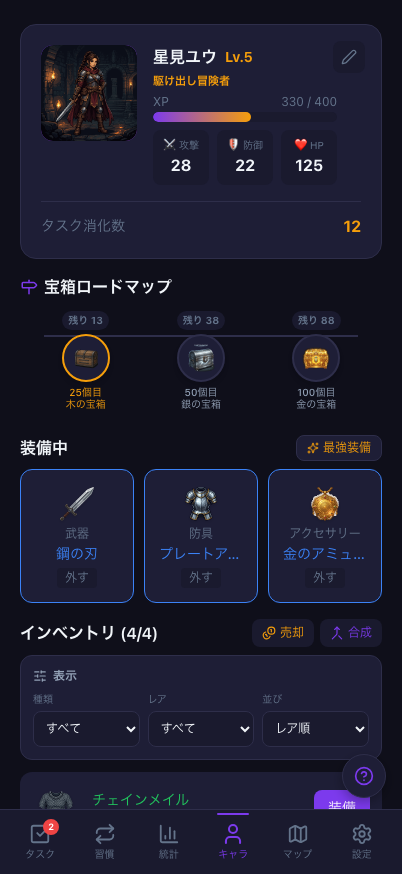](docs/screenshots/character-parity/web-dark-character.png) | [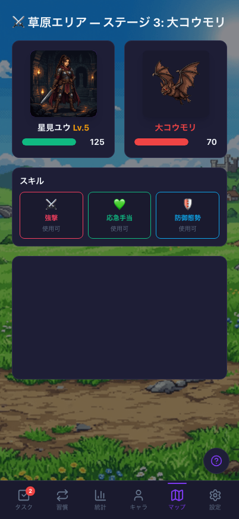](docs/screenshots/battle-parity/web-dark-battle.png) |

Web版（スマホ幅）の代表画面です。架空のサンプルデータを使用しており、詳しい画面説明とWeb / Mobileの比較は[以下のScreenshots](#screenshots)にまとめています。

[画面を見る](#screenshots) · [ローカルで試す](#ローカル起動) · [技術・設計を見る](#技術的な見どころ)

## 企画の背景：管理の便利さに、続けたくなる楽しさを加える

開発者自身は、[TickTick](https://ticktick.com/)のような既存のタスク・習慣管理アプリを、日々の予定や行動を整理するうえで便利で使いやすいと感じています。一方で、「何をするか」が整理されても、それを実行し続ける意欲まで、管理することだけで保てるとは限らないと感じたことが、企画の出発点です。

そこで、ゲームで感じる「もう少し育てたい」「次の敵を倒したい」という楽しみを、現実のタスクや習慣の達成へつなげられないかと考えました。管理のしやすさを土台に、達成する理由と、その成果を楽しむ時間を加えることが狙いです。

企画後に、[Habitica](https://habitica.com/static/home)のような、タスク管理とゲームを組み合わせた先行サービスも知りました。初見ではゲーム要素に魅力を感じる一方、日常の管理操作についてはTickTickのようなアプリの使いやすさを重視したいと感じました。Life Questは「タスク管理とゲームの組み合わせ」自体を新規性とするのではなく、日常の管理操作と育成・攻略の楽しさをどう両立するかを検討するプロジェクトです。

これは開発者の問題意識と初見の印象であり、競合の優劣・普及度や、市場の需要を調査で確認したという主張ではありません。

## 想定するユーザーと届けたい価値

想定するのは、学習・運動・趣味など、自分のためのタスクや習慣を続けたいものの、記録や整理だけでは達成の楽しみを感じにくく、ゲームの育成や収集には魅力を感じる人です。この対象像は現時点では仮説で、今後の利用者確認で見直します。

届けたい価値は、現実の小さな達成を、目に見える成長と次の楽しみに変えることです。ゲームを遊ぶために現実の行動が後回しになるのではなく、現実の行動を終えたことが、ゲームを進める喜びになる関係を目指しています。

## 価値を実現する体験設計

中心となる流れは、**タスク・習慣の達成 → 報酬 → キャラクターの成長 → マップ攻略 → 次の達成への楽しみ**です。

| 体験 | 実装している仕組み | 設計の狙い |
| --- | --- | --- |
| 今日取り組むことを整理する | タスクの期限・優先度・検索・サブタスク、習慣のカテゴリ・メモ | ゲーム要素を加えても、日常の管理操作を使いやすくする |
| 行動を終え、成果を受け取る | 達成によるXP、宝箱の獲得・開封 | 小さな達成にも、その場で見える楽しみを返す |
| 自分の積み重ねを確認する | レベル、装備による能力値、次の宝箱までの目標 | 達成を単発のチェックで終わらせず、成長として見せる |
| 育てた成果を使う | マップのステージ選択、敵との戦闘、勝敗表示 | 育成・収集に、攻略へ挑む目的を与える |
| 無理なく次の行動へ戻る | 習慣の休息日、達成記録、完了の取り消し | 継続を目指しつつ、入力や連続記録が負担になりすぎないようにする |

短期の達成感と、収集・攻略という次の目標を組み合わせる設計です。ただし、楽しさや継続率への効果を実証した段階ではありません。ゲーム要素が行動の助けになるか、逆に操作の手間や義務感を増やさないかを、両方確認していきます。

### Web / Mobileで同じ体験を届ける理由

PCでは予定の整理や振り返りを、スマホでは日々の達成の記録を行えるよう、同じデータとゲーム進行を扱う構成にしています。画面幅に応じて配置を変え、主要画面の情報順序・素材・配色はWeb / Mobileで揃えています。全画面の統一や実機確認は継続中です。

## 今後の検証・改善と、魅力の伝え方

現時点では、以下を検証したい問いとして整理しています。利用者調査や継続率の測定、広告配信の成果がすでにあるという意味ではありません。

- **管理の使いやすさ**：追加・検索・編集・完了まで迷わず操作できるか。ゲーム要素が日常の操作を妨げないか。
- **成長の実感**：初めての達成後、XP・宝箱・装備がどう成長につながるか理解できるか。
- **続けたい理由と負担**：翌日も使いたくなる理由は何か。報酬のための入力や連続記録が負担にならないか。
- **企画の伝わりやすさ**：画面紹介だけでなく、「現実の達成がキャラクターを育て、攻略につながる」短い動画や画像で、対象ユーザーに価値が伝わるか。

まずは主要な操作と育成・攻略の流れを確認してもらい、感想や操作で迷った箇所から改善します。その後、同意を得た利用テストで初回の達成や翌日以降の利用などを確認する方針です。収集するデータや指標は事前に定め、実際に確認できた結果と設計上の仮説を区別して記録します。

## 制作で担当していること

個人開発として、企画・体験設計、機能の優先順位付けから、Web / Mobileの画面・ゲームルール・データ連携の開発まで、一貫して取り組んでいます。

現在は、タスク・習慣から成長・攻略までの主要体験を実装し、代表画面の比較と品質確認を進めている段階です。ストア公開や利用者への効果検証は未完了です。詳細は[実装状況](#実装状況)、設計・実装の裏付けは[技術的な見どころ](#技術的な見どころ)をご覧ください。

## Screenshots

### Web：PC幅とスマホ幅に合わせたレイアウト

Web版は一つの実装で画面幅に応じてレイアウトを切り替えます。PCでは広い一覧を見ながら整理・振り返りができ、スマホ幅では縦に読み進めながら日々の達成を記録できる構成です。同じデータ・機能を維持し、画面全体を単に拡大・縮小するだけにはしていません。

PC幅のタスク画面（1440×900）：画像を押すと原寸で確認できます。

[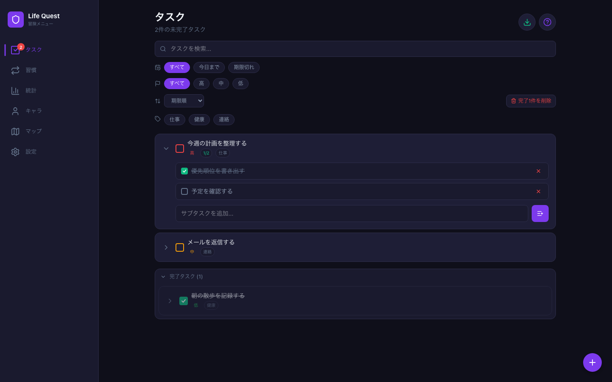](docs/screenshots/web-responsive/web-dark-tasks-desktop.png)

| 違い | Web：PC幅 | Web：スマホ幅 |
| --- | --- | --- |
| 画面移動 | 左のサイドメニュー。Alt＋1〜6でも移動可能 | 下部の6タブから移動 |
| 統計の配置 | 集計カードを4列、今週のXPと自己ベストを横並びに表示 | 集計カードを2列、グラフや記録を縦に表示 |
| タスクの操作 | 編集・複製・削除を行にマウスを重ねると表示 | ホバーなしで操作できるよう常時表示 |

以下は同じ架空データ・日時・ダークテーマの統計画面です。PCでは複数の指標を同時に見渡せ、スマホ幅ではスクロールして順に確認できます。

| Web：PC幅（1440×900） | Web：スマホ幅（402×874） |
| --- | --- |
| [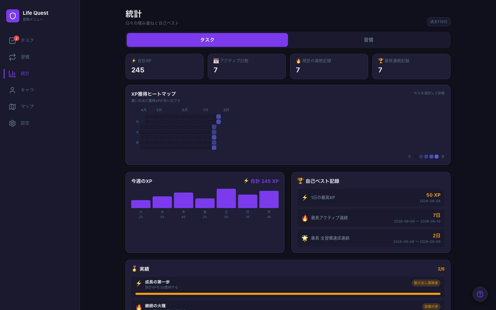](docs/screenshots/web-responsive/web-dark-stats-desktop.png) | [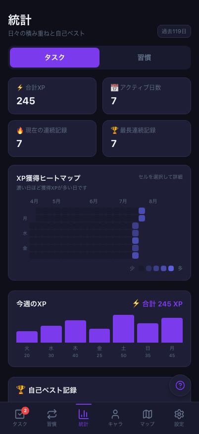](docs/screenshots/web-responsive/web-dark-stats-phone.png) |

タスク・習慣・統計の両テーマ比較と撮影手順は[Webレスポンシブ比較](docs/screenshots/web-responsive/README.md)をご覧ください。この統計比較はWeb版内の画面幅による違いであり、Mobile版の統計画面も統一済みという意味ではありません。

### Web（スマホ幅）/ Mobileで共通の画面設計

React製Web版とReact Native製Mobile版で、タスク・習慣の主要画面に共通のデザイン方針を適用しています。情報の順番、検索・絞り込み、追加フォームの入口、カード、カテゴリ表示、配色、アイコンを揃え、WebViewではなくそれぞれのUIとして実装しています。

以下は同じ架空データ・ダークテーマで撮影した比較です。Webは402×874のスマホ幅、Mobileは同じ論理サイズのiPhone 18 Proシミュレーターです。OSのステータスバー・安全領域・フォント描画の差は残しています。

| Web（スマホ幅） | Mobile（iOSシミュレーター） |
| --- | --- |
|  | 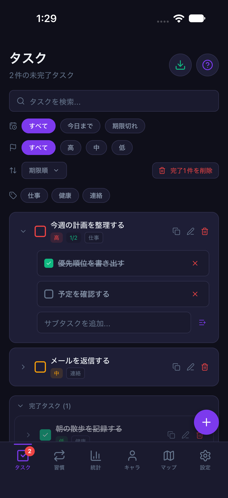 |
| 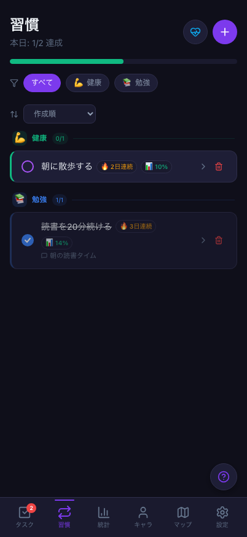 | 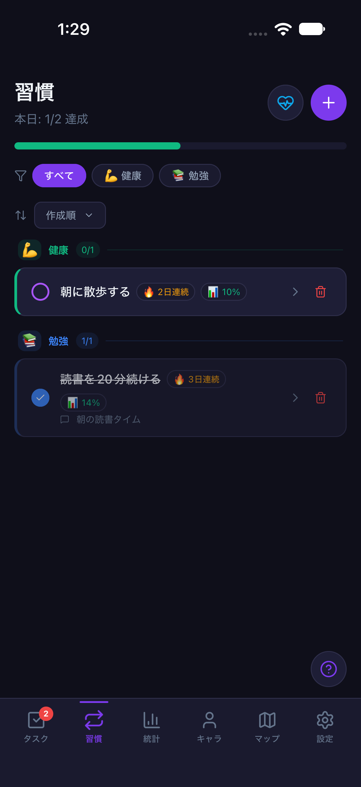 |

ライトテーマの比較、再現手順、残る差分は[比較ギャラリー](docs/screenshots/daily-parity/README.md)にまとめています。スクショは匿名の専用比較環境で撮影し、実ユーザーのデータは含めていません。

### 達成が成長につながるキャラクター画面

タスクを達成して得たXP・レベル・装備による能力値と、「次の宝箱まであと何個か」を一画面で確認できます。日々の入力だけで終わらず、成長と次の目標が見えることを重視し、Web/Mobileでプロフィール、XP、宝箱ロードマップ、装備中の情報順序と素材を揃えています。

| Web（スマホ幅） | Mobile（iOSシミュレーター） |
| --- | --- |
| [](docs/screenshots/character-parity/web-dark-character.png) | [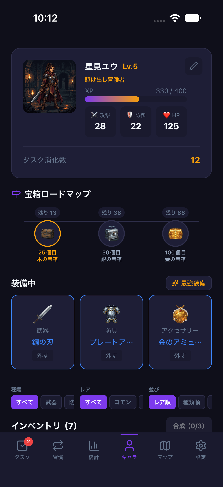](docs/screenshots/character-parity/mobile-dark-character.png) |

同じ架空データ・日時・テーマの比較です。両テーマの画像と、下部インベントリなどに残る差分は[キャラクター比較](docs/screenshots/character-parity/README.md)をご覧ください。

### 育てたキャラクターで進めるマップ

クリア済みのステージ、次に挑戦できる敵、未解放のエリアを同じ配置と素材で確認できます。「日々の達成 → 成長 → 攻略」というアプリの目的を、タスク・キャラクター・マップの画面でつなげています。

| Web（スマホ幅） | Mobile（iOSシミュレーター） |
| --- | --- |
| [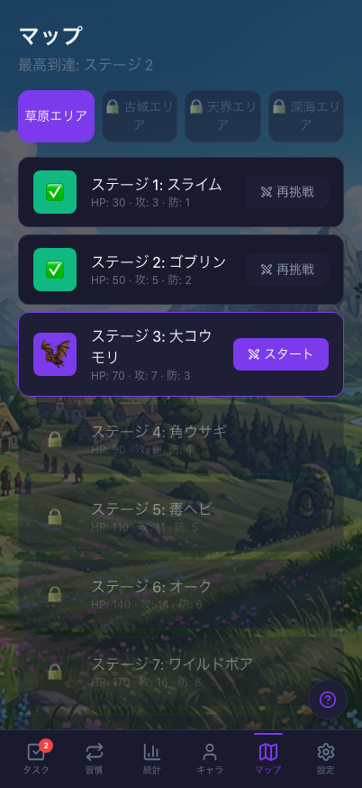](docs/screenshots/map-parity/web-dark-map.png) | [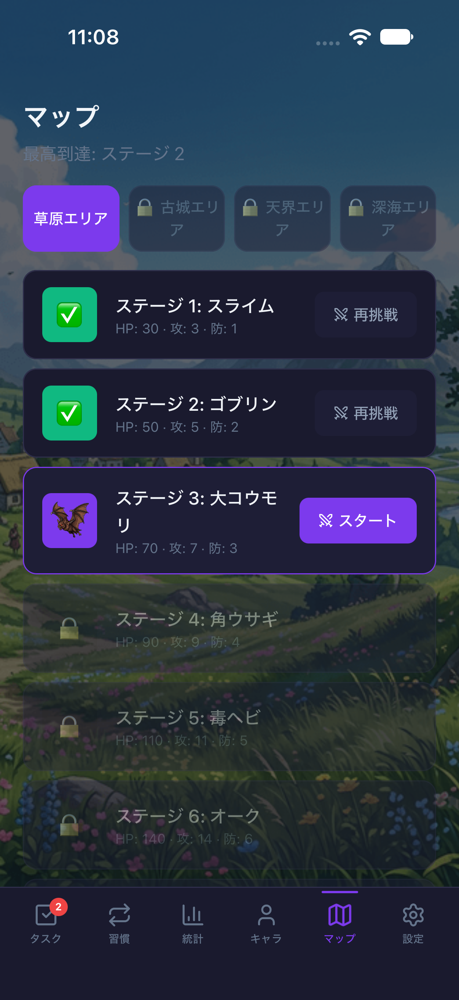](docs/screenshots/map-parity/mobile-dark-map.png) |

同じ架空データ・日時・テーマで、最高クリアはステージ2、次の敵は大コウモリです。両テーマの画像、撮影手順、戦闘中に残る違いは[マップ比較](docs/screenshots/map-parity/README.md)をご覧ください。

### 成長を攻略につなげる戦闘画面

共通のキャラクター・敵画像、HP、スキル、ログ、勝敗表示をWeb/Mobileで揃えています。以下は同じ架空データで大コウモリに通常攻撃を1回行った状態です。Mobileは手動攻撃の操作を維持し、Webは自動でターンが進みます。

| Web（スマホ幅） | Mobile（iOSシミュレーター） |
| --- | --- |
| [](docs/screenshots/battle-parity/web-dark-battle.png) | [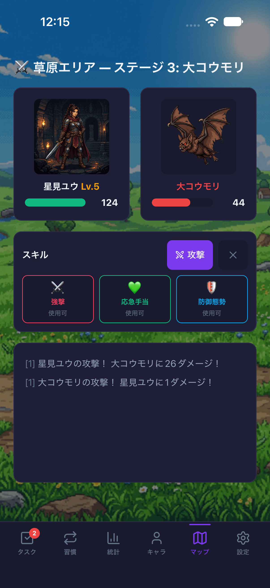](docs/screenshots/battle-parity/mobile-dark-battle.png) |

両テーマと勝利・敗北の比較、撮影手順、残る操作差は[戦闘比較](docs/screenshots/battle-parity/README.md)をご覧ください。

**UI統一は段階的に進めています。** 掲載比較はタスク・習慣の主要一覧、キャラクターの主要部分、マップ/ステージ選択と戦闘・勝敗の代表画面が対象で、全画面・全操作の一致やストア公開済みを示すものではありません。インベントリの独立画面化、自動/手動の戦闘進行、履歴/リプレイ、宝箱の開封演出などは継続課題です。選択・確認・共有にはOS固有の操作を使い、日付入力やCSVの保存方法など一部の操作差も残っています。Androidは共通コードのビルド確認までで、実機の見た目・操作検証は今後の工程です。

### ゲーム体験（Web版）

宝箱から装備を獲得し、売却・合成・装備へつなげます。開封演出は現在Web版の画像のみを掲載しています。

[](docs/screenshots/portfolio/web-chest.png)

## 主な機能

- **タスク管理**: 優先度、期限、タグ、検索、並び替え、繰り返し、サブタスク、複製、一括削除、完了取り消し
- **習慣管理**: カテゴリ、メモ、休息日、ストリーク、達成率、履歴ヒートマップ
- **ゲーム進行**: タスク・習慣の報酬、レベル、キャラクターステータス、ログインボーナス、実績・称号
- **装備とインベントリ**: 宝箱、レアリティ、装備変更、売却、3アイテム合成、フィルター・並び替え
- **マップ・バトル**: 4エリア・40ステージ、ターン制戦闘、スキル、戦闘履歴・リプレイ
- **統計**: タスク・習慣の推移、XP、ヒートマップ、実績進捗
- **設定**: ダーク / ライト / システムテーマ、モーション、通知、バックアップ、同期状態、アカウント管理
- **認証とアカウント**: メール認証、Google OAuth、iOSのAppleログイン、データを残さない退会フロー
- **クロスプラットフォーム**: WebとMobileで共有するアカウント、データ、ゲームルール、画像アセット、デザイントークン

## 技術的な見どころ

React製WebクライアントとExpo / React Native製Mobileクライアントを、共有ドメインロジックとSupabaseバックエンドで接続しています。ログイン中はタスク、習慣、キャラクター、インベントリ、報酬、バトル進行をユーザー単位で同期します。未ログインでも端末内で利用でき、既存ローカルデータからクラウドへ移行する経路を備えています。

### 1. UIではなくドメインを共有するモノレポ

WebはReact DOM、MobileはReact Nativeとして個別のUIを維持しながら、タスク・習慣・成長計算・装備・報酬・バトル・同期を`@life-quest/core`へ集約しています。画像は`@life-quest/assets`、色や余白などは共通デザイントークンを参照し、プラットフォーム固有の操作性を保ったまま結果を揃えています。

### 2. Supabaseを正とするWeb / Mobile同期

認証にはSupabase Auth、永続化にはPostgreSQLを使用しています。ログイン中の変更は端末内へ即時反映した後、永続outboxから再送されます。Realtimeは変更通知に限定し、実データは`pull_sync_batch` RPCからversion単位で取得することで、テーブル別ページングによる取りこぼしを避けています。

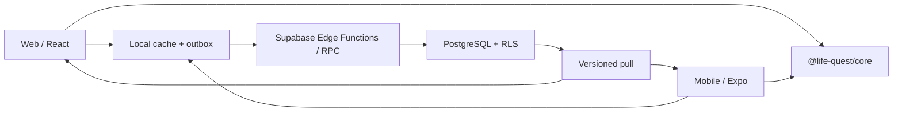

### 3. ゲーム報酬の整合性とサーバー権威

クラウドでは、タスク報酬を生涯1回のルールと冪等キーで保護しています。宝箱、合成、売却、バトル結果などはEdge FunctionsとDB関数を経由し、クライアントの自己申告だけでXPやアイテムが増えない構成です。バトルはattempt単位で再挑戦報酬を許可しつつ、同じ結果の二重送信を防ぎます。匿名Webも[保存済みの報酬台帳](docs/web-anonymous-reward-ledger.md)でタスク・サブタスクの再完了による重複を防ぎます。旧データで証拠のない過去の付与は復元できず、Web Locksが利用できない環境では報酬付与を止めます。

### 4. ユーザー境界と障害復旧

RLSに加えて、service roleを利用するEdge FunctionでもJWT由来のユーザーIDと所有権を検証します。ローカルキャッシュとoutboxはユーザーIDごとのnamespaceへ分離し、ログアウト時にはメモリ状態を破棄します。オフライン時の操作は同じoperation IDで再送され、再起動・再接続後も保留操作を復元します。Apple連携ユーザーの退会時は、サーバー側でAppleの認可を失効してからアカウントを削除し、外部処理の失敗時にユーザーデータだけが先に消えないよう保護しています。

設計上の判断と背景は[Architecture Decision Records](docs/adr/README.md)に記録しています。

## 技術スタック

| 領域 | 採用技術 |
| --- | --- |
| Web | React 19, React Router 7, Vite 8, Tailwind CSS 4 |
| Mobile | Expo 57, React Native 0.86, Expo Router |
| 言語・状態管理 | TypeScript 6, Zustand 5 |
| Backend | Supabase Auth, PostgreSQL 17, RLS, Realtime, Edge Functions |
| Test | Vitest, Playwright, pgTAP, Maestro（ローカル画面比較） |
| Quality | ESLint, TypeScript project references, GitHub Actions, Dependabot |

## リポジトリ構成

```text
Life-Quest/
├── src/                 # Webクライアント
├── apps/mobile/         # Expo / React Nativeクライアント
├── packages/core/       # プラットフォーム非依存の型・ドメイン・同期ロジック
├── packages/assets/     # Web / Mobile共有のキャラクター・敵・装備画像
├── supabase/
│   ├── migrations/      # スキーマ、RLS、RPC、整合性制約
│   ├── functions/       # 認可・ゲーム操作を担うEdge Functions
│   └── integration/     # 2クライアント同期などの統合テスト
├── e2e/                 # Web操作・ビジュアル回帰テスト
└── docs/adr/            # アーキテクチャ決定記録
```

## ローカル起動

### 必要な環境

- Node.js `22.22.2`以上、23未満
- npm
- Mobile確認時: Expoを実行できるiOS / Android環境
- クラウド同期をローカルで確認する場合: DockerとSupabase CLI（npm依存に含まれます）

### Web

```bash
git clone https://github.com/YuTakane256/Life-Quest.git
cd Life-Quest
npm ci
npm run dev
```

`http://localhost:5173`を開きます。Supabaseを設定しない場合も、未ログインのローカルモードで主要機能を確認できます。

### Mobile

```bash
npm ci
npm run mobile:start
```

表示されるExpoの案内から、シミュレータまたは実機で起動します。

### Supabaseを含むローカル環境

```bash
npm run db:start
```

出力されたローカルURLとanon keyを`.env.example`に記載されたWeb / Mobile用の環境変数へ設定します。`service_role` keyはクライアント環境へ設定しません。スキーマを初期状態へ戻す場合は`npm run db:reset`を使用します。

## テストと品質確認

```bash
npm run typecheck          # Web全体の型検査
npm run typecheck:core     # 共有ドメインの型検査
npm run mobile:typecheck   # Mobileの型検査
npm run lint               # 静的解析
npm test                   # ユニット / コンポーネントテスト
npm run test:integration   # Supabase統合テスト
npm run db:test            # RLS・DB関数のpgTAPテスト
npm run e2e                # Playwright E2E
npm run e2e:parity         # 390 x 844のWeb画面回帰テスト
npm run build              # Web本番ビルド
npm run mobile:export      # Android向けExpo export
npm run mobile:validate-release # EAS profile / 公開Expo設定の静的検査
```

Pull Requestでは型検査、lint、テスト、Web build、Mobile export、Expo公開設定、Playwright E2E、秘密情報の混入検査をGitHub Actionsで実行します。依存関係はDependabotと週次の`npm audit`で監視しています。iOSシミュレータを使うMobileスクリーンショット比較は[チェックリスト](docs/mobile-parity-checklist.md)に沿ってローカルで行います。EASのdevelopment / preview / productionビルド準備は[Mobileリリースチェックリスト](docs/mobile-release-checklist.md)を参照してください。

## 実装状況

Web / Mobileの主要機能、メール・Google・Apple認証のコード、クラウド同期、オフラインoutbox、サーバー権威のゲーム操作まで実装しています。現在はタスク・習慣を起点に画面をWeb準拠へ揃え、残る画面差分・実機検証・配布設定の確認を進めている開発段階です。署名済み実機での認証・通知・退会などの確認と、ストア提出は別工程です。進行中・検討中の内容は[Issues](https://github.com/YuTakane256/Life-Quest/issues)と[全体計画](docs/mobile-web-implementation-roadmap.md)を参照してください。

## 補足資料

- [ADR一覧](docs/adr/README.md)
- [Web / Mobile差分監査](docs/mobile-web-parity-audit.md)
- [Mobile / Web画面比較手順](docs/mobile-parity-checklist.md)
- [Mobileリリースチェックリスト](docs/mobile-release-checklist.md)
- [メール認証セットアップ](docs/email-auth-setup.md)
- [Google OAuthセットアップ](docs/google-oauth-setup.md)

## License

現時点でライセンスは設定していません。ソースコードの再利用・再配布については、リポジトリ所有者へ確認してください。
