# Life Quest

**日々の小さな達成を、自分の成長として実感できるタスク・習慣管理RPG**

[](https://github.com/YuTakane256/Life-Quest/actions/workflows/ci.yml)
[](https://github.com/YuTakane256/Life-Quest/actions/workflows/e2e.yml)
[](https://react.dev/)
[](https://expo.dev/)
[](https://supabase.com/)
[](https://www.typescriptlang.org/)

Life Questは、日々のタスクや習慣の達成を、装備収集・キャラクター育成・マップ攻略へつなげる個人開発プロジェクトです。「やるべきことを管理する」だけでなく、「今日の達成が冒険を進めた」と感じ、次の行動も楽しみにできる体験を目指しています。Web / Mobileで開発中です。

| タスクの達成 | キャラクター育成 | 戦闘・攻略 |
| --- | --- | --- |
| [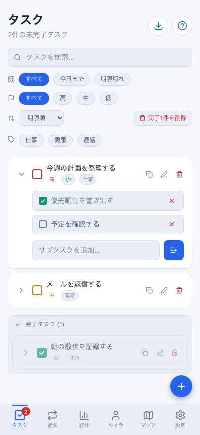](docs/screenshots/readme-20261027/web-light-tasks.png) | [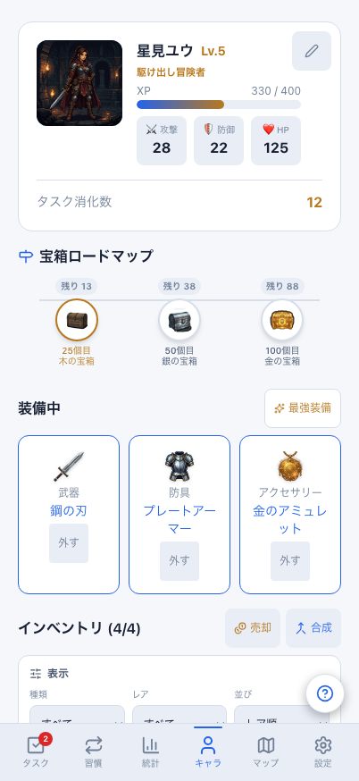](docs/screenshots/readme-20261027/web-light-character.png) | [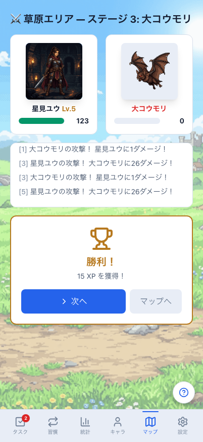](docs/screenshots/readme-20261027/web-light-victory.png) |

Web版（スマホ幅・ライトモード）の代表画面です。架空のサンプルデータを使用しており、詳しい画面説明とWeb / Mobileの比較は[以下のScreenshots](#screenshots)にまとめています。

[画面を見る](#screenshots) · [ローカルで試す](#ローカル起動) · [技術・設計を見る](#技術的な見どころ)

## 企画の背景：管理の便利さに、続けたくなる楽しさを加える

開発者自身は、[TickTick](https://ticktick.com/)のような既存のタスク・習慣管理アプリを、日々の予定や行動を整理するうえで便利で使いやすいと感じています。一方で、「何をするか」が整理されても、それを実行し続ける意欲まで、管理することだけで保てるとは限らないと感じたことが、企画の出発点です。

そこで、ゲームで感じる「もう少し育てたい」「次の敵を倒したい」という楽しみを、現実のタスクや習慣の達成へつなげられないかと考えました。管理のしやすさを土台に、達成する理由と、その成果を楽しむ時間を加えることが狙いです。

企画後に、[Habitica](https://habitica.com/static/home)のような、タスク管理とゲームを組み合わせた先行サービスも知りました。初見ではゲーム要素に魅力を感じる一方、日常の管理操作についてはTickTickのようなアプリの使いやすさを重視したいと感じました。Life Questは「タスク管理とゲームの組み合わせ」自体を新規性とするのではなく、日常の管理操作と育成・攻略の楽しさをどう両立するかを検討するプロジェクトです。

これは開発者の問題意識と初見の印象であり、競合の優劣・普及度や、市場の需要を調査で確認したという主張ではありません。

## 想定するユーザーと届けたい価値

想定するのは、学習・運動・趣味など、自分のためのタスクや習慣を続けたいものの、記録や整理だけでは達成の楽しみを感じにくく、ゲームの育成や収集には魅力を感じる人です。この対象像は現時点では仮説で、今後の利用者確認で見直します。

届けたい価値は、現実の小さな達成を、目に見える成長と次の楽しみに変えることです。ゲームを遊ぶために現実の行動が後回しになるのではなく、現実の行動を終えたことが、ゲームを進める喜びになる関係を目指しています。

## 価値を実現する体験設計

中心となる流れは、**タスク・習慣の達成 → 報酬 → キャラクターの成長 → マップ攻略 → 次の達成への楽しみ**です。

| 体験 | 実装している仕組み | 設計の狙い |
| --- | --- | --- |
| 今日取り組むことを整理する | タスクの期限・優先度・検索・サブタスク、習慣のカテゴリ・メモ | ゲーム要素を加えても、日常の管理操作を使いやすくする |
| 行動を終え、成果を受け取る | 達成によるXP、宝箱の獲得・開封 | 小さな達成にも、その場で見える楽しみを返す |
| 自分の積み重ねを確認する | レベル、装備による能力値、次の宝箱までの目標 | 達成を単発のチェックで終わらせず、成長として見せる |
| 育てた成果を使う | マップのステージ選択、敵との戦闘、勝敗表示 | 育成・収集に、攻略へ挑む目的を与える |
| 無理なく次の行動へ戻る | 習慣の休息日、達成記録、完了の取り消し | 継続を目指しつつ、入力や連続記録が負担になりすぎないようにする |

短期の達成感と、収集・攻略という次の目標を組み合わせる設計です。ただし、楽しさや継続率への効果を実証した段階ではありません。ゲーム要素が行動の助けになるか、逆に操作の手間や義務感を増やさないかを、両方確認していきます。

### Web / Mobileで同じ体験を届ける理由

PCでは予定の整理や振り返りを、スマホでは日々の達成の記録を行えるよう、同じデータとゲーム進行を扱う構成にしています。画面幅に応じて配置を変え、主要画面の情報順序・素材・配色はWeb / Mobileで揃えています。全画面の統一や実機確認は継続中です。

## 今後の検証・改善と、魅力の伝え方

現時点では、以下を検証したい問いとして整理しています。利用者調査や継続率の測定、広告配信の成果がすでにあるという意味ではありません。

- **管理の使いやすさ**：追加・検索・編集・完了まで迷わず操作できるか。ゲーム要素が日常の操作を妨げないか。
- **成長の実感**：初めての達成後、XP・宝箱・装備がどう成長につながるか理解できるか。
- **続けたい理由と負担**：翌日も使いたくなる理由は何か。報酬のための入力や連続記録が負担にならないか。
- **企画の伝わりやすさ**：画面紹介だけでなく、「現実の達成がキャラクターを育て、攻略につながる」短い動画や画像で、対象ユーザーに価値が伝わるか。

まずは主要な操作と育成・攻略の流れを確認してもらい、感想や操作で迷った箇所から改善します。その後、同意を得た利用テストで初回の達成や翌日以降の利用などを確認する方針です。収集するデータや指標は事前に定め、実際に確認できた結果と設計上の仮説を区別して記録します。

### 検討中：普段使うAIから、取り組みやすいタスクへ

入力そのものが負担になると、達成を楽しむ体験まで届きません。今後の構想として、普段使っている対話型AIで整理した目標・期限・分解済みタスクをLife Questへ取り込み、アプリでは完了時の手応えや育成・攻略を楽しむ流れを検討しています。**外部AIとの自動連携は未実装**で、具体的な連携方式や登録内容の確認方法は今後の検討項目です。

## 制作で担当していること

個人開発として、企画・体験設計、機能の優先順位付けから、Web / Mobileの画面・ゲームルール・データ連携の開発まで、一貫して取り組んでいます。

現在は、タスク・習慣から成長・攻略までの主要体験を実装し、代表画面の比較と品質確認を進めている段階です。ストア公開や利用者への効果検証は未完了です。詳細は[実装状況](#実装状況)、設計・実装の裏付けは[技術的な見どころ](#技術的な見どころ)をご覧ください。

## Screenshots

**2026-10-27のmain（PR #847反映後）から撮り直した画面です。** 同じ共有fixture・表示日時・テーマで比較しています。架空の匿名データを使い、実ユーザーの情報は含めていません。READMEでは内容を見やすく紹介するためライトモードを中心に掲載し、両テーマの全画像と再現手順は[最新ギャラリー](docs/screenshots/readme-20261027/README.md)にまとめています。

### PCで整理し、スマホで達成を記録する

Web版は一つの実装で画面幅に応じて配置を切り替えます。PC幅（1440×900）のタスク画面では、左のサイドメニューと広い一覧で予定を整理できます。

[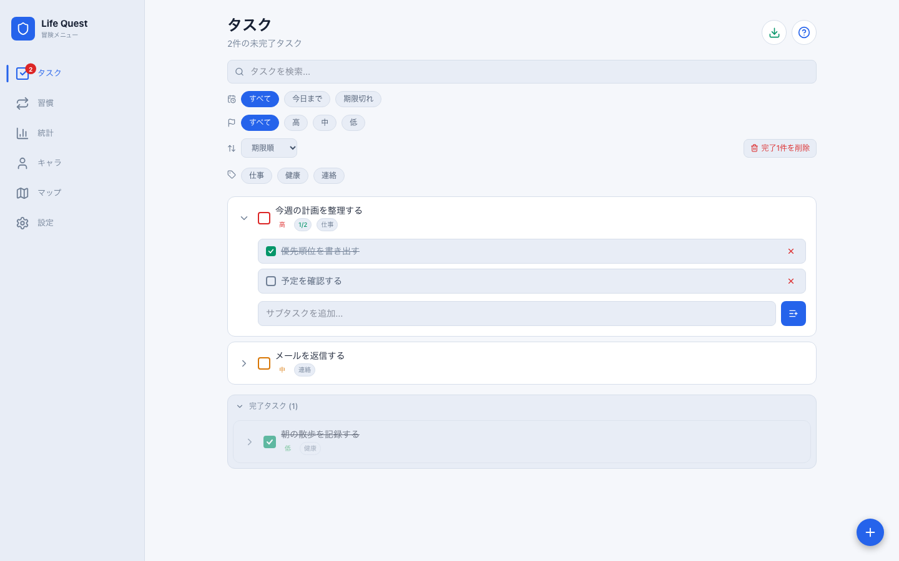](docs/screenshots/readme-20261027/web-light-tasks-desktop.png)

| 違い | Web：PC幅 | Web：スマホ幅 |
| --- | --- | --- |
| 画面移動 | 左のサイドメニュー。Alt＋1〜6でも移動可能 | 下部の6タブから移動 |
| 統計の配置 | 集計カードを4列、直近7日間のXPと自己ベストを横並びに表示 | 集計カードを2列、グラフや記録を縦に表示 |
| タスクの操作 | 編集・複製・削除を行にマウスを重ねると表示 | ホバーなしで操作できるよう常時表示 |

以下は同じデータの統計画面です。複数の指標を見渡すPCと、縦に読み進めるスマホ幅の違いが分かります。Mobileにも直近7日間のXP、自己ベスト、実績・称号の表示を実装しています。

| Web：PC幅（1440×900） | Web：スマホ幅（402×874） |
| --- | --- |
| [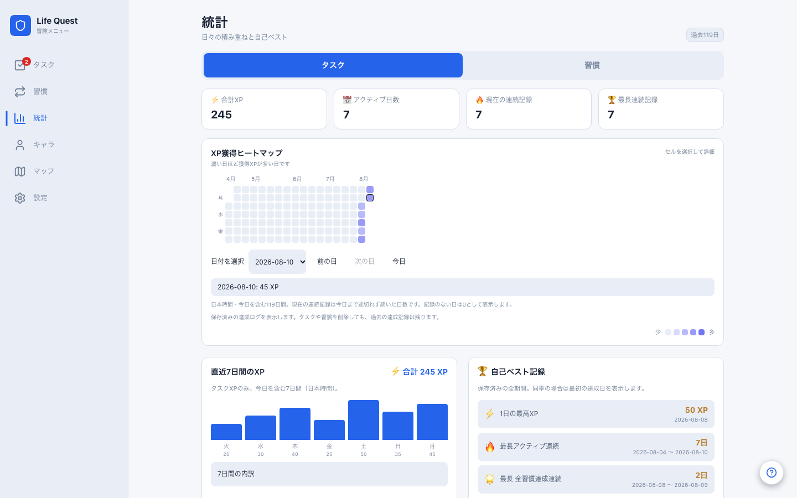](docs/screenshots/readme-20261027/web-light-stats-desktop.png) | [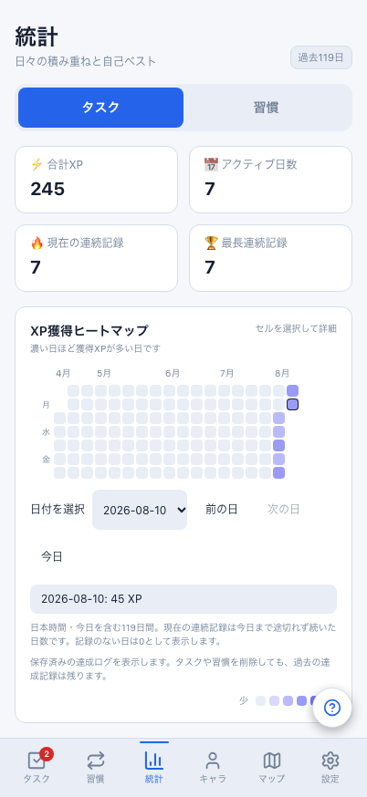](docs/screenshots/readme-20261027/web-light-stats.png) |

### Web / Mobileで揃えた、毎日の操作

Webは402×874 CSS px、Mobileは同じ論理サイズのiPhone 18 Pro / iOS 27シミュレーターです。React DOM / React NativeそれぞれのUIを維持し、情報の順序・配色・画像・操作の入口を揃えています。

| 画面 | Web（スマホ幅） | Mobile（iOS） |
| --- | --- | --- |
| タスク | [](docs/screenshots/readme-20261027/web-light-tasks.png) | [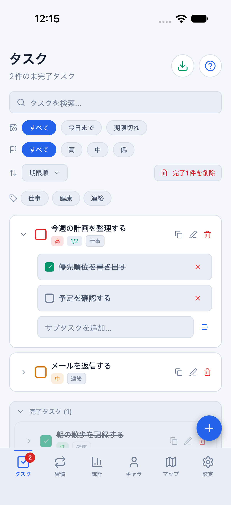](docs/screenshots/readme-20261027/mobile-light-tasks.png) |
| 習慣 | [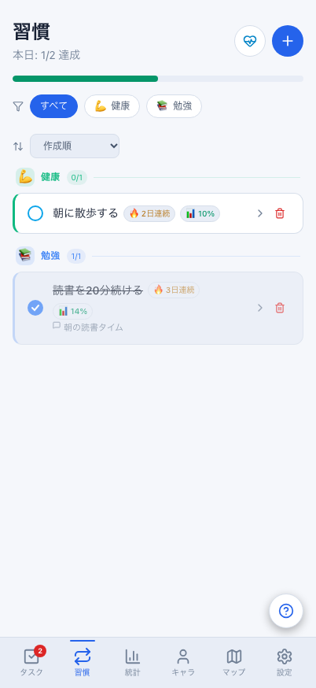](docs/screenshots/readme-20261027/web-light-habits.png) | [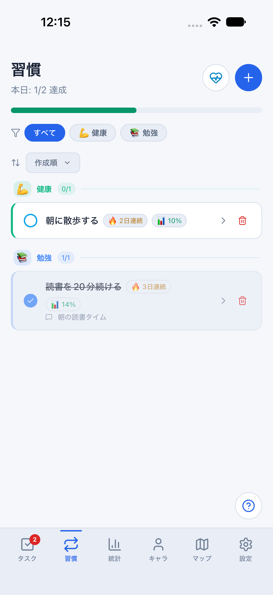](docs/screenshots/readme-20261027/mobile-light-habits.png) |

### 達成を、育成・収集の楽しさへ

キャラ画面でXP・装備込みの能力値・次の宝箱までの目標を確認し、独立したインベントリで持ち物を管理できます。Mobileにもキャラ内プレビュー、通常/売却/合成のモード切替、種類・レアリティ・並び順のフィルター、獲得履歴を実装しています。

| 画面 | Web（スマホ幅） | Mobile（iOS） |
| --- | --- | --- |
| キャラクター | [](docs/screenshots/readme-20261027/web-light-character.png) | [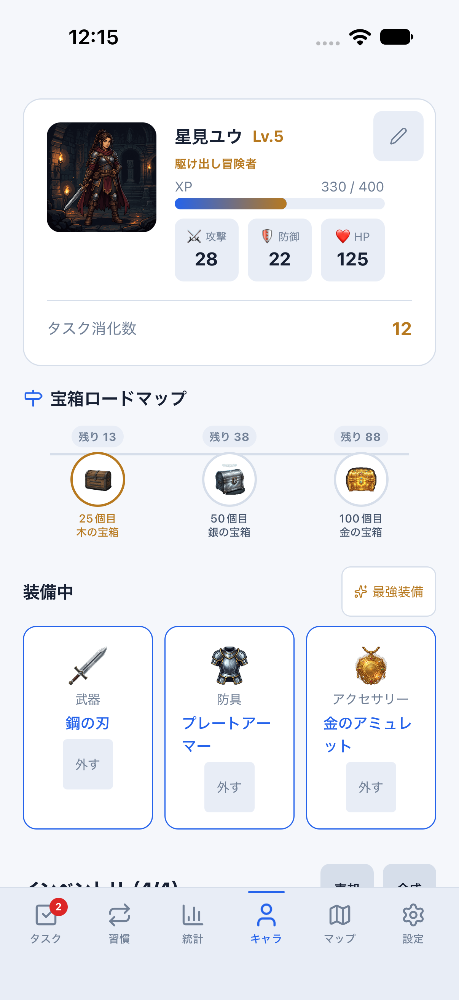](docs/screenshots/readme-20261027/mobile-light-character.png) |
| インベントリ | [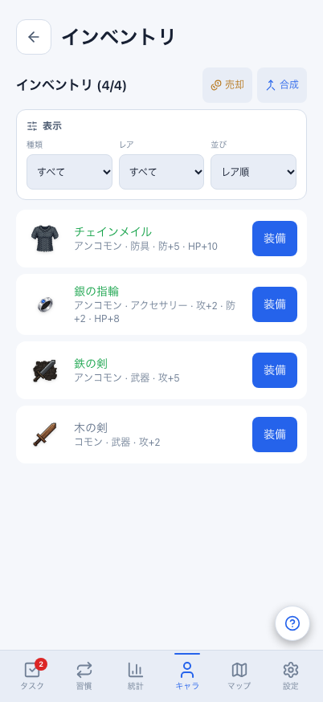](docs/screenshots/readme-20261027/web-light-inventory.png) | [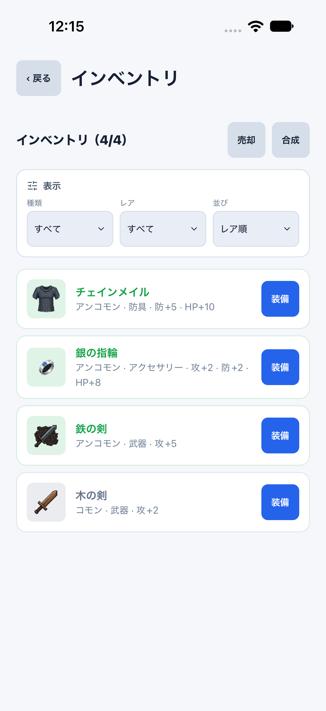](docs/screenshots/readme-20261027/mobile-light-inventory.png) |

宝箱を受け取ったら、開封演出で成果を見せます。以下は両版の青い宝箱を「タップして開ける」段階です。開封済みの結果は獲得履歴で振り返れ、クラウド同期後も履歴を保持するよう修正しています。

| Webの開封演出 | Mobileの開封演出 |
| --- | --- |
| [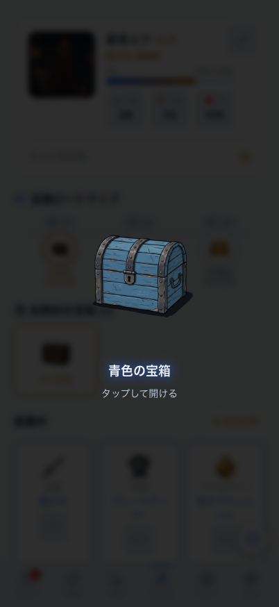](docs/screenshots/readme-20261027/web-light-chest.png) | [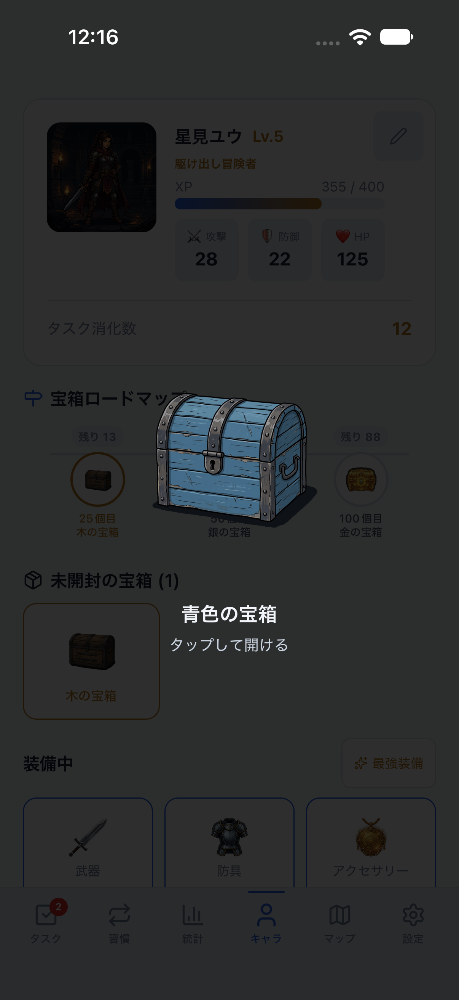](docs/screenshots/readme-20261027/mobile-light-chest.png) |

### 育てた成果を、攻略に使う

Web/Mobileとも通常攻撃は1秒周期で自動進行し、スキルは手動選択します。以下は同じ比較条件で大コウモリに勝利し、15 XPを受け取った場面です。マップの4エリア・ステージ選択の比較も[ギャラリー](docs/screenshots/readme-20261027/README.md#マップと戦闘結果)に掲載しています。

| Webの勝利画面 | Mobileの勝利画面 |
| --- | --- |
| [](docs/screenshots/readme-20261027/web-light-victory.png) | [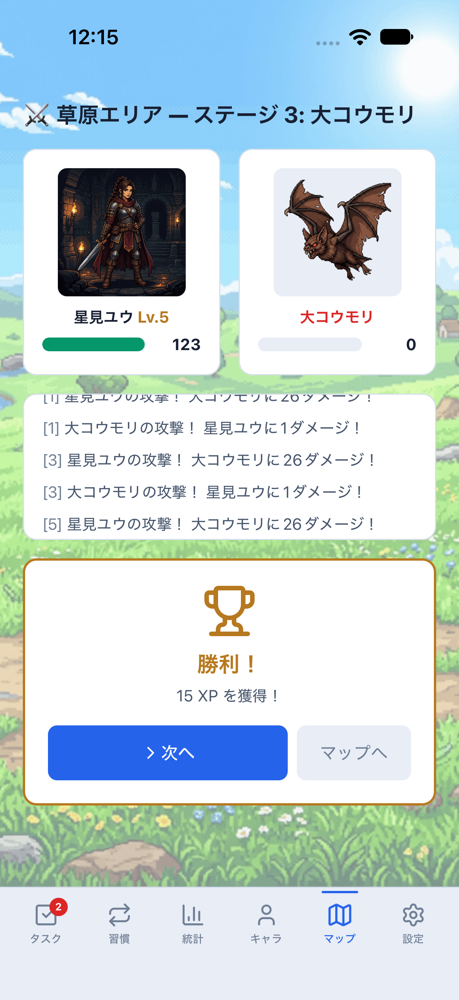](docs/screenshots/readme-20261027/mobile-light-victory.png) |

### ライト／ダークの比較

同じWebのタスク画面を、同じデータ・画面幅（402×874）で比較しています。紹介画像はライトモードを中心にしつつ、暗い配色での見え方も確認できます。アプリではライト／ダーク／システムに合わせる設定を選べます。

| ライトモード | ダークモード |
| --- | --- |
| [](docs/screenshots/readme-20261027/web-light-tasks.png) | [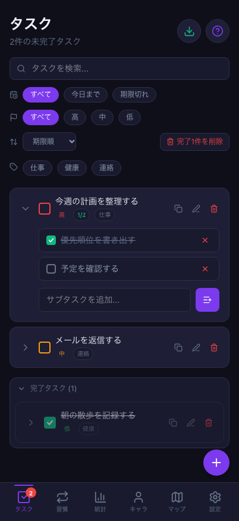](docs/screenshots/readme-20261027/web-dark-tasks.png) |

掲載画像は代表的な表示状態の比較です。OSのステータスバー・安全領域・文字描画、キーボード・日付入力・権限確認などにはOS固有の違いがあります。戦闘履歴・リプレイは現在Web版の機能です。全画面・全操作の一致、Android実機の合格、ストア公開を示すものではありません。

## 主な機能

- **タスク管理**: 優先度、期限、タグ、検索、並び替え、繰り返し、サブタスク、複製、一括削除、完了取り消し
- **習慣管理**: カテゴリ、メモ、休息日、ストリーク、達成率、履歴ヒートマップ
- **ゲーム進行**: タスク・習慣の報酬、レベル、キャラクターステータス、ログインボーナス、実績・称号
- **装備とインベントリ**: 宝箱、レアリティ、装備変更、売却、3アイテム合成、フィルター・並び替え
- **マップ・バトル**: 4エリア・40ステージ、自動の通常攻撃と手動スキル、勝敗表示、戦闘履歴・リプレイ（履歴・リプレイはWeb）
- **統計**: タスク・習慣の推移、XP、ヒートマップ、実績進捗
- **設定**: ダーク / ライト / システムテーマ、モーション、通知、バックアップ、同期状態、アカウント管理
- **認証とアカウント**: メール認証、Google OAuth、iOSのAppleログイン、Appleの認可失効を考慮した退会処理（実機の最終確認は今後）
- **クロスプラットフォーム**: WebとMobileで共有するアカウント、データ、ゲームルール、画像アセット、デザイントークン

## 技術的な見どころ

React製WebクライアントとExpo / React Native製Mobileクライアントを、共有ドメインロジックとSupabaseバックエンドで接続しています。ログイン中はタスク、習慣、キャラクター、インベントリ、報酬、バトル進行をユーザー単位で同期します。未ログインでも端末内で利用でき、既存ローカルデータからクラウドへ移行する経路を備えています。

### 1. UIではなくドメインを共有するモノレポ

WebはReact DOM、MobileはReact Nativeとして個別のUIを維持しながら、タスク・習慣・成長計算・装備・報酬・バトル・同期を`@life-quest/core`へ集約しています。画像は`@life-quest/assets`、色や余白などは共通デザイントークンを参照し、プラットフォーム固有の操作性を保ったまま結果を揃えています。

### 2. Supabaseを正とするWeb / Mobile同期

認証にはSupabase Auth、永続化にはPostgreSQLを使用しています。タスク・習慣などの変更は端末内へ即時反映した後、ユーザー別の永続outboxから再送します。宝箱開封・合成・バトルは、サーバーの確定応答を受けて結果を反映する要求/応答方式です。Realtimeは変更通知に限定し、実データは`pull_sync_batch` RPCからversion単位で取得することで、テーブル別ページングによる取りこぼしを避けています。

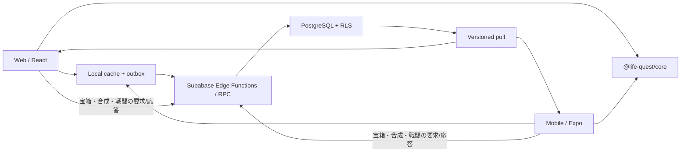

### 3. ゲーム報酬の整合性とサーバー権威

クラウドでは、タスク報酬を生涯1回のルールと冪等キーで保護しています。宝箱、合成、売却、バトル結果などはEdge FunctionsとDB関数を経由し、クライアントの自己申告だけでXPやアイテムが増えない構成です。バトルはattempt単位で再挑戦報酬を許可しつつ、同じ結果の二重送信を防ぎます。匿名Webも[保存済みの報酬台帳](docs/web-anonymous-reward-ledger.md)でタスク・サブタスクの再完了による重複を防ぎます。旧データで証拠のない過去の付与は復元できず、Web Locksが利用できない環境では報酬付与を止めます。

### 4. ユーザー境界と障害復旧

RLSに加えて、service roleを利用するEdge FunctionでもJWT由来のユーザーIDと所有権を検証します。ローカルキャッシュとoutboxはユーザーIDごとのnamespaceへ分離し、ログアウト時にはメモリ状態を破棄します。outboxに保存した操作は同じoperation IDで再送し、再起動・再接続時に復元する設計です。画面の下書き、確認ダイアログ、古い通信応答もアカウント切替の境界で隔離し、別ユーザーへ誤適用しないよう保護しています。Apple連携ユーザーの退会時は、サーバー側でAppleの認可を失効してからアカウントを削除し、外部処理の失敗時にユーザーデータだけが先に消えないよう保護しています。

設計上の判断と背景は[Architecture Decision Records](docs/adr/README.md)に記録しています。

## 技術スタック

| 領域 | 採用技術 |
| --- | --- |
| Web | React 19.3, React Router 7, Vite 8.3, Tailwind CSS 4 |
| Mobile | Expo SDK 57, React Native 0.86.3, Expo Router / development build |
| 言語・状態管理 | TypeScript 6.0, Zustand 5 |
| Backend | Supabase JS 2.118 / Auth, PostgreSQL 17, RLS, Realtime, Edge Functions |
| Test | Vitest 5, Playwright 1.64, pgTAP, Maestro（ローカルiOS操作・画面比較） |
| Quality | ESLint, TypeScript project references, GitHub Actions, Dependabot, Supabase CLI 2.122 |

npm依存のバージョンは2026-10-27の[package-lock.json](package-lock.json)に基づきます。

## リポジトリ構成

```text
Life-Quest/
├── src/                 # Webクライアント
├── apps/mobile/         # Expo / React Nativeクライアント
├── packages/core/       # プラットフォーム非依存の型・ドメイン・同期ロジック
├── packages/assets/     # Web / Mobile共有のキャラクター・敵・装備画像
├── supabase/
│   ├── migrations/      # スキーマ、RLS、RPC、整合性制約
│   ├── functions/       # 認可・ゲーム操作を担うEdge Functions
│   └── integration/     # 2クライアント同期などの統合テスト
├── e2e/                 # Web操作・ビジュアル回帰テスト
└── docs/adr/            # アーキテクチャ決定記録
```

## ローカル起動

### 必要な環境

- Node.js `22.22.2`以上、23未満
- npm
- Mobile確認時: Expoを実行できるiOS / Android環境
- クラウド同期をローカルで確認する場合: DockerとSupabase CLI（npm依存に含まれます）

### Web

```bash
git clone https://github.com/YuTakane256/Life-Quest.git
cd Life-Quest
npm ci
npm run dev
```

`http://localhost:5173`を開きます。Supabaseを設定しない場合も、未ログインのローカルモードで主要機能を確認できます。

### Mobile（iOS Simulator）

macOSにXcodeとiOS Simulatorを導入し、シミュレーターを起動してから実行します。初回は専用parityアプリのネイティブビルドを作成します。

```bash
npm ci
npm run mobile:ios
```

導入済みのparity開発ビルドをクラウド未設定で起動する場合は`npm run mobile:start:anonymous`を使います。通常版の開発ビルド向けMetroは`npm run mobile:start`です。Expo Goだけを前提にした手順ではありません。実機の署名、Android、撮影用の設定は[Mobile README](apps/mobile/README.md)と[比較手順](docs/mobile-visual-reference.md)を参照してください。

### Supabaseを含むローカル環境

```bash
npm run db:start
```

出力されたローカルURLとanon keyを`.env.example`に記載されたWeb / Mobile用の環境変数へ設定します。`service_role` keyはクライアント環境へ設定しません。スキーマを初期状態へ戻す場合は`npm run db:reset`を使用します。

## テストと品質確認

```bash
npm run typecheck          # Web全体の型検査
npm run typecheck:core     # 共有ドメインの型検査
npm run mobile:typecheck   # Mobileの型検査
npm run lint               # 静的解析
npm test                   # ユニット / コンポーネントテスト
npm run test:integration   # Supabase統合テスト
npm run db:test            # RLS・DB関数のpgTAPテスト
npm run e2e                # Playwright E2E
npm run e2e:parity         # 390 x 844のWeb画面回帰テスト
npm run build              # Web本番ビルド
npm run mobile:export      # Android向けExpo export
npm run mobile:validate-release # EAS profile / 公開Expo設定の静的検査
```

Pull Requestでは型検査、lint、テスト、Web build、Mobile export、Expo公開設定、Playwright E2E、秘密情報の混入検査をGitHub Actionsで実行します。依存関係はDependabotと週次の`npm audit`で監視しています。iOSシミュレータを使うMobileスクリーンショット比較は[チェックリスト](docs/mobile-parity-checklist.md)に沿ってローカルで行います。EASのdevelopment / preview / productionビルド準備は[Mobileリリースチェックリスト](docs/mobile-release-checklist.md)を参照してください。

## 実装状況

現在は[全体計画の④「使い続けられる品質確認」](docs/mobile-web-implementation-roadmap.md)を進行中です。主要な管理・育成・攻略と画面の共通化を実装し、実際の同期・障害復帰を確認しています。⑤の署名済み実機内部配布・ストア公開準備には、まだ進んでいません。

| 項目 | 現在の確認範囲 |
| --- | --- |
| 主要画面 | タスク・習慣・キャラ・独立インベントリ・統計・マップ/戦闘・宝箱演出の代表状態を、匿名の同条件画像で比較 |
| 実アカウントの同期 | 専用stagingのWeb/iOSでタスク・子タスク・習慣の往復、未送信タスク/下書きを伴うA/B切替と元の所有者への復帰を確認 |
| 障害・再起動 | Webの実オフライン/未送信プロセス再起動、NativeのHTTP障害からの復帰を部分確認 |
| 報酬の重複防止 | タスク完了と青/木の宝箱開封で、成功応答の喪失・同じキーの再送・送信済み状態の再起動/両端同期を確認 |

確認条件と限界は[staging受け入れ記録](docs/staging-sync-acceptance.md)に残しています。Nativeの実回線切断/未送信オフライン起動、期限切れセッション、合成・戦闘の再送、Android/実機、署名済み認証・通知・退会などには残確認があります。画面比較の成功と、保存・同期・実機の合格は区別しています。進行中・検討中の内容は[Issues](https://github.com/YuTakane256/Life-Quest/issues)を参照してください。

## 補足資料

- [ADR一覧](docs/adr/README.md)
- [Web / Mobile差分監査](docs/mobile-web-parity-audit.md)
- [Mobile / Web画面比較手順](docs/mobile-parity-checklist.md)
- [Mobileリリースチェックリスト](docs/mobile-release-checklist.md)
- [メール認証セットアップ](docs/email-auth-setup.md)
- [Google OAuthセットアップ](docs/google-oauth-setup.md)

## License

現時点でライセンスは設定していません。ソースコードの再利用・再配布については、リポジトリ所有者へ確認してください。
