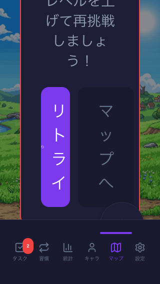
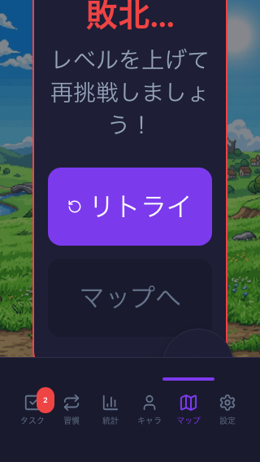
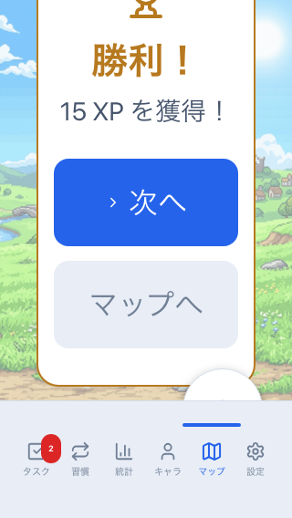
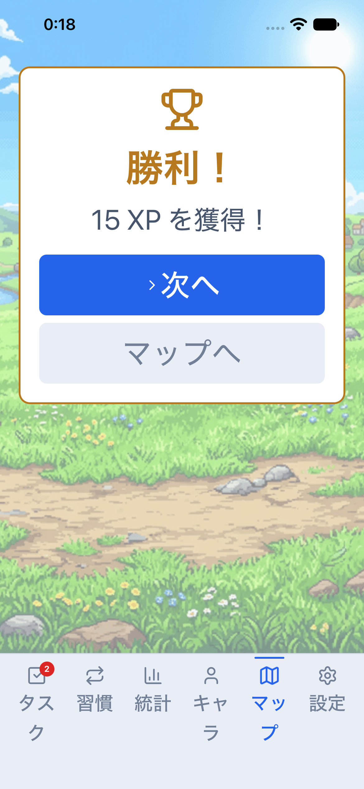
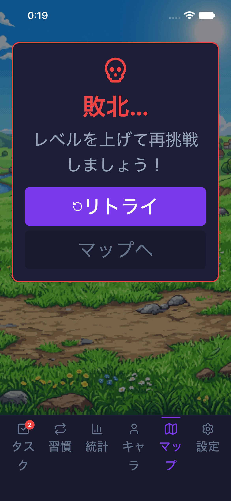

# 戦闘結果のボタンを小さい画面と大きい文字に対応させる（2026-11-27）

計画④ [#699](https://github.com/YuTakane256/Life-Quest/issues/699) のR5。戦闘結果で「次へ」「リトライ」「マップへ」の文字が狭い横並びに押し込まれ、Webの幅320px・文字200%では敗北画面のラベルが一文字ずつ折り返されていた。

Webでは、結果カードに十分な横幅があるときは横並びを使い、足りないときは同じ幅の縦並びにする。Mobileも幅360pt未満、または文字倍率1.5以上で縦に並べる。次戦・再戦・マップ復帰の操作、同期中の無効表示、報酬と戦闘進行の処理は従来どおり。

## 確認

- Webの修正前に、320×568・文字200%のライト勝利とダーク敗北で追加した2件が失敗した。修正後は、同条件の両テーマでボタンがカード内に収まり、44px以上の操作範囲でクリックできることを確認した。勝利→次戦、敗北→同じステージ、結果→マップを実クリックした。通常幅の横並びと既存の戦闘回帰を含むPlaywrightは10件成功した。
- Mobileの表示回帰では小幅・文字拡大の2件が修正前に失敗した。修正後は通常幅、狭幅、文字倍率1.6の配置と、結果操作・同期待ちの既存テストが成功した。全体テストは4,187件成功、167件スキップ。Web/Mobile型検査とLintが成功した（既存の警告7件）。
- iPhone 17e・iOS 27.0のシミュレーターで、文字設定を `accessibility-large` にして確認した。拡大時のステージ選択は自動操作を完了できなかったため、同じ匿名の戦闘比較データから検証用に勝敗を生成し、スクロールを介さず結果カードだけを表示して撮影した。アプリの通常経路でのタップ検証は残っている。撮影用の変更はPRに含んでいない。

| Web・修正前の敗北 | Web・修正後の敗北 |
| --- | --- |
|  |  |

| Web・修正後の勝利 | iOS・拡大文字の勝利カード |
| --- | --- |
|  |  |

| iOS・拡大文字の敗北カード |
| --- |
|  |
