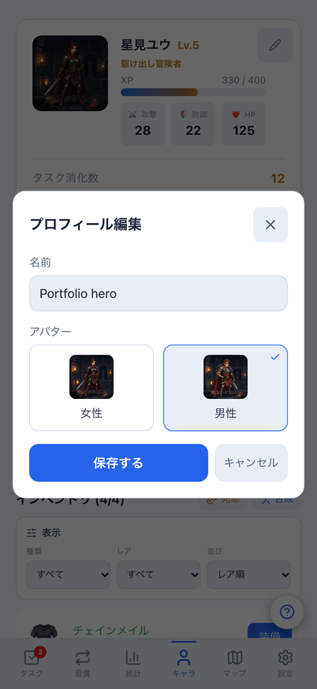
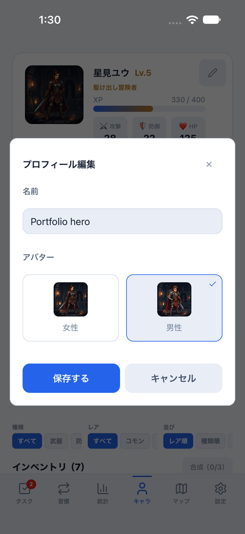
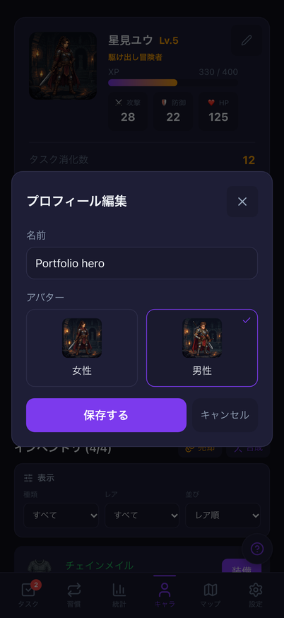
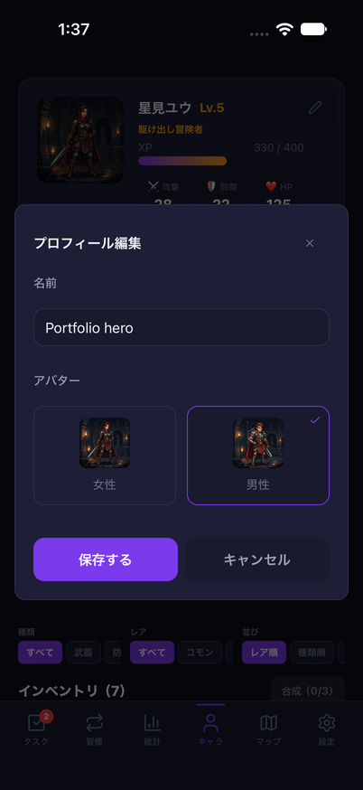
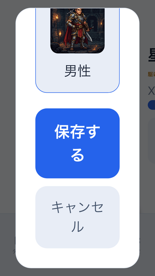
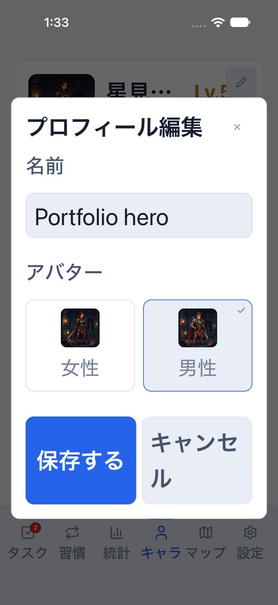
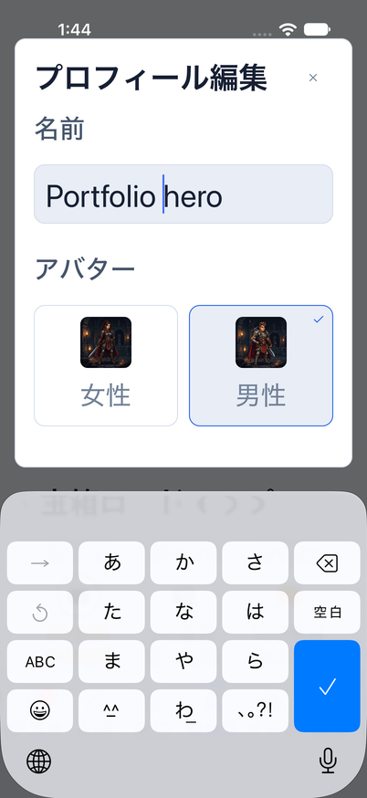

# プロフィール編集の帰属・競合・入力品質

Issue: [#795](https://github.com/YuTakane256/Life-Quest/issues/795)。計画④の入力品質の続き。

## 変更

- Web/Mobileとも、編集開始時の名前・アバターをコピーして、保存直前の現在値と照合する。
  同期等でいずれかが変わっていた場合は上書きせず、下書きとエラーを残して再編集を案内する。
  同値のpull、XP/レベル/装備など編集対象以外の更新は保存を妨げない。
- 認証世代・編集セッション・画面寿命を既存のinteraction scopeで確認する。
  ログアウト・アカウント切替・匿名からの初回ログイン・Nativeのタブ離脱で下書きを破棄する。
  同一ユーザーの重複通知では入力を維持する。
- 保存を一度受け付けたら、再描画を待たず所有権を失効させる。
  閉じて再編集した後の古い入力/保存/取消callbackも、新しい下書きに作用しない。
- Nativeは読み込み未完了時に保存せず入力を残し、完了後に再操作できる。
- 名前のtrim・空欄の「名無し」・30文字上限を共有coreへ揃える。
  既存の`updateCharacter`と`update_character_profile`送信を維持し、成長や装備を更新に含めない。
- 編集画面の閉じる/保存/取消・アバター選択の操作領域を44px/pt以上にする。
  Webの名前ラベルを関連付け、アバター選択状態を公開する。
  Webは初期フォーカス・Tab循環・Escape・閉じた後の復帰を持ち、モーダル内をスクロールできる。
  モーダル中は背景スクロールを止め、ナビより前に表示する。狭い画面ではアバター選択を縦に並べる。
  Nativeの共有Dialogへのサイズ/ラベル追加はオプションとし、他のDialogの既定値を変えない。

DB/API/保存形式/報酬量/同期経路は変更しない。これは端末に反映済みのプロフィールとの照合であり、
サーバーの排他制御や、保存開始後の別端末更新の防止を実装したものではない。

## 検証

- UI/既存モデルの26テストで、両画面の通常保存・一度だけの送信、認証切替/離脱、
  再描画前の旧操作、再編集後の旧callback、名前/アバター競合、同値pull/成長更新を確認。
  実際のstore・送信入口を使い、通信先/Native表示とストレージはモックする。
- 全体2,923件成功/98件skip、core720件成功。Web/Mobile/core型検査/build/check:secrets成功。
  lintは既存warning6件/error0。
- Web E2E22件で、PC/402px・両テーマの保存/取消/再編集・キーボード操作、競合、
  320×568/文字200%のスクロールと全操作を確認。既存インベントリ売却/合成・レスポンシブも含む。
- 初回の保存確認は、既存のWeb Locksによる非同期書き込みを待たず旧localStorageを読んでいた。
  保存値を待って検査するようテストを修正。保存経路の同期化や待機時間の固定延長は行わない。
- 小画面の実クリック失敗を検出し、背景スクロールのロックで修正した。
  ナビの重なりや拡大時のアバター画像の縦伸びも調整し、クリック判定を弱めず再実行する。

### 390px画像回帰の切り分け

今回の編集入口は当たり判定を広げても鉛筆位置を維持する。390px画像回帰は36pxの
未変更のselect矢印差で失敗した。編集入口を元の描画に戻した対照実行でも同じ36pxの差を確認。
差分画像を確認し、基準画像・許容値は変更しない。この画像比較を成功件数へは含めない。

### iOSとキーボード

専用parity ID/8082/クラウド設定なし/dailyメモリfixtureで確認する。
キーボードのあるフローは`node scripts/run-mobile-parity-screenshots.mjs profile`。
`Done`キーの実表示を必須とし、入力欄のフォーカスだけでは合格にしない。
初回は`Done`キーを確認できず停止したが、Device Hubのキーボード設定を変更せずに
再実行した通常dark・通常light・拡大lightでは、画面内キーボードの実表示と入力欄を画像でも確認した。
初回の原因を設定の無効化と断定しない。設定変更への追加回答は不要。
通常darkは`2026-10-22_013806`、通常lightは`2026-10-22_014022`で成功した。
light/accessibility-largeも`2026-10-22_014339`で、取消・保存・再編集と実キーボードを含む
`profile`全体が成功した。拡大時も入力欄がキーボードに隠れず、決定キーで閉じて操作を続けられる。
これらはメモリfixture内の保存/再編集であり、通常データの永続化やクラウド同期の証拠ではない。

別途、キーボード検証を含まない`node scripts/run-mobile-parity-screenshots.mjs profileUi`で、
名前/アバター・取消・保存・再編集・閉じるを確認する。`profile`も同じUIフローを呼び出してからキーボードの実表示を検証する。
いずれにも同じparity/runtime/profileガードを通す。UI検証とキーボード検証の結果は区別する。
UI専用フローの成功を、ソフトウェアキーボード表示中の成功とは扱わない。
UI専用の通常light・light accessibility-large・通常darkの3フローは成功。
light/拡大文字の初回は同内容の一時フローから実行し、再現できるようその内容を`profileUi`へ保存した。
ログは順に`2026-10-22_012951`、`2026-10-22_013232`、`2026-10-22_013613`。

## 比較画像

共通の架空dailyデータ・固定日時・402×874。名前「Portfolio hero」、男性アバター選択・未保存を比較する。
OSヘッダー・モーダル位置・文字描画の違いは残す。キーボードは表示しておらず、その確認証拠ではない。

| 状態 | Web | iOS |
| --- | --- | --- |
| light |  |  |
| dark |  |  |

下は同条件の画素比較ではなく、Web320×568/文字200%とiOS402×874/accessibility-largeの操作確認。

| Web・スクロール後の操作 | iOS・拡大文字 |
| --- | --- |
|  |  |

画面内キーボードの実表示：iOS/light/accessibility-large。入力欄と決定キーを目視確認した。
全フローではキーボードを閉じてから保存・取消・閉じる操作を確認している。

検証後は使用した8082のMetroと専用parityアプリだけを停止し、シミュレーターの文字サイズを
元の`large`へ戻した。キーボード設定は変更せず、通常版/サインイン済みデータは初期化していない。

## 残る範囲

実アカウントの競合/復元、Android/実端末、VoiceOver/TalkBack全面、キャラ画面全体の拡大文字対応は後続。
通常データは初期化せず、README画像を追加しない。計画④の継続で、⑤の配布/ストア提出には進まない。
PR後にGPT-6.1 Sol・エフォート中の独立レビューと最終HEADのCI3つを確認し、自動マージしない。

独立レビューではコードの修正必須の指摘なし。認証/セッション/Native blur・競合・一度だけの保存、
Webのフォーカス/スクロール、共有Dialogの既定値維持を確認した。
独立実行のテストは65件＋既存モデル/Escapeの6件が成功。
通常起動は一時ファイルの権限で停止したため、`--configLoader runner --cache false`で検証した。
実キーボードの3条件も確認済み。最終マージ判断は資料更新後の最終HEADのCI結果と合わせて行う。
