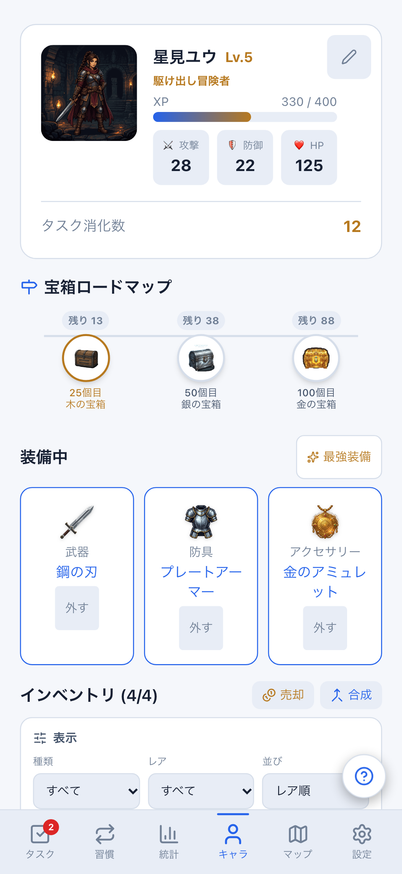
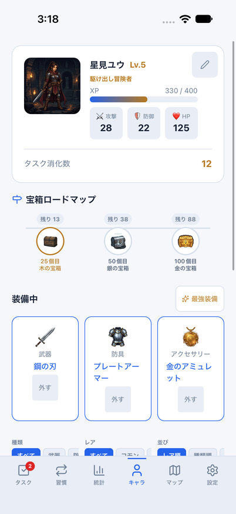
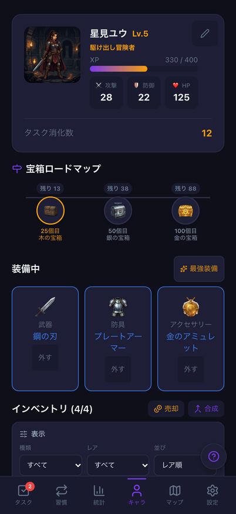
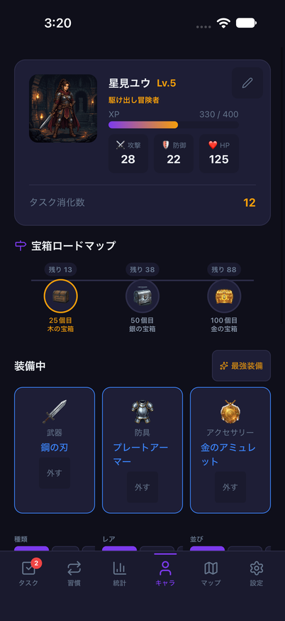
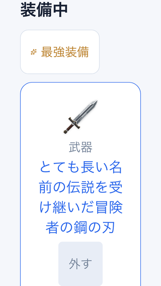
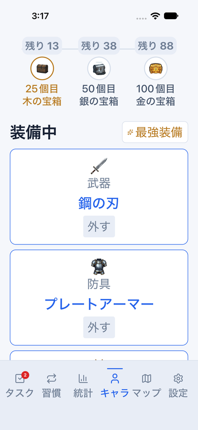

# 装備の直接操作・小画面での装備中表示

Issue: [#797](https://github.com/YuTakane256/Life-Quest/issues/797)。計画④の日常操作品質の続き。

## 変更と境界

- Webのキャラ/独立インベントリ、Nativeのキャラ上部/インベントリ一覧の
  装備する・外す・最強装備を、表示した装備一覧と画面/認証の寿命に結び付ける。
- 操作前に名前・性能・装備状態・ID等の全フィールド、件数と順序を確認する。
  変わっていれば古い操作は実行せず、再描画された最新のボタンから操作する。
  同値のpull、同一ユーザー通知、XP/レベル/プロフィールだけの更新では操作できる。
  順序も確認するのは、同点の最強装備を選ぶ既存ルールが一覧順に依存するため。
- 1つのcallbackは一度だけ実行する。比較用コピーは各画面の描画時に一度作り、
  最大2,000件の各行に一覧コピーを作る二乗の負荷を避ける。
- 認証切替/ログアウト/初回ログイン、Nativeのタブ離脱・復帰後の旧操作を拒否する。
  Nativeの読み込み未完了時も変更しない。
- 共有interaction hookはマウント/フォーカスの有効化後に再描画する。
  StrictModeのeffect再実行後も、通常のボタンが古い世代のままにならないようにする。
  旧callbackの有効期限、認証通知、遅延処理の取消は維持する。
- 装備中の名前を省略せず、Webはrem基準のグリッド、NativeはfontScaleに応じて折り返す。
  最強装備/外す/Webインベントリの装備ボタンを44px/pt以上にし、操作対象名をラベルで伝える。

DB/API/保存形式/報酬量/最強装備の選び方は変更しない。既存storeと`set_equipped_items`の送信を使う。
これは端末に反映済みの一覧との照合であり、サーバー排他制御や保存開始後の別端末更新の防止ではない。
売却・合成・宝箱の既存経路は維持する。Nativeインベントリの全表示や全画面の文字拡大完了ではない。

## 自動検証

- 対象3ファイル110件成功：共有core15件＋実画面/store/送信入口の95件。
  装着/解除/最強の一度だけの送信、同IDの別アカウント/変更済み装備、順序変更、
  同値pull/成長、Native blur/refocus/読み込み、既存プロフィール・売却/合成を含む。
  通信先・Native描画・永続ストレージはテストで置き換える。
- 全体2,970件成功/98件skip、core735件成功。Web/Mobile/core型検査、build、秘密情報検査成功。
  lintはerror0/既存warning6。
- Web E2E26件成功：両テーマの解除→インベントリ装着→最強、保存値と成長不変、
  320×568/文字200%・長い名前・44px操作・再装着、既存プロフィール/売却/合成。
  既存2プロジェクトで実行し、今回の画面確認は402×874へ明示的に揃える。
- 最初のガード実装ではStrictMode初期化で通常操作も拒否する問題をテストが検出。
  有効化後の再描画を追加してから上記を再実行した。テストの期待値を弱めていない。

### 390px基準画像

最強/外す/装備の44px化、装備名の全文表示でキャラ・インベントリの画像差分が発生する。
更新前の失敗と差分画像を確認し、意図した操作領域/折り返し/後続コンテンツの移動だけを確認した。
既知のselect矢印の微差も含め、該当2枚を現行描画で更新し、再比較2件が成功した。
画像比較の許容値・対象画面・テストの条件は変更していない。更新前の比較を成功扱いにはしない。

## iOS操作と比較

専用parity ID、8082、クラウド未設定、dailyメモリfixtureだけを使う。
`node scripts/run-mobile-parity-screenshots.mjs loadout`で解除・最強・インベントリ装着・最強への復帰を確認する。
これはメモリfixture上の操作であり、通常データの永続化/クラウド同期の証拠ではない。

通常light（`2026-10-22_031803`）とlight/accessibility-large（`2026-10-22_031647`）は全フロー成功。
通常dark（`2026-10-22_031932`）も全フロー成功。
拡大時は装備カードが1列に折り返し、名前/外すボタンを表示して操作できる。
初回の拡大フロー（`031414`）は、戻りのスクロール中央化が対象をタブバーの下へ送り、
テストのタップがマップへ移動したため失敗した。座標ログと失敗画像で切り分け、上方向は
中央化せず初めて見えた位置で操作するように修正した。表示率100%と最終装備の検査は維持する。
初回の失敗画像を最終成功の証拠として使わない。

比較は共通の架空dailyデータ・固定日時・402×874、初期の最強装備3個を装着した状態。
OSヘッダー/スクロール位置/フォント描画は異なる。インベントリはWebが未装備4個、Nativeは装備中を含む7個で、
この既存の違いまで統一した画像ではない。

| テーマ | Web | iOS |
| --- | --- | --- |
| light |  |  |
| dark |  |  |

以下は同条件の画素比較ではない。Web320×568/文字200%・検証用の長い装備名と、
iOS402×874/accessibility-large・元の装備名で、それぞれ折り返し/操作を確認する。
Webは操作可能な位置へのスクロール後に撮影する。キャラ画面全体/ナビの拡大文字完了の証拠ではない。

| Web | iOS |
| --- | --- |
|  |  |

検証後は使用した8082のMetroと専用parityアプリだけを停止した。
文字サイズは元の`large`へ戻して確認済み。通常版/サインイン済みデータは初期化していない。

## 後続

実アカウントの双方向同期/競合、Android/実端末、読み上げ全面、インベントリ全面統一は後続。
⑤の内部配布・ストア提出には進まない。README画像は増やさず、PR後の6.1 Sol・中の独立レビューと
最終HEADのCI3件でマージ可否を判定する。自動マージはしない。
