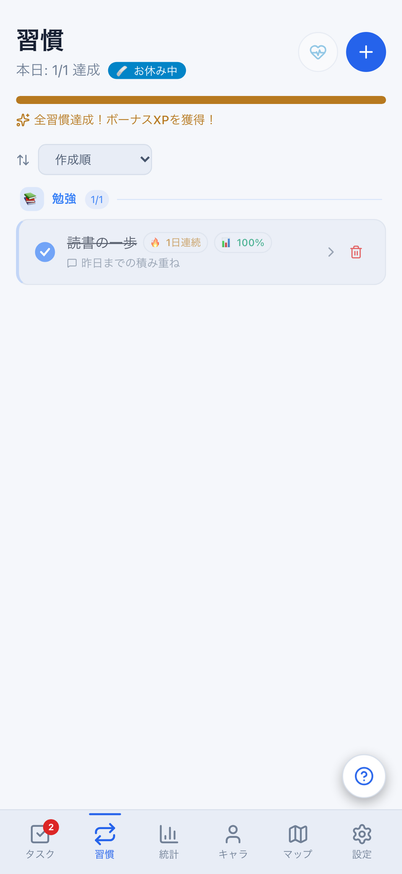
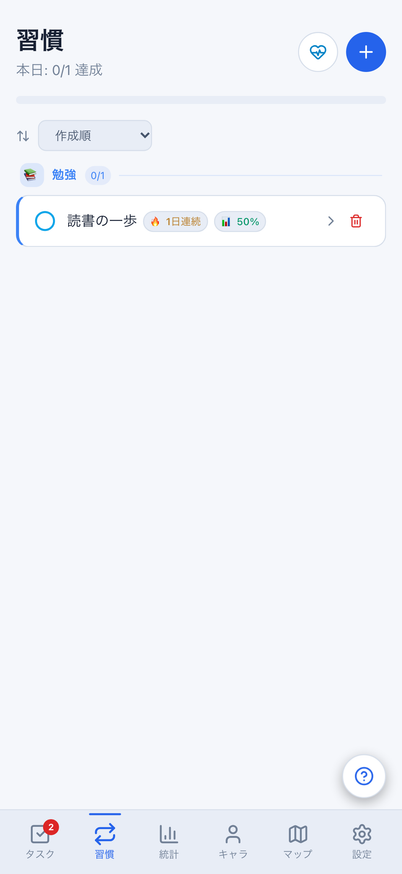
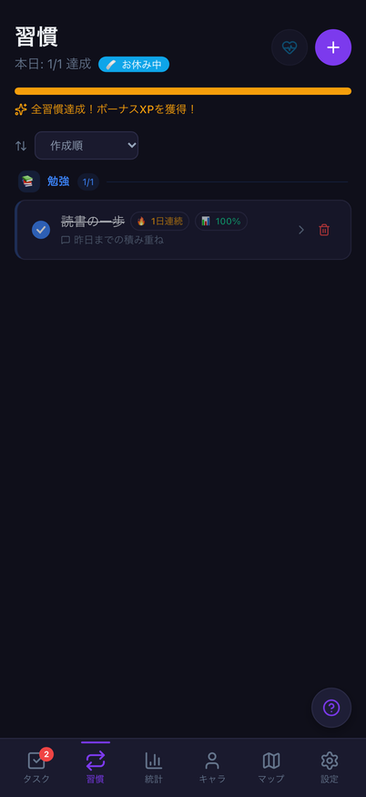
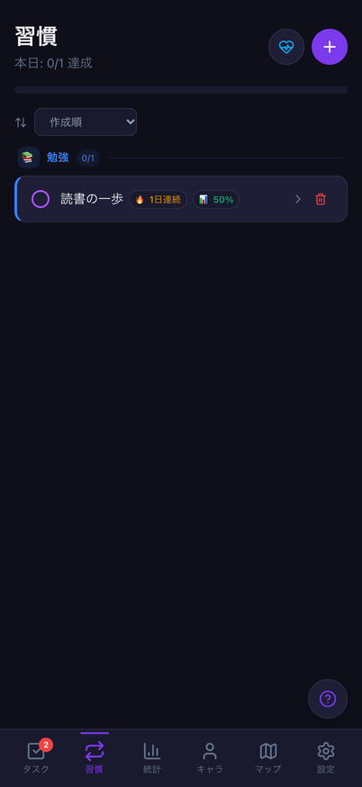
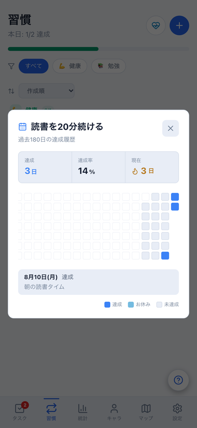
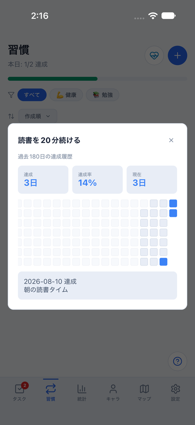
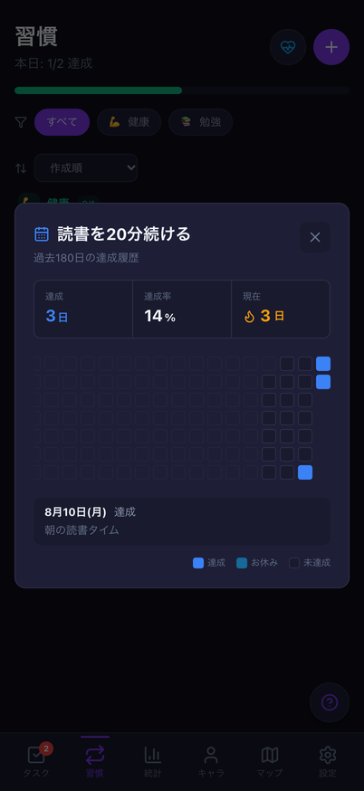
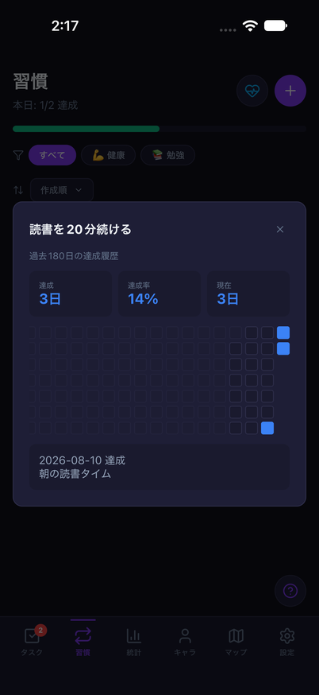

# 習慣の今日表示・開いた履歴の日付更新

Issue: [#803](https://github.com/YuTakane256/Life-Quest/issues/803)。計画④の日常利用品質の続き。
AI連携や新ゲーム機能は追加せず、翌日も迷わず達成チェックできる既存導線を改善する。

## 変更と境界

- Web/Mobile習慣に既存の`useJstToday`を適用。JST午前0時、画面/アプリ復帰で
  今日の達成・全達成・お休み・進捗・30日達成率・ストリークを更新する。
- 既存hookのタイマー/リスナーを再利用し、通知は描画の再確認を起こすだけにする。
  描画では実際のJST日付を読む。タイマーが遅れた際の通常の再描画や、時計が往復した際にも
  キャッシュした日付のまま残さない。隠れた画面のタイマー停止・解除は維持する。
- Webの集計も既存共有coreの関数へ同じ表示日を明示して渡す。計算ルールは変更しない。
- 開いた履歴へ親画面の表示日を渡し、日付が変わっても180日分を再計算する。
  選択は古い日オブジェクトではなく日付で保持し、未記録→未達成や同期後のメモを最新データから表示する。
  選択日が表示期間外なら古い詳細を出さない。
- Web履歴の先頭曜日はカレンダー日をUTCで読む。ブラウザーが日本以外のタイムゾーンでも
  JSTの深夜をローカル時刻へ変換したことによる曜日ずれを起こさない。
- 日付更新でカテゴリ条件・追加下書き・メモ下書きを消さない。旧日のメモ保存/お休み確定を
  翌日に流用しない既存ガード、古い達成callbackの拒否と通常の再操作は維持する。

DB/API/保存形式/報酬量/達成条件/連続日数・率の計算ルールは変更しない。
日付の表示更新そのものは記録・報酬・送信を作らない。通知/OS時刻設定/実アカウント同期、
Android実機や全画面アクセシビリティの合格、計画⑤への移行は今回の対象外。

## 検証

- 対象5ファイル315件成功。実Web/Native画面・store、日付hook、既存タスク/個別削除、起動ガードを含む。
  習慣の午前0時/前景/タブ復帰19件と、共有時計の通常再描画/時計往復4件を追加した。
  Native描画/OS/通信/ストレージはテストで置き換えるため、実機合格とは区別する。
- Web E2Eは両テーマ・402×874、習慣の日付境界/選択履歴/UTCブラウザー/旧メモ/旧確認、
  既存達成・メモ・カテゴリ回復・履歴操作と、前PRのタスク日付境界を実行する。
  メモ比較では完了操作由来の正当な非同期ボーナスを先に確定させ、以後の保存不変を検査する。
  その処理を待たない初回比較の失敗を成功扱いにしたり、比較対象を減らしたりしていない。
- 最終ソースで全体3,048件成功/98件skip、core749件成功。Web/Mobile/core型検査、build、秘密情報検査成功。
  lintはerror0/既存warning6。Web E2E44件成功（新規日付境界16、履歴4、既存習慣12、タスク12）。
- 390px画像は7件成功/既知のタスク矢印19px差分1件失敗。実画像SHA-256は
  `bf452f819c3595e4bf8e9962402038350ad8b950df969e2082100f813aae9cf3`で前PRのbase検証と一致する。
  成功扱いにはせず、基準画像/許容値は変更していない。

## Webの日付境界

架空の1習慣・同じデータで8/10 23:59:59→8/11 00:00:00。
前日の達成/お休み/全達成表示を翌日の0件表示へ切り替える。保存記録と成長値は不変。
ブラウザー内の時計だけを進め、Mac/iOSのシステム日時は変更しない。

| テーマ | 日付変更前 | 日付変更後 |
| --- | --- | --- |
| light |  |  |
| dark |  |  |

## iOS履歴・既存操作

`node scripts/run-mobile-parity-screenshots.mjs habitHistory`を使用する。
専用parity ID/8082/クラウド未設定/dailyメモリfixtureだけで、履歴選択と保存済みメモの表示、
既存の完了→メモ→未達成化・カテゴリ回復を確認する。通常データは初期化しない。
固定時計なので、この実行をiOS実機の午前0時/時計変更や永続化の証拠にはしない。
最終ソースのlight（`2026-10-23_021526`）は全フロー成功。darkは確認後に追記する。

比較は共通dailyデータ・固定日時・402×874、読書の8/10達成・「朝の読書タイム」を選択した履歴。
上の日付境界専用データとは異なる。OSヘッダー、書体、モーダルやスクロールの既存配置差は残る。

| テーマ | Web | iOS |
| --- | --- | --- |
| light |  |  |
| dark |  |  |

最終HEADのCI3件と6.1 Sol・中の独立レビューでマージ可否を判定する。自動マージはしない。
