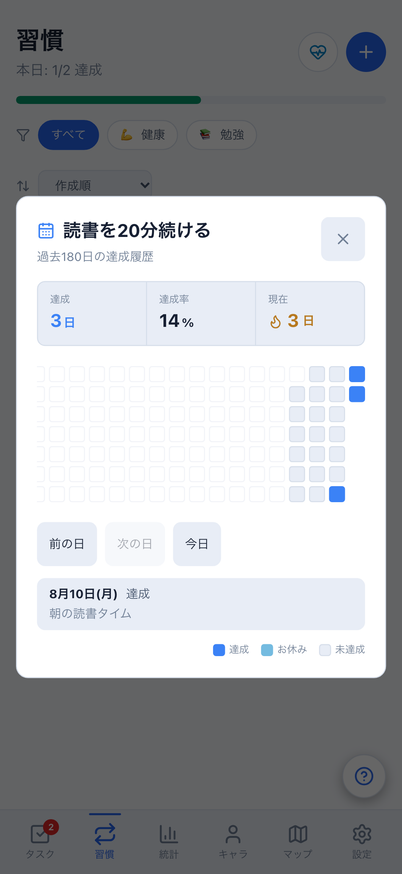
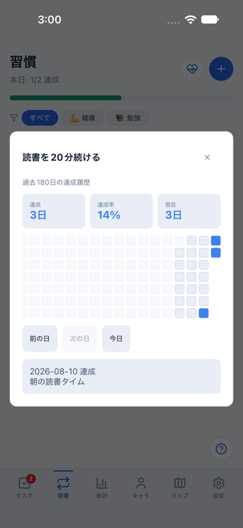
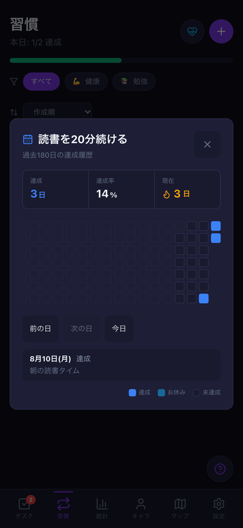
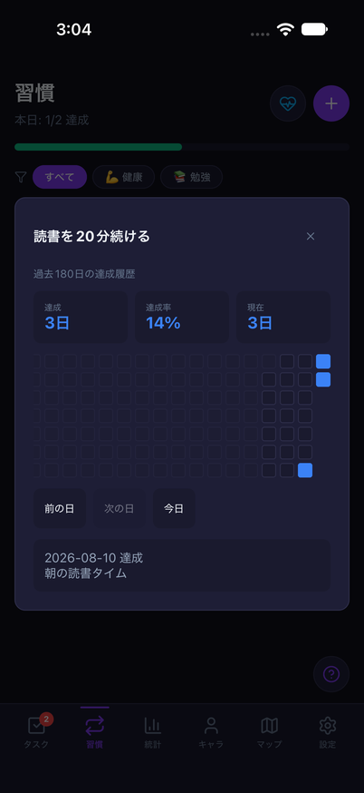
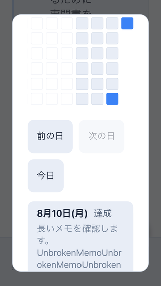
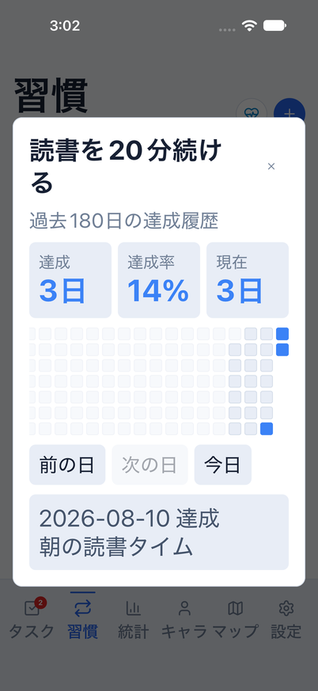
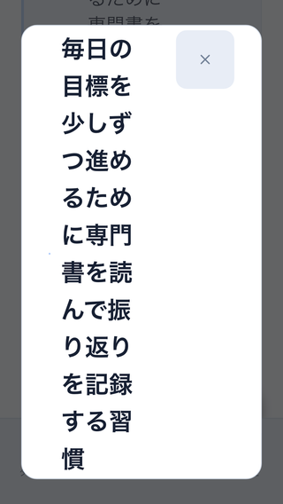

# 習慣履歴の日付操作・小画面・文字拡大

Issue: [#805](https://github.com/YuTakane256/Life-Quest/issues/805)。計画④・#692/#699の続き。

## 変更

- Web/Mobileの180日履歴に44px/pt以上の「前の日・次の日・今日」を追加。
  16pxのマスを正確に押さなくても日別の状態と保存済みメモを確認できる。
  未選択時の移動は今日を基準とし、最古日より前・今日より後への操作は無効にする。
- 隣接日と選択詳細は同じ共有coreの読み取り専用関数から取得する。
  選択した日付は維持し、日付変更や記録更新後も最新の状態を表示する。
  期間外になった古い選択は詳細を出さず、今日から操作を再開できる。
- 選択マスに選択状態を付け、日別詳細の変更を通知。Nativeの読上げ内容は
  固定の説明で置換せず、日付・状態・メモ本文を保持する。
- 履歴の閉じる操作も44px/ptにする。Webのタイトルは省略せず、長いメモ・改行を折り返す。
  モーダルは画面高の90%以内で縦スクロールする。Nativeは既存のDialog内スクロールを維持する。
- 検証でWebの一覧メモに長い英数字があると履歴を開きにくい問題を確認したため、
  一覧の習慣名・メモもカード内で折り返し、アイコンだけが縮まないようにした。

DB/API/保存形式/報酬量/達成・率・連続日数の計算と同期は変更しない。
日付移動は表示のみで、記録・成長値・送信を作らない。AI連携は保留のまま。

## 検証

- 共有モデル: 未選択/隣接日/両端/期間外/空/1日の読み取り専用操作を確認。
- 実Web/Native画面: 前後・今日・最古日、日付変更、メモ更新と保存/送信不変を確認。
  最古日はセルから選択して境界を確認し、179回の画面再描画に依存しない。
- Web E2E: 両テーマ・402×874の44px操作、保存全体の不変と既存習慣/日付境界回帰。
  320×568・ルート文字24px・長い習慣名/改行/連続英数字メモで、
  履歴を実クリックで開く→今日の詳細→閉じる操作、横はみ出しなしを確認する。
- 既知の390pxタスク矢印19px差分は別件として残し、画像基準/許容値を変更しない。
  7件成功/1件失敗。実画像SHAは前PRと同じ`bf452f819c3595e4bf8e9962402038350ad8b950df969e2082100f813aae9cf3`。
- iOSは専用parity ID/8082/クラウド未設定/dailyメモリfixtureを使用。
  通常版やサインイン済みデータは初期化しない。文字拡大は検証後に元のlargeへ戻す。
- 最終ソース: 全体3,056件成功/98件skip、core753件成功、Web E2E40件成功。
  Web/Mobile/core型検査、build、秘密情報検査成功。lintはerror0/既存warning6。
- iOS light通常（030006）/light文字拡大（030202）/dark通常（030421）は
  日付移動・保存済みメモ・閉じる・既存習慣操作の全フロー成功。
  8082のMetroと専用アプリは終了し、文字サイズlargeへ復元確認済み。

### 比較

共通dailyデータ・固定日時・402×874。読書の8/10達成・同じ保存済みメモを選択。
OSヘッダー・書体・モーダル等の既存配置差は一致対象外。

| テーマ | Web | iOS |
| --- | --- | --- |
| light |  |  |
| dark |  |  |

| 小画面・文字拡大（別条件） | |
| --- | --- |
| Web 320×568・ルート文字24px・架空の長いメモ | iOS 402×874・accessibility-large・共通dailyデータ |
|  |  |

Webの長い見出しは同じ画面の上へスクロールして確認する。

実行結果と最終CI/独立レビューはPRに記録する。
この確認を実永続化・実アカウント同期・Android実機・全画面アクセシビリティの合格や⑤への移行とは扱わない。
