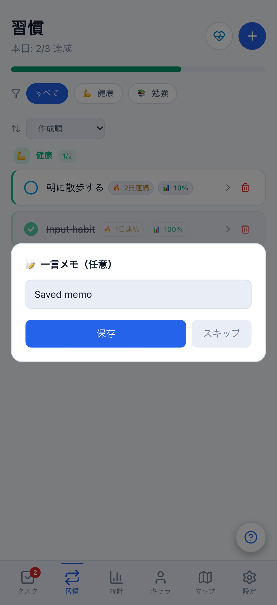
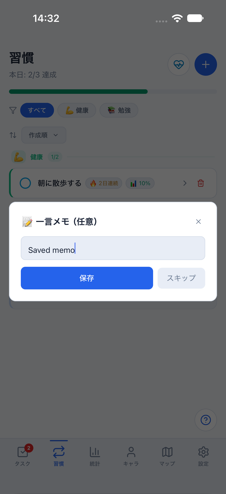
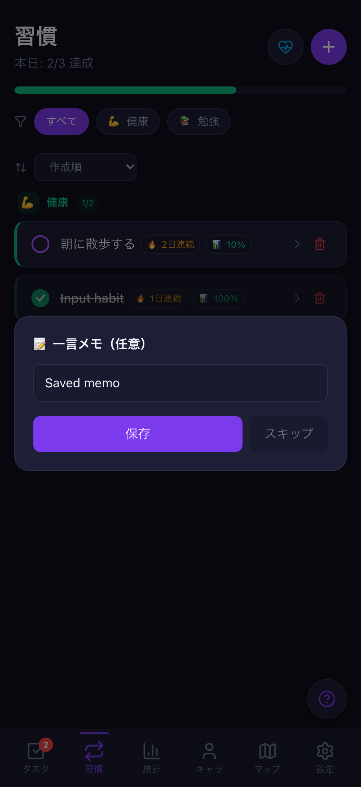
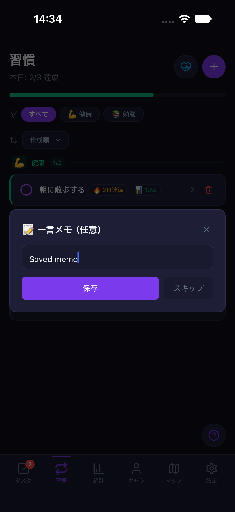
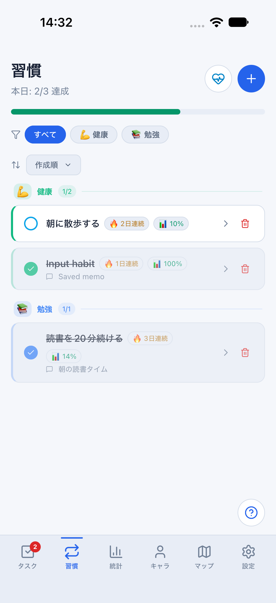
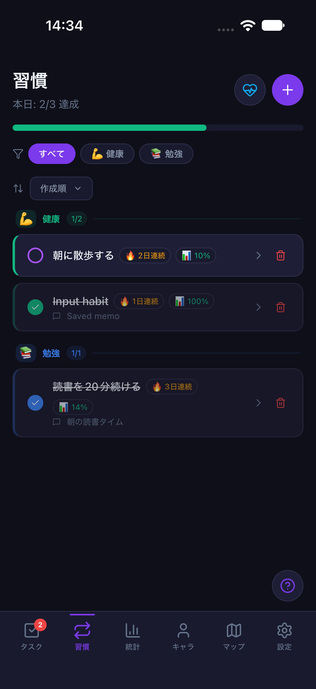
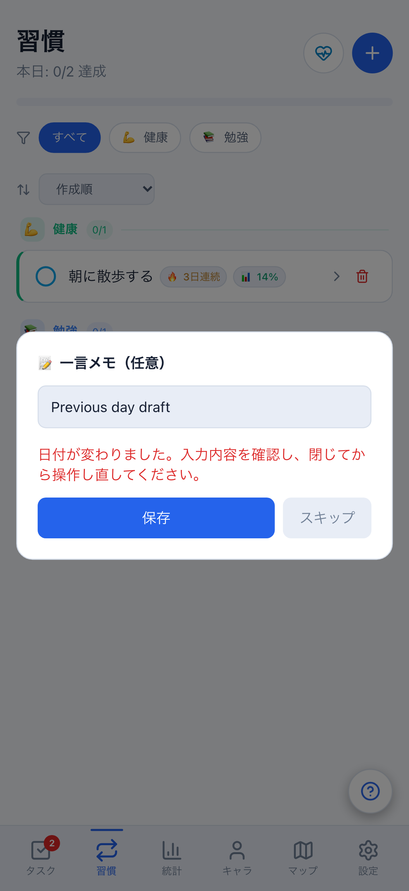
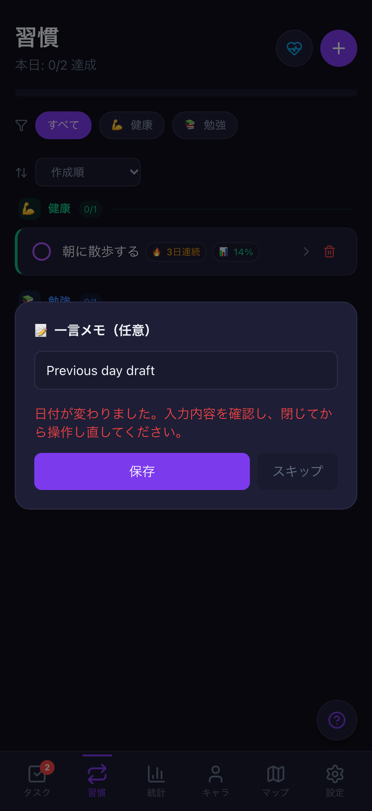

# 習慣追加・達成メモ・お休み確認の入力品質（#773）

計画④の継続です。タスクフォーム（#771 / PR #772）に続き、Web/Mobileの習慣入力を保護します。

## 修正と方針

- 未保存の習慣名/カテゴリ、達成メモ、履歴表示、お休み確認は認証切替で破棄します。
  ログアウト後に同じユーザーへ戻っても旧操作は復活しません。保存済み匿名データの移行は変更しません。
- 取消・再開、画面破棄、Mobileタブ離脱では旧callbackの所有権を失効させます。
  Webのメモ保存はボタン・Enter・背景クリック、Nativeはボタン・キーボード確定を同じ経路で検査します。
- 同一ユーザー通知と、同じ内容のpullでは現在の入力を維持します。
- 達成メモは習慣と記録の固定値を捕捉し、保存直前に再確認。対象/記録の削除・変更・
  未達成化などの競合では下書きを残し、上書き/送信せず再操作を案内します。
- メモとお休み確認の日付は開いたときに固定し、日付が変われば書き込みません。
  新しい達成操作は、画面表示時ではなく操作時のJST日付を使います。
- お休みを別操作/同期ですでに設定済みなら重複送信しません。古いAlertの取消も新しい確認へ干渉しません。
- Webの習慣達成ボタンとNativeメモ操作のアクセシビリティラベルを明示しました。

これはローカルの入力/確認の保護です。サーバーrevision排他制御や、すべての同期競合の解決ではありません。
DB・API・保存形式・報酬計算は変更しません。達成時の報酬と、任意メモの保存は別に扱います。

## 回帰テスト

```bash
npx vitest run src/hooks/habitInputSession.test.tsx packages/core/src/habitMemoEditGuard.test.ts \
  src/stores/useHabitStore.session.test.ts apps/mobile/src/stores/useMobileHabitStore.session.test.ts \
  scripts/run-mobile-parity-screenshots.test.mjs
npx playwright test e2e/habit-input-quality.spec.ts --project=desktop-chromium --project=mobile-chromium
```

実画面と実ストアを使い、NativeのOS/UIのみモック化します。認証切替・再描画前・取消/再確認・
同値pull・メモ競合・日付境界・二重保存・Nativeタブ離脱と、既存報酬の境界を検証します。
Web実ブラウザーはPC/402px・両テーマで保存・再読み込み・お休み取消/確定・日付変更時の拒否を確認します。

## iOS操作

通常の8081は止めず、クラウド未設定のメモリ専用daily比較環境を8082で起動します。

```bash
npm run start:reference:light --workspace @life-quest/mobile -- --port 8082
node scripts/run-mobile-parity-screenshots.mjs habitInput
```

darkは8082のみ停止し`start:reference:dark`へ切り替えます。runnerはparity・local-only・daily・
両テーマを検査し、通常データのclearStateは行いません。追加・メモの入力/保存・フォームのタブ離脱・
お休みの取消/確定を操作します。端末の日時は変更しません。日付境界/認証切替は自動回帰の証拠と区別します。

検証後は8082だけを停止し、Simulatorを通常8081へ戻します。

```bash
xcrun simctl openurl booted 'lifequest-parity://expo-development-client/?url=http%3A%2F%2F127.0.0.1%3A8081&disableOnboarding=1&disableAutoLaunch=1&disableFab=1'
```

## 残る確認

2026-10-19: WebのPC/402px・light/dark計8ケース、全ユニット2,430件（98 skip）、
core 629件、型検査・lint（既存6警告/0エラー）・Webビルド・Android exportが成功。
iOS 27 / iPhone 18 Proのlight/darkも全操作が成功しています。メモリfixtureの操作確認は
実データの永続化証拠ではなく、Webの再読み込み検証とは区別します。

同じdailyデータに健康カテゴリの`Input habit`を追加し、`Saved memo`を入力した状態です。
OS固有の閉じるボタン・文字描画・safe areaは一致対象外です。

| Web light・メモ入力 | iOS light・メモ入力 |
| --- | --- |
|  |  |

| Web dark・メモ入力 | iOS dark・メモ入力 |
| --- | --- |
|  |  |

| iOS light・保存後 | iOS dark・保存後 |
| --- | --- |
|  |  |

Webの日時だけを進めた日付変更時の拒否表示です。Simulatorの日時は変更していません。

| Web light | Web dark |
| --- | --- |
|  |  |

最終HEADのCI・独立レビュー・操作画像はPRへ記録します。今回の入力保護は、習慣画面の全面統一、
すべての直接削除・履歴操作、全画面の文字拡大/Android実機、stagingでの実アカウント同期・認証/通知を
合格にするものではありません。計画④は継続中です。
