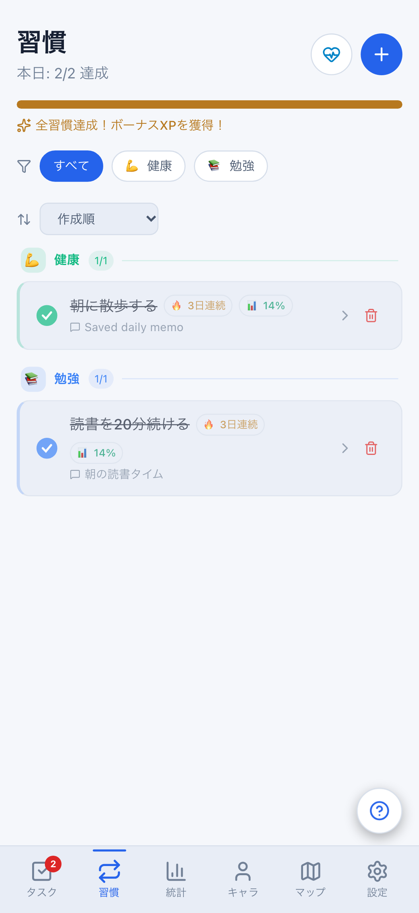
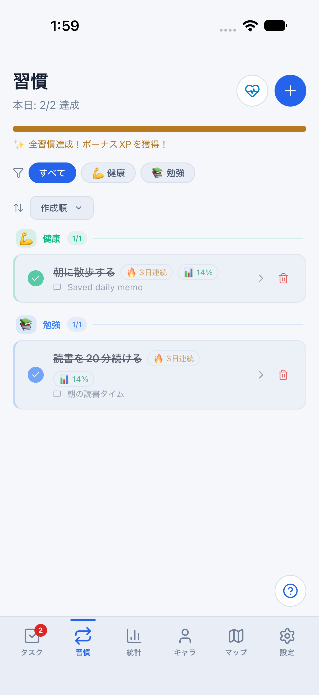
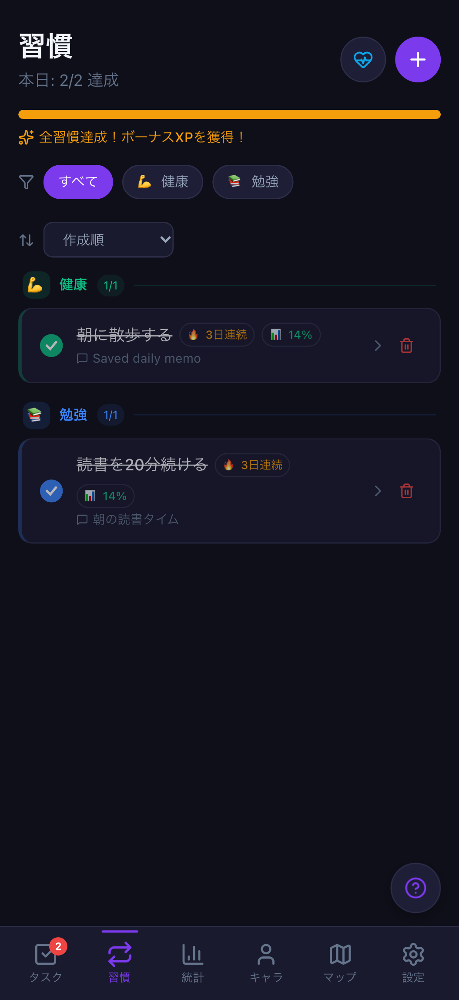
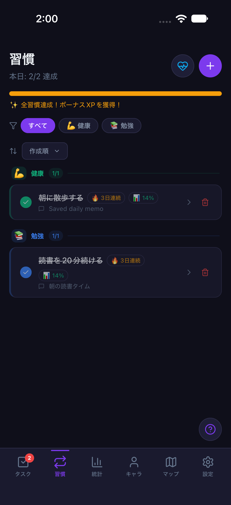
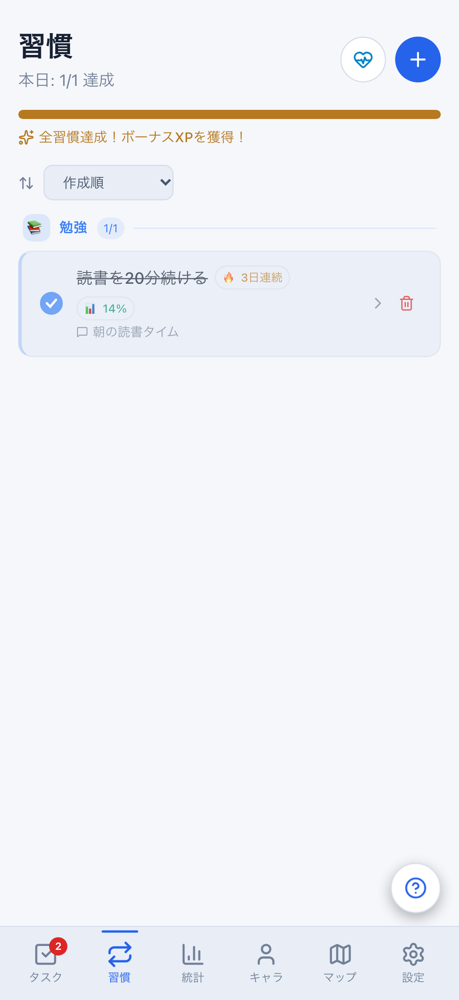
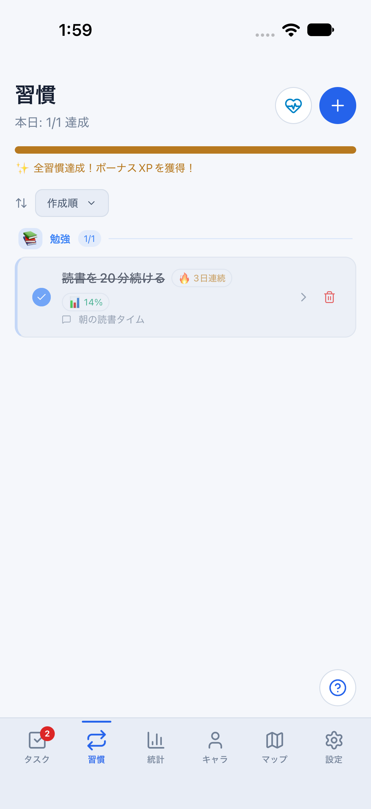
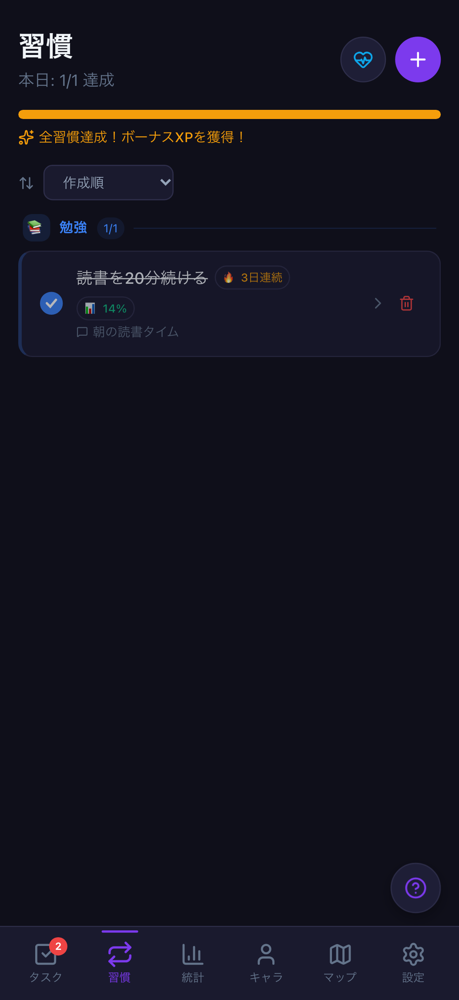
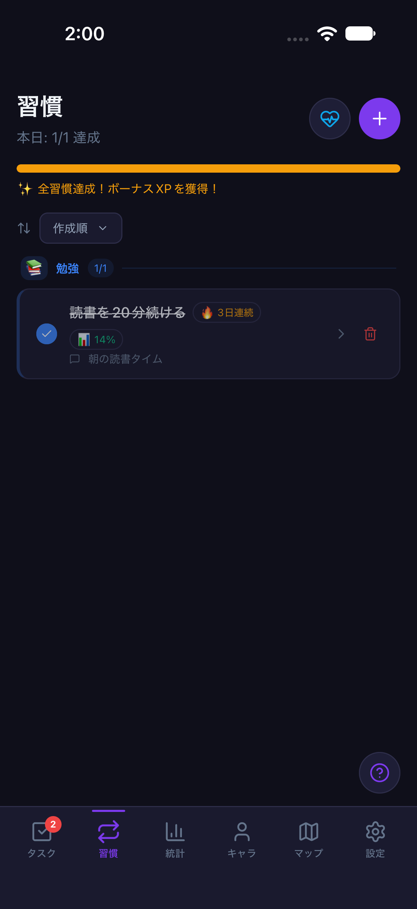

# 習慣一覧の達成操作・日付境界・カテゴリ復帰

Issue: [#781](https://github.com/YuTakane256/Life-Quest/issues/781)。計画④の日常操作品質。

## 変更

- Web/Mobileの達成・未達成操作は、表示した習慣の全定義と当日記録（未作成も区別）を値で固定する。
  同期等で対象・達成状態・メモが変更/削除された場合は拒否し、最新一覧を確認して再操作するよう案内する。
- 表示日と操作日のJSTが異なる場合は何も書き込まず、一覧と統計表示を更新する。再操作時に当日の記録を作る。
- 同じcallbackは一度だけ実行する。新しい一覧からの未達成化・再達成は維持するため、時間による一律デバウンスではない。
- 認証切替・破棄・Nativeタブ離脱で画面寿命を更新する。復帰後も旧行や旧追加/休息/削除確認の開始操作を受け付けない。
- 一時カテゴリ選択は認証切替/Nativeタブ離脱時にリセットする。同一ユーザー通知・同値pull・通常操作では維持する。
  選択カテゴリの最後の習慣を削除/移動した場合は全件へ戻し、非表示のフィルターで空一覧に閉じ込めない。

`actionError`は通知ごとに新しい値を設定する。同じエラー文でも日付や画面寿命を再描画できるようにし、
StrictModeで初回の旧画面寿命が残らないようにする。Webのストリーク/達成率キャッシュは日付・休息日も再計算条件に含める。

## 検証

- 実際のWeb/Native画面＋実ストアをStrictModeで検証する `src/hooks/habitInputSession.test.tsx`。
  通常の達成/未達成・メモ保持、再実行、対象/当日記録の競合、認証切替/再描画前の切替/破棄、
  Nativeタブ離脱/復帰と復元前、カテゴリの維持/リセット/削除後復帰を含む。
- 共有の値比較は `packages/core/src/habitCompletionGuard.test.ts`。
- Webは `e2e/habit-list-actions.spec.ts` と既存入力回帰をPC/402×874、light/darkで実行する。
  達成→メモ保存→未達成化→再読込、日付またぎの拒否→再操作→再読込、カテゴリ最終項目の削除後復帰を確認する。
- iOSは `npm run mobile:parity:screenshots -- habitList`。ソフトウェアキーボード入力でメモ保存後、未達成化、
  カテゴリ選択→タブ復帰、カテゴリ最終項目の削除後復帰をlight/darkで確認する。
  Nativeのメモ文字は履歴ボタンのアクセシビリティラベルにまとめられるため、画像で表示を確認し、値は実ストア回帰で検証する。
  日付/アカウント競合の自動回帰と、Simulator上の通常操作の合格は区別する。

## 比較画像

同じ架空匿名データ、2026-08-10、402×874。Webはスマホ幅、iOSはiPhone 18 Pro/iOS 27。
完了画像は「朝に散歩する」を達成して `Saved daily memo` を保存した直後。
OSステータスバー、描画微差、ネイティブ操作は一致対象外。READMEの画像は増やさない。

| 状態 | Web | iOS |
| --- | --- | --- |
| light・達成/メモ保存 |  |  |
| dark・達成/メモ保存 |  |  |
| light・カテゴリ最終項目の削除後 |  |  |
| dark・カテゴリ最終項目の削除後 |  |  |

## 境界

DB・同期API・保存形式・報酬計算に変更なし。値比較はローカルのUI競合防止であり、サーバーの排他制御ではない。
同じ値へ戻った変更まで検出するバージョン管理ではない。日付変更の自動ポーリングは追加せず、操作時に確認する。
同日のお休み中の達成、同値pull、同一ユーザー通知は維持する。

比較データはparity専用・クラウド未設定・メモリ専用環境のみ。通常8081や保存データは変更しない。
Nativeの再起動永続化、Android実端末、staging実認証・通知、履歴を含む全画面の品質完了は主張しない。
既存CI3つとPR後の独立レビューを確認し、自動マージしない。
