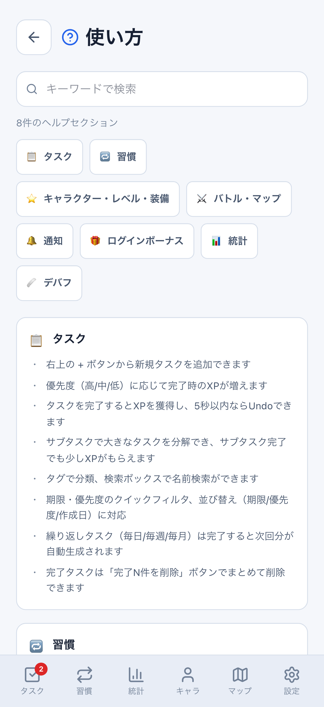
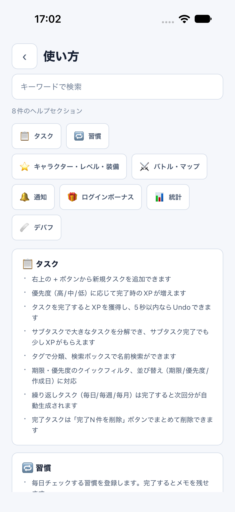
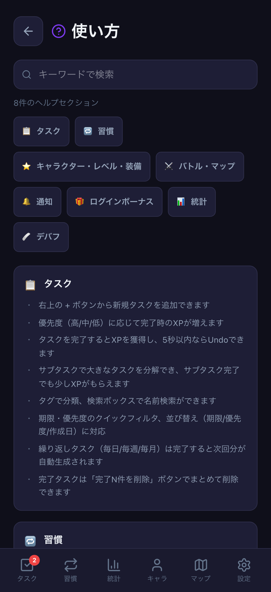
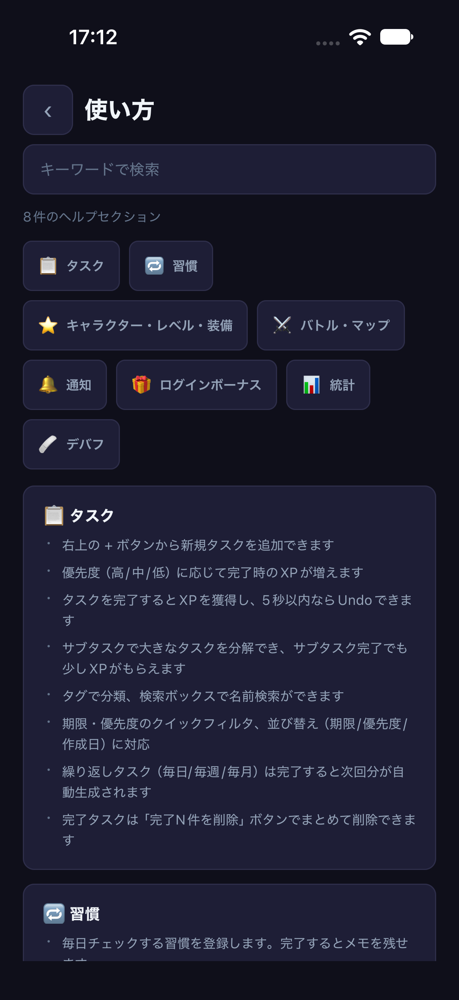
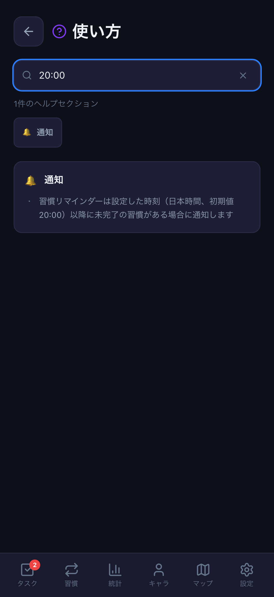
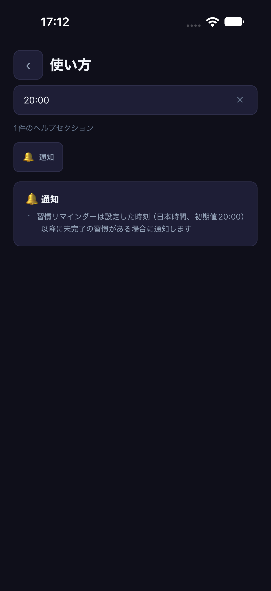
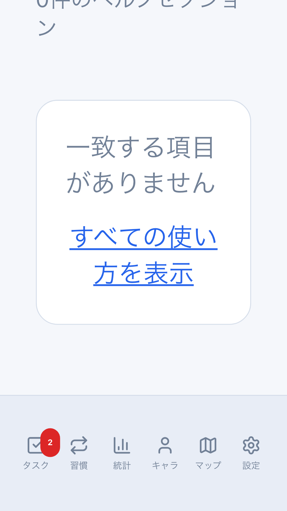
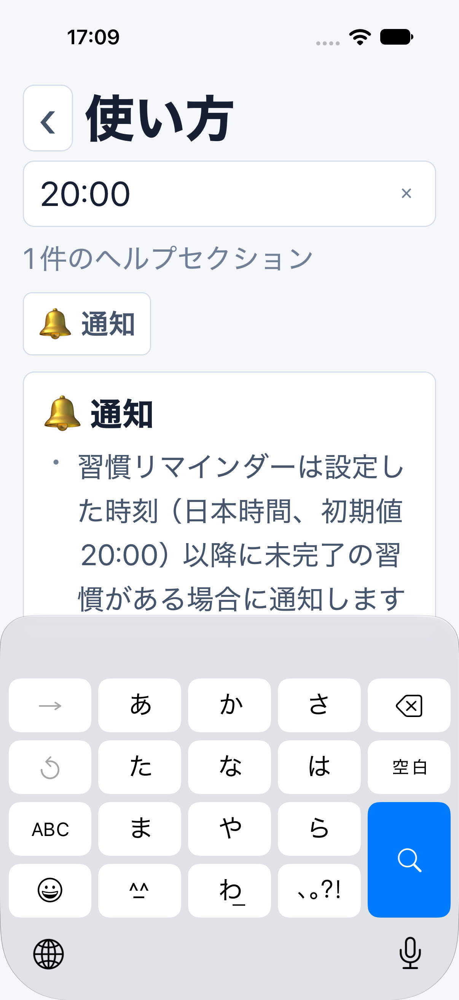

# ヘルプの検索・セクション移動・拡大文字

Issue: [#787](https://github.com/YuTakane256/Life-Quest/issues/787)。計画④の日常操作と画面条件の確認。

## 変更

- Web/Mobileで、検索結果に残っているセクションだけを移動ボタンに表示する。
  件数、検索クリア、該当なしから「すべての使い方を表示」への復帰を揃える。
  既存の共有検索（前後空白・大文字小文字を無視し、見出しまたは本文を検索）は維持する。
- Nativeは保存したリスト内のyではなく、対象カードの実座標をscroll contentから計測する。
  検索変更/ABA、別ジャンプ、画面離脱、画面サイズ/文字サイズ変更、手動スクロール後の旧計測を使わない。
  キーボード表示中でも1回のタップでジャンプし、キーボードを閉じる。
- Webはジャンプ先の見出しにフォーカスを移し、その後のキーボード操作を続けられる。
  両クライアントで「動きを減らす」を尊重し、ジャンプをアニメーションしない。
- 移動ボタンを折り返し、検索欄とボタンの高さを内容に合わせる。戻る/クリア/移動等は44pt/px以上の領域を確保する。
  Nativeで戻る履歴がないときは設定へ戻す。
- 通知説明を、実装済みの端末通知・選択した日本時間のリマインダー時刻・期限切れを含む期限通知に合わせる。
  通知処理や報酬ルールは変更しない。

## 自動検証

- `HelpPage.test.tsx` / `HelpScreen.test.ts`: 実UI（Native部品はDOMスタブ）。検索/復帰、
  相対座標、古い計測の拒否、文字サイズ/画面変更、動きの設定、フォーカス/戻りを検証する。
- core `help.test.ts`: 既存検索の非破壊性と正規化、現在の通知説明を確認する。
- `help-navigation-quality.spec.ts`: PC/402×874、両テーマの検索/ジャンプ/戻りと、
  320×568・文字200%での横はみ出し/ボタンの折返し/操作復帰を検査する。
- Webの検索欄はブラウザー内蔵のクリアと独自ボタンが重ならないようにし、文字拡大時もアイコン用の余白を固定する。
  該当なしの復帰ボタンが下部ナビゲーションに隠れない位置で操作できることも検査する。
- `npm run mobile:parity:screenshots -- help`: 固定parity ID、クラウド未設定・dailyメモリfixture・8082だけで実行する。
  実ソフトウェアキーボードのSearchキーを検査するため、フォーカスだけでは合格にしない。
  通常parityのデータ消去やクラウド認証は行わない。

## 比較

架空の匿名daily fixture、402×874、両テーマ。ヘルプ本文はWeb/Mobileで共有する。
Webの下部ナビゲーションとNativeの独立画面/固定ヘッダー、OSのフォント/絵文字/ステータスバーは差として残す。
ピクセル単位の全画面一致を主張するものではない。READMEの画像は増やさない。

| 状態 | Web | iOS |
| --- | --- | --- |
| light・全表示 |  |  |
| dark・全表示 |  |  |
| dark・時刻説明の検索 |  |  |

文字拡大の確認はピクセル一致ではなく、操作と表示の検証として分ける。

| Web・320×568/文字200% | iOS・402×874/アクセシビリティ拡大文字 |
| --- | --- |
|  |  |

## 390px既存画像回帰の切り分け

既存の6画像テストは、習慣/統計/設定の3件成功、タスク/キャラ/インベントリの3件に微小差が出た。
マージ済みmain `b6aa1a94` の専用worktreeでも同じ3件が失敗した。
mainと本変更の実出力を比較するとタスク/キャラは完全一致、インベントリは下部の4ピクセルだけの色差だった。
既存基準に対するmainの差はタスク19px・キャラ36px・インベントリ54px。
本PRでは基準画像の更新や許容値拡大は行わず、このローカルの既存差を成功扱いにはしない。

## 今回の実行記録（2026-10-21）

- 全体2,850件・core703件・関連4suite65件成功。型検査、lint（既存6warnings/error0）、build、check:secrets成功。
- 新規Web E2E8件成功。PC/402px・両テーマ、および320×568/文字200%で確認した。
- iOS27/iPhone18Proでlight通常文字、light `accessibility-large`、dark通常文字の3フローが成功。
  実Searchキーの表示、入力、キーボード中のジャンプ/非表示、該当なし復帰、クリア、設定への戻りを検査した。
- 初回のWebは別のstatus通知とのセレクタ競合、Nativeは上端欄の中央配置条件、
  キーボード非表示の検証設定、拡大文字ページの探索時間不足で停止した。
  これらは成功件数に含めず、条件修正とキーボード実表示後に再実行した。
- Simulatorの文字サイズは検証前の `large`、ソフトウェアキーボードも元の非表示へ戻した。検証用8082と専用parityアプリは終了済み。

## 境界

DB/API/保存形式/報酬計算の変更なし。検索は画面内だけの一時状態で、ゲームデータに書き込まない。
入力テストは架空文字列だけで、外部送信や通知許可要求も行わない。
本PRの範囲を、全画面のアクセシビリティ合格、VoiceOverの全面確認、Android実端末、
staging双方向同期や実機認証の確認済みとは扱わない。
⑤の署名済み実機配布/公開準備へ進んだものではない。

PR後に独立レビューと最終HEADのCI3つを確認し、自動マージしない。
