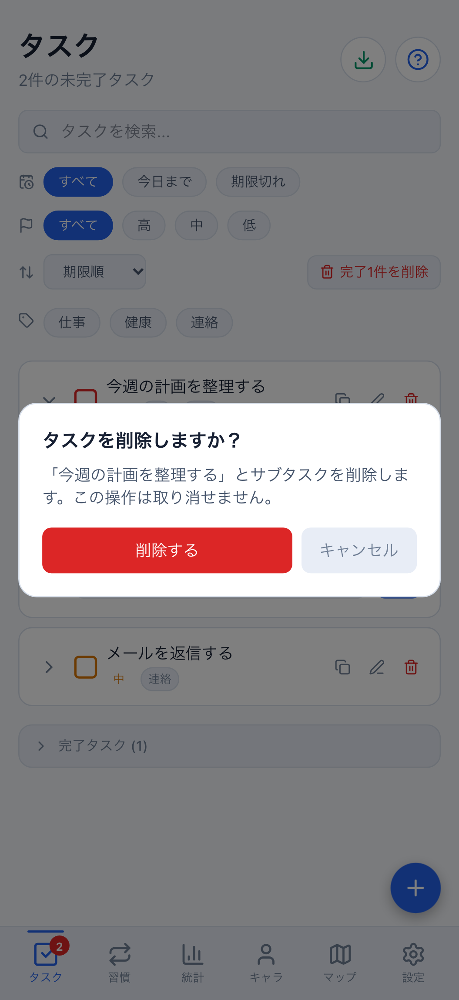
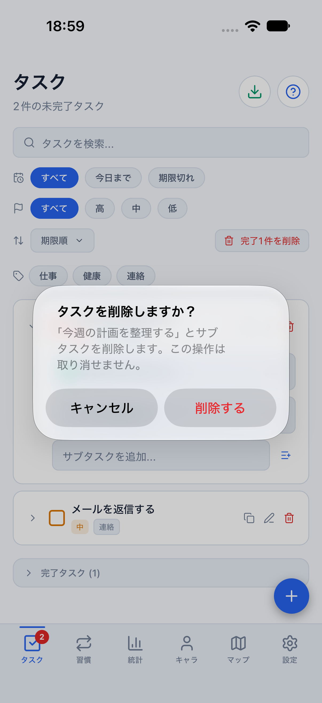
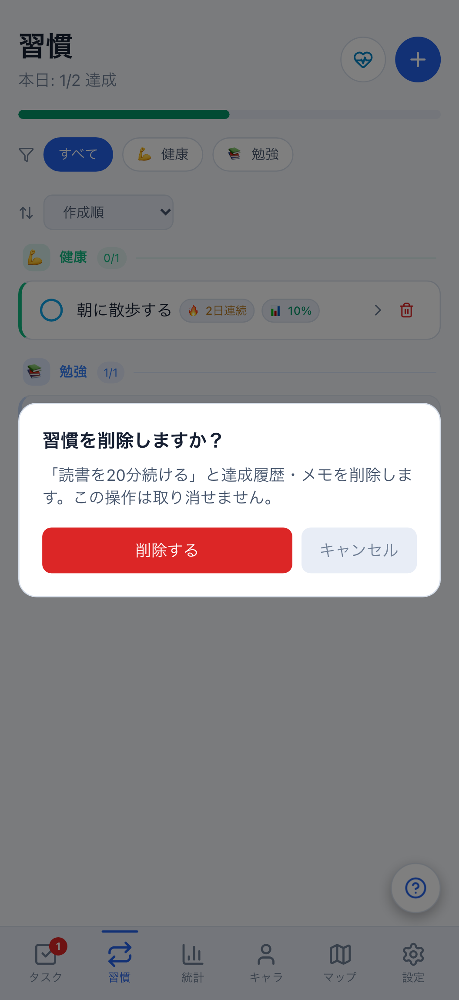
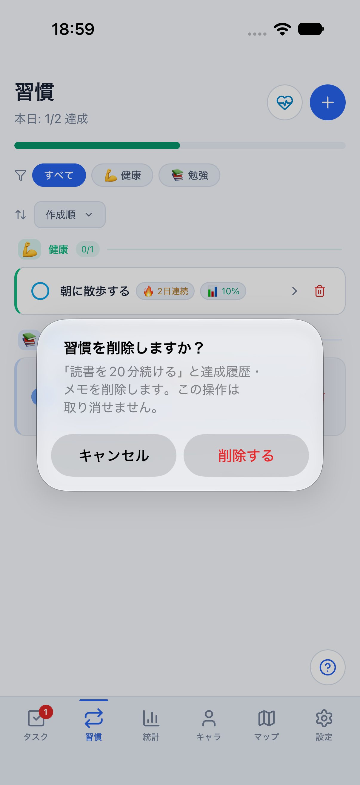
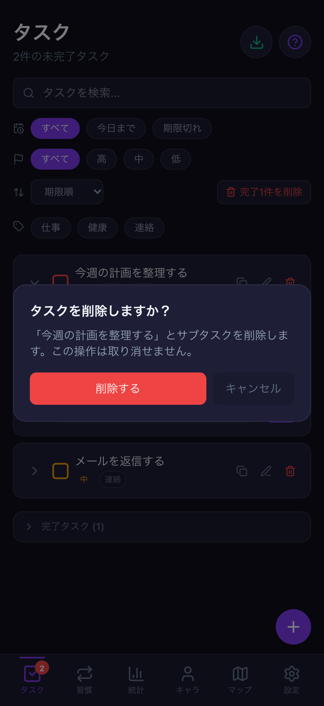
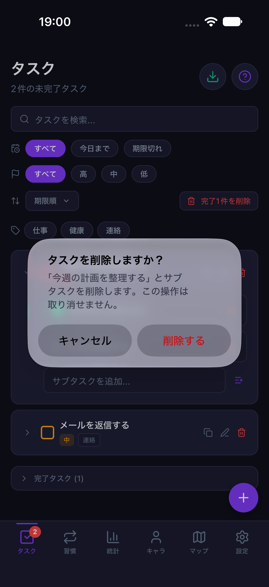
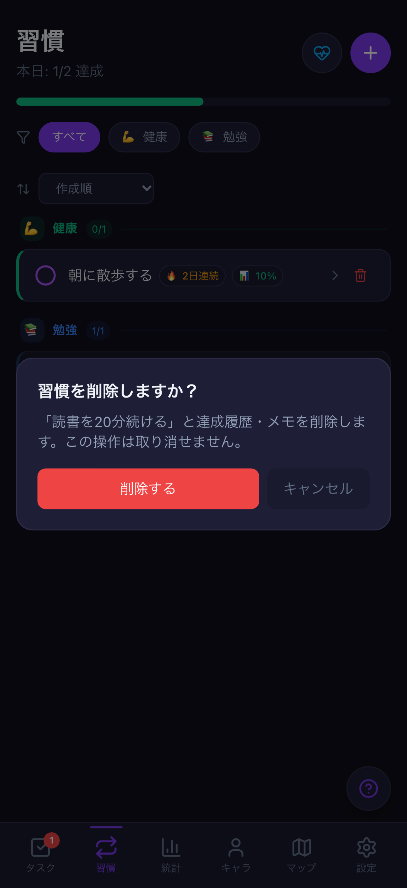
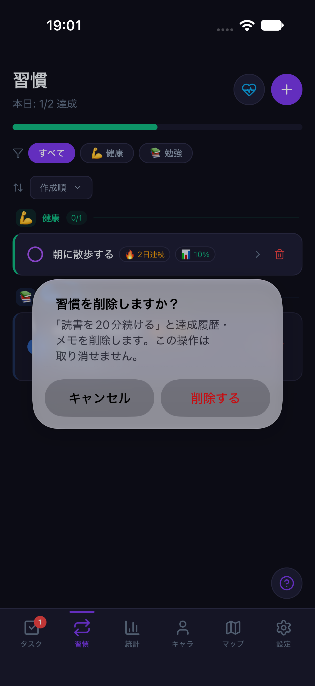

# 個別タスク・習慣削除の確認と操作帰属（#775）

計画④のうち、一覧からの個別削除をWeb/Mobileで揃えるまとまりです。
削除ボタンを押すだけで消える状態を改め、対象名・削除範囲・取り消せないことを確認します。
タスクはサブタスク、習慣は達成履歴・メモも削除されることを明記します。

## 保護する境界

- キャンセル・確認の再開・二重確定：確認ごとのトークンで一度だけ削除します。旧取消も新しい確認を閉じません。
- 認証切替・ログアウト・同じアカウントへの戻り・アンマウント：古い確認を無効化します。Nativeではタブ離脱後も無効のままです。
- タスクの内容・サブタスク・完了/Undo待機状態の変更：削除せず、内容を確認して操作し直すよう案内します。
- 習慣の内容・達成記録・履歴メモの追加/変更/削除：履歴ごと削除せず再確認を案内します。
- 同一ユーザー通知・同値pull・習慣記録の順序だけの変更：確認を維持します。他の習慣の記録変更では妨げません。

比較はローカル状態の値を固定した楽観的チェックです。サーバーのリビジョン排他制御ではなく、
変更後に全く同じ値へ戻った履歴まで識別するものではありません。既存の一括削除・複製Undo・報酬計算は維持します。
DB・同期API・保存形式の変更や通常データの初期化は行いません。

Webは既存の確認ダイアログ、NativeはOS標準Alertを使います。内容と結果を一致させ、
ボタン順・OSの書体/角丸・ステータスバーは画面一致の対象外とします。
Webの競合エラーは確認内に表示し、閉じて再確認するまで確定を無効化します。

## 確認結果

- React StrictModeで実画面と実ストアを接続し、Web/Nativeそれぞれのタスク・習慣を回帰確認。
  変更された対象/履歴の保持、認証の再描画前切替、取消・再開、タブ離脱、重複送信を検査します。
- 共有コアの習慣削除承認テスト：13件。既存のタスク編集スナップショットも再利用します。
- Web：PC幅と402×874、ライト/ダークで通常削除・取消/Escape・再読込、確認中の同期変更と再確認を検証。
  個別削除16ケースと既存一括削除4ケースが成功しています。
- iOS Simulator（iPhone 18 Pro、iOS 27、402×874）：両テーマでタスク/習慣の取消→再確認→削除、他の項目の保持を確認。
  日時は2026-08-10、共有daily fixture、クラウド未設定の専用parity環境です。
- iOSの操作確認は8082のメモリ専用環境です。永続化はWebの再読込検証と区別します。
  通常の確認用Metro8081と、ユーザーの匿名/サインイン済みデータは変更しません。

## 同条件画像

タスク確認は初期fixture、習慣確認は同じタスク1件を削除した後で比較します。
画像は見た目の確認資料であり、送信・永続化の証拠は上記の操作テストです。

| 状態 | Web 402×874 | iOS 402×874 |
| --- | --- | --- |
| タスク・light |  |  |
| 習慣・light |  |  |
| タスク・dark |  |  |
| 習慣・dark |  |  |

## 再実行

```sh
npx vitest run src/hooks/individualDeletion.test.tsx packages/core/src/habitDeletionGuard.test.ts
npx playwright test e2e/individual-deletion.spec.ts e2e/completed-task-deletion.spec.ts --project=desktop-chromium --project=mobile-chromium
npm run mobile:reference:light -- --port 8082
# 別ターミナル。darkは上の一時サーバーだけ終了してmobile:reference:darkへ切り替える
node scripts/run-mobile-parity-screenshots.mjs individualDeletion
```

サブタスクの個別操作/直接入力全般、全画面の長文・拡大文字、Android実端末、
stagingでの双方向同期・署名付き認証/通知/Apple失効確認は、このPRの完了条件に含めません。
