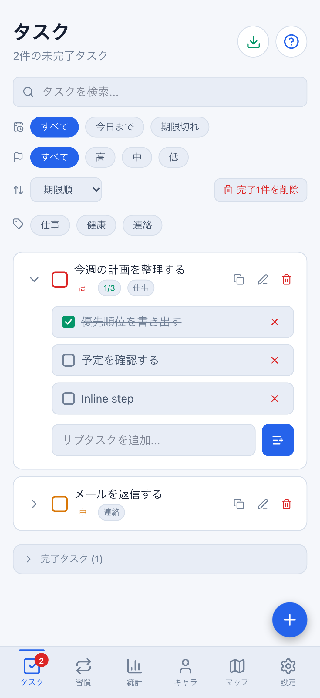
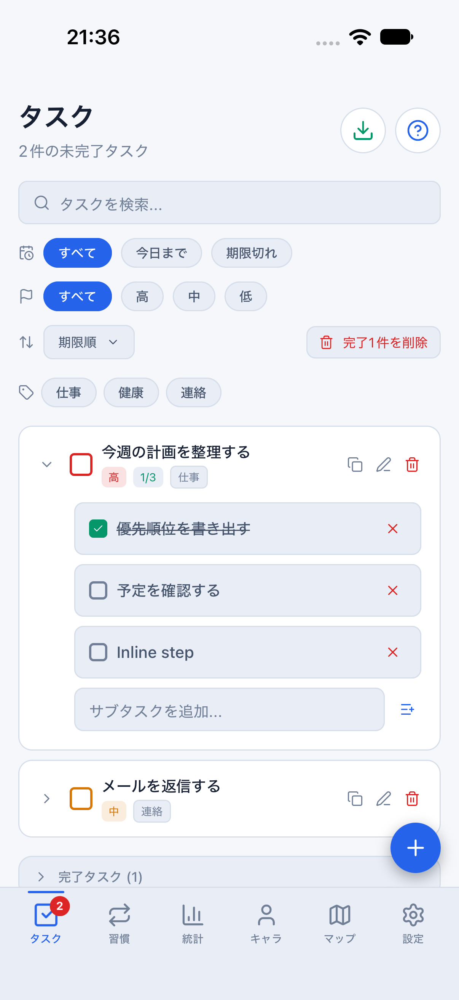
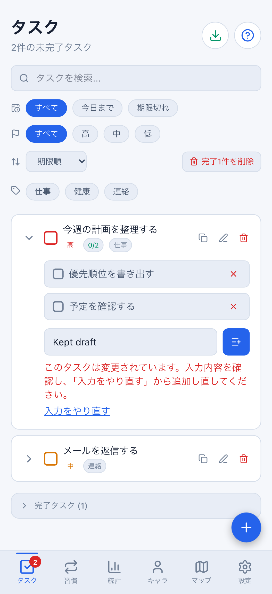
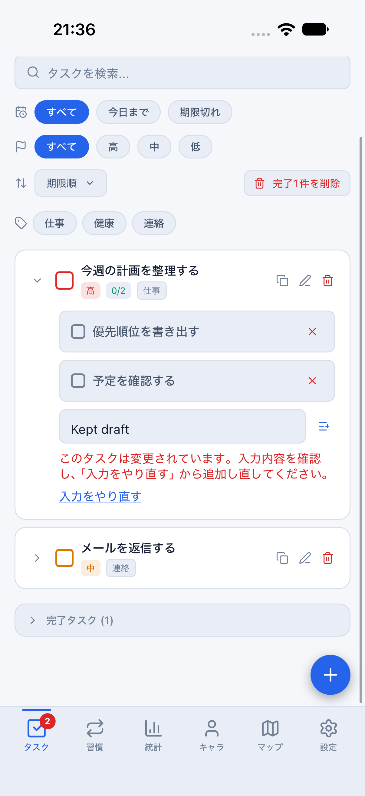
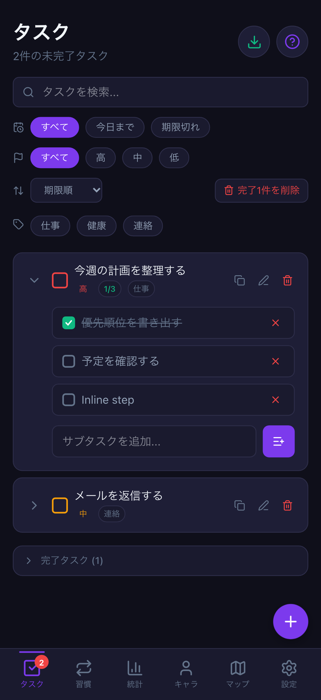
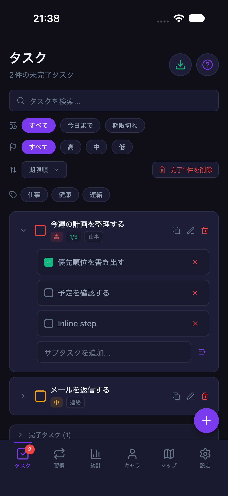
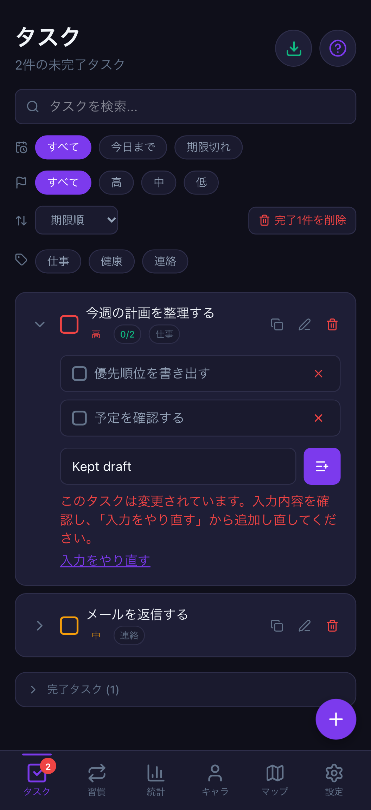
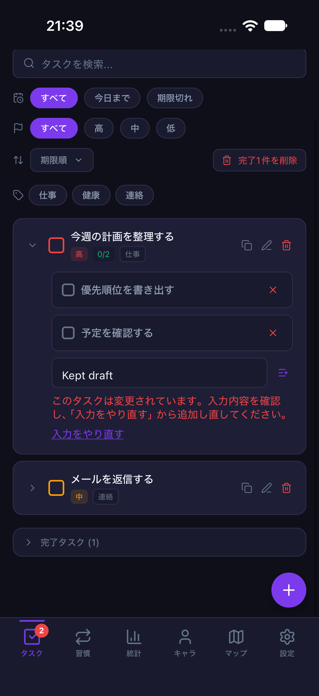

# 一覧サブタスクの入力・直接操作品質（#777）

計画④のうち、タスク一覧内のサブタスク追加・完了・未完了・削除を保護します。
新しいゲーム機能や報酬計算ではなく、既存操作の帰属と入力失敗時の扱いを揃える変更です。

## 変更

- 入力開始時の親タスク全フィールド・子タスク一覧を既存の`captureTaskEdit`で固定します。
  同期や他の操作で対象が変わった場合は、追加せず下書きとエラーを表示します。
- 同一ユーザー通知・同値pullでは入力を維持します。空入力・空白だけでは送信しません。
- 上限等で追加できなかった場合も入力を消さず、原因と「入力をやり直す」を表示します。
  Webストアの追加結果もMobileと同じbooleanで返し、成功時だけ下書きを消します。
- 認証切替・ログアウト・同じアカウントへの戻り、画面のアンマウント後は旧入力/追加/完了/削除を拒否します。
  Nativeではタブ離脱時にも下書きを破棄し、復帰後の旧コールバックを拒否します。
- 一覧を折りたたんで再展開した場合も、両版で未保存入力を破棄します。
  対象の削除や完了グループへの移動など、入力欄自体がアンマウントされる場合も同様です。
- 通常の完了・未完了・削除は即時操作のままです。描画した親/子の状態が古ければ実行しません。
  同じコールバックの連打による反転や余分な送信を防ぎます。

これはローカルの値比較で、サーバーのリビジョン排他制御ではありません。
変更後に全く同じ値へ戻った履歴は区別しません。DB・同期API・保存形式・報酬計算は変更しません。
入力中の競合検出と、クラウド送信の成功/失敗表示は別です。追加成功はローカル保存・既存outboxへの委譲を指します。

## 検証

- `src/hooks/inlineSubtaskSession.test.tsx`：34件。
  実際のWeb/Native画面とストアを使用し、実際の旧JSX/Nativeコールバックを保持して
  認証の再描画前切替、タブ復帰、折りたたみ/再展開、同値pull、二重操作、上限、Native復元待ちを検証します。
- Web：PC幅と402×874、light/darkで追加・完了・未完了・削除、競合後の入力保持・やり直し、再読込後の状態を検証します。
- iOS Simulator：iPhone 18 Pro / iOS 27 / 402×874、light/darkの共有daily fixture。
  ソフトウェアキーボードから追加し、競合時の入力保持・やり直し、タブ離脱時の破棄を実操作で確認します。
  8082のメモリ専用parity環境のみ使用し、通常Metro8081や通常データは変更しません。
- iOSのメモリ上の操作確認と、Webの再読込による永続化確認は区別します。

## 同条件画像

共有の架空匿名データ・2026-08-10・同じ操作順で撮影します。
競合例は初期fixtureに戻し、最初の子タスクを未完了に変えてから「Kept draft」を追加しようとした状態です。
OSステータスバー・キーボード・スクロール位置・文字描画の微差は一致対象外です。

| 状態 | Web 402×874 | iOS 402×874 |
| --- | --- | --- |
| 追加成功・light |  |  |
| 競合・light |  |  |
| 追加成功・dark |  |  |
| 競合・dark |  |  |

## 再実行

```sh
npx vitest run src/hooks/inlineSubtaskSession.test.tsx
npx playwright test e2e/inline-subtask-quality.spec.ts --project=desktop-chromium --project=mobile-chromium
npm run mobile:reference:light -- --port 8082
# 別ターミナル。darkは上の一時サーバーだけ終了してmobile:reference:darkへ切り替える
node scripts/run-mobile-parity-screenshots.mjs inlineSubtask
```

全画面の拡大文字・Android実端末・stagingの双方向同期/実機認証・通知まで合格したとは扱いません。
