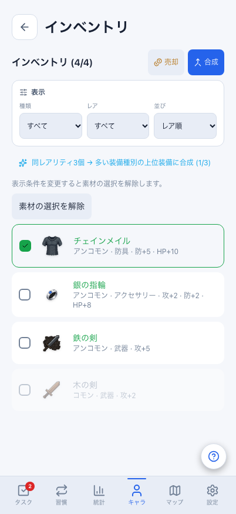
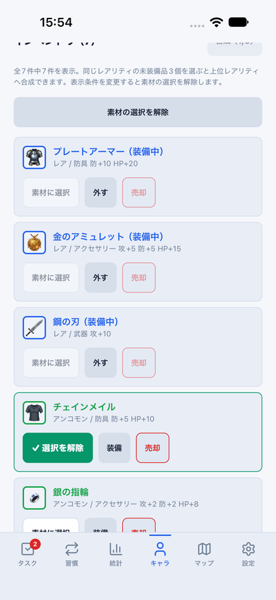
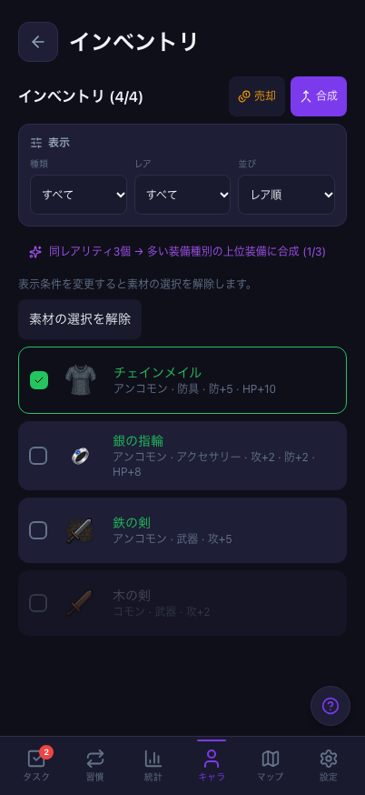
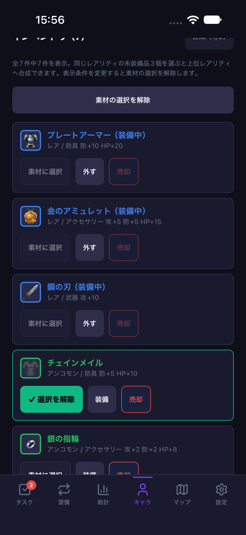
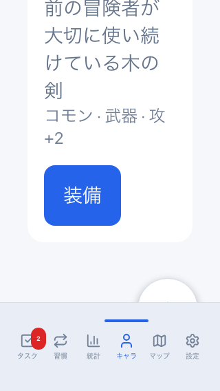
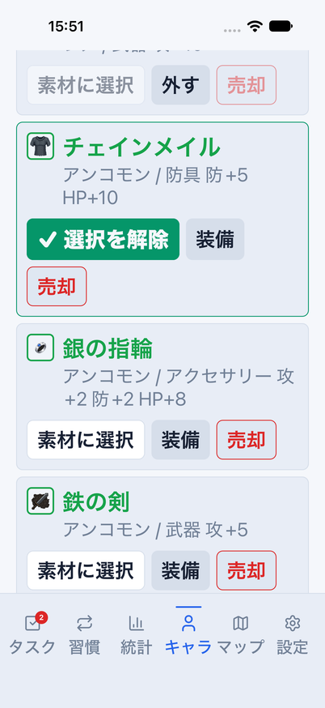

# インベントリの素材選択・絞り込み復帰・一覧操作

Issue: [#799](https://github.com/YuTakane256/Life-Quest/issues/799)。計画④の日常操作品質の続き。

## 変更と境界

- 合成素材はIDだけでなく、選択時の装備の全フィールドをコピーして保持する。
  同IDの装備でも名前・性能・装備状態等が変わる、削除される、装備中になる場合は選択を解除して通知する。
  同値のpull、並び順だけの変化、選択外の装備追加では選択を維持する。
- 選択は同じレアリティの未装備品3個まで。レジェンダリーは選べず、選択済みの解除は上限時もできる。
  Web/Mobileで共有する。全素材の明示的な選択解除も追加する。
- 種類・レア・並び順・Webの売却/合成モードを変更すると選択を解除する。
  表示の世代と素材選択の世代を別々に管理し、変更前の行操作/合成callback/確認ダイアログを拒否する。
  認証切替、Nativeのタブ離脱/復帰でも旧操作を拒否し、フィルターを初期化する。
- 装備変更で消えた選択が古いIDの復帰で再び選択されないよう、描画だけでなく選択state自体を整理する。
  遅れて返った合成結果/再送結果で、後から選び直した素材を解除しない。
- 絞り込み0件と未所持を区別し、表示条件のリセットを追加する。
  Webのselectに明示的なラベルを付け、Nativeの選択肢はradioのchecked状態を伝える。
- 装備名/性能を省略せず折り返し、フィルター・素材選択・装着/解除・売却を44px/pt以上にする。
  NativeはFlatListの仮想化を維持する。アクセサリーの名称と種類順のラベルもWebに合わせる。

DB/API/保存形式/報酬量/合成抽選は変更しない。既存storeと送信入口を使用する。
反映済み一覧との照合であり、サーバー排他制御や送信開始後の別端末更新の防止ではない。
Nativeの独立インベントリ画面や売却/合成モード全面統一、Android/実端末、⑤への移行は対象外。

## 自動検証

- 対象4ファイル148件成功。共有選択13件と実画面/store/送信入口の回帰を含む。
  3個上限/同レア、全フィールド変更、同値pull、古い素材callback、フィルター/モード/認証切替、
  Native確認中の離脱、遅い合成結果が新しい選択を消さないことを確認する。
  Native描画・ストレージ・通信先はテストで置き換えるため、実クラウド検証ではない。
- 全体3,008件成功/98件skip、core748件成功。Web/Mobile/core型検査成功。
  lintはerror0/既存warning6、秘密情報検査成功。
- Web E2E26件成功。今回の12件に既存インベントリ/装備操作を加えたもの。
  両テーマの選択→フィルター解除→0件復帰、売却取消、変更された素材の選び直し→合成、
  320×568/文字200%/長い名前/44pxの操作と保存値を確認する。
  既存2プロジェクトで実行し、通常の比較画面は402×874へ明示的に揃える。

### 390px基準画像

更新前は5件成功/3件失敗。キャラ・インベントリの差分を確認し、44px化/折り返し/表示条件の変更に
伴う該当2枚だけを更新した。再比較は7件成功/1件失敗で、タスク画面の既知のselect矢印19px差分だけが残る。
タスク画面の実画像SHA-256は`bf452f819c3595e4bf8e9962402038350ad8b950df969e2082100f813aae9cf3`で、
前PRのbase検証画像と同一。今回の回帰ではないが、この画像テストを成功扱いにはしない。
対象外の基準画像、比較の許容値、テスト条件は変更していない。

## iOS操作と比較

専用parity ID、8082、クラウド未設定、dailyメモリfixtureだけを使う。
`node scripts/run-mobile-parity-screenshots.mjs inventorySelection`で0件→リセット、素材選択/明示解除、
条件変更での解除、売却取消、装着→解除を確認する。通常データの永続化/同期の証拠ではない。

最終版のiOS実行結果と比較画像は確認後に追記する。

比較は共通の架空dailyデータ・固定日時・402×874で、チェインメイルを素材に選択した状態。
Webは独立インベントリの未装備4個、Nativeはキャラ内で装備中を含む7個を表示する。
ヘッダー/スクロール位置/OS描画の差と、この既存の画面構成差まで統一した画像ではない。

| テーマ | Web | iOS |
| --- | --- | --- |
| light |  |  |
| dark |  |  |

次は同条件の画素比較ではない。Web320×568/文字200%・検証用の長い名前と、
iOS402×874/accessibility-large・元の名前で、それぞれ一覧の折り返しと操作を確認する。
Webは対象の装備ボタンまでスクロール後に撮影する。全画面/ナビの拡大文字完了の証拠ではない。

| Web | iOS |
| --- | --- |
|  |  |

## 後続

実アカウントの双方向同期/競合、Android/実端末、読み上げ全面、独立インベントリ全面統一は後続。
README画像は増やさず、PR後の6.1 Sol・中の独立レビューと最終HEADのCI3件でマージ可否を判定する。
自動マージはしない。
