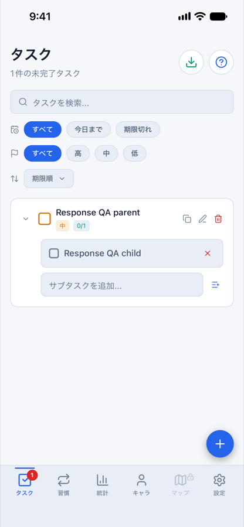

# iOSで認証更新の成功応答が失われても同期が自動で復帰する（2026-11-22）

計画④ [#699](https://github.com/YuTakane256/Life-Quest/issues/699) のR3／T08。main `4b13171b20fc387a36e9df54deb05053177dda01` を、iPhone 17e・iOS 27.0シミュレーター、parity開発ビルド、ローカルSupabaseで検証した。ローカルAuthの設定はJWT有効期間180秒、更新トークンのローテーション有効、再利用間隔10秒。使い捨てアカウントA・Bのログインボーナスを各20 XPで確定した。

1. Aの通常ログイン後に同期の接続を一時的に止め、画面から親子タスクを各1件作成した。DBは各0件で、端末には保留2件と送信順の依存関係が保存された。その状態でアプリを終了し、JWTが実際に期限切れになってから別プロセスで起動した。
2. SDKの最初の認証更新をローカルAuthに転送した。AにHTTP 200で更新後の認証情報が返り、更新トークンのローテーションを確認した時点で、中継が端末への接続をヘッダー送信前に閉じた。その後の認証更新も一時的に切断した。保護画面が開き、対象の同期要求は発生せず、元の表示と保留操作は端末に保持され、両アカウントのDBは開始時と一致した。MaestroのiOSドライバーが起動待ちでタイムアウトしたため、保護画面はシミュレーターのスクリーンショットで目視確認した。
3. 初回の成功から設定上の再利用間隔10秒を過ぎて接続を戻した。アプリは再ログイン・手動同期なしで元の更新トークンを再送し、Authが再びHTTP 200を返した。その応答から取得したアクセストークンで親送信・子送信・受信が順に成功し、操作キーと親子の行IDが元の保留操作と一致した。認証情報の比較は中継のメモリ内で行い、公開記録には一致の有無だけを残した。
4. AのDBに未完了の親・子が各1件、Bは各0件。両アカウントの総XPと報酬台帳は開始時と一致した。端末の保留は0件で、受信カーソルは子の版まで進み、設定は「同期済み」と表示された。

[認証情報と識別子を除いた照合結果](evidence/ios-auth-refresh-response-loss-20261122.json)を添付する。認証・起動復帰・実DB同期の既存テスト3ファイル60件が成功した。

ローカルAuthで、1回の更新成功応答が失われた起動を確認した。複数の成功応答が連続して失われる場合、処理中の同期操作を伴う期限切れ、端末の全回線断、同条件のWeb・実機・Android・stagingは引き続き確認する。
