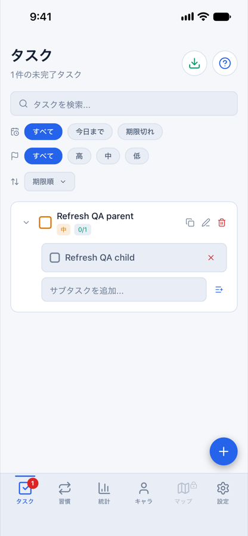

# iOSで起動時の認証更新が一時的に失敗しても同期が自動で復帰する（2026-11-22）

計画④ [#699](https://github.com/YuTakane256/Life-Quest/issues/699) のR3／T08。main `bf6fd6220ee89e71202463380c7d58f2194dba78` を、iPhone 17e・iOS 27.0シミュレーター、parity開発ビルド、ローカルSupabaseで検証した。ローカルAuthのJWT有効期間は180秒に設定し、使い捨てアカウントA・Bのログインボーナスを各20 XPで確定した。

1. Aでメールログインした。ローカル中継がアプリからの親子タスク送信と受信の接続を閉じる間に、画面から親子を各1件作成した。DBに親子が未登録で、端末に未送信操作2件と親子の送信順を決める依存関係が残ることを確認し、アプリを終了した。
2. AのJWTが実際に期限切れになるまで待ち、別プロセスでアプリを起動した。中継はSDKの更新要求8件をAuthに転送せず、接続を閉じた。保護画面が表示され、親子は画面から見えず、所有者・未送信操作・保存中の表示データは保持された。この間に対象の同期RPCは発生せず、A・BのDBは開始時と一致した。
3. 更新への接続を戻した。再ログイン・手動同期の操作をせず、SDKの更新にAuthが200を返した。新しいJWTの有効期限を持つAの要求で、親送信・子送信・受信が順に200となった。復帰前と同じ操作キーと行IDを照合した。
4. AのDBに未完了の親・子が各1件、BのDBは各0件だった。アプリで親タスクが再び表示され、設定は「同期済み」と表示された。初回の設定表示確認はExpo開発メニューが重なったため、メニューを閉じて再確認した。端末の保留は0件になった。受信カーソルは子の版まで進み、両アカウントの総XPと報酬台帳は開始時と一致した。

[匿名化した照合結果](evidence/ios-auth-refresh-retry-20261122.json)を添付する。認証・起動復帰・DB同期の既存テストは3ファイル60件成功した。

この検証では、端末の回線が利用できる状態で、更新要求だけがAuthに届く前に切断された。Authによる更新セッションの無効化は[前回の本人再認証](ios-expired-session-outbox-20261121.md)で確認している。Authが更新を受理したあとの応答喪失は[別記録](ios-auth-refresh-response-loss-20261122.md)で確認した。端末の全回線断、処理中の操作を伴う期限切れ、Web・実機・Android・stagingでの同条件は引き続き確認する。
