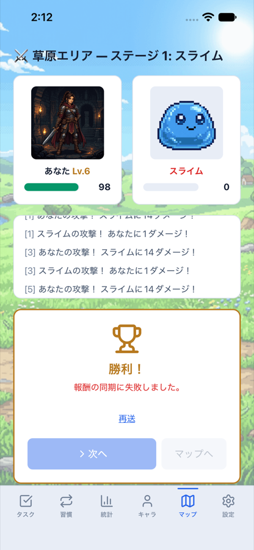
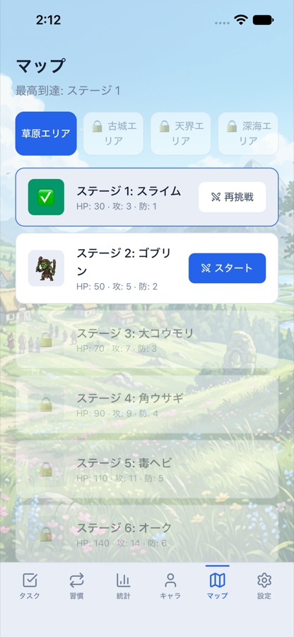

# iOS再起動後に確定済みの戦闘結果を同期する（2026-11-19）

計画④ [#699](https://github.com/YuTakane256/Life-Quest/issues/699) のT07。main `535e9a4704915ad5f86b3b2b6165fd6ddd941bde` のコードを、iPhone 17e・iOS 27.0の専用シミュレーターとローカルSupabaseで検証した。署名済みparity開発ビルドを現行JavaScriptへ接続し、ステージ1を解放した使い捨てアカウントで通常のメールログインを行った。比較基準は、初期500 XPに当日のログインボーナス20 XPを加えた状態。

1. 通常のマップ操作でステージ1を開始し、勝利した。結果送信の時点から受信同期リクエストをループバックプロキシで保留した。結果のPOSTはローカルSupabaseへ渡し、勝利確定と報酬付与を示すHTTP 200をプロキシが受け取った時点で、端末への応答を切断した。
2. 端末には「再送」が表示され、AsyncStorageには送信リクエストと一致する戦闘ID・再送キー・行動列が本人用のキーで保存されていた。端末は520 XP・最高到達0のまま、DBでは同じ戦闘が勝利として確定し、5 XPの報酬記録が1件できていた。
3. `simctl terminate` でアプリを終了した。終了後も端末の保留レコードを照合でき、DBの戦闘・確定記録・キャラクター・報酬台帳は勝利確定直後と一致した。受信同期の保留を解除して別PIDで起動した。
4. 起動後に結果確認の受信同期が成功し、マップに最高到達ステージ1とステージ2の有効な開始ボタンが表示された。保留表示と端末の保留レコードが消え、保存されたXPは525になった。再起動後の戦闘結果POSTは0件で、DBの戦闘・確定記録・キャラクター・報酬台帳は勝利確定直後と一致した。

| 確認項目 | 応答喪失後・終了前 | 再起動・受信同期後 |
| --- | --- | --- |
| サーバーの戦闘 | 勝利、確定済み | 同じ戦闘ID・結果・版・確定時刻 |
| 戦闘の確定記録／報酬台帳 | それぞれ1件 | 同じ記録1件ずつ |
| 端末の総XP／最高到達 | 520／0 | 525／1 |
| 端末の保留結果 | 送信内容と一致 | 消去済み |

| 応答を失った勝利画面 | 再起動後のマップ |
| --- | --- |
|  |  |

[識別子を除いた照合結果](evidence/ios-battle-response-loss-20261119.json)に確認結果を記録した。既存の戦闘統合テスト28件もローカルDB・Edgeで成功した。

[送出前に終了した場合の手動再送](ios-battle-result-restart-20261119.md)と合わせて、決着後の2つの再起動経路を確認した。今回は制御したHTTP応答喪失で、物理端末・Android・staging、回線全体の切断、決着前の戦闘からの続行は未確認。
