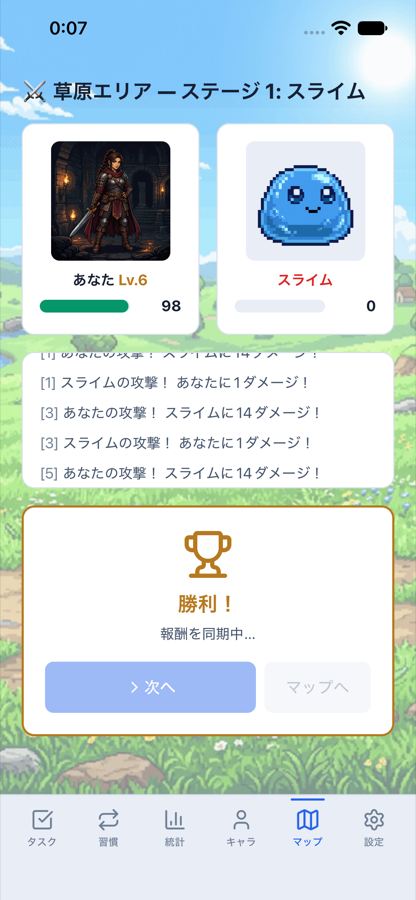
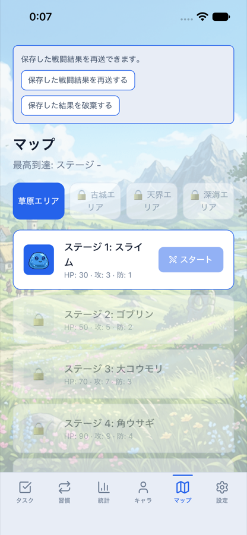
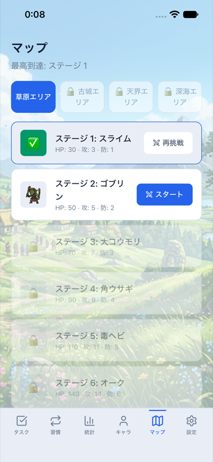

# iOS再起動後の戦闘結果の再送確認（2026-11-19）

計画④ [#699](https://github.com/YuTakane256/Life-Quest/issues/699) のT07。main `ce3a6447c20bef8bcc52d36a6f6e972180042072` のアプリ・共有Core・DB/Edgeのコードで確認した。iPhone 17e・iOS 27.0の専用シミュレーターで、署名済みparity開発ビルドを現行JavaScriptへ接続した。ローカルSupabaseに使い捨てアカウントを用意し、ステージ1を解放した。比較基準は初期500 XPに通常のログインボーナス20 XPが加わった時点とした。

1. 通常のメールログイン後、マップからステージ1を開始して勝利した。ループバックプロキシで `resolve_battle_attempt` を上流へ渡す直前に保留した。端末のAsyncStorageにある本人用の保存から、戦闘ID・再送キー・行動列が保留した要求と一致することを確認した。
2. 保留要求をサーバーへ渡さずに `simctl terminate` で終了した。終了後も同じ保存結果がディスクに残った。DBの対象戦闘は `in_progress` で、結果送信の確定記録と戦闘報酬は0件だった。
3. 別PIDで起動してマップを開くと「保存した戦闘結果を再送する」が表示された。通常の起動時同期を経ても、同じ本人と保存結果が残り、ボタンを押す前の上流への結果POSTは0件だった。
4. ボタンを1回押すと、同じ戦闘ID・キー・行動列のPOSTが1件届き、サーバーが勝利を確定した。端末の保留表示と保存レコードが消え、ステージ2の開始ボタンが利用可能になった。

| 確認項目 | 再起動後・再送前 | 手動再送後 |
| --- | --- | --- |
| 対象の戦闘 | `in_progress`、勝敗未確定 | 同じ戦闘IDの `resolved`、勝利 |
| 確定記録／戦闘報酬台帳 | 0件／0件 | 同じ再送キーで1件／同じ戦闘IDで1件 |
| サーバーと端末の総XP | 520 | 525 |
| 最高到達ステージ | 0 | 1 |

| 元の勝利結果 | 再起動後の保留 | 手動再送後 |
| --- | --- | --- |
|  |  |  |

既存の戦闘統合テスト28件も、ローカルDB・Edgeで成功した。[識別子を除いた照合結果](evidence/ios-battle-result-restart-20261119.json)に結果を記録した。

今回はiOSシミュレーターで、決着して保存が完了した戦闘の送出前終了を検証した。戦闘途中からの続行、確定後の応答喪失を挟む実プロセス再起動、物理端末・Android・stagingでの確認は残件。
