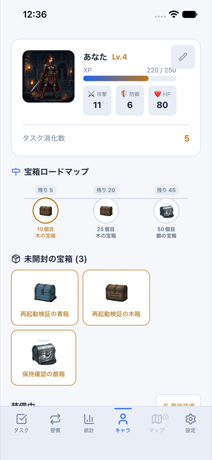
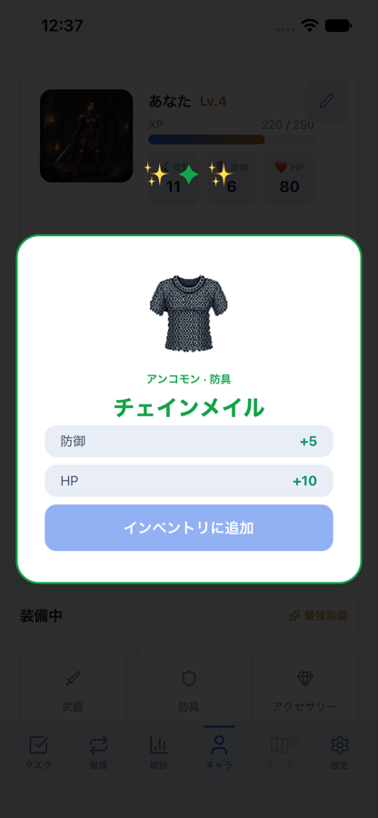
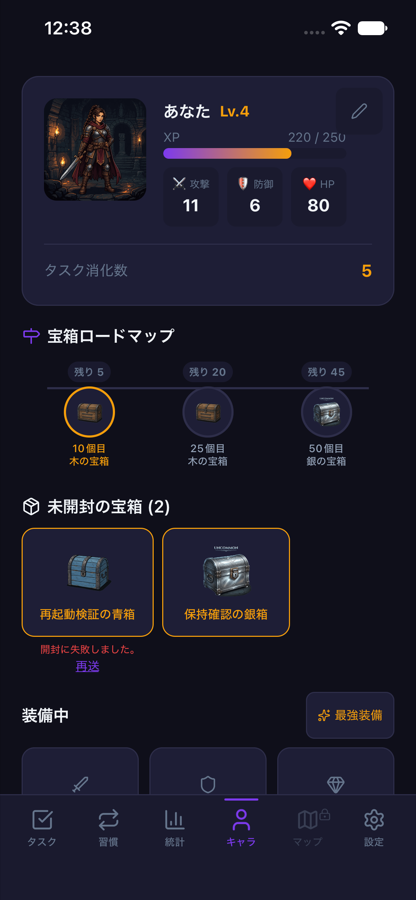
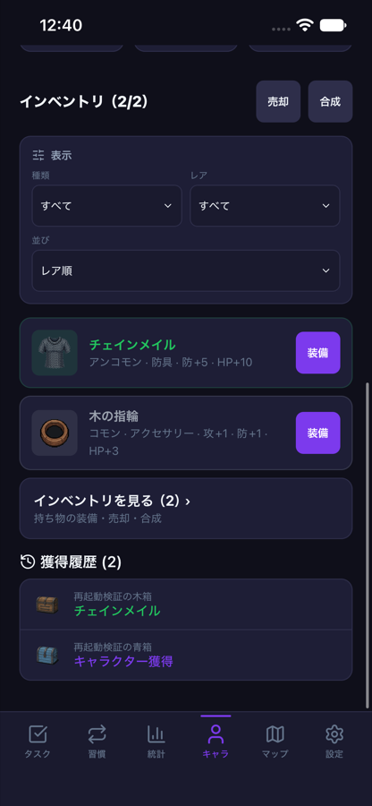

# iOSの終了・再起動を挟んだ宝箱開封の確認（2026-11-18）

計画④ [#699](https://github.com/YuTakane256/Life-Quest/issues/699) のT07。main `db22dba511ec49a24df6f3c3d8b84cd75d77e166` を、iPhone 17e・iOS 27.0（390×844pt）の専用シミュレーターとローカルSupabaseで確認した。アプリは既存の署名済みparity開発ビルドへ現行JavaScriptを接続した。アプリ・共有Core・DB/Edgeの対象ソースがmainと一致することを照合した。

セッションはSecureStore、ゲーム状態はAsyncStorageを使用した。使い捨てアカウントに木箱・スターター青箱・保持確認用の銀箱、木の指輪1個を用意した。キャラクターの基準値は200 XP・タスク消化数5で、実際のログインボーナス20 XPを確定してから比較を始めた。

## 木箱の要求がサーバーに届く前の終了

1. キャラ画面の通常の開封ボタンを押し、ループバックプロキシで上流へ渡す直前に要求を保留した。プロキシの送出ログとDBを照合し、対象の開封記録0件・全箱未開封・所持品1個を確認した。
2. `simctl terminate`でアプリを終了した。保留要求を上流へ渡さず、終了後のDBが基準値と完全一致することを確認した。アプリの保存ファイルには同じ所有者と3個の宝箱が残っていた。
3. 別PIDで起動し、通常同期後に木箱が未開封で残ることを確認した。この時点まで開封POSTの自動送出は0件だった。
4. 同じ木箱を選び直すと、終了前に捕捉した所有者・宝箱ID由来の同じキーで開封できた。初回確定を表す`replayed: false`の成功応答、新規開封演出、チェインメイル1個を確認した。確定した開封記録は1件で、元の木の指輪と他の箱も保持されていた。

| 再起動後、開封前 | 選び直して開封した結果 |
| --- | --- |
|  |  |

## 青箱の確定後、成功応答が届かない状態での終了

1. 青箱を通常UIから開封した。プロキシで上流のHTTP 200を受け取り、DBの開封記録1件・装備IDなし・バトル解放を確認して、成功応答を端末へ渡す前に接続を切った。
2. 古い端末表示を保つため、この開封要求の送出時から受信同期の応答も保留した。端末には青箱の再送案内が表示され、実保存は青箱未開封・バトル未解放だった。
3. アプリを終了し、同じ古い表示状態が保存されていることを確認した。受信同期の保留を解除して別PIDで起動すると、通常同期で青箱が獲得履歴へ移り、バトルが解放された。
4. 確認した復帰画面に開封演出は出ず、ステージ1の開始ボタンが利用可能だった。再起動後の開封POSTは0件。DBの開封記録・結果・箱と装備の版・キャラクター・報酬台帳は、初回確定時点と完全一致した。

| 成功応答喪失後の端末表示 | 再起動・通常同期後の履歴と所持品 |
| --- | --- |
|  |  |

## 照合結果

| 確認項目 | 開封前の基準値 | 木箱の復帰・開封後 | 青箱の復帰後 |
| --- | --- | --- | --- |
| 開封記録 | 0件 | 1件 | 2件 |
| 開封済みの箱・獲得履歴 | 0件 | 1件 | 2件 |
| 所持品 | 木の指輪1個 | 同じ指輪＋チェインメイル | 同じ2個 |
| バトル解放 | false | false | true |
| 総XP／タスク消化数 | 220／5 | 220／5 | 220／5 |
| 報酬台帳 | ログインボーナス1件 | 同じ1件 | 同じ1件 |
| 保持確認用の銀箱 | 未開封 | 同じID・版の未開封 | 同じID・版の未開封 |

終了後の実保存では、所有者、箱のID、開封状態、装備、XPと消化数を照合した。最終保存では履歴が各箱1件、チェインメイルのIDがDBの確定結果と一致した。既存の宝箱統合テスト17件も、同じローカルDB・Edge環境で成功した。

[識別子を除いた照合結果](evidence/ios-chest-restart-20261118.json)には、件数と同一性の判定を記録した。生のセッション・資格情報・メール・ユーザーUUID・宝箱ID・再送キーは検証用の非公開ファイルで照合した。

今回確認したのは、iOSシミュレーターのプロセス終了を挟む木箱の送出前と青箱の確定後の2条件。物理端末・Android・staging・回線全体の切断、戦闘の終了復帰、合成の送出前終了は残件。計画④の端末・通信条件の確認を継続する。
