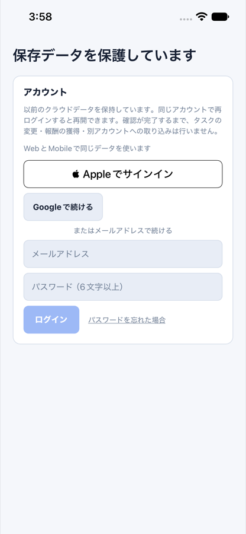
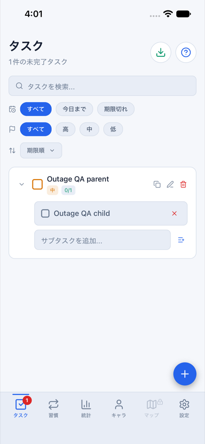

# iOSで認証期限切れ後に未送信の親子タスクを復旧する（2026-11-21）

計画④ [#699](https://github.com/YuTakane256/Life-Quest/issues/699) のR3／T08。main `f5d0549c40bb101e26f0b8d376431e7f48a8b505` を、iPhone 17e・iOS 27.0の専用シミュレーター、署名済みparity開発ビルド、ローカルSupabaseで検証した。使い捨てのメールアカウントA・Bを作成し、それぞれ当日のログインボーナス20 XPを確定してから比較した。

1. Aで通常ログインしたあと、端末から同期先へのTCP接続を止めた状態で親子タスクを各1件作成した。本人用のAsyncStorageに未送信操作2件と親への依存関係が保存され、DBの親子は0件だった。その状態でアプリを終了した。
2. ローカルAuthでAの更新セッションを無効にし、発行済みJWTの180秒の有効期限が実際に過ぎるまで待った。接続を戻して別PIDで起動すると、通常のSupabase SDKによる更新要求にAuthがHTTP 400（`refresh_token_not_found`）を返し、「保存データを保護しています」が表示された。
3. Bのメール認証はAuthで成功した。アプリは元のアカウントでの再ログインを案内し、Aのタスク操作と表示を保護した。保存されたAの操作・依存関係と表示内容は同じで、A・Bとも親子のDB登録は0件だった。
4. Aで通常ログインすると、手動同期を押さずに親・子・受信の順に同期した。保存時の操作IDとリクエストのキーが一致し、AのDBに同じ親子が未完了で各1件登録された。設定は「同期済み」、端末の保留は0件になり、受信カーソルは子の版に到達した。

| 照合項目 | 期限切れ起動・Bの認証後 | Aの再ログイン後 |
| --- | --- | --- |
| 端末のAの保留操作 | 同じ2件、親への依存あり | 0件 |
| AのDBの親／子 | 0／0件 | 同じIDで1／1件 |
| BのDBの親／子 | 0／0件 | 0／0件 |
| A・Bの総XPと台帳 | 各20 XP、ログインボーナス各1件 | 同じ各20 XP、同じ各1件 |

| 期限切れで起動したとき | Aで復帰したとき |
| --- | --- |
|  |  |

[識別子を除いた照合結果](evidence/ios-expired-session-outbox-20261121.json)に結果を記録した。認証、起動復帰、DB同期の既存テストは3ファイル60件成功した。

この条件では、JWTの実期限切れとAuthでの更新セッション無効化を組み合わせた。期限切れからの自動更新と、更新要求がAuthに届く前の通信障害は[別記録](ios-auth-refresh-retry-20261122.md)で確認した。更新受理後の応答喪失、物理端末・Android・staging、Google・Appleでの再認証は引き続き確認する。
