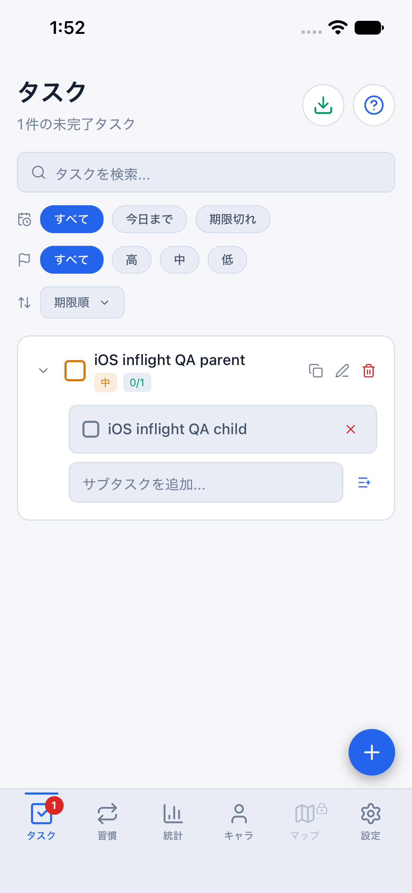

# iOSの同期中に認証が更新されたとき、期限切れの要求を送り直せることを確認する（2026-11-25）

計画④ [#699](https://github.com/YuTakane256/Life-Quest/issues/699) のR3／T08。[Webでの確認](web-inflight-auth-rollover-20261125.md)に続けて、iPhone 17e・iOS 27.0の専用シミュレーターで検証した。Expo SDK 58のparity開発ビルドにmain `fe4d5dee53d7b5274e80b15df2698e17f25708b6` のJavaScriptをMetroから読み込んだ。ローカルSupabaseのJWT有効期間は180秒。

1. 使い捨てアカウントAで通常ログインし、画面から未完了の親タスクとサブタスクを各1件作成した。元のJWTが有効な状態で出た最初の親作成要求だけを、ゲートウェイの手前の中継で保留した。端末の保存キューには送信中の親1件と、その親に依存する保留の子1件があった。設定の同期欄も送信待ち2件を表示した。
2. 親の要求を中継に保持したまま、アプリを起動し続けた。Supabase SDKがAのJWTを自動更新したあとも、保存済みの親子の操作・依存関係・受信カーソルは同じだった。送信再開前のDBで、Aと比較用アカウントBの親子、操作の記録、XP・報酬台帳は開始時と一致した。
3. 元のJWTの有効期限を過ぎてから、保持したAuthorizationを使って親作成要求をSupabaseへ転送した。実際に返った期限切れのHTTP 401のあと、同じアプリプロセスが更新済みのJWTで親を再送し、子を送信した。親子ともHTTP 200で、元と同じ操作キー・行IDだった。再ログイン・アプリの再起動・手動同期は行わなかった。
4. その後の受信も成功し、親・子はAに各1件、Bは各0件、保留は0件だった。受信カーソルは子の版まで進み、両アカウントのXPと報酬台帳は開始時と同じだった。設定の「同期済み」と、タスク画面に残った親子を確認した。

| 親を送信中・子を保留している同期欄 | 復帰後のタスク画面 |
| --- | --- |
|  |  |

同期欄の画像は該当カードだけを切り出した。[認証情報・テスト用の識別子を除いた照合結果](evidence/ios-inflight-auth-rollover-20261125.json)に検証の内訳を記録した。認証、同期キュー、共有の再送処理、実DB同期の関連テスト7ファイル116件も成功した。

今回はiOSシミュレーターとローカルSupabaseで、ゲートウェイへの転送前の遅延によって元のJWTが期限切れになる条件を確認した。物理iPhone・Android・stagingでの同条件と、書き込み成功後に応答が失われる場合や送信中のアカウント切り替えは、この検証の範囲外。
