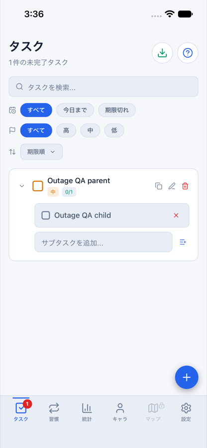

# iOSで同期先に接続できない状態から親子タスクを復旧する（2026-11-21）

計画④ [#699](https://github.com/YuTakane256/Life-Quest/issues/699) のR1／T04・T05。main `bd4195196cbef6950a3b7713a325fa1d6cd520d3` を、iPhone 17e・iOS 27.0の専用シミュレーターと使い捨てアカウント、ローカルSupabaseで確認した。署名済みparity開発ビルドを現行JavaScriptに接続し、通常ログインを行った。

1. iOSの同期先として使っていたループバックプロキシを停止し、ポートへの接続拒否を確認した。Auth・REST・Edge・Realtimeはこのポートを経由する。端末のシステム回線とMetroは稼働したまま。
2. タスク追加フォームで親1件と子1件を作成した。AsyncStorageの本人用キューに保留操作2件が保存され、子は親の操作IDに依存していた。DBの対象行は親子とも0件だった。
3. `simctl terminate` で終了し、ポートを閉じたまま別PIDで起動した。親子の表示と設定の送信待ち2件を確認した。保存されていた所有者、操作ID、内容、依存関係は同一で、DBは未登録のままだった。
4. アプリをバックグラウンドへ移し、プロキシを再起動した。前面復帰直前のDBも未登録だった。アプリを同じPIDのまま前面に出すと、手動同期を押さずに、親作成・子作成・受信同期の順で最初の3件がHTTP 200になった。2件の送信キーは保存していた操作IDと一致し、設定に「同期済み」と表示された。

| 照合項目 | 接続できない状態での再起動後 | 接続回復・前面復帰後 |
| --- | --- | --- |
| 端末の送信待ち | 親・子の2件、親への依存あり | 0件 |
| DBの親／子 | 0／0件 | 同じIDの未完了タスク各1件 |
| 受信カーソル | 復帰前の保存値 | 子の版まで到達 |
| 総XP／報酬台帳 | 20／ログインボーナス1件 | 同じ20／同じ1件 |

[識別子を除いた照合結果](evidence/ios-sync-endpoint-outage-20261121.json)に件数と同一性の判定を記録した。起動時の同期・再接続・送信キューの既存テストは3ファイル32件成功した。

今回の範囲は、接続先のTCPポートを閉じた状態での起動と、接続先の復旧後の前面復帰。OS回線そのものの切断、NetInfoの再接続通知だけでの実機復帰、Android・stagingは引き続き確認する。
