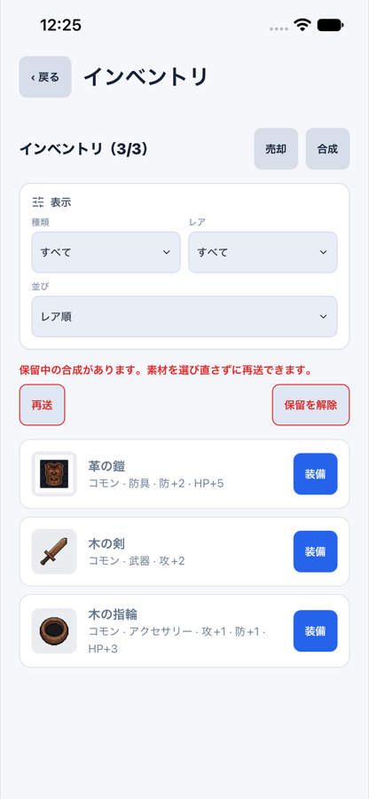
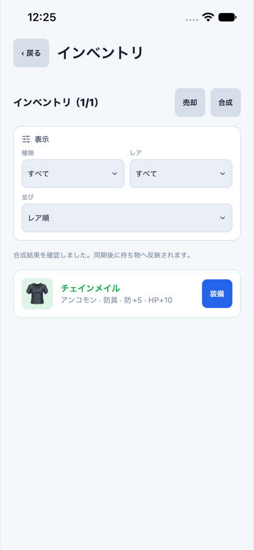

# iOS再起動後にサーバー未到達の装備合成を再送する（2026-11-20）

計画④ [#699](https://github.com/YuTakane256/Life-Quest/issues/699) のT07。main `30f7fcfd8a26197173e571bd51dbbed0b6ddbd5a` のコードを、iPhone 17e・iOS 27.0の専用シミュレーターとローカルSupabaseで検証した。署名済みparity開発ビルドを現行JavaScriptに接続した。使い捨てアカウントに木の剣・革の鎧・木の指輪を1個ずつ用意し、当日のログインボーナスを確定してから比較した。

1. 通常のメールログイン後、インベントリで素材を3個選び、合成を確定した。ループバックプロキシでPOSTをローカルSupabaseへ送る直前に保留した。端末のAsyncStorageに、本人の合成レコードとして同じ素材ID3件と再送キーが保存されていた。DBには合成記録がなく、素材3個が残っていた。
2. 保留したPOSTを転送せずにアプリを `simctl terminate` で終了した。終了後も端末の保存レコードとDBを照合し、それぞれ終了前と一致した。
3. 別PIDで起動し、インベントリを開くと、未消費の素材3個と「再送」ボタンが表示された。この時点で合成POSTの自動送信は0件だった。
4. 素材を選び直さず「再送」を1回押した。サーバーに届いたPOSTは1件で、終了前に保存した素材ID3件と再送キーが一致した。HTTP 200で合成が確定し、素材3個が消費された。確定記録と結果装備はそれぞれ1件で、端末の所持品とDBで同じ結果IDを確認した。端末の保留表示と保存レコードも消えた。

| 確認項目 | 再起動後・再送前 | 手動再送後 |
| --- | --- | --- |
| 合成の確定記録 | 0件 | 元のキーで1件 |
| 素材 | 元の3個 | 同じ3個を消費 |
| 合成で作った装備 | 0個 | 1個 |
| 総XP／報酬台帳 | 20／ログインボーナス1件 | 同じ20／同じ1件 |

| 再起動後の保留表示 | 手動再送後のインベントリ |
| --- | --- |
|  |  |

[識別子を除いた照合結果](evidence/ios-synthesis-before-send-20261120.json)に結果を記録した。既存の装備合成テストは、ローカルDB・Edgeを使う確認を含め20件成功した。

[確定後に成功応答を失った場合の再送](ios-synthesis-restart-20261117.md)に続く、制御したHTTP条件での確認。物理端末・Android・staging・回線全体の切断は引き続き確認する。
