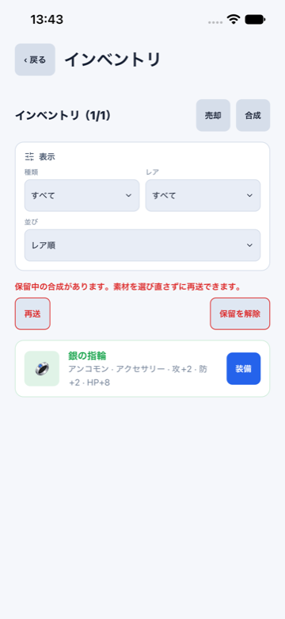
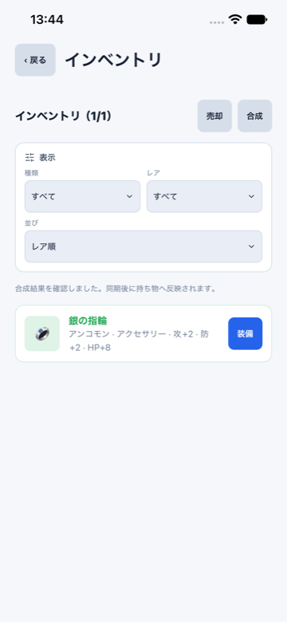

# iOSの終了・再起動を挟んだ装備合成の再送確認（2026-11-17）

計画④ [#699](https://github.com/YuTakane256/Life-Quest/issues/699) のT07。対象は `a31de63b` のアプリとEdge Function。iPhone 17e（iOS 27.0）の専用シミュレーター、ローカルSupabase CLI 3.1.0、使い捨てアカウントで実施した。開発ビルドは検証専用の識別子権限をXcodeで埋め込み、標準のSecureStoreを使用した。

## 操作

1. ローカルDBのテスト用アカウントに、木の剣・革の鎧・木の指輪を1個ずつ用意した。iOSアプリから通常のメールログインを行い、インベントリで3個を選んで合成した。
2. 合成の成功応答が端末に届く前に、Mac内のループバックプロキシの接続が切れた。端末に「再送」が表示され、DBでは合成キーと結果がすでに1件確定していた。
3. `xcrun simctl terminate` でアプリを終了し、`xcrun simctl launch` で別のPIDになったことを確認した。端末の保存データを保持した状態でインベントリを開くと、結果の銀の指輪1個と保留中の合成が表示された。この時点までに、自動の合成POSTはなかった。
4. 素材を選び直さず「再送」を1回押した。合成POSTは1回でHTTP 200。POSTで送った素材ID3件と再送キー、応答の結果IDを初回のDB記録と照合した。保留表示が消え、所持は銀の指輪1個のままだった。

プロキシでは初回の成功応答を受け取ったあとに圧縮データの解析で終了した。このため初回のリクエストログは保存されず、初回のキー・素材消費・結果は `idempotency_keys` と `inventory_items` の確定記録を使って照合した。再送時にはプロキシを起動し直し、応答を中継した。

| ローカルDBの確認項目 | 初回の確定後 | 再起動・再送後 |
| --- | --- | --- |
| 合成の冪等性記録 | 1件 | 同じキー・同じ結果の1件 |
| 消費した素材 | 3個 | 同じ3個 |
| 所持している結果 | 銀の指輪1個 | 同じID・同じ版の1個 |
| キャラクターXP | 20 | 20 |
| 報酬台帳 | ログインボーナス1件、20 XP | 同じ1件、20 XP |

### 再起動後、再送前

### 再送後

実施したのはiOSシミュレーターとローカルDBでの「確定後の応答喪失」1条件。サーバー到達前の終了、実機・Android、staging、回線全体の切断は残件。
