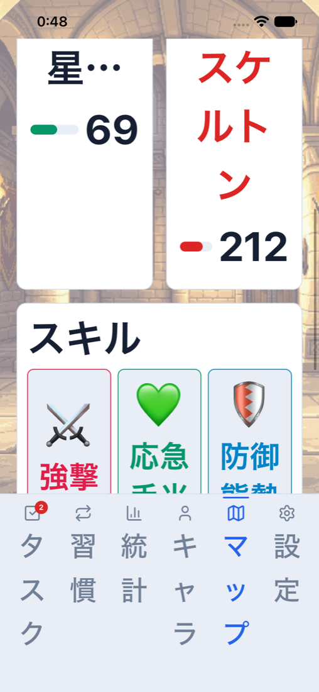
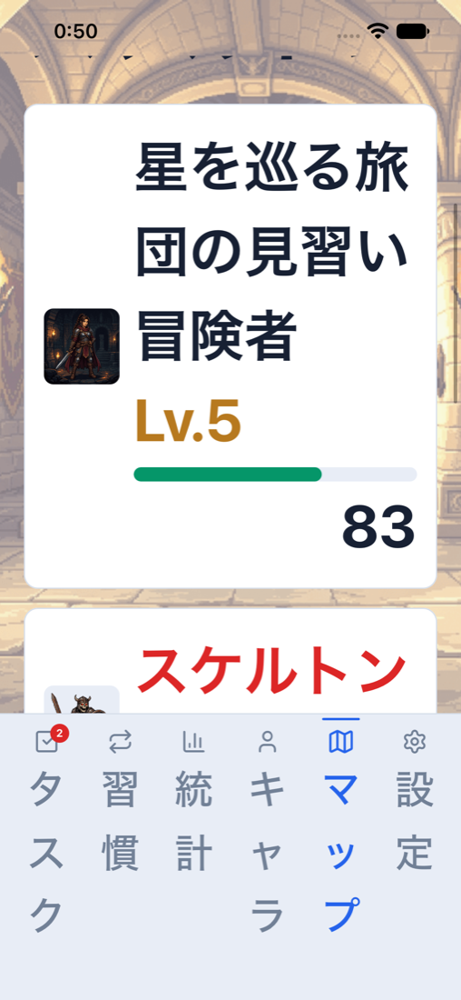
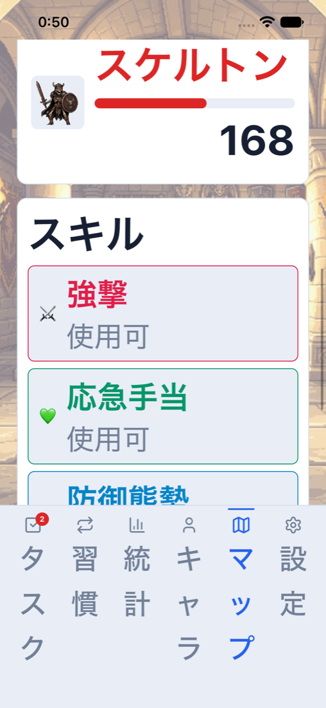
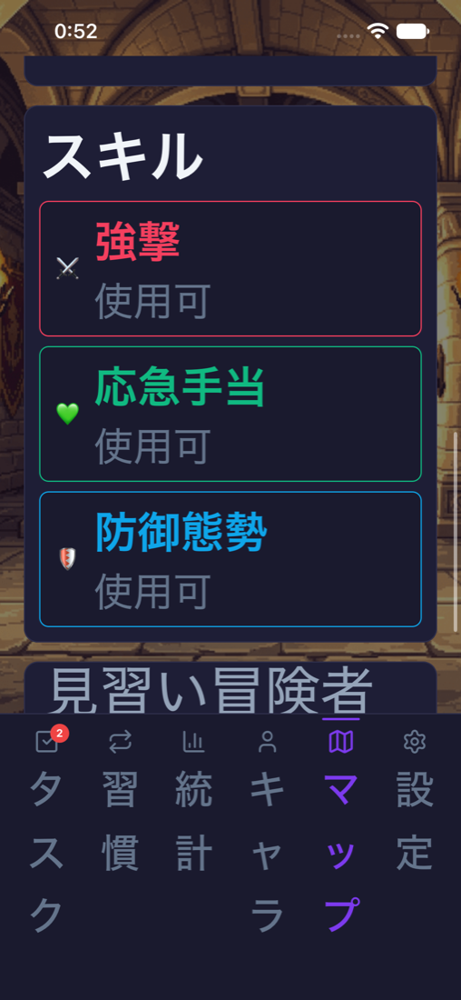

# モバイルの戦闘中画面を大きい文字に対応させる（2026-11-29）

計画④ [#699](https://github.com/YuTakane256/Life-Quest/issues/699) のR5。[ステージ選択](mobile-map-stage-layout-20261127.md)と[戦闘結果](battle-result-action-layout-20261127.md)に続き、戦闘中の名前・HP・スキルを確認した。

幅360pt未満、または文字倍率1.5以上では、プレイヤーと敵のカードを縦に並べる。キャラ名は折り返し、HPバーと数値を上下に置く。スキルは解放されたものを1列に並べて、名前と使用可否を読める幅を確保する。通常の幅と文字サイズでは横並びで表示する。

## 確認

- 通常幅、320pt、390ptで文字倍率1.6と2.8を回帰テストに追加した。修正前には狭幅と文字拡大の3件が失敗した。修正後は全条件が通り、使用不可のスキルと、防御態勢の1回の操作を確認した。
- 自動攻撃、戦闘開始・結果への遷移を含む関連81件、ローカル全体4,195件（167件スキップ）が成功した。Web/Mobileの型検査とLint（既存警告7件）も成功した。
- iPhone 17e / iOS 27.0の専用シミュレーターを最大文字サイズ（`accessibility-extra-extra-extra-large`）に設定し、同じ架空データでステージ11を実際に開始した。修正前はキャラ名が「星…」になり、スキル名は狭い3列で折り返された。修正後はキャラ名とHPをライトで、3つのスキル名と「使用可」をダークで読めることを確認した。各画像は対象部分までスクロールしている。

| iOS・ライト 修正前 | iOS・ライト 修正後のキャラ名とHP | iOS・ライト 修正後のスキル | iOS・ダーク 修正後のスキル |
| --- | --- | --- | --- |
|  |  |  |  |

最大文字設定では下部タブのラベルも複数行になる。Android・物理端末・スクリーンリーダーでの操作とあわせて、引き続き確認する。
