# キャラ画面の持ち物プレビュー

Issue #815。Webのキャラクター画面と同様に、未装備の持ち物を確認しながら成長・装備更新へ進めるようにする。

## 変更内容と境界

- Nativeの既存インベントリを`InventorySection`へ抽出し、独立画面とキャラ内で同じ操作・確認・フィルタ・行表示を使う。
- キャラ内では「全在庫を絞込・並べ替え→先頭5件を描画」の順。装備済みは上の装備欄で管理する。
  残件数は表示条件に合う未装備品のうち、プレビューに出していない件数。
- 通常/売却/合成、装備、売却取消/確定、素材選択と合成確認/再送は既存処理を共用する。
  確認中の装備変更、認証、同値フィルタ、取消、遅延した結果を扱うガードを維持する。
- キャラのScrollView内は最大5行のView。最大2,000件の独立画面はFlatListによる仮想化を維持し、入れ子にしない。
- 「インベントリを開く」直後から、blur前でも旧装備/確認/選択/フィルタ/結果通知を無効にする。
  独立画面との往復で表示条件・選択は初期化するが、合成の送信状態/冪等キーの所有は従来どおりroot Providerに残す。
- キャラのレベルアップ通知は親画面だけで表示し、埋込側で二重表示しない。宝箱・履歴は従来の位置関係を維持する。

DB・API・保存形式・報酬計算・抽選ルール・通常データの初期化は変更しない。AI連携は保留のまま。

## 検証

- 独立画面で実施してきた操作/認証/素材選択/遅延応答のテストを、キャラ内プレビューでも実行する。
- 空/1/5/6/2,000件の描画上限、装備済み除外、5件で切る前の絞込、残件数、画面移動直後の旧操作拒否を確認する。
- Webの既存プレビューでも、7件→5件表示、絞込、装備反映、独立画面との選択分離を回帰確認する。
- iOSはクラウド未設定・匿名専用parity・dailyメモリデータ・Metro8082だけを使う。
  初期4件と装備解除後7件、絞込、装備→最強装備、売却取消、素材選択→画面往復を検証する。
  ライト/ダークと文字拡大を確認し、文字設定は終了後largeへ戻す。通常確認用8081は変更しない。
- 比較は同じdailyデータ・同じ操作後の状態・402×874。390pxの既存回帰を維持し、基準/許容値は緩めない。

## 実行記録

- 全体3,188件成功/98件skip、core755件成功。関連の操作/画面境界/Provider/runner261件は独立レビューでも再実行して成功。
- Web関連E2E24件、402×874比較2件成功。Web/Mobile/core型検査、build、秘密情報検査、release config成功。
  lintはerror0/既存warning6。
- Web全体のローカル追加実行は251件成功、既存の匿名成長テスト1件がタスク追加ボタンの安定待ちでタイムアウト。
  同じテストの単独再実行は成功。テスト条件・待ち時間・クリックの強制は変更していない。
- iOS light（214723）は4件表示、7件中5行、絞込、装備→最強装備、売却取消、3素材選択→一覧往復まで成功。
  初回の中央寄せ指定での検出停止と、入口がタブバー越しに検出される問題は、明示スクロールで入口全体を表示して解消した。
- 文字拡大の初回（215023）は、XCTestがタブバー背後の最強装備ボタンを可視扱いし、タップでマップへ移動して停止した。
  検証フローに小さなスクロール操作を追加して対象を画面内へ移し、押した結果を装備欄で確認するassertも追加した。
  アプリ本体に固定座標を持ち込んだり、操作不能な場所へのクリックを強制する変更ではない。
- 文字拡大の再実行（215554）は、最強装備の反映確認を含め、売却取消・3素材選択・独立画面との往復まで全フロー成功。
  検証後は文字設定を元のlargeへ戻した。
- dark（215937）も同じ最終フローがすべて成功。専用parityアプリ/Metro8082を停止し、通常の8081と保存データは変更していない。
- 390px回帰は7件成功/既知のタスク矢印19px差分1件。実画像SHA-256は従来と同じ
  `bf452f819c3595e4bf8e9962402038350ad8b950df969e2082100f813aae9cf3`。基準/許容値変更なし。

最終コミットのCI3件と画像/独立レビューの照合はPRに記録する。自動マージしない。

## 同条件の比較画像

共通dailyデータ、402×874、未装備4件の初期状態。OSバーとNativeの常設入口は一致対象外。

| テーマ | Web | iOS |
| --- | --- | --- |
| light | 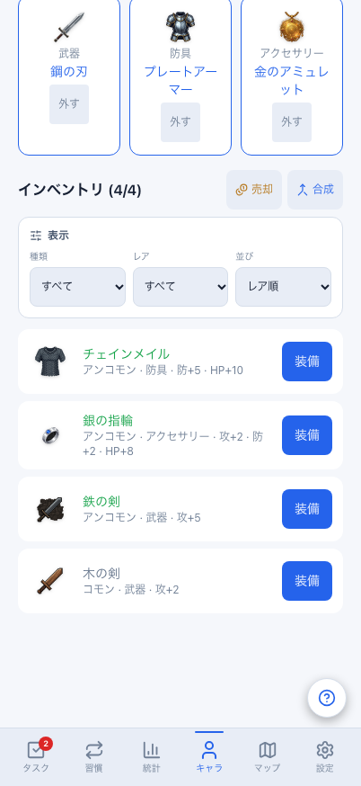 | 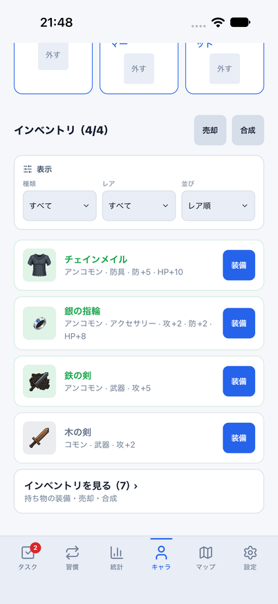 |
| dark | 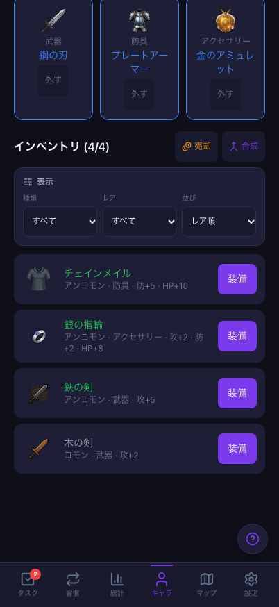 | 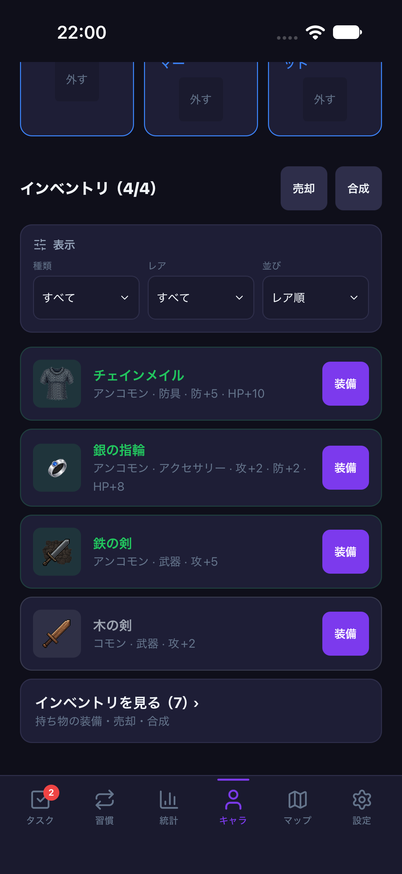 |

同じ3装備を外した状態。7件中5行と残り2件を比較する。

| テーマ | Web | iOS |
| --- | --- | --- |
| light | 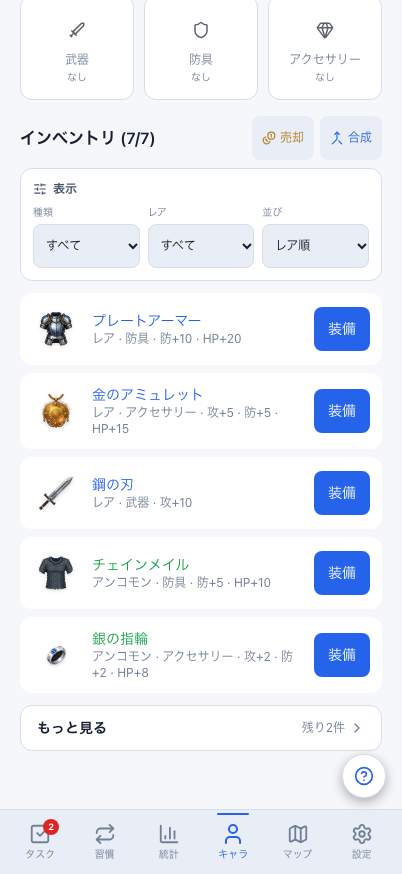 | 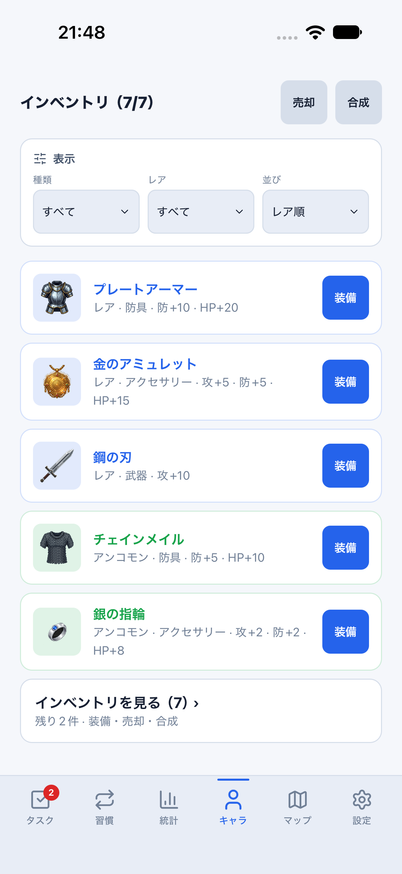 |
| dark | 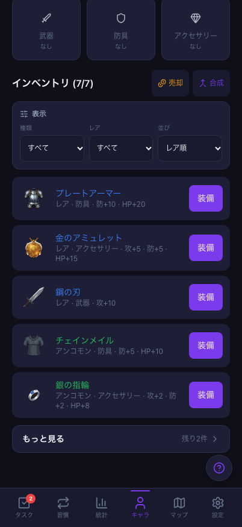 | 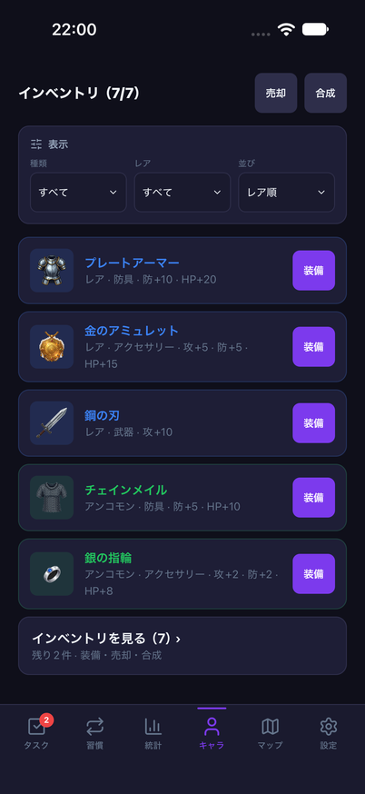 |

文字拡大（accessibility-large）では縦スクロールし、名前・性能・操作を省略しない。以下は各状態の下部。

| 4件のプレビュー下部 | 7件のプレビュー下部 |
| --- | --- |
| 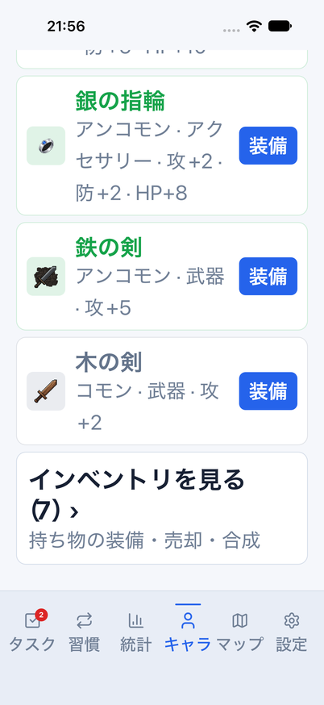 | 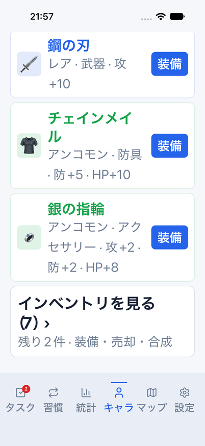 |

素材選択は表示条件/画面移動で初期化する。文字拡大でも確認ボタンへスクロールできる。

| iOS light | iOS dark | iOS文字拡大 |
| --- | --- | --- |
| 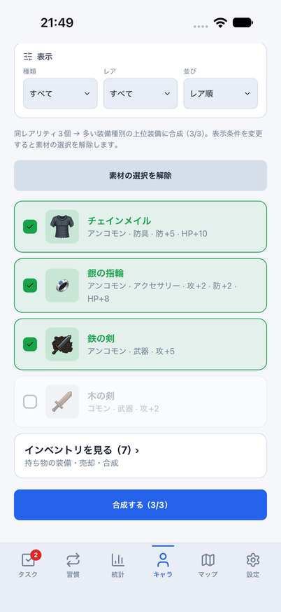 | 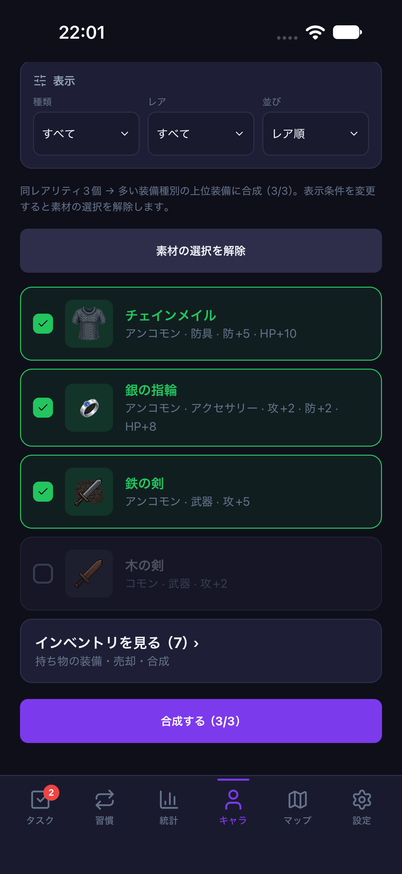 | 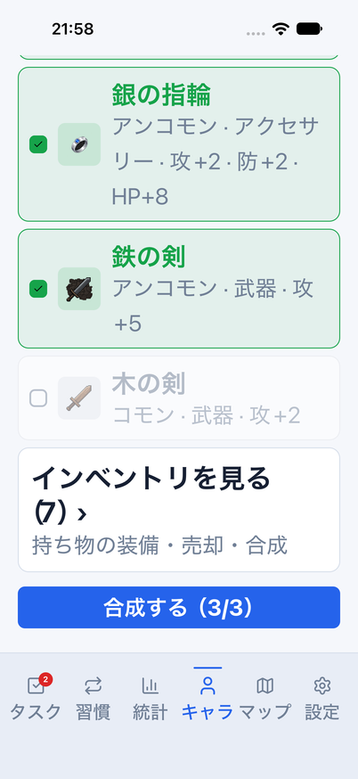 |

## 残る差分

Nativeは未装備5件以下/空でも独立画面への入口を残す。Webの「もっと見る」は5件超過時のみ。
選択ポップアップ、確認はOS固有のDialog/AlertとWebのselect/dialogで異なる。
OS安全領域・文字描画・モードアイコンまでの完全一致とは扱わない。
固定メモリデータのUI確認は、実アカウント同期、Android実機、VoiceOver実聴、署名済み配布の完了を意味しない。
