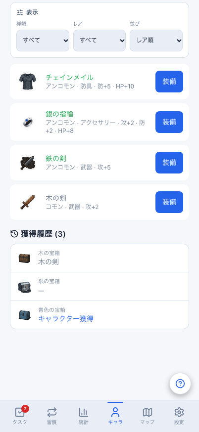
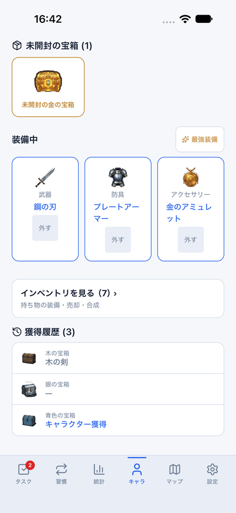
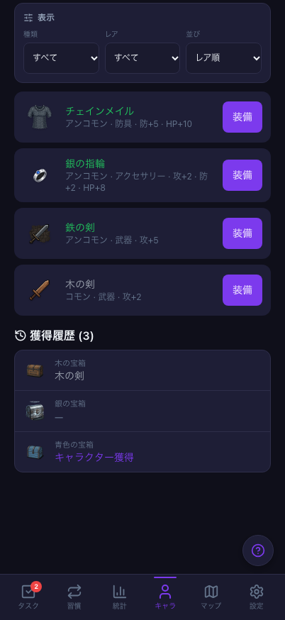
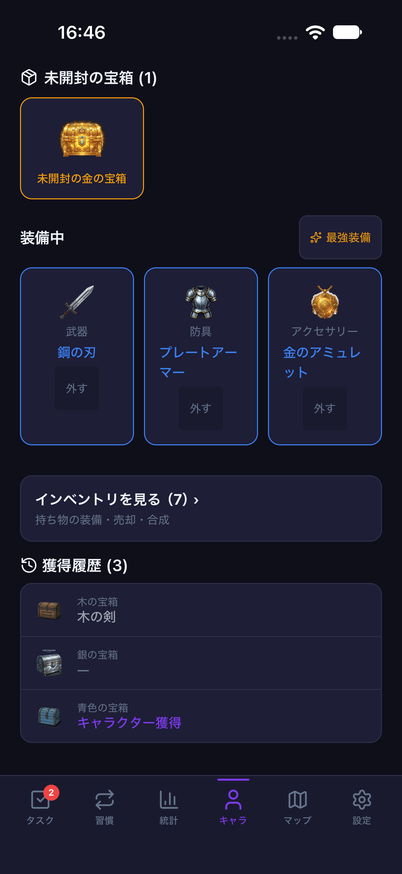
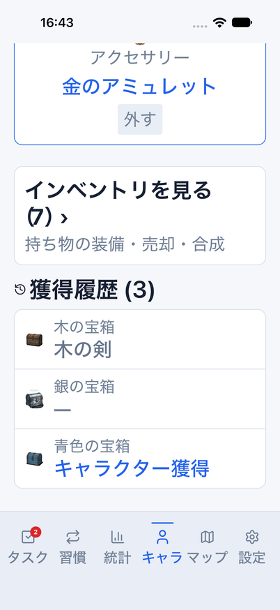

# 宝箱の獲得履歴：Web / Mobile

Issue #813。キャラクター画面のインベントリ入口の後に、Webと同じ宝箱の獲得履歴を表示する。

## 表示と安全性

- 開封済みのみを宝箱キューの逆順（Webと同じ順序）で表示。保存配列自体は反転しない。
- 宝箱画像・名前、獲得装備名とレアリティ色、キャラクター獲得、結果未記録時の「—」を表示する。
- 現在の持ち物ではなく宝箱の獲得結果を参照し、売却・合成で元の装備がなくなっても表示する。
- 履歴は閲覧専用。再開封・再付与の操作は置かず、DB・同期API・報酬計算・保存形式は変更しない。
- 空ならセクション全体を非表示。データ再読込中は既存の画面ガードで隠し、ストアの差替えを即時反映する。
- Nativeは高さ320pt以内のスクロールカードとし、長い名前を省略せず折り返す。外側の画面スクロールも維持する。
  行は宝箱名と結果をまとめて読み上げる構成とする。VoiceOver実聴は別途確認が必要。

## 検証条件

- コンポーネントテスト：両テーマ、空/未開封、表示順と非破壊、画像fallback、結果なし、
  実際の売却/合成後の履歴保持、開封/同期結果差替え、80件・長文、再読込中の非表示。
- Web E2E：両テーマ・PC/スマホ、履歴順、画面移動/再読込、在庫消失後の保持、履歴クリア。
- iOS `rewards`フロー：実際の開封→演出終了→履歴2件→インベントリ。
- iOS `chestHistory`フロー：共通の固定historyデータで3件を表示し、タブ往復で維持。
  比較画像はWeb/iOSとも402×874。ライト・ダーク、iOSの文字拡大で確認する。
- `history`データは匿名専用parityビルド、クラウド未設定、比較テーマ指定のメモリ環境のみで使用する。
  通常版・preview・実アカウントの保存データへ投入しない。通常確認用8081は変更しない。

## 実行結果

- 全体3,120件成功/98件skip、core755件成功。Web関連E2E24件と402×874比較4件成功。
- Web/Mobile型検査、build、秘密情報検査成功。lint error0/既存warning6。
- iOS実開封フロー成功（163356）。固定historyのライト（164202）、文字拡大accessibility-large（164323）で全行表示・タブ往復成功。
- 固定historyのダーク（164529）も全フロー成功。終了後は専用parityアプリとMetro8082を停止し、通常8081や保存データは変更していない。
- 固定historyの初回（163829）は、スクロール先に指定した最終行がカードの端にあるため検出が停止。
  画像/アクセシビリティ階層で3行の表示を確認し、カード全体へスクロールしてから各行をassertする形へ修正した。
  行の検証は省略せず、文字設定も検証後に元のlargeへ戻した。
- 390px画像回帰は7成功/既知のタスク矢印19px差分1件。実画像SHA-256は前回と同じ
  `bf452f819c3595e4bf8e9962402038350ad8b950df969e2082100f813aae9cf3`。基準画像/許容値の変更なし。

独立レビューと最終コミットのCI3件はPRで照合する。

## 同条件の比較画像

Web/iOSとも固定historyデータ、402×874。同じ3件の履歴を比較する。
スクロール位置より上にあるWebの在庫プレビューとNativeの入口は今回の一致対象外。

| テーマ | Web | iOS |
| --- | --- | --- |
| light |  |  |
| dark |  |  |

文字拡大（iOS accessibility-large）でも全3件を表示できる。

## 今回の範囲外

獲得履歴は既存キューに保持される範囲のみで、無期限の全履歴保存機能ではない。
Webのキャラ内インベントリプレビューとNativeの入口はまだ異なる。
OS安全領域・文字描画、Webの長い装備名の省略とNativeの折返しも完全一致とは扱わない。
実アカウント同期、Android実機、実機認証/権限、配布準備の完了をこの確認で代替しない。
