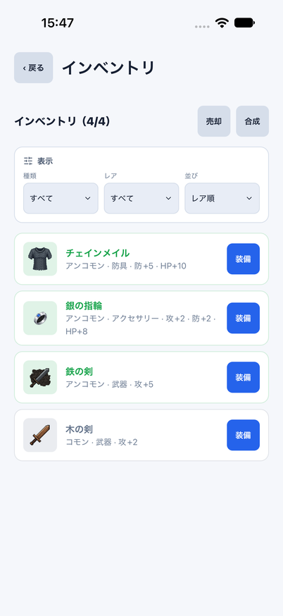
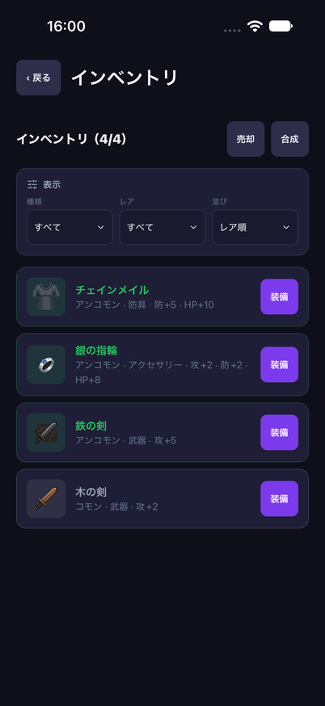
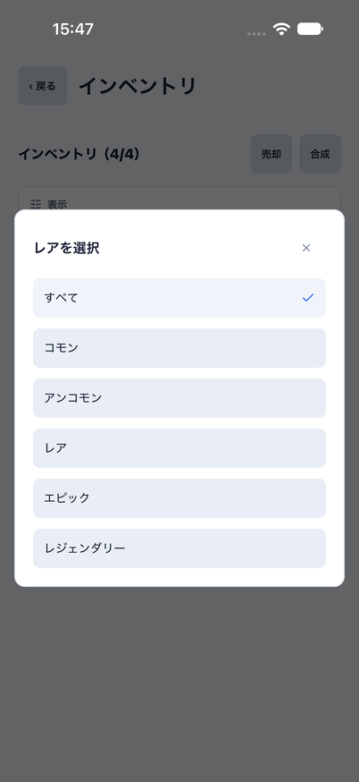
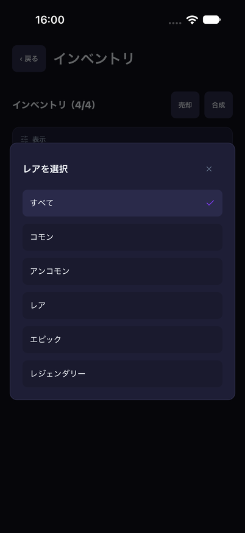
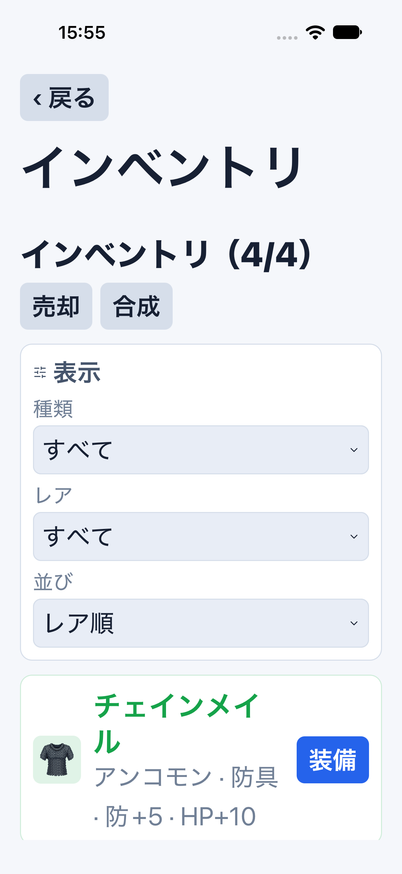
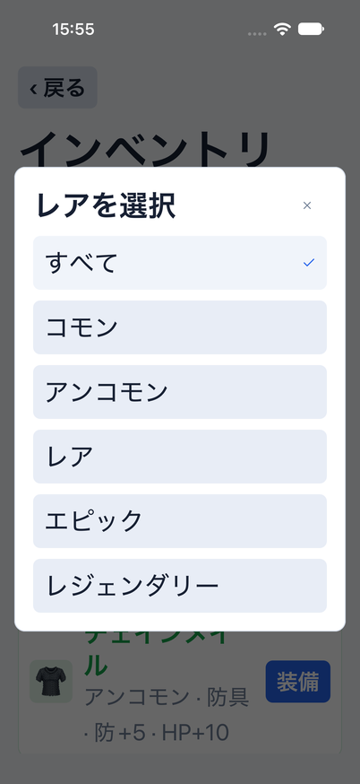

# Mobileインベントリのコンパクトなフィルタ

Issue: [#811](https://github.com/YuTakane256/Life-Quest/issues/811)。#809の続き。
計画④の品質確認と並行して、残っていたインベントリのフィルタ形式をWebへ寄せる。AI連携は保留。

## 変更

- 横スクロールのラジオ群をやめ、Webと同じ「表示」カード内に種類・レア・並びを配置する。
  通常の402px幅では3列。104ptを基準に文字倍率を反映した幅で折り返し、小画面や文字拡大では列数を減らす。
  現在値・項目名をボタンの読み上げラベルに含め、開閉状態も渡す。操作領域は44pt以上。
- 選択は既存のNative `Dialog`を使う。全選択肢をスクロール可能にし、現在値のチェックを示す。
  閉じる操作も44pt。AndroidのAlertの選択肢数に依存せず、レジェンダリーまで選べる。
  WebのHTML selectの選択ポップアップとはOSに合わせた操作の差を残す。
- ダイアログを開く/閉じる/同じ値を選ぶだけでは、表示条件・素材選択・保存データを変えない。
  異なる値を選んだときだけ、従来の画面世代更新を経由して素材選択・旧確認・古い行操作を無効化する。
- ダイアログは一覧のヘッダー内に置かず、画面直下で所有する。
  各回の所有トークンを同期的に消費し、古い選択や閉じるcallbackが次のダイアログへ作用しないようにする。
  モード変更・認証変更・blur・戻る・読込中への移行でも閉じ、旧選択は受け付けない。
- 日常画面の`Choice`は変更しない。インベントリの既存ガードと操作領域に合わせた選択ボタンを画面内に持つ。

装備・売却・合成のルール、Provider、DB/API/store、保存形式、報酬計算・抽選は変更しない。
初期テーマsystemを維持し、通常版・preview・サインイン済みデータは初期化しない。

## 検証

- Web/Nativeの既存操作・認証/画面境界に加え、3項目の全選択肢と現在値、取消・システム戻る・同値選択での素材保持、
  古い選択/閉じる/開く操作、二重選択、認証/blur/戻る/読込、同値pull、並び順と保存データの不変を確認する。
- iOSは専用parity ID/8082/クラウド未設定/dailyメモリfixtureのみを使う。
  最上位レアリティ、0件復帰、取消/同値選択後の素材保持、条件変更での解除、装備→キャラで解除→再入場、
  売却取消/確定・合成取消/確定をライト/ダークと文字拡大で検証する。文字設定は検証後にlargeへ戻す。
- Webの関連E2E、全体/coreテスト、型検査、build、秘密情報検査、既存CI3件を確認する。
  390px画像回帰の既知のタスク矢印差分と今回の回帰は分け、基準画像/許容値は緩めない。

最終結果・比較画像・6.1 Sol中の独立レビューはPRへ記録する。自動マージしない。
固定メモリfixtureのUI検証を実データ永続化・実アカウント同期・Android実機・VoiceOverの実聴・⑤の配布準備の完了とはしない。

### 実行結果

- 全体3,099件成功/98件skip、core753件成功。画面コンポーネントの操作/認証/ダイアログ境界114件を含む。
- Web関連E2E26件成功。Web/Mobile/core型検査、build、秘密情報検査成功。lintはerror0/既存warning6。
- iOSライト（154558）で、最上位レアリティ・0件復帰・取消/同値選択での素材保持・装備往復・合成/売却確定まで全フロー成功。
- 文字拡大の初回（155140）は取消後の素材行が画面外になりassertが停止した。
  失敗時も選択数1/3が残っていることを階層と画像で確認し、同じ選択行へ明示スクロールしてからassertするようフローを修正。
  選択保持の検証を削除したり、タップを強制する変更ではない。
- 文字拡大の再実行（155434）は素材保持から合成/売却確定まで全フロー成功。終了後、文字設定は元のlargeへ復元。
- 390px画像回帰7件成功/既知のタスク矢印19px差分1件。実画像のSHA-256は前回と同じ
  `bf452f819c3595e4bf8e9962402038350ad8b950df969e2082100f813aae9cf3`。基準/許容値変更なし。
- 6.1 Sol中の初回レビューではP2以上の指摘なし。最終コミットの画像・記録とCI結果もPRで照合する。

### 比較画像

共通dailyデータ・同じ初期状態・402×874。Webの選択ポップアップとNativeダイアログはOS固有の操作として分ける。

| テーマ | Web | iOS |
| --- | --- | --- |
| light |  |  |
| dark |  |  |

| Nativeのレア選択 light | Nativeのレア選択 dark |
| --- | --- |
|  |  |

| iOS文字拡大（accessibility-large） | 文字拡大での選択肢 |
| --- | --- |
|  |  |

## 残る差分

フィルタの情報順序・カード構成・選択肢は揃えるが、選択ポップアップはNativeダイアログとWeb selectで異なる。
OS安全領域、フォントの微差、モードボタンのアイコン、キャラ内のプレビュー等まで完全一致したとは扱わない。
