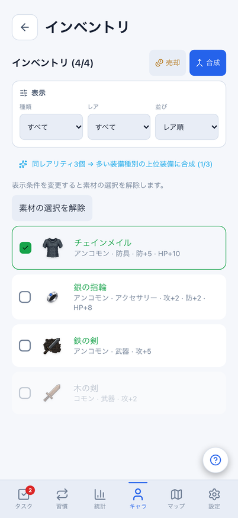
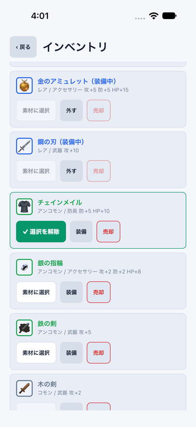
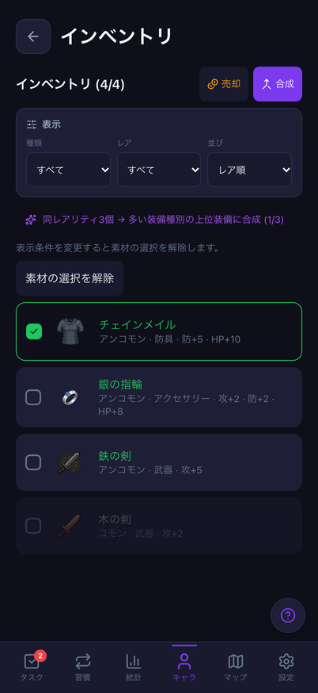
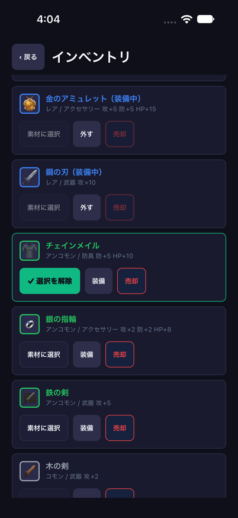
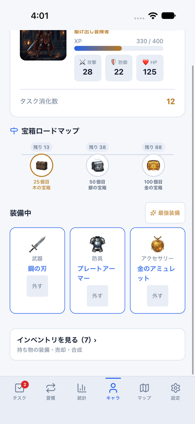
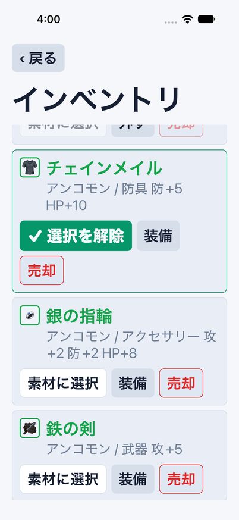

# Mobileインベントリの独立画面・往復品質

Issue: [#807](https://github.com/YuTakane256/Life-Quest/issues/807)。#695/#699の続き。
計画④の品質確認と並行して、残っていた画面の役割分担を揃える。AI連携は保留のまま。

## 変更と境界

- キャラはプロフィール/成長/宝箱/装備中/最強装備に集中させ、所持件数付きの
  「インベントリを開く」導線から独立画面へ移動する。全装備行はキャラに重ねて描画しない。
- `/inventory`をroot Stackに追加。キャラへ戻る44pt操作を一覧の外へ置き、
  下へスクロールしても戻れる。直接起動・読込中にもキャラへ戻れる。
  `dismissTo('/character')`は目的地が履歴になければ置換する既存Router APIを使う。
- 独立画面は下部safe areaも確保する。タブ画面のキャラは従来どおりタブ側が下部を管理する。
- 既存の装備一覧・絞込・選択/解除・装着/解除・売却確認・合成確認/再送・結果通知を移動。
  最大2000件を想定したFlatList仮想化、同じ共有選択モデルと画面/認証ガードを維持する。
- 戻る操作時はblur通知を待たず確認・選択・旧結果通知を無効にし、連打による重複移動を防ぐ。
  入口もhydration/認証/画面寿命と連打を確認する。戻って再入場すると選択/フィルターは初期化する。
- 合成hookの所有だけは画面より長く生きるProviderへ移す。root Stackが存続する間は
  エラー・素材コピー・冪等キーを保持し、画面を閉じて戻っても同じ操作IDで再送できる。
  送信済み処理は画面を離れただけで二重起動せず、同じ本人の確定結果をstoreへ一度反映する。
  認証変更時の破棄は既存useGameOperationScopeが担当し、旧応答/再送を別ユーザーへ持ち越さない。
- レベルアップ通知は同じstoreイベントを両画面で表示できる共通部品に分ける。
  宝箱の確定報酬・演出はキャラ画面とrootの既存overlayを維持する。

DB/API/保存形式/報酬量/抽選/装備・売却・合成のルールは変更しない。
再送状態の保持はアプリ稼働中の画面往復が対象。プロセス終了後まで冪等キーを永続化する変更ではない。
Webは既存画面・機能を変更せず回帰確認する。Mobileは従来どおり装備中を含む全所持品、
Webは未装備品が一覧対象のため、同じfixtureでも表示件数は7件と4件になる。
絞込UI・売却/合成モード・キャラ内のプレビュー等まで完全一致させた扱いにはしない。

## 検証

- 既存売却/合成/素材選択・認証/画面境界テストを移動先で維持。
  入口の連打/読込/認証/復帰、戻る直後の旧Alert拒否・旧結果通知抑止を追加する。
- 実合成hook＋Providerで画面の消滅/再作成を検証。同じ素材と冪等キーでの再送、
  離脱中の進行中状態/二重起動防止/一度だけの結果反映、認証切替後の旧結果破棄を確認する。
- Webの装備/合成/売却/プロフィール/キャラ関連E2E42件成功。
- iOSは専用parity ID/8082/クラウド未設定/dailyメモリfixtureで、直接起動・通常の往復、
  空の絞込からの復帰、素材選択/解除、売却取消、装着/解除を確認する。
  文字拡大は検証後に元のlargeへ戻す。通常版・サインイン済みデータは初期化しない。
- 390px画像は既知のタスク矢印19px差分を除く7件成功。基準/許容値は変更しない。
- 全体3,072件成功/98件skip、core753件成功。Web/Mobile/core型検査、build、秘密情報検査成功。
  lintはerror0/既存warning6。所持品0件・読込中・両画面のレベルアップ通知も回帰確認した。
- iOS light通常（040109）とlight文字拡大（035923）は直接起動から往復・既存操作まで全フロー成功。
  dark（040403）と、一覧で装備した鉄の剣がキャラの装備中へ反映される最終フローの結果はPRへ追記する。

実行結果・比較画像・最終CI3件・6.1 Sol中の独立レビューはPRにまとめる。マージしない。
固定fixtureのUI確認と実永続化/クラウド同期は別判定。Android実機、全画面アクセシビリティ、
実アカウント同期、⑤の署名済み実機/内部配布・ストア提出は今回の合格範囲に含めない。

## 比較

共通dailyデータ・同じ状態・402×874。件数・フィルター/操作UIの既存差とOSヘッダーは残る。

| テーマ | Webの持ち物 | iOSの独立画面 |
| --- | --- | --- |
| light |  |  |
| dark |  |  |

| キャラからの入口 | iOS文字拡大 |
| --- | --- |
|  |  |
