# Mobileインベントリの操作モード・未装備一覧

Issue: [#809](https://github.com/YuTakane256/Life-Quest/issues/809)。#807の独立画面の続き。
計画④の品質確認と、残っているWeb/Mobileの画面差分の解消を進める。AI連携は保留。

## 今回揃えること

- Webと同じく、一覧は未装備品だけにする。見出しは表示件数/未装備件数。
  装備すると一覧から外れ、キャラ画面の装備中スロットへ反映する。
  解除はキャラ画面から行い、品物そのものは所持データから削除しない。
- 通常は装備ボタン、売却は行全体の操作と獲得XP、合成は行全体のチェック選択に切り替える。
  全行に3種類の操作を常時並べる構成をやめる。各操作の対象は44pt以上を確保し、名前は折り返す。
- 売却/合成行にはレアリティ・種類・能力値（売却時はXPも）を`accessibilityValue.text`として渡す。
  名前が同じ品でも性能を区別できるようにし、読み上げヒントの有効/無効に依存させない。
  チェック記号は文字ではなく固定サイズの装飾アイコンにして、文字拡大で枠からはみ出さないようにする。
- 合成確定は一覧末尾に置く。3素材・同レアリティ・未装備・最上位以外という既存条件を維持する。
  売却/合成の確定には従来のNative確認ダイアログを使う。
- モード変更はフィルタ変更と同じ画面世代の更新を経由し、選択・古い行操作・旧確認を即座に無効化。
  認証変更、blur、戻る直後、同じ操作の連打に関するガードは維持する。
- rootの合成Providerは変更せず、画面往復中の処理・エラー・冪等キーの所有を維持する。
  再送はモードを問わず確認できる。処理中の品物や報酬量はUI変更で書き換えない。

DB、API、store、保存形式、報酬計算、抽選、通常版の初期テーマ(system)は変更しない。
所持件数を示すキャラの入口は全装備の数、インベントリ内は未装備品の数なので意味が異なる。

## 検証と判定の境界

- Web/Nativeの実画面コンポーネントでモード別操作、未装備品のみの表示、装備後もstoreに残ることを確認。
  再描画前の切替、旧売却/合成確認、素材解除、認証/画面寿命に関する既存テストを維持する。
- Webの既存装備/売却/合成E2E、型検査、全体/coreテスト、build、秘密情報検査を実行する。
- iOSは専用parity ID、8082、クラウド未設定、dailyメモリfixtureで検証する。
  直接起動、0件フィルタからの復帰、素材選択/解除、売却取消、装備→キャラで解除→再入場、
  合成取消/確定、売却確定を確認する。ライト/ダークと文字拡大を確認し、文字設定は元へ戻す。
- Maestroの既存装備/宝箱フローの期待件数を未装備一覧に合わせる。
  全所持品が7件のfixtureでは初期4件、宝箱で未装備品が1件増えた状態では5件になる。
- 390pxのWeb画像回帰は既知のタスク矢印差分と切り分け、基準画像や許容値を緩めない。

最終実行結果・画像・CI3件・6.1 Sol中の独立レビューはPRに記録する。自動マージしない。
画像やメモリfixtureの成功を、実データ永続化/双方向同期/Android実機/⑤の署名済み配布の合格とはしない。

### 実行結果

- 全体3,083件成功/98件skip、core753件成功。コンポーネントの操作/画面境界98件を含む。
- Web/Mobile/core型検査、build、秘密情報検査成功。lintはerror0/既存warning6。
- Web関連E2E26件成功。比較画像を追加した最終版のインベントリE2E12件も成功。
- 最終コードでWeb全体E2E240件成功。テストが再生成した既存の匿名報酬画像4件は元へ戻し、今回の差分に混ぜない。
- 390px画像回帰7件成功/既知のタスク矢印19px差分1件。実画像のSHA-256は
  `bf452f819c3595e4bf8e9962402038350ad8b950df969e2082100f813aae9cf3`で前回と同じ。基準/許容値変更なし。
- 6.1 Sol中レビューのP2（行をまとめた際の読み上げ情報不足）を修正し、同名異性能の2ケースを追加。
  再レビューではP2以上の指摘なし。VoiceOver実機での読み上げは未確認で、props契約とNative実装を確認した。
- iOSライト通常（144956）とaccessibility-large（145327）で、直接起動から素材選択/解除・0件復帰・売却取消・
  装備→キャラで解除→再入場・合成取消/確定・売却確定まで全フロー成功。文字設定はlargeへ戻した。

### 比較画像

共通dailyデータ・同じ状態・402×874。選択はチェインメイル1件、売却は確認前。
Nativeの安全領域、Webの下部ナビゲーション、フィルタUI・余白・文字の細部は残る。
未装備品はどちらも4件。画像はWebの読込完了後に取得している。

| 状態 | Web | iOS |
| --- | --- | --- |
| light 通常 | 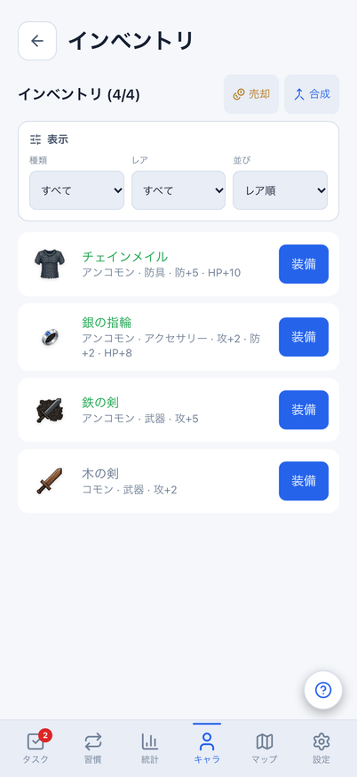 | 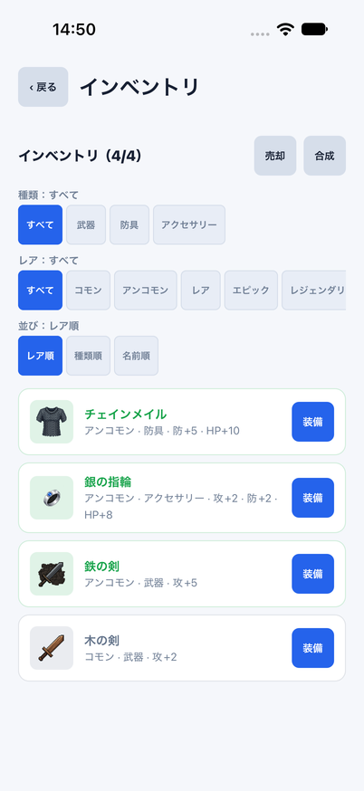 |
| dark 通常 | 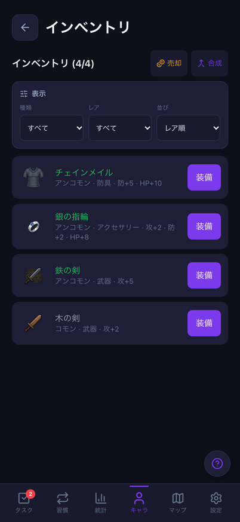 | 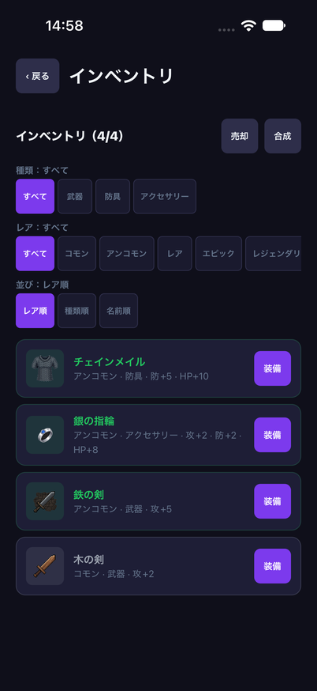 |
| light 素材選択 | 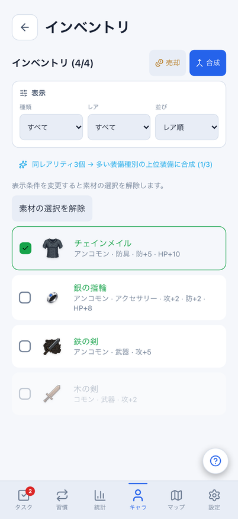 | 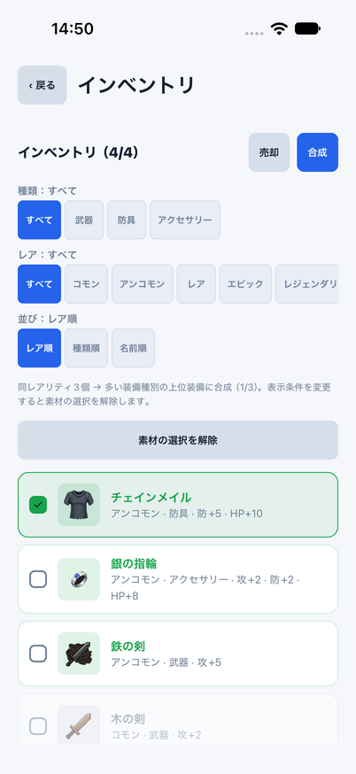 |
| dark 素材選択 | 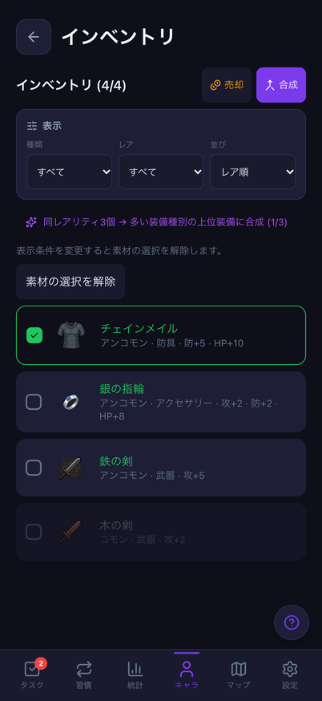 | 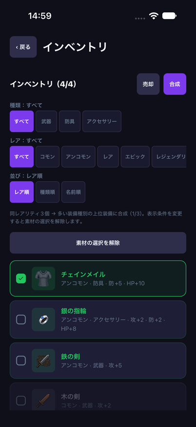 |
| light 売却 | 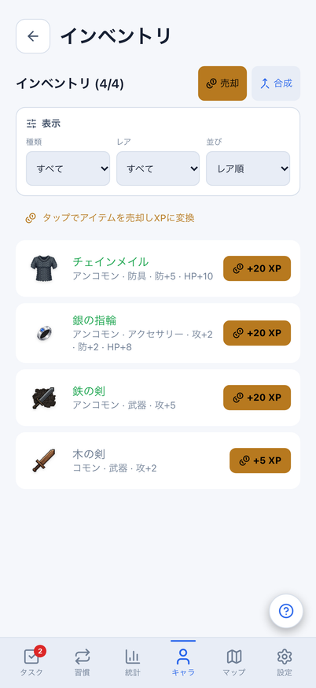 | 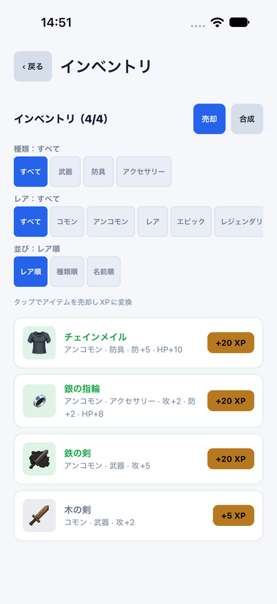 |
| dark 売却 | 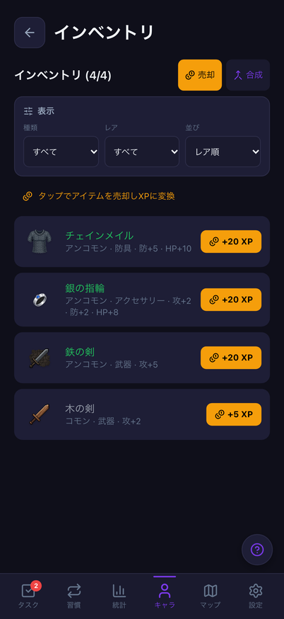 | 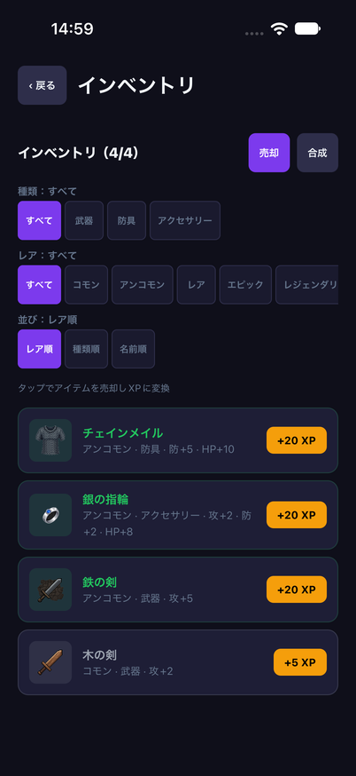 |

iOS文字拡大（accessibility-large。Webの200%文字確認とは別条件）:

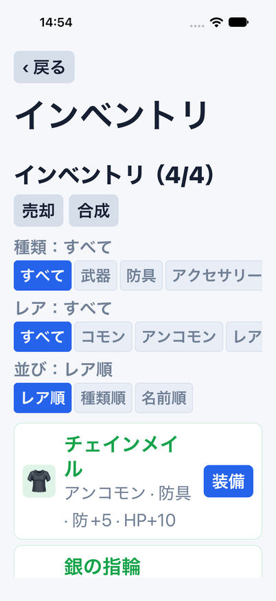

## 今回残す差分

フィルタは同じ選択肢を維持するが、Webの3セレクトに対しNativeは横スクロールのラジオ群。
この細部の圧縮、キャラ内のプレビュー等は後続。OSの安全領域・フォント描画・確認ダイアログは
プラットフォームに合わせる。今回だけでインベントリ全体が完全一致したとは扱わない。
