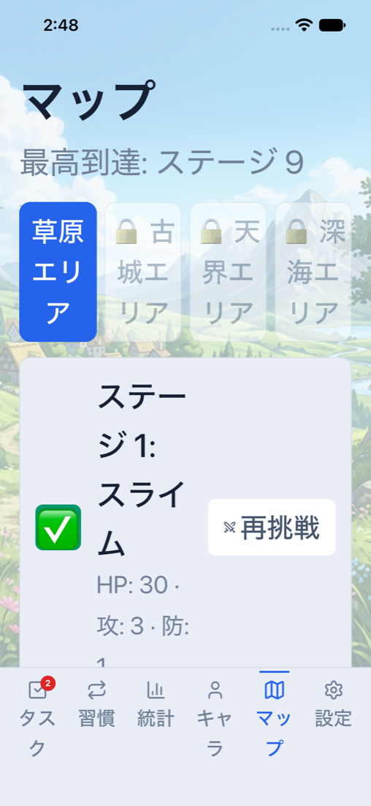
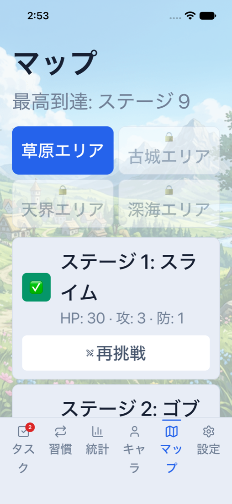
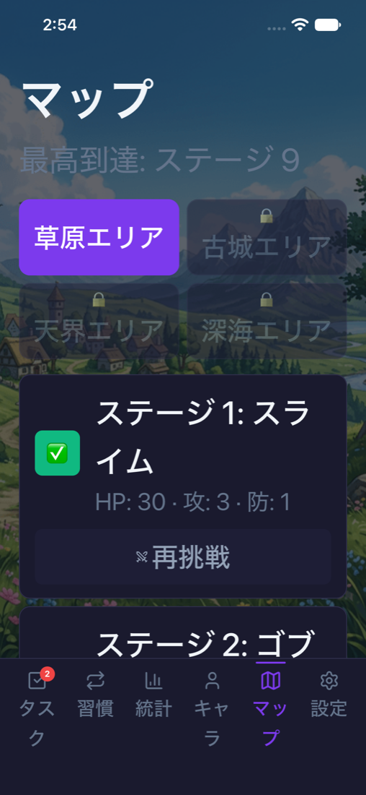

# モバイルのマップとステージ選択を大きい文字に対応させる（2026-11-27）

計画④ [#699](https://github.com/YuTakane256/Life-Quest/issues/699) のR5。[戦闘結果の操作](battle-result-action-layout-20261127.md)に続き、戦闘前のマップを確認した。iPhone 17eで文字を拡大すると、4列のエリア名や、開始ボタンと横並びのステージ名・能力値が細かく折れていた。

- 通常の表示はエリア4列と横並びのステージカードを使う。幅360pt未満または文字倍率1.5以上ではエリアを2列にし、ステージの説明の下に全幅の開始・再挑戦ボタンを置く。エリアは文字倍率2.4以上で1列にする。拡大時の鍵はラベルの上に表示する。
- エリア・開始・再挑戦の操作領域は高さ44pt以上。未開放エリアの無効表示、開始できるステージ、同期中の操作制限には既存の判定を使う。

## 確認

- iPhone 17e・iOS 27.0の専用シミュレーターを `accessibility-large` に設定した。匿名の比較データでライトの前後とダークの修正後を撮影し、5文字の各エリア名と、最初のステージのHP・攻撃・防御をそれぞれ一行で読めることを確認した。
- 通常のparity開発ビルドに比較データを入れ、ダークで未開放エリアの無効状態を確認した。ステージ1の「再挑戦」をタップし、勝利後に「次へ」でステージ2へ進んだ。続けて「マップへ」をタップし、最高到達がステージ9のマップに戻った。撮影モードで止まった初回の自動タップは、通常の操作成功に数えていない。
- 追加した4条件の回帰テストは修正前に狭幅・拡大の3件が失敗し、修正後はすべて成功した。Mobileの戦闘開始・結果の関連46件、Webのマップ・戦闘のPlaywright 22件、ローカル全体4,191件（167件スキップ）が成功した。Web/Mobileの型検査とLintも成功した（既存警告7件）。

| iOS・ライト 修正前 | iOS・ライト 修正後 | iOS・ダーク 修正後 |
| --- | --- | --- |
|  |  |  |

物理端末やAndroidでの表示と、全画面での文字拡大は引き続き確認する。
