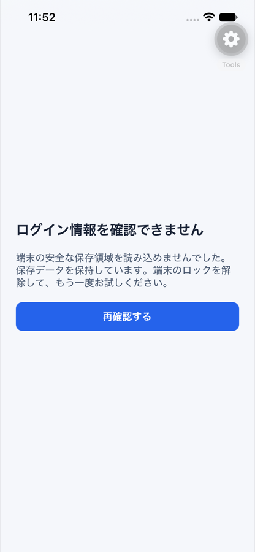
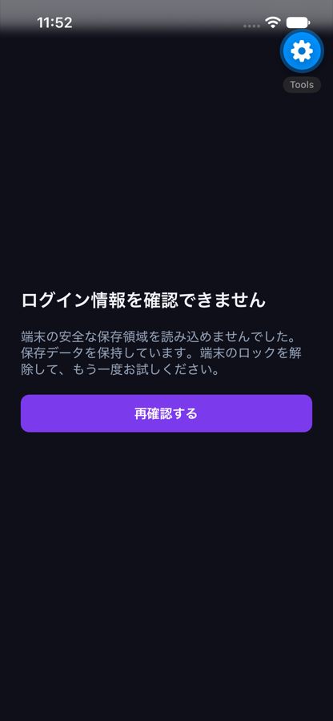

# Mobileのログイン情報読込失敗からの復帰（2026-11-18）

計画④の認証・起動復帰確認（#699）。iOS検証中に見つかった、安全な保存領域の読込失敗で「アカウントを確認しています」から進めなくなる経路に対応する。

## 復帰の動作

SecureStoreの読込が失敗すると、アカウントの有無を判断できるまでSDKの読込要求を保留する。同じキーへの並行読込は同じPromiseで待機する。

- 「ログイン情報を確認できません」と保存データを保持していることを表示する。ネイティブModalで背面の操作を遮る。
- 「再確認する」で失敗した読込を再開する。待機中は進行表示となり、再び失敗した場合は再確認ボタンへ戻る。
- 読込成功後はSDKの通常の認証通知、所有者確認、送信待ちキューと受信同期へ進む。保存領域から正常に返った空値もSDKへ渡す。
- セッションキーの変換規則を維持する。書込・削除の失敗は呼出し元へ返す。画面のエラー表示は一般化した案内を使う。

保存領域の読込要求が再確認を待つ間、すでに認証情報を取得した通信は既存のライフサイクルに従って進行する。

## 自動テスト

- `secureSessionStorage.test.ts`で、同じキーの並行読込、繰り返す失敗、複数キーの再確認、正常な空値、保存キーの互換性、書込失敗を確認した。
- `cloudStartupRecovery.test.ts`で実際のSupabase JSクライアントと認証・同期ライフサイクルを使用。起動時の1回目・2回目の読込失敗を再現し、保存セッション・表示所有者・未送信タスクを保持すること、再確認前の`getSession()`が未完了でRPCが0件であること、復帰後に同じ本人で送受信が進むことを確認した。ネイティブ保存とHTTP応答はテスト用の差し替えである。
- `CloudSessionRecoveryGate.test.ts`で、クラウド側が確認済みの場合も失敗画面が優先されること、ライト／ダーク、背面操作の遮断、再失敗、待機表示、成功後の通常確認／アカウント復旧表示を確認した。
- 現行package-lockに一致する環境で全体テスト4,176件成功、167件スキップ。対象3ファイル11件成功。Web・Mobileの型検査と全体Lintが成功し、Lintは既存の警告7件を含む。

## iOS画面の操作確認

iPhone 17e・iOS 27.0の一時シミュレーターと既存の署名済みparity開発ビルドを使用した。検証用コピーだけにSecureStore読込直前の失敗を注入し、再確認時に解除した。ライト／ダークの各テーマで、失敗画面の表示→ボタンのタップ→通常のタスク画面の検索欄までMaestroで確認した。

接続先はローカルの検証用URLで、保存アカウントがない状態からの画面復帰を確認した。保存済み本人と未送信タスクを伴う復帰は上記の自動テストで確認した。

| ライト | ダーク |
| --- | --- |
|  |  |

右上の歯車はExpo開発ビルドのツールボタン。失敗注入のコードは検証用コピーに限定し、検証後に取り除いた。

## 残る確認

物理端末のロック状態やKeychain／Keystore自体の障害、Androidの実表示、保存領域が恒久的に利用できない端末は未確認。計画④の端末・通信条件の確認を継続する。
