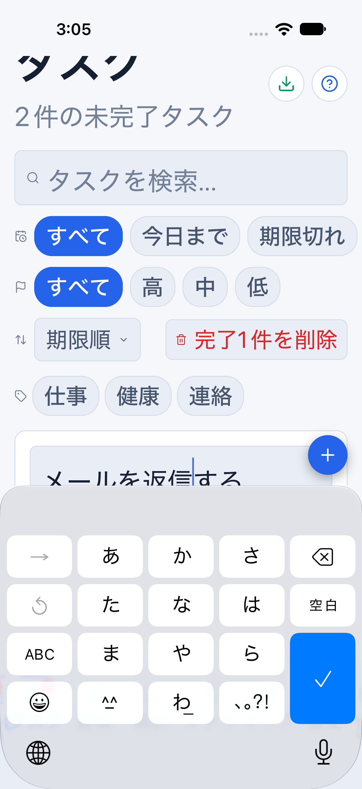
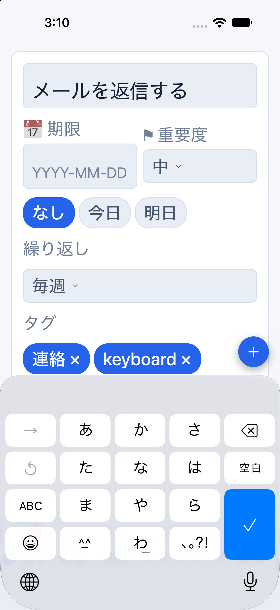
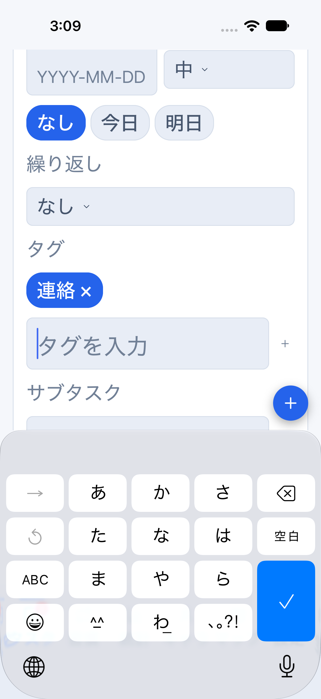
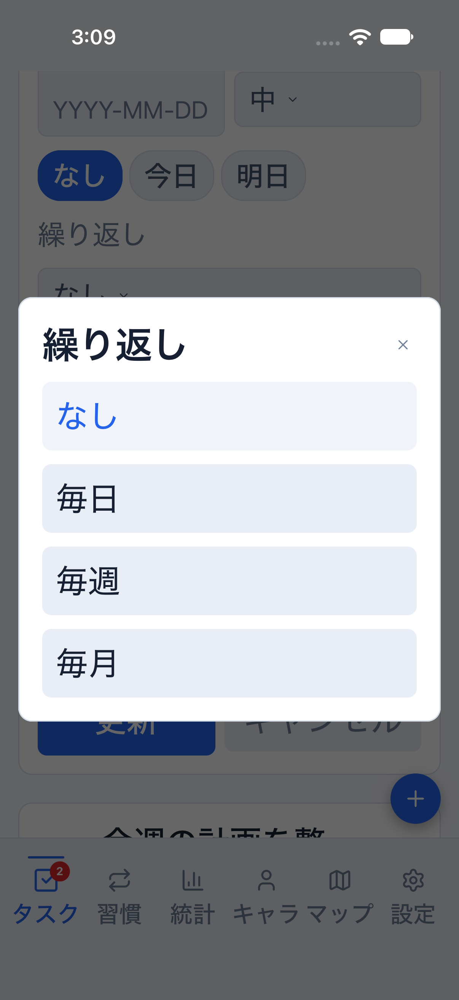
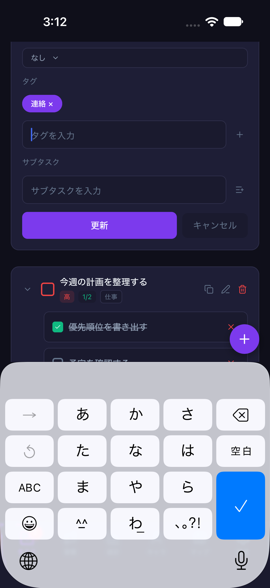
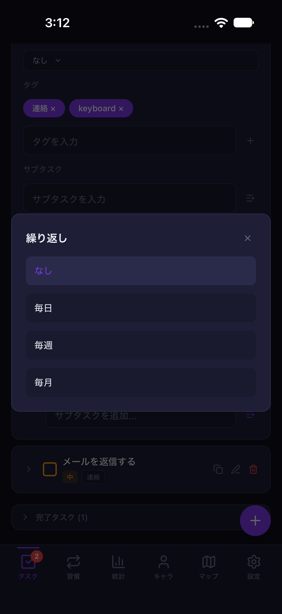
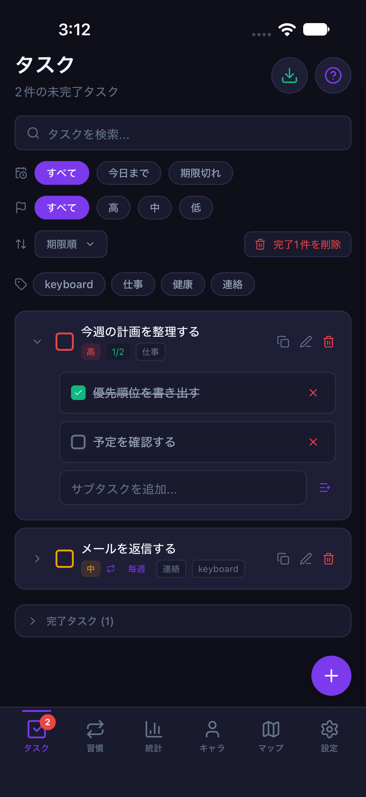
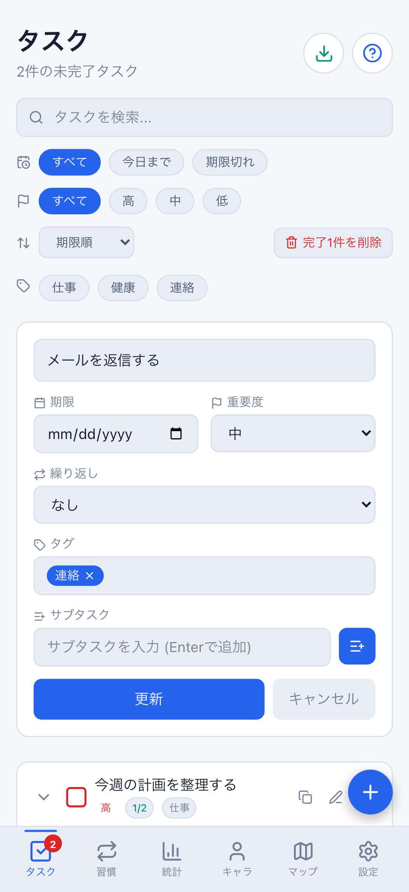
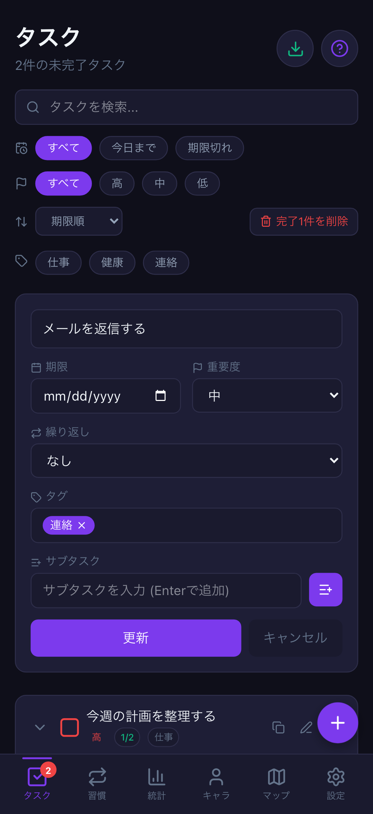

# Mobile：タスク繰り返し編集と入力品質（#761）

Webでは作成後も変更できる繰り返し設定が、Mobileでは「作成時の設定」として
読み取り専用になっていました。編集時も「なし／毎日／毎週／毎月」を選択・保存できます。

## 変更と境界

- 共有の編集型に既存の`recurrence`を含め、Nativeの実フォームから保存します。
- DB・API・保存形式・報酬量は変更せず、既存の`upsert_task.p_recurrence`を使います。
- 編集だけでは報酬や次回分を発行しません。以降の完了確定時に変更後の周期を使います。
- すでに作成された別IDの次回タスクを一括変更する「シリーズ編集」ではありません。
  Web同様に選択したタスク1件の設定を変更します。
- 完了済みの編集だけでは再報酬・次回分の追加発行を行いません。
- iOSでキーボード表示後にフォーカス中の入力欄を計測し、欄全体と下部ボタン用の
  余白が見える位置までスクロールします。名前・期限・タグ・サブタスクが対象です。
  文字拡大・キーボードの高さ変更にも追従し、blur/別入力/非表示/手動スクロール/
  unmount後の遅い計測結果は使いません。Androidの既存キーボード動作は変更しません。
- フォーム全般のアカウント切替保護や、実アカウントの同期確認を完了した扱いにはしません。

## 自動回帰

```bash
npx vitest run src/hooks/mobileTaskRecurrence.test.tsx \
  apps/mobile/src/hooks/useTaskKeyboardVisibility.test.ts \
  apps/mobile/src/stores/useMobileTaskStore.test.ts \
  apps/mobile/src/stores/useMobileTaskStore.cloud.test.ts \
  packages/core/src/tasks.test.ts scripts/run-mobile-parity-screenshots.test.mjs
npx playwright test e2e/task-recurrence.spec.ts \
  --project=desktop-chromium --project=mobile-chromium
```

Native実フォームの4周期の保存・再編集・キャンセルと送信値、保存データ、
匿名の次回分・報酬、認証済みの場合のサーバー権限を検査します。
入力欄の計測とキーボード/画面の境界はhook単体でも検査します。
Webは両テーマ・PC/402pxで編集・キャンセル・実際の保存からの再読み込みを検査します。

## iOS画面操作の再実行

通常の確認用Metro8081を止めず、メモリ専用比較環境を8082で起動します。

```bash
npm run start:reference:light --workspace @life-quest/mobile -- --port 8082
# 別ターミナル
node scripts/run-mobile-parity-screenshots.mjs taskForm
```

ダークは8082のMetroだけを止め、`start:reference:dark`に切り替えます。
起動済みSimulatorは1台にし、Device Hubの
`Device > Keyboard > Toggle Software Keyboard`でソフトウェアキーボードを表示してください。
フローはキーボードの`Done`キーを検査するため、入力欄のフォーカスだけでは合格しません。
文字サイズの変更前の値を控え、検証後に元へ戻してください。

runnerはparity・クラウド未設定・dailyメモリfixture・両テーマの条件を検査します。
`clearState`を実行せず、比較用URLから直接起動するため通常データは初期化しません。
起動直後にもう一度URLを送る競合も避けます。メモリfixtureは永続化の証拠ではありません。
検証後は通常の8081へ戻します。

```bash
xcrun simctl openurl booted 'lifequest-parity://expo-development-client/?url=http%3A%2F%2F127.0.0.1%3A8081&disableOnboarding=1&disableAutoLaunch=1&disableFab=1'
```

## 残る確認

本PRのタスクフォーム確認と、全画面のアクセシビリティ合格は別です。
Android・実機認証/通知権限・staging双方向同期は引き続き計画④/⑤で確認します。

## 今回の実行記録（2026-10-19）

- Web：PC/402×874、light/darkの4ケースで保存・取消・再読み込みが成功。
- iOS：iPhone 18 Pro / iOS 27 / 402×874、light・`accessibility-large`で
  キーボード表示→タグ入力→週次へ変更→保存→再編集→変更取消→週次の保持を確認。
  タスク名でも、修正後に欄全体がキーボード上に表示されることを別途確認しました。
- iOSの通常文字サイズ（`large`）・darkも同じフローが全操作成功。
- 最初のMaestro実行は起動URL切替のタイムアウト、再実行は装飾バッジがAXに出ない
  セレクタ不一致で失敗しました。選択肢のselected状態を検査する方式に修正。
  文字拡大時の入力欄の隠れは実際の不具合として修正し、これらの失敗を成功件数に含めません。
- 比較データはメモリ専用です。ユーザーの通常parityデータは操作せず、検証後に
  文字サイズ`large`と通常Metro8081へ戻しています。

### 文字拡大時の入力欄

同じiPhone・light・文字サイズ`accessibility-large`のタスク名です。
修正前は欄の下半分がキーボードに隠れ、修正後は欄全体と下部操作用の余白を確保します。
修正後の画像は保存/取消検査後なのでタグが1件増え、周期が毎週になっています。

| 修正前 | 修正後 |
| --- | --- |
|  |  |

入力を使った回帰はタグ欄で実施し、保存後に入力したタグと選択中の毎週を再編集で確認します。
これは文字拡大・ソフトウェアキーボードの操作証拠であり、Webとのピクセル一致の証拠ではありません。

| 拡大文字の入力 | 周期の選択 |
| --- | --- |
|  |  |

通常文字サイズのダークテーマでもキーボード表示・選択・保存/取消を確認しました。

| iOS dark・入力 | iOS dark・周期 | 保存/取消後 |
| --- | --- | --- |
|  |  |  |

Web側の同じdailyデータ・402pxの編集フォーム（周期を変更する前）。
日付入力やキーボード・選択ダイアログはOS固有の表示を維持します。

| Web light | Web dark |
| --- | --- |
|  |  |
