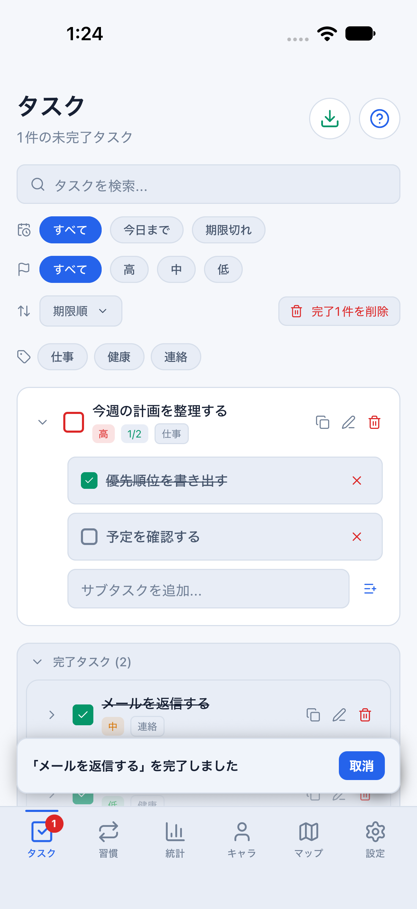
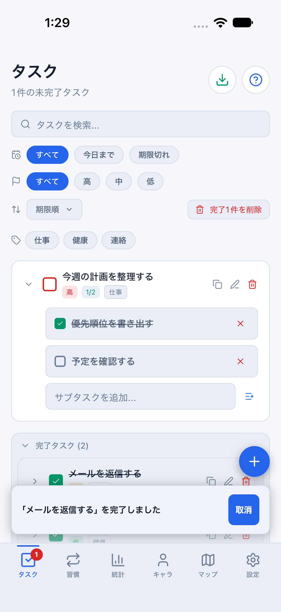
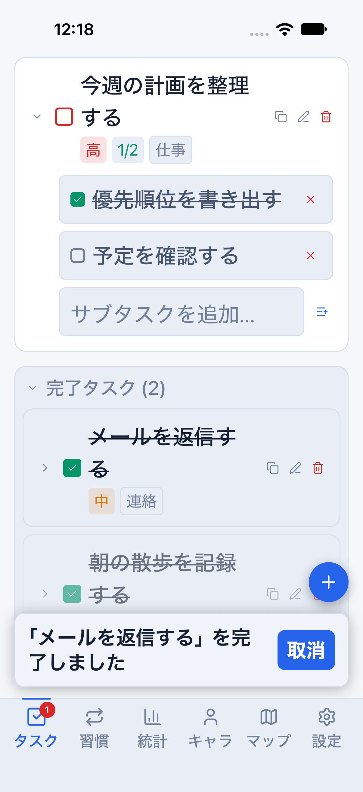

# Mobile：完了取消と追加ボタンの分離（#721）

タスク完了後の5秒間、右下の追加ボタンと取消トーストが同じ位置に重なり、
追加しようとした操作が取消に届く問題を修正します。

## 変更範囲

- 追加ボタンと取消トーストを同じ親の通常フローに配置し、12ptの間隔を確保。
- トーストの実測高に合わせて一覧の下余白を増やし、文字拡大・折り返しに追従。
- 取消ボタンは最低44×44pt。取消猶予・報酬確定の5秒は変更しません。
- iOSのキーボード回避領域の内側に一覧とボタン領域を置きます。
- 保存形式・同期・認証・報酬計算は変更しません。

## 再実行

専用parityアプリをインストールした、起動済みのiOS Simulatorを1台だけ用意します。
8081の別Metroを止めてから実行してください。

```bash
npm run mobile:reference:light
# 別ターミナル
node scripts/run-mobile-parity-screenshots.mjs undo
```

ダークはMetroを止めてから `npm run mobile:reference:dark` に切り替えます。
このフローはメモリ内のdaily比較データ専用です。runnerがmanifestを検査し、
通常版・preview・クラウド設定あり・別profileでは開始しません。
`clearState:false` のまま起動し、保存データを初期化しません。

完了直後に追加フォームを開き、そのまま取消して元のタスクが戻ることを検査します。
続いてトースト表示、フォーム入力、新規追加、猶予終了後の配置を確認します。
大きい文字では対象を画面中央へスクロールしてから操作し、画面外の要素を
ラベルだけでタップして成功扱いにしません。

`*-input` 画像は入力フォームの証拠です。Simulatorのハードウェアキーボード設定に
よってソフトウェアキーボードが出ない場合があるため、キーボード表示中の成功証拠とは
区別します。検証結果と未実施項目はPR本文に明記します。

これは匿名の画面操作テストであり、実保存・クラウド同期・Android実機の合格証拠では
ありません。[既存の保存・報酬回帰](anonymous-progression-quality.md)は別に維持します。

## 実画像

同じdaily比較データ・ライトテーマ。通常表示の修正前後と、文字拡大時の分離を記録します。

| 修正前 | 修正後 | 修正後・文字拡大 |
| --- | --- | --- |
|  |  |  |
