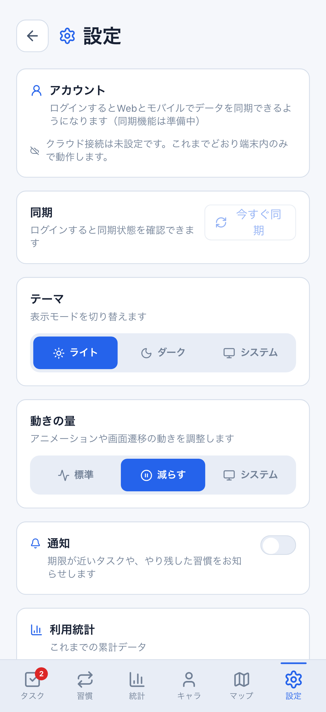
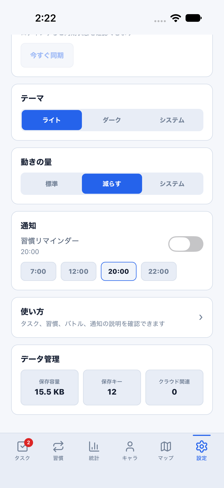
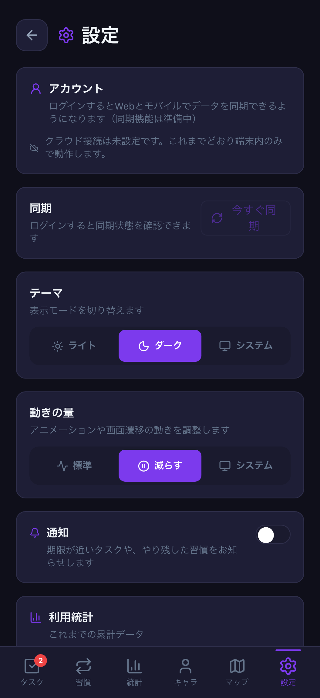
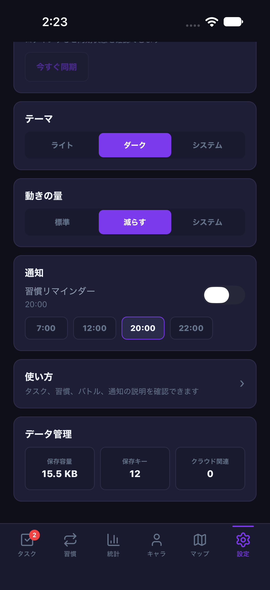
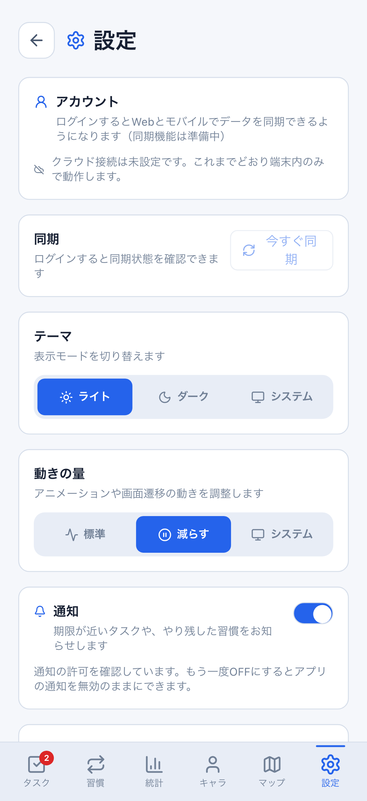
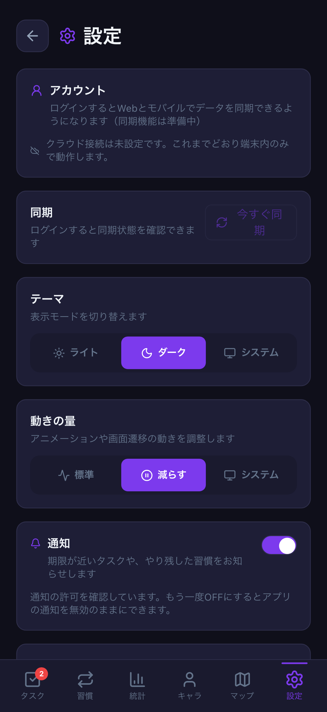

# 通知の許可待ち・送信・既通知記録の帰属

Issue: [#783](https://github.com/YuTakane256/Life-Quest/issues/783)。計画④の設定/日常操作品質。

## 変更

1. Web/Mobileで許可待ちを表示し、待機中のOFF・認証切替・画面破棄後に古い返答でアプリ通知をONへ戻さない。
   Nativeはタブ離脱/復帰と復元前も保護し、画面寿命を失った旧処理はOS許可要求も開始しない。
   スイッチの待機表示は一時状態で、許可確定まではON設定を保存/同期しない。
2. 共有の `createNotificationCheckGate` で認証/設定/前景寿命を持つ。同じ有効なチェックだけ重複を防ぎ、
   旧処理が未完了でも新アカウントは開始できる。旧finallyは新処理のロックを解除しない。
   OFF→ONや非表示→表示でも旧処理を復活させない。
   認証切替のストア初期化完了を待ってから内容を読む。通知チェックを認証ライフサイクルフックの中からawaitしない既存の呼び出し方を維持する。
3. WebはSW取得後の送信直前にも対象を確認し、両クライアントとも送信完了時の対象と帰属を再確認する。
   タスク変更/削除/完了、習慣変更/休息/全達成、日付・時刻設定の変更で古い既通知記録を反映しない。

通常送信、同一ユーザー通知、同値pull、失敗後の再試行は維持する。WebのOS拒否状態でも、
保存済みON設定はOFFへ戻せる。通知文言・時刻・24時間の期限判定・前景のみの方式は既存ルールを使う。

## 検証

- `src/utils/notificationOperationQuality.test.ts`: 実ストア＋実Web/Native通知経路に、許可照会/SW取得/OS受付の待機を差し込む。
  認証切替、ログアウト、ON/OFF、前景復帰、対象変更、旧finallyと新実行の競合、再試行、Native解除/復元前を確認する。
- `NotificationSettings.test.tsx` と `SettingsScreen.test.ts`: 実UI＋実設定ストアで許可待ち中のOFF、
  旧返答と新要求、画面離脱、同一ユーザー通知、通常の時刻選択を確認する。共有ゲート6件と既存通知回帰も維持する。
- `e2e/notification-operation-quality.spec.ts`: PC/402×874 × light/darkの8ケース。
  ブラウザー通知APIはテストダブル。OFF後の遅延許可と再読込、通常の許可/時刻選択/OFF/再読込を確認する。
- `npm run mobile:parity:screenshots -- notifications`: iPhone 18 Pro/iOS 27、両テーマ。
  通知はOFFのまま22時→7時→20時とタブ復帰を確認する。OS許可要求や実通知送信はしない。

## 比較資料

同じ架空匿名fixture・402×874・2026-08-10。NativeはOFF中も時刻チップを表示、WebはON時だけ時刻欄を表示する既存差を残す。
設定画面全体の完全一致を主張する資料ではない。READMEの画像は増やさない。

| 状態 | Web | iOS |
| --- | --- | --- |
| light・OFF |  |  |
| dark・OFF |  |  |

Webの許可待ち表示（APIはテストダブル）:

| light | dark |
| --- | --- |
|  |  |

## 境界

- OSへ渡した通知や表示済みの許可ダイアログを強制撤回する機能ではない。OS受付後は表示される可能性を残すが、
  旧結果を新しいアプリ状態の既通知記録へ持ち越さない。
- OSの実際の許可/拒否/設定変更・実配信、Android実端末、staging認証は公開前の実機確認に残す。
- 値比較はローカル競合防止であり、サーバー排他制御やexactly-once保証ではない。同じ値へ戻るデータ変更の検出や、
  既存の通知履歴をアカウント別形式で保存する変更は含まない。
- DB/API/保存形式/報酬計算に変更なし。通知履歴は既存の端末ローカル方式を維持する。
  通常8081・ユーザー保存データは変更せず、専用parity・クラウド未設定・メモリ専用8082だけで比較する。

PR後の独立レビューと既存CI3つを確認し、自動マージしない。
