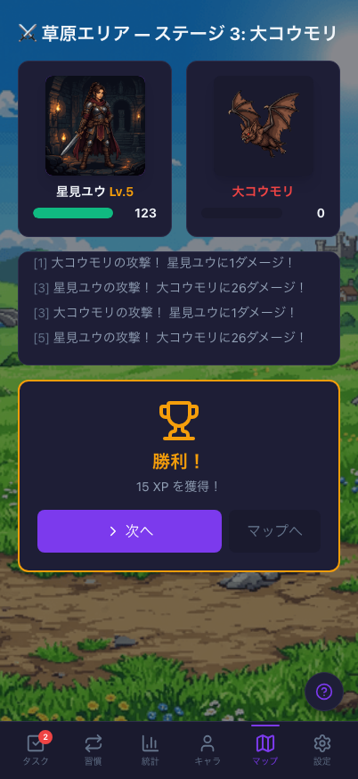
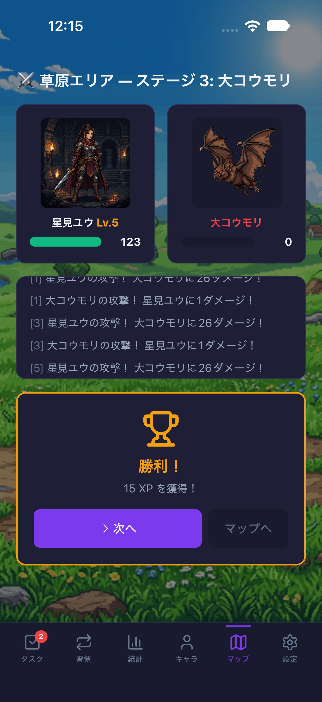
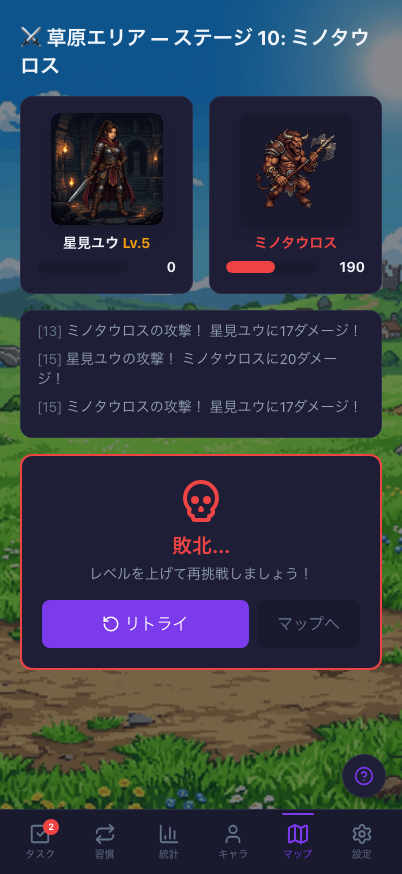
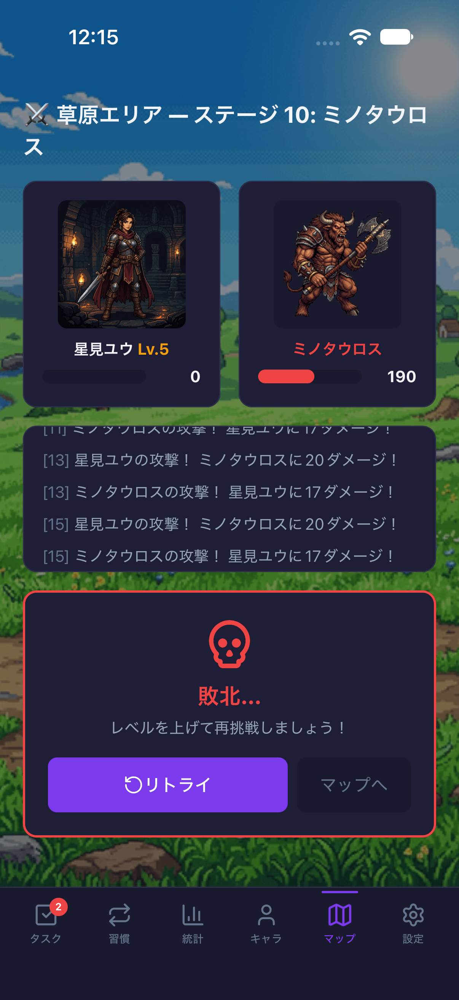
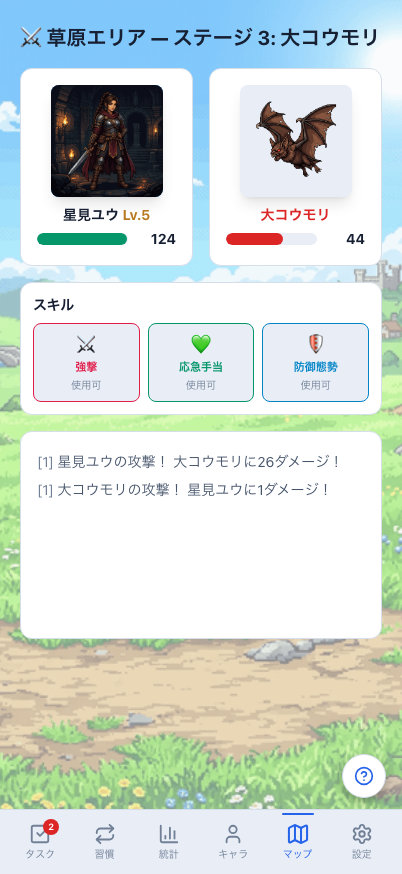
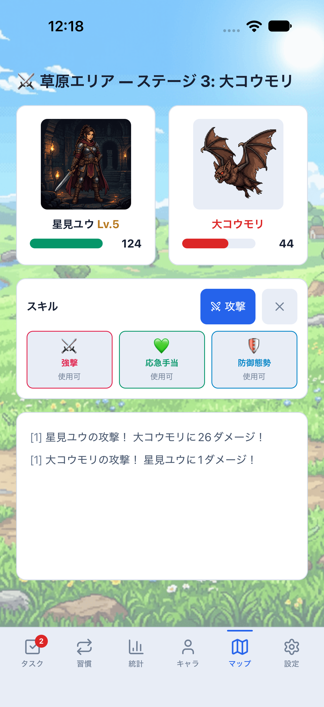
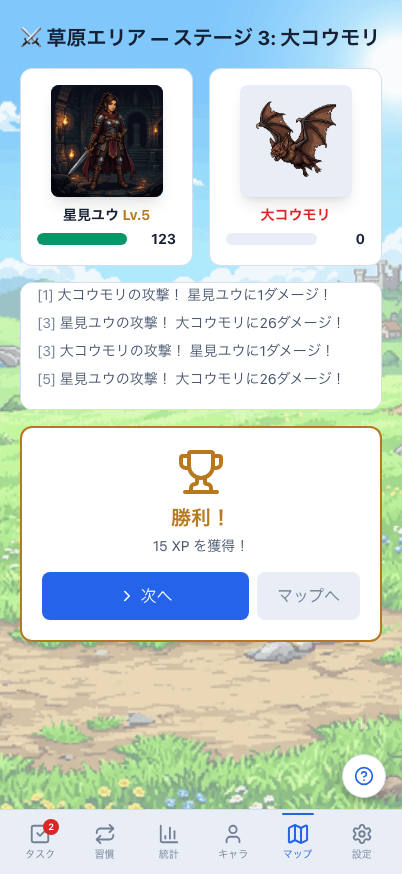
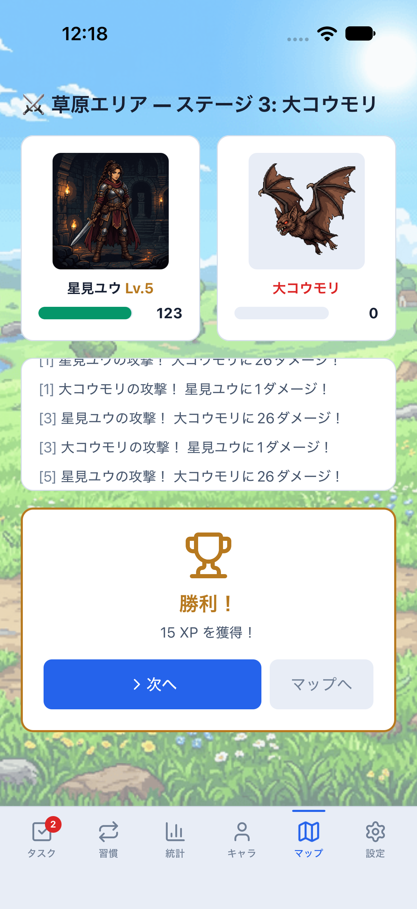
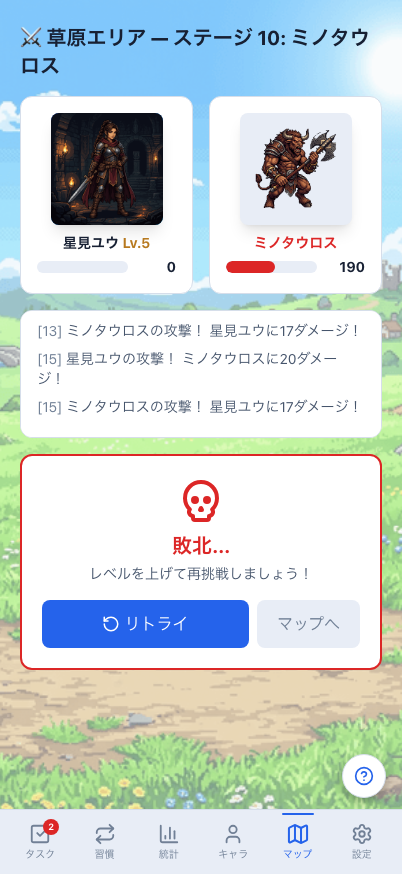
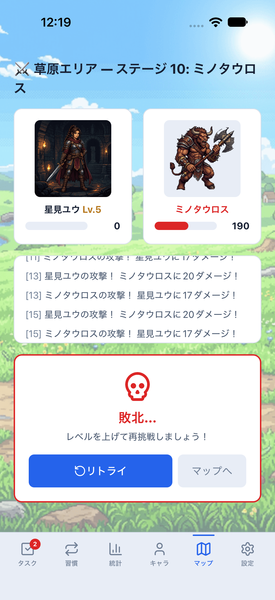

# 戦闘・勝敗のWeb / Mobile比較

同じ架空匿名データ・行動・日時（2026-08-10 21:00 JST）・テーマで撮影した実画面です。原本PNGは加工・切り抜きなし。画像を押すと原寸で確認できます。

- Web：Chromium、402×874 CSS px。Mobile：iPhone 18 Pro / iOS 27、402×874 pt（1206×2622 px）。
- 共通のbattle比較profile：星見ユウ/Lv.5/330 XP、装備込み能力値28/22/125、最高クリア9、消化数12。通常のdaily比較profile（最高クリア2）は維持します。
- 戦闘中：ステージ3の大コウモリに通常攻撃1回。プレイヤーHP124/125、敵HP44/70、同じ2件のログ。
- 勝利：続けて通常攻撃2回。敵HP0、15 XPを獲得し345 XP。同じ行動・結果を実際の既存エンジンで進めています。
- 敗北：マップへ戻り、ステージ10のミノタウロスに通常攻撃8回。プレイヤーHP0、敵HP190/350、XPは345のまま。
- Mobile撮影はdev/parity・クラウド設定なし・メモリ専用。通常保存データや初期テーマsystemを変更しません。

## ダーク

| 状態 | Web | Mobile / iOS |
| --- | --- | --- |
| 戦闘中 |  |  |
| 勝利 |  |  |
| 敗北 |  |  |

## ライト

| 状態 | Web | Mobile / iOS |
| --- | --- | --- |
| 戦闘中 |  |  |
| 勝利 |  |  |
| 敗北 |  |  |

## 揃えた部分と残る差

背景・プレイヤー/敵の横並び画像・名前/レベル・HPバー・3列のスキル・ログ・勝敗カードと結果後の導線を揃えました。HP上限/スキル解放/プレイヤー名・レベルは戦闘開始時のスナップショットを参照し、途中の装備変更や成長で表示だけがずれないようにします。勝敗後のログは両版で短いスクロール枠とし、結果と操作を優先します。最終ステージの「次へ」は「再挑戦」と表示します。

Webは自動ターン進行、Mobileは既存の手動攻撃/スキル操作を維持します。Mobileの攻撃・戦闘終了ボタンはスキル欄に追加しています。OS安全領域・字体/絵文字・背景領域の差、Webだけの履歴/リプレイは残ります。全面的な操作一致や#697全体の完了とはしません。

クラウドの勝敗結果が未適用（初期/同期中/エラー）の間は、両版で次の戦闘/マップ復帰を無効化し、元のattemptを残して同じ結果を再送します。適用済みの復元データは移動を妨げません。戦闘計算、XP付与、サーバーAPI、保存形式は変更しません。掲載画像はローカルの見た目比較であり、クラウド同期や実保存の合格証拠ではありません。

## 再現

Web：`npm run e2e:parity:reference`。日常7画面×両テーマの14画像に加え、戦闘3状態×両テーマ6画像を保存します。比較テストだけで時計を停止し、Webの自動攻撃を1000/2000/8000ms進めて同じ行動数に揃えます。通常のタイマーは変更しません。

Mobile：`LIFE_QUEST_PARITY_PROFILE=battle npm run mobile:reference:dark`（または`:light`）を起動し、別ターミナルで`npm run mobile:parity:screenshots -- battle`。3状態の撮影後にリトライ、回復/防御/攻撃スキルとクールダウン、マップへの復帰も確認します。runnerは実際のMetro manifestにbattle profileがある場合だけ実行し、通常のreference/mapフローとの取り違えを拒否します。clearState:falseで実保存を消しません。

撮影後はMetroを停止し、profile/captureフラグなしで通常版の開発へ戻します。Android実機・署名済み認証・双方向同期などは#699/#700に残します。

関連：[マップ比較](../map-parity/README.md)、[キャラクター比較](../character-parity/README.md)、[全体計画](../../mobile-web-implementation-roadmap.md)。
