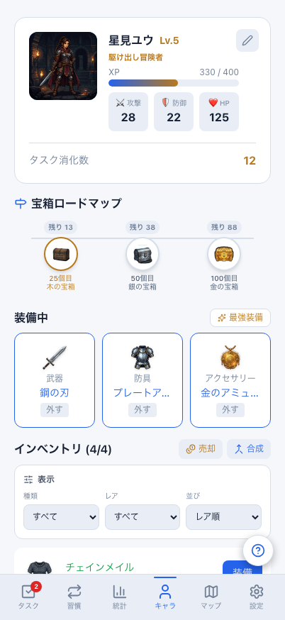
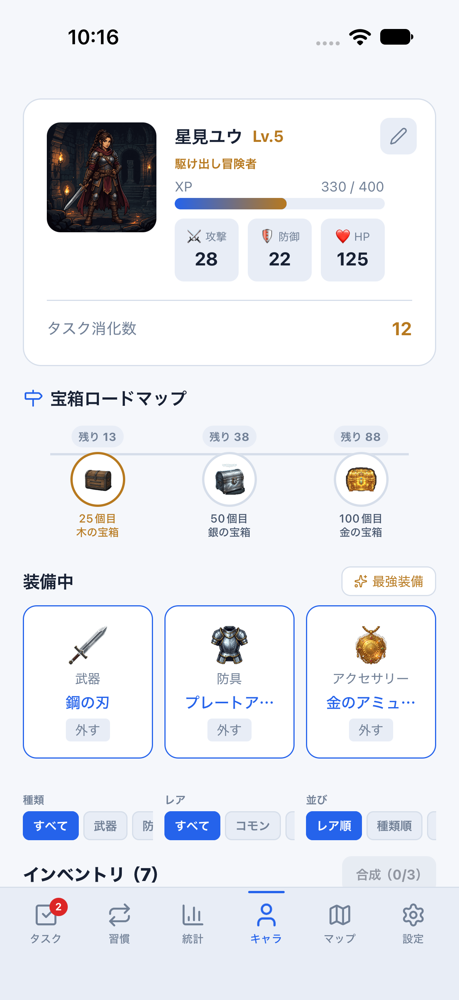

# キャラクター：成長・次の目標・装備のWeb / Mobile比較

同じ架空匿名データ、JST日時（2026-08-10 21:00）、テーマで撮影した実際の画面です。原本PNGは加工・切り抜きなし。画像を押すと原寸で開けます。

- Web：Chromium、402×874 CSS px。
- Mobile：iPhone 18 Pro / iOS 27シミュレーター、402×874 pt（PNGは1206×2622）。OSの安全領域・ステータスバー・文字/絵文字の描画差は一致対象外です。
- 共通fixture：星見ユウ、Lv.5、330 / 400 XP、称号「駆け出し冒険者」、消化数12、装備込み能力値28 / 22 / 125。
- 次の目標は25 / 50 / 100個目、残り13 / 38 / 88。Web/Mobileで同じ読み取り専用ヘルパーを使います。
- 通常の初期テーマ「システムに合わせる」や保存データは変更しません。Mobile撮影はdev/parity/クラウドなしのメモリ専用環境です。

## ダーク

| Web | Mobile / iOS |
| --- | --- |
|  |  |

## ライト

| Web | Mobile / iOS |
| --- | --- |
|  |  |

## 今回優先した部分

日々の達成→キャラクターの成長→次の宝箱や装備という循環が伝わる主要部分を優先しました。

- プロフィール：96ptの共通アバター、名前・レベル・称号、XPバー、装備込み能力値、タスク消化数の順序と配置。
- 宝箱ロードマップ：次の3目標と残り回数、共通画像・選択色。表示は読み取り専用で、報酬の付与・抽選をしません。
- 装備中：武器・防具・アクセサリーの3列、共通画像・レアリティ色、外す・最強装備の入口。
- プロフィール編集：編集ボタンから開き、名前とアバターの下書きを明示保存。閉じるだけでは保存しません。保存済みの長い名前を切り詰めないよう、編集上限は既存保存形式と同じ30文字に統一しました。
- 未開封の宝箱：既存の開封・失敗・再送処理を維持し、入口のカード表示をWebに近づけました。fixtureの未開封数は0なので掲載画像にはありません。
- 小さい能力値ラベルの折り返しをWeb/Mobile両方で修正。成長・報酬・装備の計算式は変更しません。

## 残る違い

- 下部インベントリは今回の一致対象外です。Mobileは既存の埋め込み一覧・装備中も含む7件、Webは未装備4件のプレビューと独立画面を使います。装備・売却・合成・絞り込みはMobileでも引き続き利用できますが、見た目・導線の統一は#695で扱います。
- 獲得履歴・デバフ表示・レベルアップ/宝箱演出などの全面統一は後続工程です。画像の主要部分が揃っていることを、キャラクター関連の全状態・全操作の一致とはしません。
- Android実機、小さい画面・大きい文字、署名済み実機認証・同期確認は後続工程。見た目の比較画像は保存・同期・認証・報酬の合格証拠ではありません。

## 再現・操作確認

Web：`RUN_WEB_PARITY=1 npx playwright test --project=web-reference-402x874`。

Mobile：`npm run mobile:reference:dark`または`:light`を起動し、別ターミナルで`npm run mobile:parity:reference`。

同じメモリ環境で`npm run mobile:parity:screenshots -- character`を実行すると、プロフィール下書きの取消・保存、装備の解除・最強装備、既存インベントリの絞り込みを確認できます。このフローはクラウドなしの比較manifestを要求し、`clearState:false`で通常保存データを消しません。

実保存は比較Metroを停止した後、captureフラグなしの匿名parity環境で`npm run mobile:parity:smoke`を実行して別途確認します。専用parityアプリだけを初期化し、タスク・習慣・プロフィールの保存と再起動後の復元を検証します。

関連：[タスク・習慣比較](../daily-parity/README.md)、[全体の実装計画](../../mobile-web-implementation-roadmap.md)、[同条件撮影](../../mobile-visual-reference.md)。
