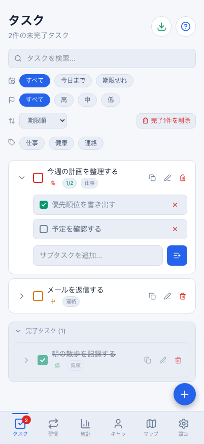
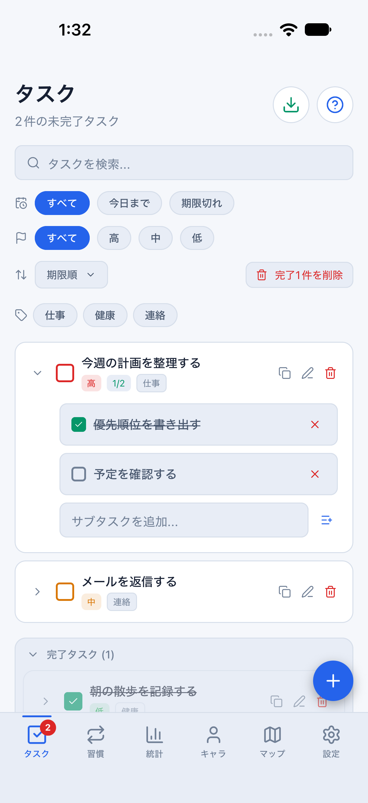
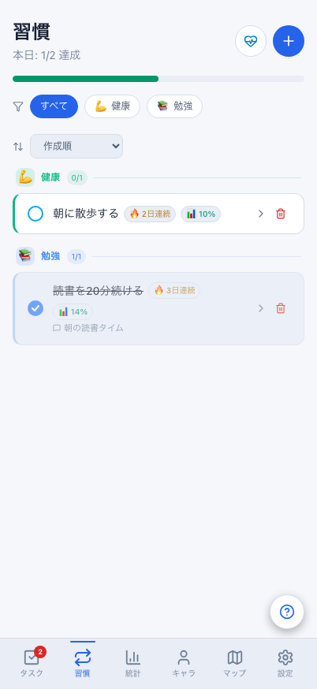
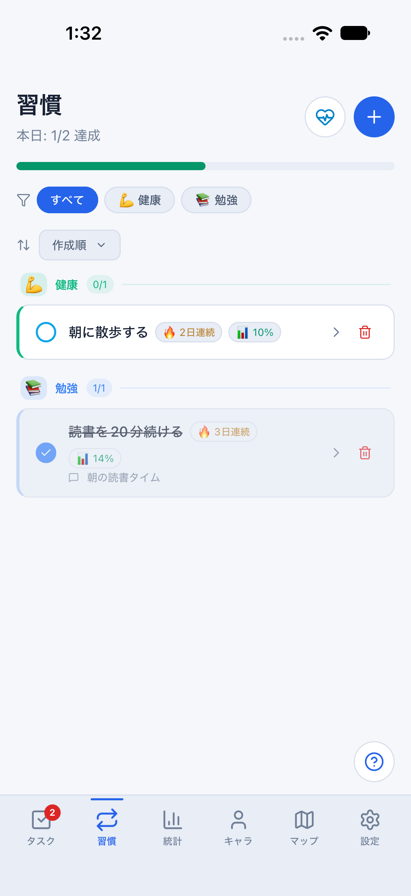

# タスク・習慣：Web / Mobile比較

同じ架空の匿名データ、JST日時（2026-08-10 21:00）、テーマで撮影した実際の画面です。画像は加工・切り抜きなしで保存し、表では幅を揃えて表示します。

- Web：Playwright / Chromium、402×874 CSS px。
- Mobile：iPhone 18 Pro / iOS 27シミュレーター、402×874 pt（PNGは1206×2622）。
- ライト / ダークを明示指定。通常版の初期設定「システムに合わせる」は変更しません。
- タスクの完了一覧は両方で開く。習慣のカテゴリ・記録・メモも同じデータです。
- Mobileの比較用データは開発・parity・クラウド設定なしのメモリ内に限定。通常の保存データやサインイン済みデータを初期化しません。

## ダーク

| Web | Mobile / iOS |
| --- | --- |
|  |  |
|  |  |

## ライト

| Web | Mobile / iOS |
| --- | --- |
|  |  |
|  |  |

## 今回揃えたもの

- タスク：検索・期限/優先度/タグの絞り込み、並び替え、閉じた追加フォームと右下の入口、優先度・サブタスク・タグ表示、完了一覧。
- 習慣：見出しの達成数と追加/休息ボタン、達成バー、使用中カテゴリの絞り込み、カテゴリ別の見出し・件数・カード、ストリーク・達成率・メモ。
- 主要な余白、文字サイズ、背景、カード、Lucideアイコン、選択色。タッチ幅のWebでも編集・複製・削除をホバーなしで利用可能にしました。
- Mobileの編集・サブタスク・完了取り消しは既存ストアを使用。メモ保存・休息日も既存の処理を呼び出します。
- CSVの列と数式対策、180日履歴の読み取りモデルをWeb/Mobileで共有しました。報酬ルール、DB、同期API、保存形式は変更していません。

## 残す差・継続課題

- OSステータスバー、安全領域、文字・絵文字描画の微差は一致対象外。WebよりMobileの一覧表示領域は小さくなります。
- 選択はMobileの画面内ダイアログ、確認はOSの確認ダイアログ。期限はYYYY-MM-DD入力と今日/明日のショートカットです。
- CSVはWebでファイル保存、MobileではOS共有シートへCSVテキストを渡します。
- Mobile編集では繰り返しを作成時の設定として表示し、変更はしません。フォーム・履歴モーダルの全配置や全画面の一致を保証する比較ではありません。
- フィルター/並び替えはMobile画面内の状態です。再起動で選択を保存する仕組みは今回追加していません。
- Android実機、小さい画面・大きい文字、署名済み実機認証・同期確認は後続工程。これらの画像は保存・同期・認証の合格証拠ではありません。

## 再現

Web：`RUN_WEB_PARITY=1 npx playwright test --project=web-reference-402x874`

Mobile：`npm run mobile:reference:dark`（または`:light`）を起動し、別ターミナルで`npm run mobile:parity:screenshots -- reference`。

フォーム・検索・編集・完了・習慣メモ/履歴/休息日は、同じメモリ環境で`npm run mobile:parity:screenshots -- daily`。通常の永続化回帰は比較環境を停止した後、匿名parityの通常Metroで`npm run mobile:parity:smoke`を実行します。

詳細：[比較環境](../../mobile-visual-reference.md)、[全体計画](../../mobile-web-implementation-roadmap.md)。Issue #691・#692の残りの条件は継続管理します。
