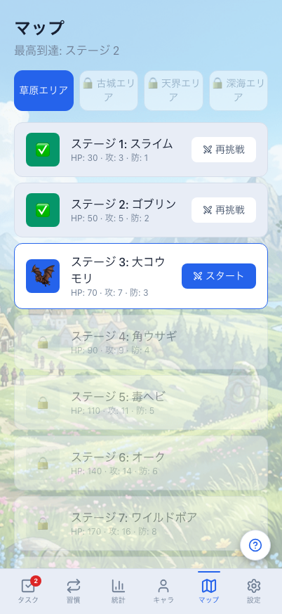
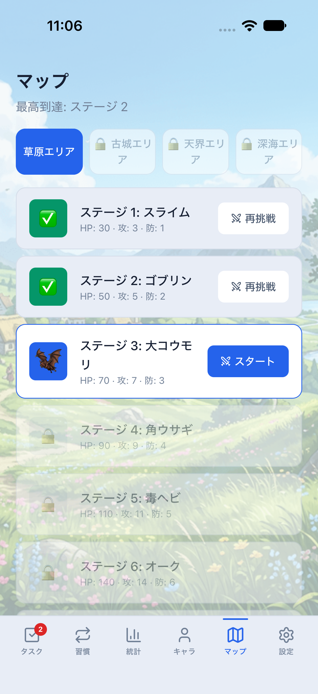

# マップ：成長の先にある攻略のWeb / Mobile比較

同じ架空匿名データ、日時（2026-08-10 21:00 JST）、テーマで撮影した実際の画面です。原本PNGは加工・切り抜きなし。画像を押すと原寸で開けます。

- Web：Chromium、402×874 CSS px。
- Mobile：iPhone 18 Pro / iOS 27シミュレーター、402×874 pt（PNGは1206×2622）。OSの安全領域・ステータスバー・フォント/絵文字の描画差は一致対象外です。
- 最高クリアはステージ2、次の攻略対象はステージ3の大コウモリ。草原エリアを選択し、古城・天界・深海は未解放です。
- 共通の既存背景・敵画像、情報順序、エリア選択、ステージの能力値、再挑戦/スタートの入口を揃えています。
- 比較データは専用dev/parity・クラウドなしのメモリ専用環境に限定。通常保存データや初期テーマsystemを変更しません。

## ダーク

| Web | Mobile / iOS |
| --- | --- |
|  |  |

## ライト

| Web | Mobile / iOS |
| --- | --- |
|  |  |

## 今回の範囲と残る差

今回の一致対象は戦闘前のマップ/ステージ選択です。Mobileの数字だけの格子一覧を、Webと同じエリア別の敵一覧へ変更しました。未解放ステージには開始ボタンを出さず、クリア済みには再挑戦、次のステージにはスタートを表示します。Webで深海エリアだけ抜けていたタブのロック表示も、既存ステージ条件（ステージ30クリア）に統一しています。

戦闘は既存の処理を使用します。Webの自動ターン進行とMobileの手動攻撃/スキル、戦闘中の配置、勝敗演出、履歴・リプレイにはまだ差があります。背景の表示領域もWebのviewportとMobileの画面領域で異なります。#697の全面完了、Android実機、認証・同期・報酬・永続化の合格を掲載画像だけで示すものではありません。

## 再現・操作確認

Web：`npm run e2e:parity:reference`で7画面×両テーマの14画像を取得します。`e2e/map-portfolio.spec.ts`では4エリアのロック、解放境界での切り替え、再挑戦からマップへの復帰を確認します。390×844の既存回帰も維持します。

Mobile：`npm run mobile:reference:dark`または`:light`のMetroを起動し、別ターミナルで`npm run mobile:parity:reference`。同じメモリ専用環境で`npm run mobile:parity:screenshots -- map`を実行すると、未解放タブ/ステージ、再挑戦、通常攻撃、勝利、マップへの復帰、次ステージの解放を確認します。`clearState:false`で既存保存データを消しません。

クラウドの失敗/再送/二重付与は既存のストア・hookテストとCIで別途検証し、署名済み実機・双方向同期は#699/#700で扱います。

関連：[キャラクター比較](../character-parity/README.md)、[全体計画](../../mobile-web-implementation-roadmap.md)、[同条件撮影](../../mobile-visual-reference.md)。
