# README画面ギャラリー（2026-10-27）

[ルートREADME](../../../README.md#screenshots)へ戻る。

## 撮影条件と確認範囲

アプリのソースはPR [#847](https://github.com/YuTakane256/Life-Quest/pull/847)反映後のmain、`792acfe9b815516b8fd23328e1f93b2387b17adb`。共有データは[`parityFixture.ts`](../../../packages/core/src/parityFixture.ts)です。通常利用・サインイン済み・stagingの保存領域を使わず、Webは独立ブラウザーcontext、iOSは新規の撮影専用Simulatorで取得しました。

| 条件 | 設定 |
| --- | --- |
| Webスマホ幅 | 402×874 CSS px、Chromium、PNGも402×874 |
| Web PC幅 | 1440×900 CSS px、Chromium、PNGも1440×900 |
| Native Mobile | iPhone 18 Pro / iOS 27.0 Simulator、402×874 pt、PNG 1206×2622 |
| テーマ | ライト・ダークを各画像で明示指定。通常版の初期設定systemは維持 |
| アプリ内の壁時計 | 2026-08-10 21:00 JST。OSのステータスバー時計は撮影時刻 |
| daily | タスク3件（未完了2）、子タスク2件（完了1）、習慣2件（当日達成1）、星見ユウLv.5・330XP、装備中3/未装備4、最高到達2 |
| battle | dailyを基に最高到達9。ステージ3の大コウモリに通常自動攻撃で勝利し15XPを獲得 |
| rewards | 青/木の未開封箱と前日のログイン記録。ログインボーナスを閉じ、青い箱の「タップして開ける」を表示 |

日常6画面とPC幅はdaily、勝利はbattle、宝箱はrewardsです。各組はWeb/Nativeで同じprofileを使います。**全画像が一続きのプレイ記録ではありません。** 画像は無加工のviewportキャプチャです。掲載時の`width`だけ縮小し、トリミングや描き足しはしていません。全36ファイルの寸法とSHA-256は[capture.json](capture.json)に記録しています。

今回の取得ではWebの関連36テストとiOSの6撮影フロー（2テーマ×3profile）が成功しました。これは代表状態の画面・操作確認です。OSのsafe area、ステータスバー、文字描画、ネイティブ入力による差があります。同じ論理サイズでも画面内に収まる量が異なり、下部はスクロールして操作します。全画面のピクセル一致や保存・同期の合格を示すものではありません。同期と障害復旧の確認範囲は[staging受け入れ記録](../../staging-sync-acceptance.md)を参照してください。Android・実機・Apple認証の最終確認は含みません。

## WebのPC幅とスマホ幅

PCは左サイドバー、スマホ幅は下部タブです。統計の集計カードは4列から2列へ、グラフと記録は横並びから縦並びに切り替わります。

### ダーク：Webのレスポンシブ表示

| 画面 | PC幅 | スマホ幅 |
| --- | --- | --- |
| タスク | [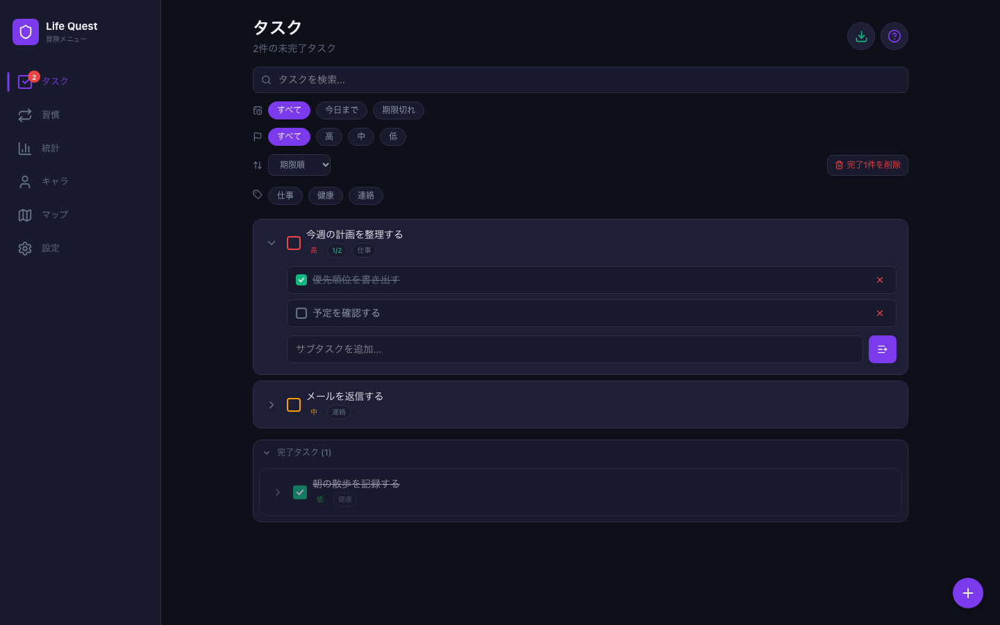](web-dark-tasks-desktop.png) | [](web-dark-tasks.png) |
| 統計 | [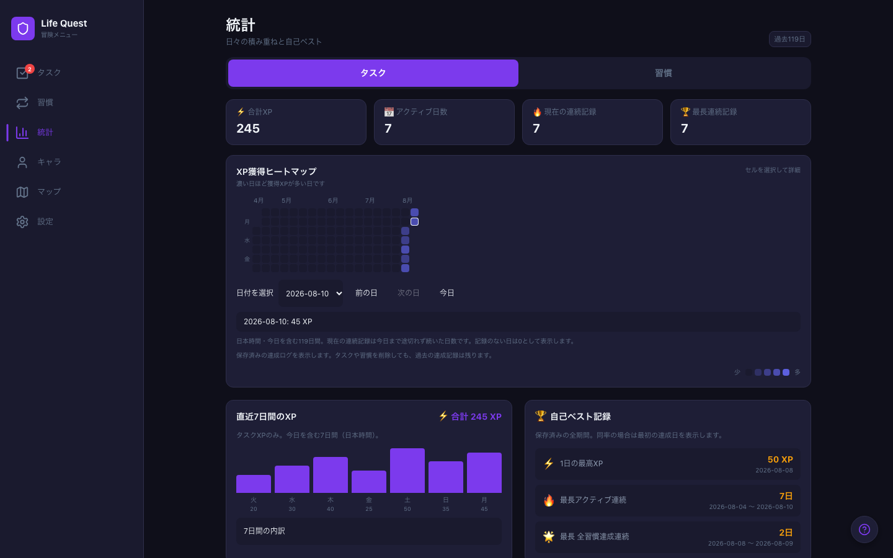](web-dark-stats-desktop.png) | [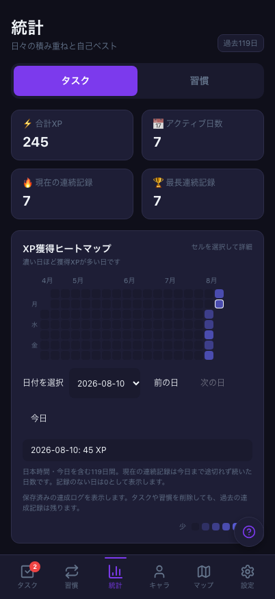](web-dark-stats.png) |

### ライト：Webのレスポンシブ表示

| 画面 | PC幅 | スマホ幅 |
| --- | --- | --- |
| タスク | [](web-light-tasks-desktop.png) | [](web-light-tasks.png) |
| 統計 | [](web-light-stats-desktop.png) | [](web-light-stats.png) |

## 毎日のタスクと習慣

| 画面・テーマ | Web（スマホ幅） | Mobile（iOS） |
| --- | --- | --- |
| タスク・ダーク | [](web-dark-tasks.png) | [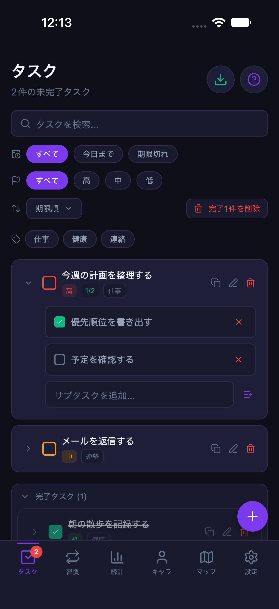](mobile-dark-tasks.png) |
| タスク・ライト | [](web-light-tasks.png) | [](mobile-light-tasks.png) |
| 習慣・ダーク | [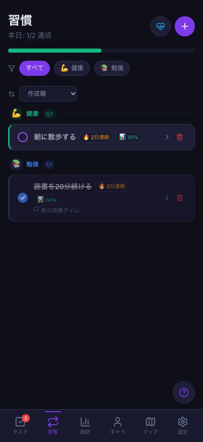](web-dark-habits.png) | [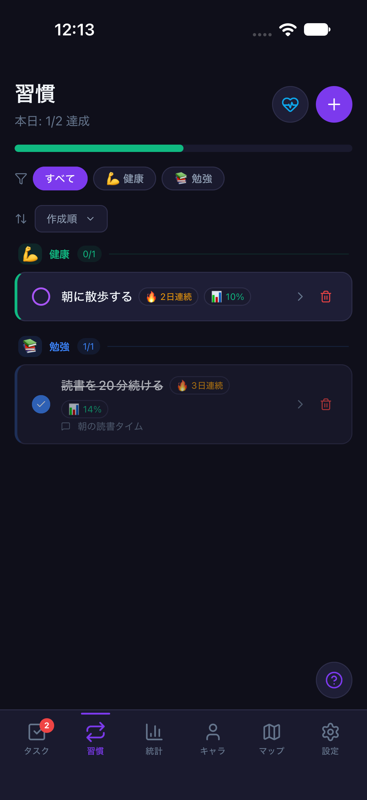](mobile-dark-habits.png) |
| 習慣・ライト | [](web-light-habits.png) | [](mobile-light-habits.png) |

## 積み重ねの確認

| 画面・テーマ | Web（スマホ幅） | Mobile（iOS） |
| --- | --- | --- |
| 統計・ダーク | [](web-dark-stats.png) | [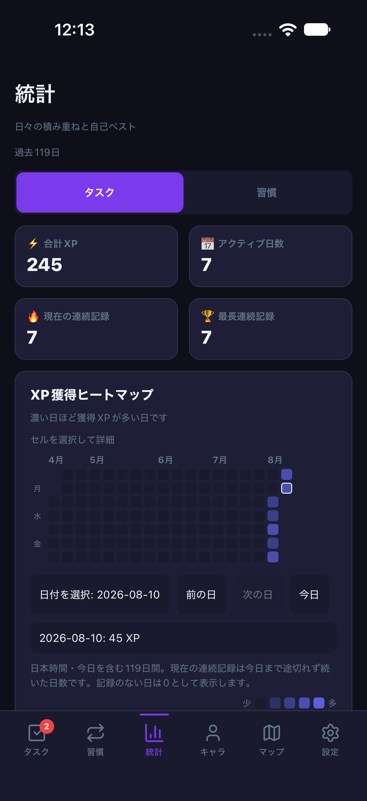](mobile-dark-stats.png) |
| 統計・ライト | [](web-light-stats.png) | [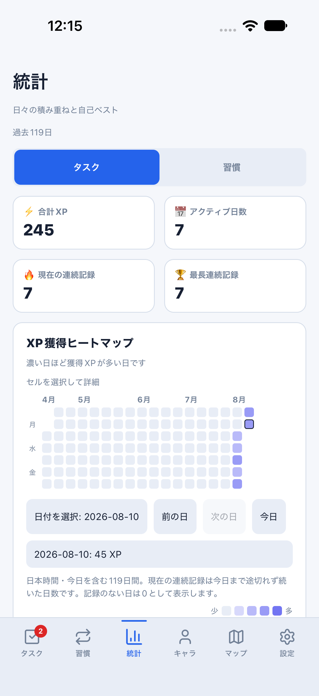](mobile-light-stats.png) |

## キャラクターとインベントリ

| 画面・テーマ | Web（スマホ幅） | Mobile（iOS） |
| --- | --- | --- |
| キャラクター・ダーク | [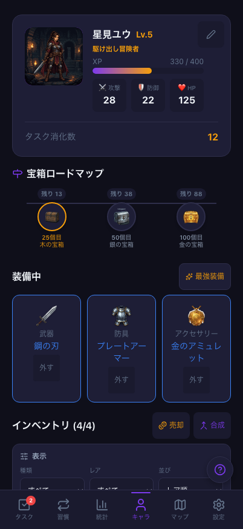](web-dark-character.png) | [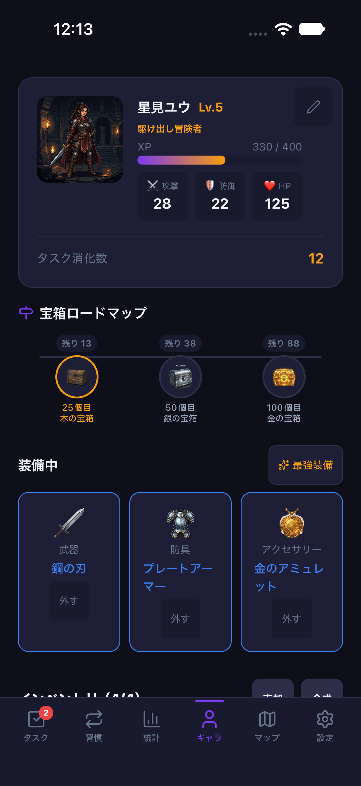](mobile-dark-character.png) |
| キャラクター・ライト | [](web-light-character.png) | [](mobile-light-character.png) |
| 独立インベントリ・ダーク | [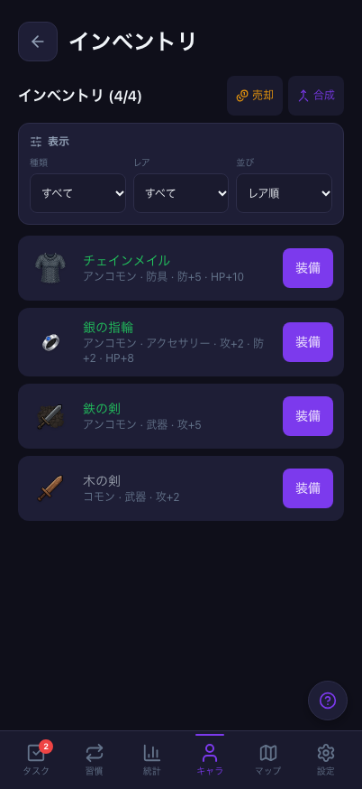](web-dark-inventory.png) | [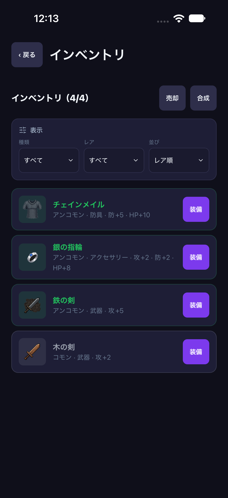](mobile-dark-inventory.png) |
| 独立インベントリ・ライト | [](web-light-inventory.png) | [](mobile-light-inventory.png) |

## マップと戦闘結果

マップはdailyの最高到達2、勝利画面はbattleの再挑戦です。Web/Nativeとも1秒周期の通常自動攻撃と手動スキルに対応します。戦闘履歴・リプレイはWebのみです。

| 画面・テーマ | Web（スマホ幅） | Mobile（iOS） |
| --- | --- | --- |
| マップ・ダーク | [](web-dark-map.png) | [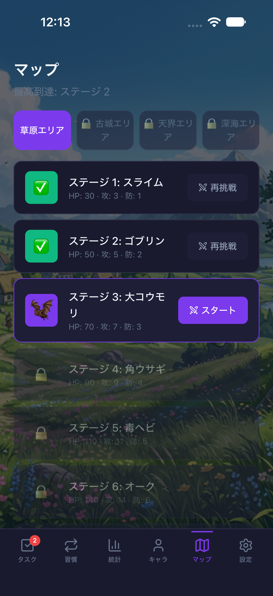](mobile-dark-map.png) |
| マップ・ライト | [](web-light-map.png) | [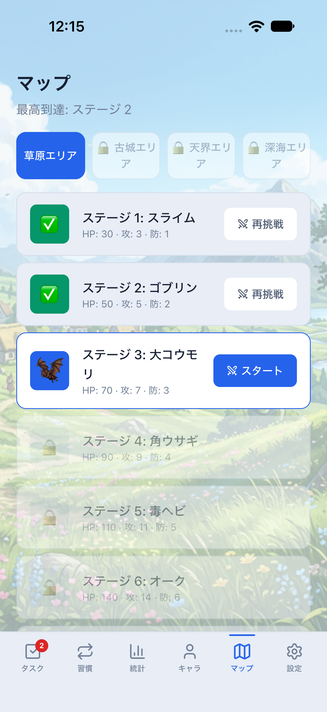](mobile-light-map.png) |
| 戦闘結果・ダーク | [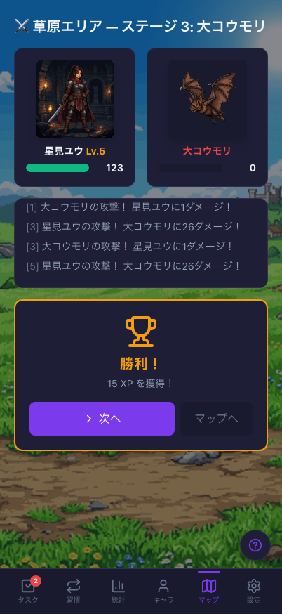](web-dark-victory.png) | [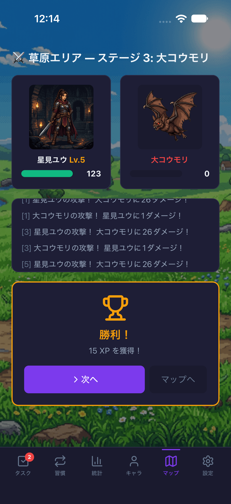](mobile-dark-victory.png) |
| 戦闘結果・ライト | [](web-light-victory.png) | [](mobile-light-victory.png) |

## 宝箱の開封演出

開封結果の抽選前にある、同じ青い箱の待機状態です。Webの背景ぼかしとNativeの暗い背景など、演出の実装差もそのまま掲載しています。

| 画面・テーマ | Web（スマホ幅） | Mobile（iOS） |
| --- | --- | --- |
| 青い宝箱・開封待ち・ダーク | [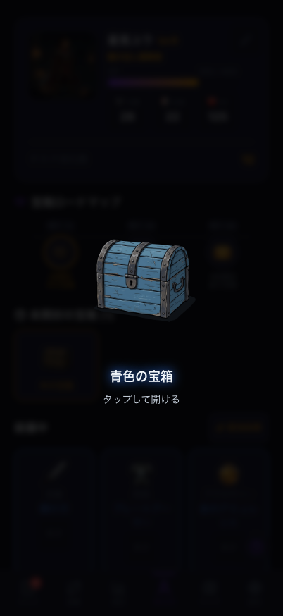](web-dark-chest.png) | [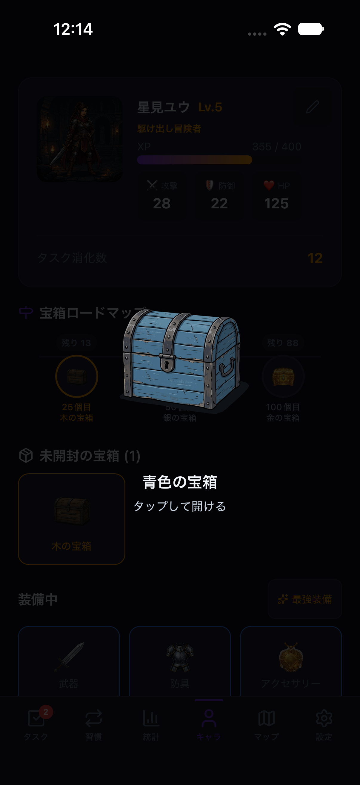](mobile-dark-chest.png) |
| 青い宝箱・開封待ち・ライト | [](web-light-chest.png) | [](mobile-light-chest.png) |

## 再取得

Webはリポジトリのルートで次を実行します。通常の390×844回帰設定は変更しません。

```bash
RUN_WEB_PARITY=1 npx playwright test \
  --project=web-reference-402x874 \
  --project=web-responsive-showcase \
  --workers=2
```

`test-results`内からdailyの6画面、victory、chestとPCのtasks/statsを選びます。その他の取得状態もテストreportに残ります。

iOSの基本設定・ガードは[同条件撮影手順](../../mobile-visual-reference.md)を参照してください。今回の撮影用フローは[capture-daily.yaml](capture-daily.yaml)、[capture-battle.yaml](capture-battle.yaml)、[capture-rewards.yaml](capture-rewards.yaml)です。既存のreference/battle/rewardsフローから、掲載対象の操作とスクリーンショットだけを抽出しています。

1. 新規の撮影専用iPhone 18 Pro Simulatorへparity development buildを導入します。通常利用・stagingの端末を指定しません。ネイティブ依存は撮影元mainと同じものを使います。
2. Supabase関連の公開環境変数を空にし、`.env`読込を止めたMetroを8082で起動します。`LIFE_QUEST_APP_VARIANT=parity`、`LIFE_QUEST_PARITY_CAPTURE=dark`または`light`、`LIFE_QUEST_PARITY_PROFILE=daily` / `battle` / `rewards`を指定します。
3. 実際のExpo manifestで`appVariant=parity`、`parityLocalOnly=true`、テーマとprofileを確認します。既存runnerの`getReferenceTheme` / `assertReferenceProfile`でも照合したうえで、対応するフローだけを実行します。JS起動時にも開発ビルド・application ID・クラウド未設定を検査し、保存はメモリだけを使用します。
4. `maestro --device <撮影専用SimulatorのUDID> test -e REFERENCE_THEME=dark --test-output-dir <出力先> docs/screenshots/readme-20261027/capture-daily.yaml`のように**端末を明示**します。profileごとにMetroを停止・切替し、lightも同様に取得します。Maestroの管理する出力ディレクトリ内にPNGができます。
5. 画像を確認してからコピーし、撮影用Metroを停止します。今回作成した撮影専用Simulatorは停止し、通常利用・staging端末はそのまま保ちます。

撮影フローはアプリ停止/起動とメモリ上の表示操作だけで、`clearState`やログイン・DB初期化は行いません。ログインボーナスは画面端の背景タップで閉じています。報酬・同期・永続化の品質試験には、それぞれの専用手順を使います。
