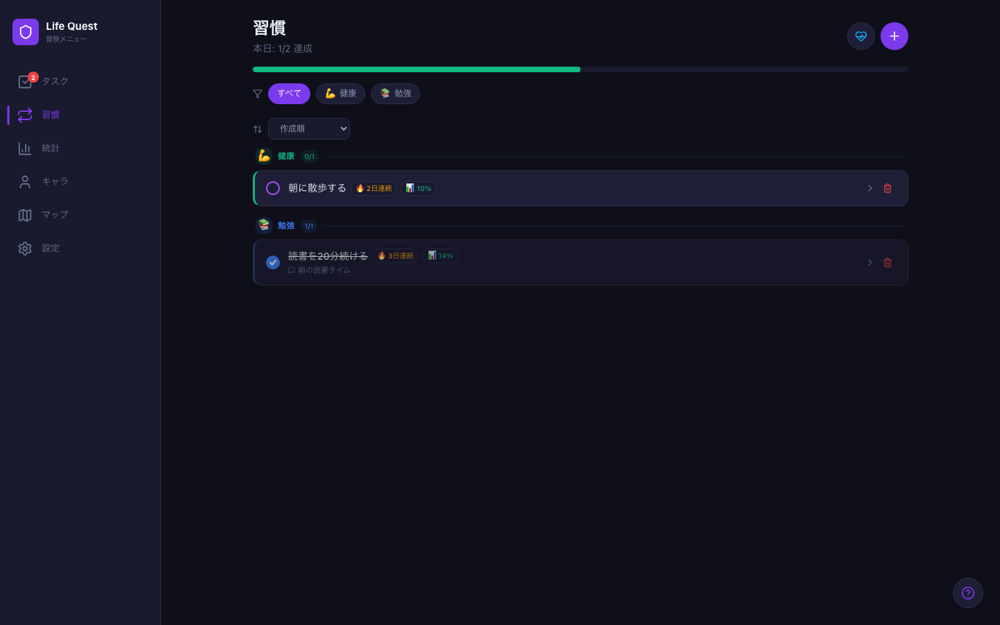
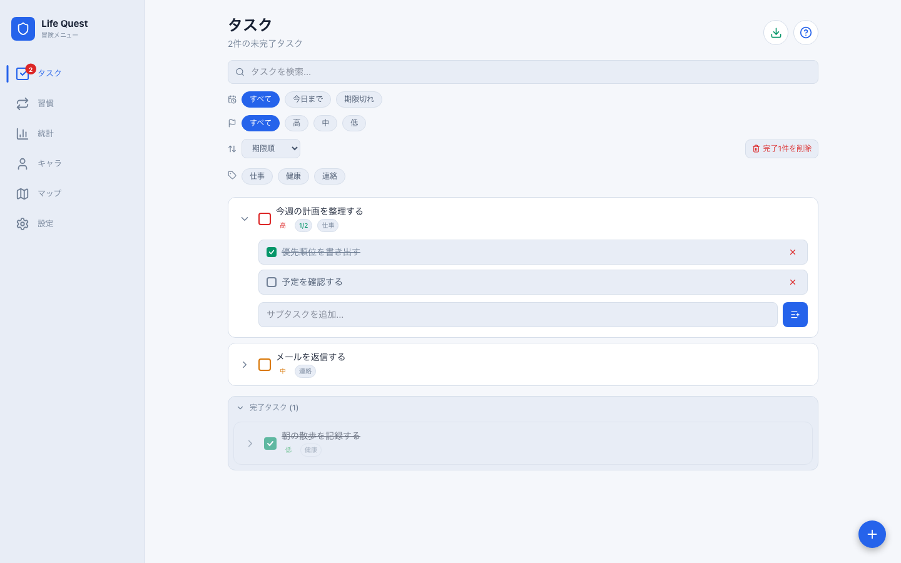
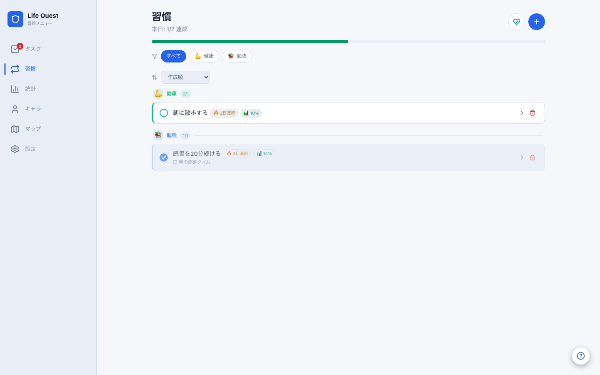
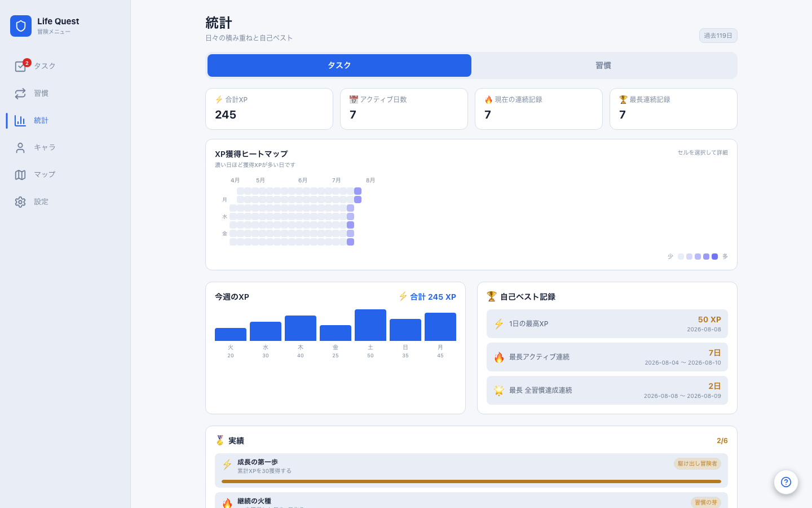
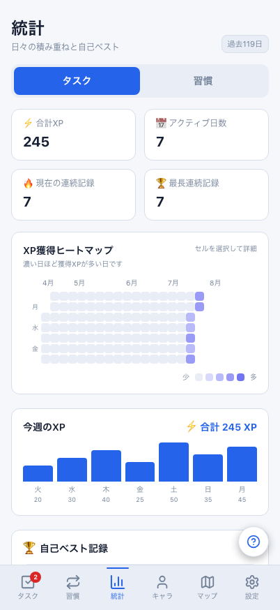

# Web：PC幅 / スマホ幅の比較

同じWeb実装、架空の匿名データ、JST日時（2026-08-10 21:00）、テーマ、表示状態で撮影した実際の画面です。画像は加工・切り抜きなし。表では表示サイズを調整しており、画像を押すと原寸で開きます。

- PC幅：Chromium、1440×900 CSS px。画面左にサイドメニュー。
- スマホ幅：Chromium、402×874 CSS px。画面下に6タブ。
- ライト / ダークを明示指定。タスクの完了一覧はどちらも展開しています。
- タスク・習慣のスマホ幅画像は[Web/Mobile比較](../daily-parity/README.md)の既存画像を利用。今回の撮影でも同じ条件で両サイズを検証しています。
- 独立したPlaywrightブラウザーで、クラウド設定を空にして共有fixtureを投入。通常ブラウザーや実ユーザーのデータは読み書きしません。

## なぜ両方の幅に対応するか

PCでは一覧を広く見渡してタスクを整理し、複数の指標を並べて進捗を振り返る使い方を想定しています。狭い画面では情報を縦に並べ、下部タブから切り替えて日々の達成を記録する構成です。これらは利用場面を考えた設計意図であり、ユーザー調査で効果を実証したという主張ではありません。

| 実装上の違い | PC幅 | スマホ幅 |
| --- | --- | --- |
| ナビゲーション | 左サイドメニュー（撮影幅では232px） | 下部タブ（64px＋safe area） |
| 一覧の幅 | 本文の最大幅1040px・左右余白48pxで広く表示 | 本文の最大幅512px・左右余白16pxで縦に表示 |
| 統計の集計カード | 4列 | 2列 |
| 今週のXP / 自己ベスト | 2列で横並び | 1列で縦並び |
| タスクの行操作 | マウスを重ねると編集・複製・削除を表示 | ホバーを必要とせず常時表示 |

Webのサイドメニュー・統計の多列配置は768px以上、タスク行操作のホバー表示は640px以上で切り替わります。1280px以上ではサイドメニューと本文の最大幅がさらに広がります。PCでは入力欄以外でAlt＋1〜6を使って画面移動もできます。

これは既存のレスポンシブ設計の紹介です。この変更ではアプリのUI、保存形式、ゲームルール、同期APIは変更していません。

## ダーク

| Web：PC幅 | Web：スマホ幅 |
| --- | --- |
| [](web-dark-tasks-desktop.png) | [](../daily-parity/web-dark-tasks.png) |
| [](web-dark-habits-desktop.png) | [](../daily-parity/web-dark-habits.png) |
| [](web-dark-stats-desktop.png) | [](web-dark-stats-phone.png) |

## ライト

| Web：PC幅 | Web：スマホ幅 |
| --- | --- |
| [](web-light-tasks-desktop.png) | [](../daily-parity/web-light-tasks.png) |
| [](web-light-habits-desktop.png) | [](../daily-parity/web-light-habits.png) |
| [](web-light-stats-desktop.png) | [](web-light-stats-phone.png) |

## Web幅の比較と、Web / Mobile比較の違い

上記はReact DOM製Web版の画面幅による違いです。[Web / Mobile比較](../daily-parity/README.md)は、スマホ幅のWeb版とReact Native製Mobile版のタスク・習慣を比べる別の確認です。MobileはWebViewではありません。Mobile統計など他画面の統一、Android実機・大きい文字・署名済み認証・同期の品質確認は引き続き後続工程です。

画面が同じデータに見えることは、クラウド同期・認証の合格証拠にはなりません。この比較は読み取り表示とレイアウトの紹介です。

## 再現

```bash
RUN_WEB_PARITY=1 npx playwright test --project=web-responsive-showcase
```

タスク・習慣・統計 × PC幅/スマホ幅 × ライト/ダークの12画像を`test-results`に保存し、レポートへ添付します。撮影前にフォント・画像の読み込みを待ち、ポインターは画面左上へ退避します。

通常の`npm run e2e`ではナビゲーション、キーボード導線、統計の列数・配置、ページ全体の横はみ出しの回帰テストも実行します。撮影コードは`e2e/visual-parity/responsive-showcase-web.spec.ts`、回帰テストは`e2e/responsive-layout.spec.ts`、CSSは`src/App.css`です。
