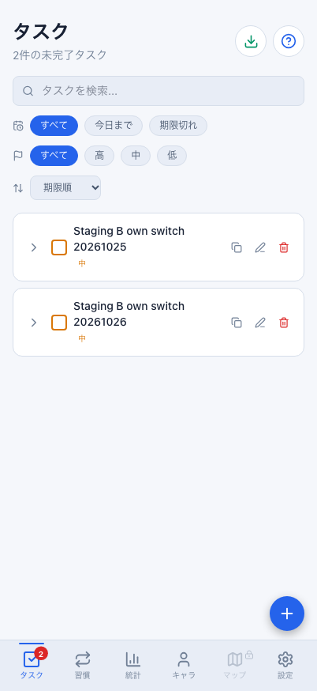
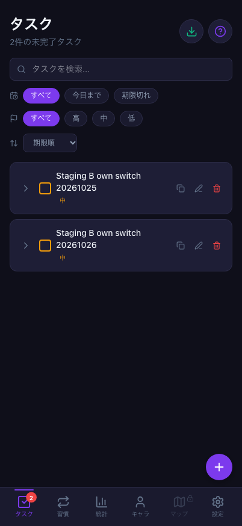
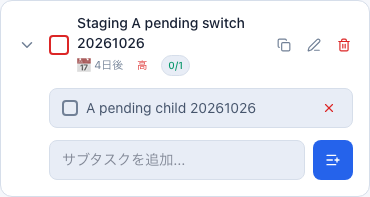

# Webのアカウント切替と複数タブの受信漏れ（2026-10-26 / #835）

計画④ [#699](https://github.com/YuTakane256/Life-Quest/issues/699) / T06。
main `9c8b6687ddc0b026b76abb88dac31b74d554a656`（#834マージ後）を基準に確認した。
承認済みの専用Supabase・既存テストアカウントA/Bと、専用Chromium profileを使用。
通常のブラウザ・Simulator・本番設定は変更していない。

## 見つかった問題

2タブでA→B→Aへ切り替え、Aの未送信操作を送った後、DBには親子タスクがあるのに一方のタブで親が表示されなかった。
未送信0件・失敗0件でも表示が欠けており、同じprofileを再度開いても復元されなかった。

原因は、タブごとのメモリ内キャッシュと、localStorageで共有する受信カーソルの不一致だった。
別タブがカーソルを先へ進めると、古いキャッシュしか持たないタブもそこから差分を要求してしまい、
自分が未受信の追加/削除を取りこぼす。保存キャッシュが古い・欠けた・壊れた場合も同じ問題が起きる。
DBのデータ消失や、AのデータがBへ書かれる問題ではなかった。

## 修正

- Webの各同期ハンドルが、**自分で適用したバッチのカーソル**をメモリで保持する。
  後続の差分取得で別タブの保存カーソルを流用しない。
- 新しいハンドルではversion 0からサーバーの現行行を読み直し、保存キャッシュの欠落も回復する。
  その後はハンドル内の適用済み位置から通常の差分取得へ戻る。
- 起動時のキャッシュ読込を先に待ち、早い手動/Realtime取得の結果を遅い古い読込で上書きしない。
- 既存の認証世代ガード、未送信の送信後に受信する順序、保存キー/形式を維持する。

新規ログイン/再起動時の読込量は増える。現行の`pull_sync_batch`のページングで処理し、
常時すべてを読み直す処理にはしない。サーバー状態の再読込は書き込みや報酬再付与ではない。
DB/RLS/API・報酬計算、未送信の保存形式、Mobileの実装は変更しない。
古い失敗キューの消去/自動再送や、保存領域の初期化も行わない。

## 実操作の結果

専用起動は`npm run sync:staging:web`（localhost:4175、fixture無効）。
操作と設定用の2タブは同じ専用profile/保存領域を使い、通常の認証通知で切り替えた。
A/Bごとの独立したオンラインNode SDKを読み取り専用の照合側に使用した。

| 段階 | 確認したこと |
| --- | --- |
| Aの未送信作成 | 操作用contextをofflineにして、通常フォームで親1件・子1件を作成。期限2026-10-30、重要度high。A専用outboxに2件、DBの親は不在 |
| Aの下書き | 同じ親の編集フォームを開き、別の名前と重要度lowへ変更したまま保存しない |
| 切替の準備 | Authをオンラインにする前に、対象A親子のIDを持つRPCだけを遮断。Auth・pull・B自身の保存は通常接続のまま |
| 別タブでAをログアウト | 操作タブの古いフォームが閉じ、Aの一覧が消える。同じAの2個の操作キーは保持 |
| Bでログイン | 操作タブもBへ切替。Aの親/下書きは表示されず、新規フォームは空。Bの通常作成はB所有の親1件として保存される |
| Bの同期 | 今すぐ同期を押してもAの2件を送らない。AのDBには対象親が不在で、BにはB自身の親だけが存在 |
| Aへ戻る | 同じ2個の操作キーがAの領域に残り、Bの対象タスクは表示されない |
| Aの再送 | 対象RPCの遮断を解除し、通常の今すぐ同期で両タブを確認。Aの親1件・有効な子1件、元の期限/highがDBと表示へ復帰。未保存の名前/lowは適用されない |
| 最終状態 | A/B各ケースの親はそれぞれ1件、Aの子は1件。対象キュー0件・失敗/競合0件。Bの親はAへの復帰後もBだけに残る |

初期再現（2026-10-25）と修正後の再確認（2026-10-26）は異なる検証用の名前を使用し、
既に作ったタスクを再作成しない。各ケースのデータは次回へ残している。
以前表示されなくなったAの保存済みタスクも、修正後はキャッシュを消さず、通常起動で再表示された。

**これは全回線オフラインでのログアウト試験ではない。**
未送信作成時はcontextの実オフライン、認証切替中は対象RPCの一時的なHTTP障害である。
認証/Realtimeを含めた全回線切断、Native/実機、習慣や報酬操作を残した全状態の切替は未確認。
タスクの完了・宝箱・合成・戦闘は操作していない。通常ログイン時の自動ボーナス表示は閉じており、
この確認を報酬の冪等性試験の合格にはしない。

## 確認画像

Web幅402px。Bのライト/ダークは切替試験後の通常ログインで撮影し直した同じ一覧。
前日の検証用Bタスクも削除せず保持しているため、一覧は2件。Aの対象タスクは出ていない。
テーマ設定systemを維持し、ブラウザの配色変更と画面の安定を待っている。
Aの画像は復帰後の対象カードのみ。メール・認証画面・操作キーを含まない。

| B・ライト | B・ダーク | Aの復帰後 |
| --- | --- | --- |
|  |  |  |

## 回帰と残る項目

- 修正前は、別タブが進めたカーソルと古い/壊れた/欠けたキャッシュの4ケースで表示漏れを再現。
- 修正後は上記4件と起動読込の遅延1件を追加し、Web/Mobileの既存認証境界を含む同期テスト45件成功。
- 切替/キュー/所有者ガードの既存テスト100件、全体3,361件成功/98件skip。
- Web/core/Mobile型検査・check:secrets・lint（既存警告6件のみ）・本番ビルド成功。PR後に既存CI3件と独立レビューを確認する。

**T06はWeb・A/B・タスクの未送信/編集下書きの範囲でpass。T06全体と④全体は未完了。**
T04/T05のNative実回線/未送信再起動、Nativeの切替、T07の報酬再送、T08の期限切れ復帰、Android/実機は残る。
アカウント追加/削除、Auth設定変更、有料プラン変更、DB初期化はしていない。
資格情報や生のoutbox payloadは公開しない。確認後は専用サーバーとブラウザを終了する。
