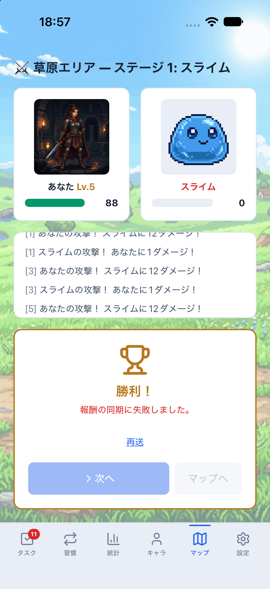
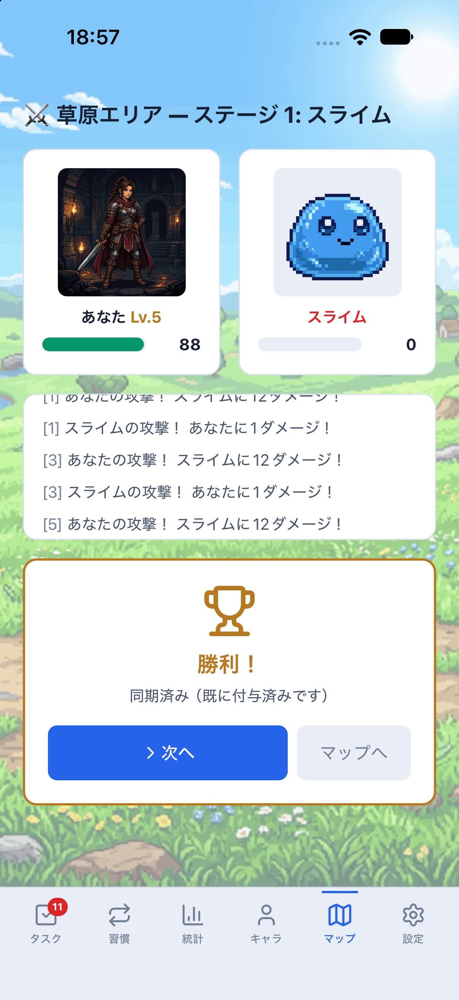
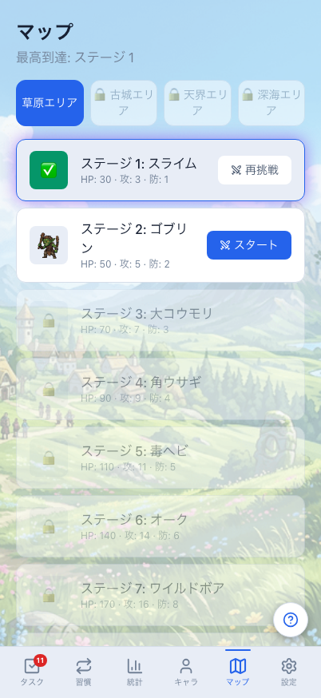
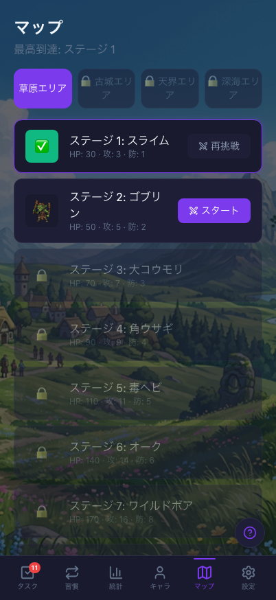
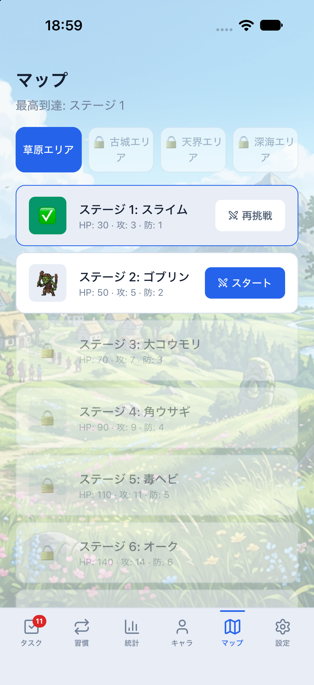
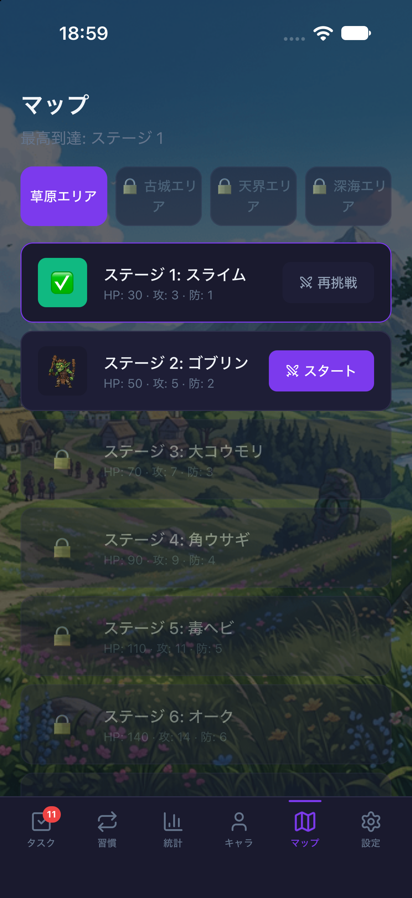

# 戦闘結果の応答喪失・再送と報酬の重複確認（2026-10-27 / #852）

計画④ [#699](https://github.com/YuTakane256/Life-Quest/issues/699) / T07のうち、戦闘結果の再送を確認した。
通常UIで開始したステージ1の戦闘について、サーバー成功後の応答喪失、同じ結果の再送、
送信済み状態のNative再起動・両端同期で、報酬と進行が1回分のままであることを照合した。
不具合は見つからず、アプリ・DB/API・報酬計算・保存形式の変更はない。

## 条件と方法

- 対象main：`9ca2d9805e619e379cb87107049fd8854fcfcd83`（PR #851反映後）。
  Native依存に変更がないため、既存parityバイナリと最新JavaScriptを使用した。
- 承認済みの専用stagingアカウントA、専用iPhone 18 Pro / iOS 27.0 / 402×874pt、専用Web context。
  `sync:staging:mobile`（8083）/`sync:staging:web`（4175）を使用し、接続先固定・fixture/capture無効。
- [前回の宝箱確認](staging-chest-reward-retry-20261027.md)から、XP310・消化数10・装備1個・開封履歴2件を維持。
  通常UIで青い宝箱を開封して解放されたマップを使い、進行や装備を直接投入していない。
- Nativeの通常UIで「ステージ1 スタート」を1回押し、通常自動攻撃3回でスライムに勝利した。
  サーバーが作成したactor snapshotと実際の行動列を使用し、勝利状態や行動を内部から設定していない。
- 指定staging・A・今回のattemptの`resolve_battle_attempt`だけ、最初のHTTP 200を読み捨て、通信エラーを返した。
  `start_battle_attempt`は通常接続。Authや他操作の通信も遮断しない。
- 自動pullが先に報酬を取り込む経路と区別するため、そのNativeの`pull_sync_batch`だけ短時間エラーにした（2回）。
  UIの再送前後で同じattempt ID・行動列・冪等キーであることを比較した。
  既存Edge invokerはfetchを保持するため、障害の設置/除去時に既存のリセット関数を使った。
- 独立Node SDKで本人RLSによるcharacters / battle_attempts / reward_transactions等の読み取りを行った。
  service_role、内部の冪等性テーブル、直接DB書き込み、保存領域の初期化は使用しない。

## 実測結果

| 段階 | サーバーXP | 最高到達 | attempt | 対象の報酬台帳 |
| --- | ---: | ---: | --- | --- |
| 戦闘前 | 310 | 0 | 0件 | 0件 |
| 最初の結果確定・応答喪失後 | 315 | 1 | 1件・resolved/victory | 1件・5 XP |
| 同じ内容のUI再送後 | 315 | 1 | 同じ1件 | 同じ1件 |
| Native再起動・両端の通常同期後 | 315 | 1 | 同じ1件 | 同じ1件 |

戦闘開始はHTTP 200が1回、結果送信はHTTP 200が2回。別所有者からの対象送信は0回。
最初の応答は`granted=true`、再送は`granted=false, already_resolved=true`である。
**宝箱の再送と異なり、戦闘の再送応答は付与フラグまで同一ではない。** 既に確定した同じ勝敗を返し、
追加付与しないことが期待どおりの結果になる。再送でcharacters・attemptのversion/確定時刻も変わらなかった。

応答喪失時のNativeはXP310・最高到達0のまま、勝利と失敗案内を表示し、次へ/マップへは無効だった。
再送後は「同期済み（既に付与済みです）」になり、同じattemptを消費して最高到達1へ反映した。
この間pullを遅らせたためXPは310のままであり、障害除去後の通常同期でサーバーの315へ収束した。
ローカルで勝利報酬を重ねて付与したわけではない。

送信済み・キュー0件の状態で専用Nativeアプリを終了/起動し、PIDが変わったことを確認した。
再起動後のactiveBattleはnullで、同じ戦闘の再送・報酬演出は発生しなかった。
通常の「今すぐ同期」とWeb側の同期で、両端のXP315・最高到達1、ステージ1再挑戦/ステージ2開始の表示を確認した。
消化数10・当日タスクXP200・装備1個・開封履歴2件は不変。両端のpending/inflight/failed/conflictは0件。

[識別子を除去した結果](evidence/staging-battle-reward-retry-20261027.json)には資格情報・メール・ユーザーID・
attempt ID・操作キー・装備ID・生通信ログを含めない。送信の同一性は非公開の記録で照合し、公開結果は真偽値にした。

## 確認画像

| 成功応答を失った後 | 同じ結果を再送した後 |
| --- | --- |
|  |  |

送信済み状態の再起動・同期後のマップ。Web/Nativeともsystem設定を維持し、撮影時だけOS/ブラウザの配色を切り替えた。
撮影後はlightへ戻した。画面の最高到達と、ステージ2を開始できることを確認できる。

| 画面 | ライト | ダーク |
| --- | --- | --- |
| Web 402×874 |  |  |
| iOS 402×874pt |  |  |

最初のSimulator URL起動は待ち時間切れになり、アプリ起動後のURL指定で接続した。
Web撮影には遅れて出た通常のログインボーナスが重なったため、通常UIで閉じて画像だけ再取得した。
戦闘は繰り返さず、報酬・進行が不変であることを再照合した。

## 検証範囲と残確認

- T07の**ステージ1・勝利結果1件**について成功応答喪失と同じキーの再送を確認した。T07全体の完了ではない。
- 再送処理が終わってからの再起動である。未確定/未送信の戦闘を残した終了、オフライン起動の証明には使わない。
- 敗北・手動スキル・別キー/並行要求・新しいattemptでの正規再挑戦報酬・他ステージ/レベルアップは今回未確認。
- 合成、他の宝箱の節目、未完了開封の再起動、Native実回線切断/T05、期限切れT08、Android/実機、⑤は残る。
- 既存の戦闘確定・Edge変換・共有ゲーム呼出し・戦闘エンジンの回帰54件が成功した。
  PR作成後に独立レビューとCI3件を確認する。自動マージしない。
- 検証データは保持。障害を除去し、専用アプリ/Simulatorと今回のWeb/Metroだけを停止した。
  通常のSimulatorと個人データ、古い失敗キューは操作していない。
