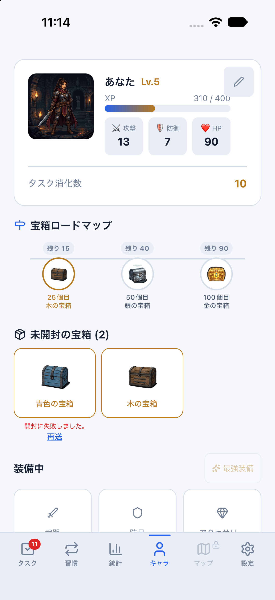
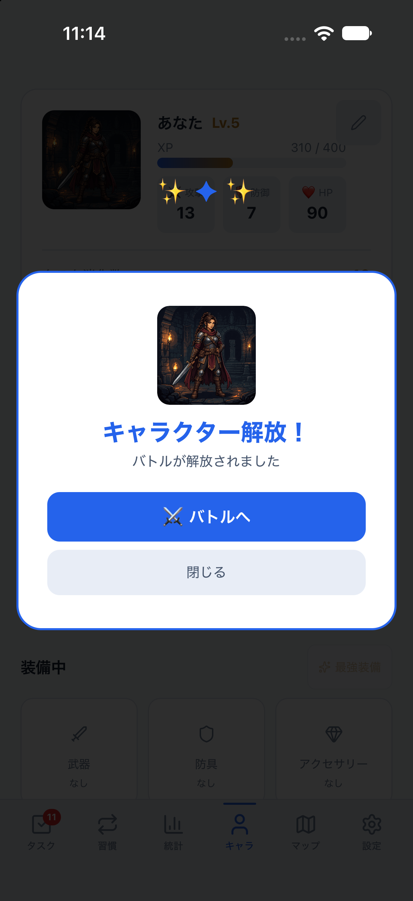
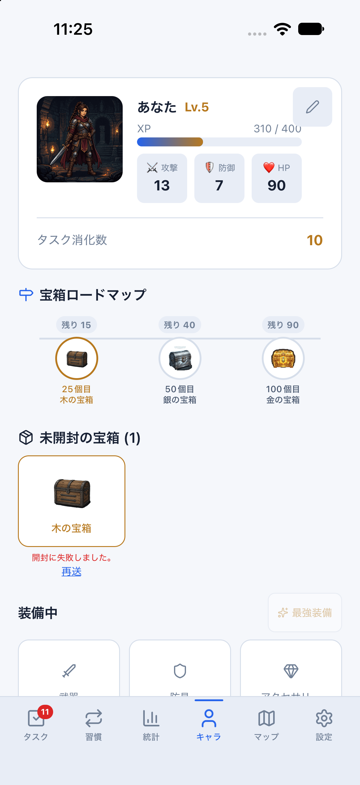
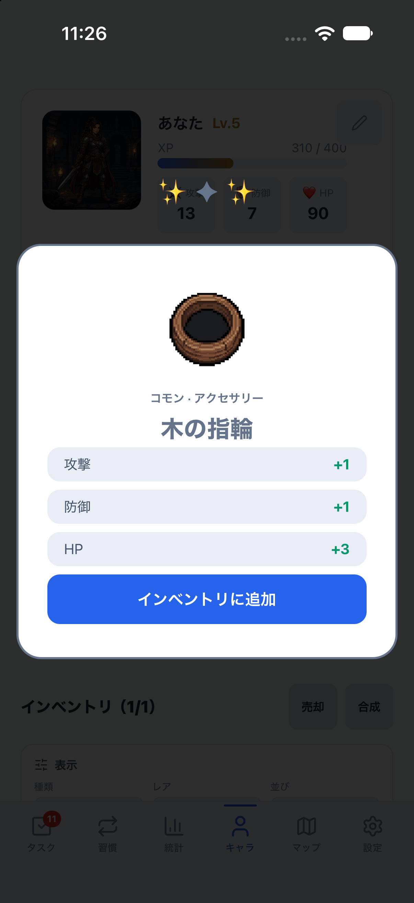
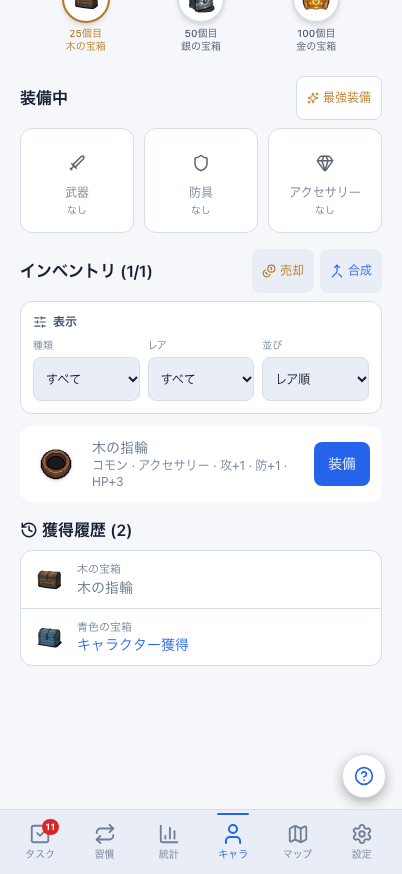
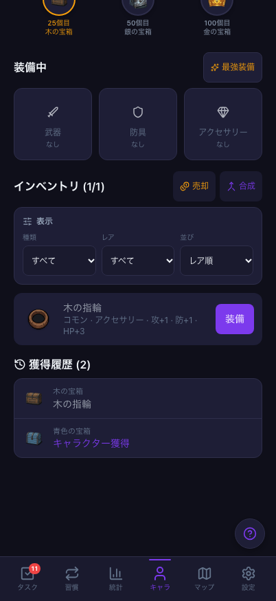
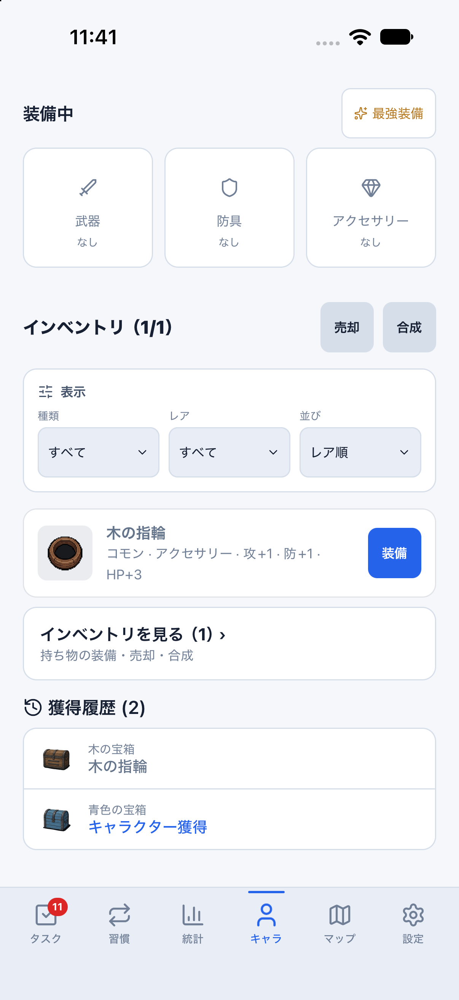
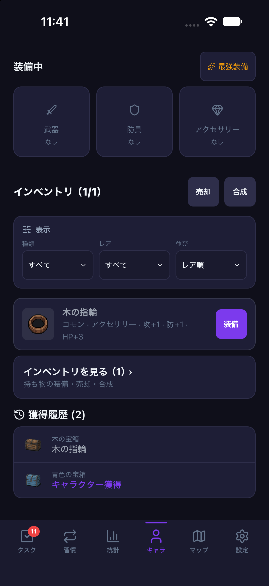

# 宝箱開封の再送確認と、同期で消える獲得履歴の修正（2026-10-27 / #846）

計画④ [#699](https://github.com/YuTakane256/Life-Quest/issues/699) / T07。
[タスク報酬の確認](staging-task-reward-retry-20261027.md)に続き、青・木の宝箱を通常操作で獲得し、
開封の成功応答を失わせた後の再送、再起動と両端同期を確認した。
その過程で見つかった、**Web/Mobileとも同期後に獲得履歴が消える不備**も修正した。

## 修正した不備

開封はDBへ保存されていたが、共有の`buildCanonicalGameSnapshot`が開封済みの宝箱を除外していた。
そのため、開封直後には見えた獲得履歴が次のpullで消え、再起動や他端末でも復元されなかった。
青の開封後にこの状態を実際に確認した。同期そのものや報酬の重複の不具合ではない。

共有変換を次のように変更した。画面構成・DB/RLS/API・報酬計算・保存形式は変更しない。

- 開封済みを`opened: true`のまま履歴に残す。未開封一覧や開封対象には戻さず、演出も再発行しない。
- `opened_item_id`でキャッシュ内の確定装備を参照し、既存テンプレートから表示情報を復元する。再抽選しない。
- 売却/合成後の装備の墓標も履歴の参照元として使うが、持ち物一覧には復活させない。
  装備行が未受信・欠落、または未知テンプレートなら結果はnull。次のpullで行が届けば解決する。
- `created_at`とIDで獲得順を安定させ、既存の500件上限と未開封優先の保持ルールを適用する。
  全履歴の無制限保存や、欠落した装備の復旧を保証する変更ではない。

追加した回帰4件と既存の期待値更新は修正前に5件失敗し、修正後は成功した。
キャッシュ保存/復元、スターター、装備の墓標、削除済み宝箱、未開封への装備混入防止、
遅れて届く装備、未知テンプレート、獲得順、保持上限を確認している。
実環境で装備を売却・合成したわけではなく、その条件は単体検証の範囲である。

## 専用stagingでの実操作

- 対象base: `5ff1df7536cee0fa7ca45c41d41c14b1758c41d9`（PR #845マージ後）と上記の共有変換修正。
  Native依存に変更はなく、既存parityバイナリを使用し、修正後は専用Metroとアプリを再起動した。
- 承認済みの既存A、専用Web context、専用iPhone 18 Pro / iOS 27.0 / 402×874pt。
  `sync:staging:web`（4175）/`sync:staging:mobile`（8083）、接続先固定・fixture/capture無効。
- Webの通常フォームから新しい検証タスク9件だけを作成し、通常の完了操作で1件ずつ達成した。
  名前は`Staging chest preparation 20261027 02`〜`10`、medium・繰り返しなし。
  既存の検証タスクは完了し直さず、宝箱・装備・残高を直接投入していない。
- Nativeの通常UIから青・木を各1回開封し、それぞれ最初のHTTP 200を読み捨てて通信エラーを返した。
  対象は指定staging・指定宝箱の`open_chest`だけ。画面の「再送」で同じキーを再利用した。
- 再送UIを確認できる短時間だけ、当該Nativeの`pull_sync_batch`も一時失敗させた。
  自動pullが先に確定結果を取り込む経路と区別するための条件で、Authや他の操作は遮断しない。
  各ケースでpullの保留は1回、開封の転送は2回（HTTP 200が2回）だった。
- 障害の設置/除去時に既存のEdge invokerキャッシュをリセットした。認証・store・保存データは内部から書き換えない。
  独立Node SDKの本人RLS読み取りでサーバーの宝箱・装備・XP・達成回数・当日統計を照合した。
  service_roleや内部の冪等性テーブルへの読み取りは使わない。

| 段階 | XP合計 | タスク消化数 | 当日のタスクXP | 宝箱 | 装備 | バトル |
| --- | ---: | ---: | ---: | --- | ---: | --- |
| 準備前 | 130 | 1 | 20 | 0個 | 0個 | 未解放 |
| 新規9件の達成後 | 310 | 10 | 200 | 青/木各1個・未開封 | 0個 | 未解放 |
| 青の初回成功・応答喪失後 | 310 | 10 | 200 | 青のみ開封済み | 0個 | 解放 |
| 青を同じキーで再送 | 310 | 10 | 200 | 同じ青の開封結果 | 0個 | 解放のまま |
| 木の初回成功・応答喪失後 | 310 | 10 | 200 | 青/木各1個・開封済み | 1個 | 解放のまま |
| 木を同じキーで再送 | 310 | 10 | 200 | 同じ木の開封結果 | 同じ1個 | 解放のまま |
| Native再起動・両端の通常同期後 | 310 | 10 | 200 | 履歴2件・未開封0件 | 同じ1個 | 解放のまま |

準備した9件の報酬台帳は各1行で計9行。5回目の青と10回目の木を各1個獲得した。
応答喪失中はサーバーで開封済みでも、Nativeに新しい装備や開封演出は生成されなかった。
再送のレスポンスは最初の確定結果と一致し、宝箱versionも不変。木の装備ID/テンプレートは同じで、
実際の結果は「木の指輪」1個だった。別所有者からの対象送信は0回。

**青の応答喪失・再送は修正前のコードで確認した。** その後に履歴欠落を発見し、修正後の再起動/通常同期で
同じ開封済み青が履歴へ復元することを確認した。**木の応答喪失・再送は修正後のコードで確認した。**
青を再開封したり、検証データを作り直したりして成功へ読み替えていない。
最後にもう一度専用アプリを実プロセス再起動（PID変更）し、両端の通常同期で同じ装備1個・履歴2件が残ることを確認した。
Nativeの開封演出は再起動後に再発行されず、Web/Nativeともpending/inflight/failed/conflictは0件。

検証スクリプトでは、当初は消える履歴を同期収束条件にしていたため不備を発見した。
修正コードを読み直した際は遅れて出る通常のログインボーナスを閉じ、Hermesでの関数の文字列判定も
実際のpull成功後の値の照合へ直した。iOSテストドライバーの起動待ち失敗は待ち時間を調整して再試行し、
Webもサーバーを再起動して開発時のモジュール参照を読み直した。
開封操作は繰り返さず、後続の同期・表示確認だけを再実行した。
[識別子を除去した照合結果](evidence/staging-chest-reward-retry-20261027.json)には、資格情報・操作キー・ユーザー/装備のUUIDを含めない。

## 確認画像

再送の失敗表示と、確定した結果の開封演出。青は履歴修正前、木は修正後の同じ検証ケースで撮影した。

| 宝箱 | 成功応答を失った後 | 同じキーの再送後の演出 |
| --- | --- | --- |
| 青 |  |  |
| 木 |  |  |

修正後の再起動/再同期を経た持ち物・獲得履歴。system設定を維持し、ブラウザ/専用Simulatorの配色だけを切り替えた。
撮影後はlightへ戻した。レイアウト全面一致の判定ではない。

| 画面 | ライト | ダーク |
| --- | --- | --- |
| Web 402×874 |  |  |
| iOS 402×874pt |  |  |

## 検証と残確認

- 全体3,367件成功/98件skip。関連150件、Web/core/Mobile型検査、lint（既存6警告）、Web/PWA build、check:secrets成功。
- **T07はタスク完了に加え、5/10回目の宝箱獲得・青/木の開封再送・送信済み再起動/両端同期の範囲でpass。**
  開封キーの比較は同じ画面の稼働中の再送であり、未完了の開封要求を再起動後も同じキーで再送できることは未検証。
- 合成/戦闘の再送、他の宝箱の節目、Native実回線切断/未送信オフライン起動、T08、Android/実機、⑤は残る。
  装備の売却/合成後の履歴保持は単体回帰であり、実操作の合格ではない。
- 検証データは保持。障害を除去し、今回の専用Simulator/Web/Metroだけを終了する。
  DB初期化・アカウント追加/削除・古い失敗キューの消去/再送はしていない。
  PR後にGPT-6.1 Sol・中の独立レビューと既存CI3件を確認し、自動マージしない。
