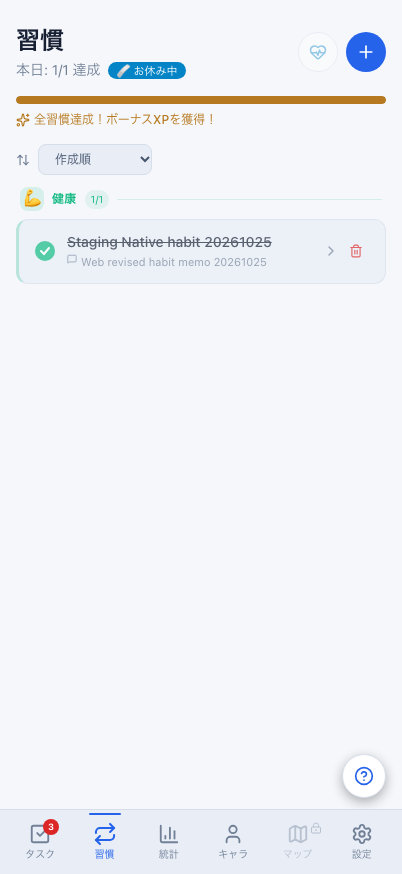
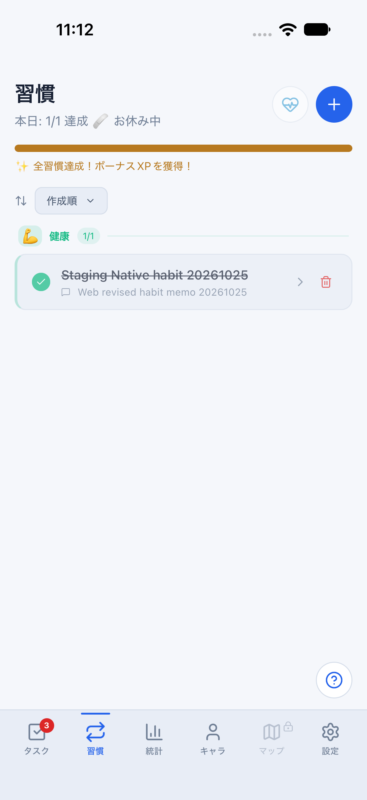
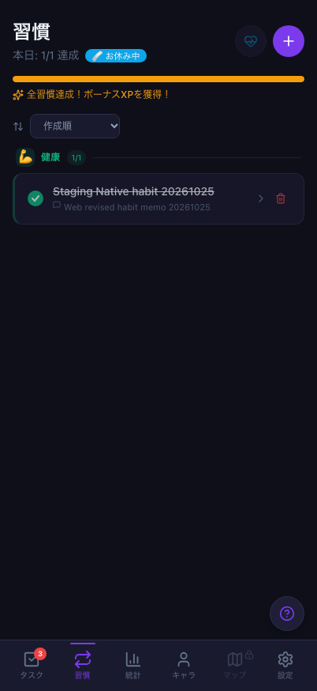
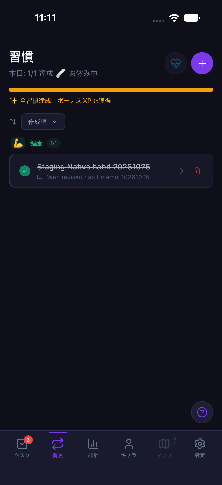

# 習慣の双方向同期：T03の実操作記録（2026-10-25）

Issue [#829](https://github.com/YuTakane256/Life-Quest/issues/829) / 計画④ [#699](https://github.com/YuTakane256/Life-Quest/issues/699)。
対象の実装はmain `9a5cbfb74ecf8db99e7597cf20859944fbe7b4a7`（#828マージ後）。
今回の変更は検証記録だけで、アプリ、DB/RLS/RPC/Edge Functions、報酬量、保存形式は変更していない。

## 対象と操作

ユーザー承認済みの検証専用 `life-quest-staging` と既存アカウントAを使用。
Webは専用Chromium profile、iOSは専用iPhone 18 Pro Simulator / iOS 27.0。
通常のブラウザや端末データには触れず、fixture無効の専用起動コマンド（4175/8083）を使った。
開始時のAは習慣0件、当日の習慣記録0件、休息日0件。
日付は両端の日本時間 `2026-10-25`。担当はCodex。

| 操作 | 確認結果 |
| --- | --- |
| Mobileで健康カテゴリの習慣1件を追加 | WebとDBに同じ習慣が1件だけ存在。カテゴリはhealth |
| Mobileで当日を達成し、メモを保存 | Webに達成済みと同じメモを表示。DBのhabit_logsもcompleted=trueで一致 |
| 全達成ボーナス | 当日のhabit_all_completeの報酬記録は1件、xp_delta=15 |
| Webで未達成へ戻す | DBの当日completed=falseを確認。保存済みメモを維持 |
| Webで再達成し、メモを変更 | DBとWebの当日completed=true・変更後メモが一致。報酬記録は1件のままで、再達成前後のサーバーXP差は0 |
| Webで休息日を確認ダイアログから設定 | DBのrest_daysがis_rest=true。Web再読込後も設定済み表示とボタン無効化を維持 |
| Mobileを終了し再起動して受信 | 当日1/1達成・お休み中を表示。習慣履歴の「今日」にWeb変更後メモを表示 |
| 統計 | DBのhabit_count=1 / all_habits_complete=true、WebのhabitLog={count:1, allComplete:true}が一致。Mobileの習慣統計にも当日「1個達成 (全達成!)」を表示 |

両テーマの表示・再起動確認を終えた後も、当日のボーナス記録は1件（15 XP）、
サーバーの総XPは最初のボーナス受信後から増えていないことを再照合した。

Webのメモ変更は、既存の「未達成に戻す→達成→メモ入力」の導線を使った。
メモの直接編集機能を追加したという意味ではない。
Web/DBの確認はログイン済みAのクライアントによる読み取りで行い、DBを直接書き換えて表示を合わせていない。
管理者キーや追加アカウントは使用していない。

習慣の当日チェックは現在の状態を表す。一方、永続統計のcount/allCompleteは
既存の「その日一度でも到達した最大値・全達成」の意味を維持する。
取り消し中に累積統計まで0へ戻ることは、この検証の期待値にしていない。

## 確認の方法と限界

Nativeは通常UIをMaestroで操作し、画面も確認した。習慣名・メモは一覧の履歴ボタンの内側にあるため、
文字列だけの探索では見つからない場合がある。習慣の達成操作ラベル、休息日を示す本文、
履歴の今日の詳細、統計の切替ラベルと日別詳細を使って判定した。
入力後の保存ボタンはキーボード表示中でも操作でき、今回のメモ保存では閉じるジェスチャーに依存していない。
自動操作の失敗を同期失敗と混同せず、保存済みデータを初期化してやり直していない。

Webのスマホ幅402×874とiOSの402×874相当で、ライト/ダークの同じ当日記録・メモ・休息日を確認した。
設定のテーマモードはsystemのまま、Webのカラースキームと専用Simulatorの外観だけを切り替えた。
OSの外観は確認前のlightへ戻す。同日の実同期確認のため、時刻は固定していない。

| テーマ | Web | iOS Simulator |
| --- | --- | --- |
| ライト |  |  |
| ダーク |  |  |

関連する既存の習慣・認証境界・Web/Native canonicalSyncの単体回帰は8ファイル96件成功。
このdocs差分にもPRのCI3件と6.1 Sol・エフォート中の独立レビューを適用し、結果はPRに記載する。
今回の同期経路でアプリの修正が必要な不具合は見つからなかった。

**T03はA・習慣1件・当日・WebとiOS Simulatorという範囲でpass。計画④全体の完了ではない。**
今回の再起動は送信済みデータの復元確認であり、未送信操作を残したOS終了（T05）の代用にはしない。
T04〜T08、Android/実機、確認メール配送、Google/Apple認証、旧IDの失敗データ救済（#827）は残る。
ボーナス1件の照合を、T07のタスク・宝箱・合成・戦闘全体の合格とは扱わない。

検証アカウントとこの習慣・達成記録・メモ・休息日は次の確認に残す。
DB初期化・過去の失敗キューの消去/再送・アカウント削除はしていない。
確認後は検証サーバーと専用Simulatorを停止する。資格情報や未加工の認証ログはPRへ添付しない。
