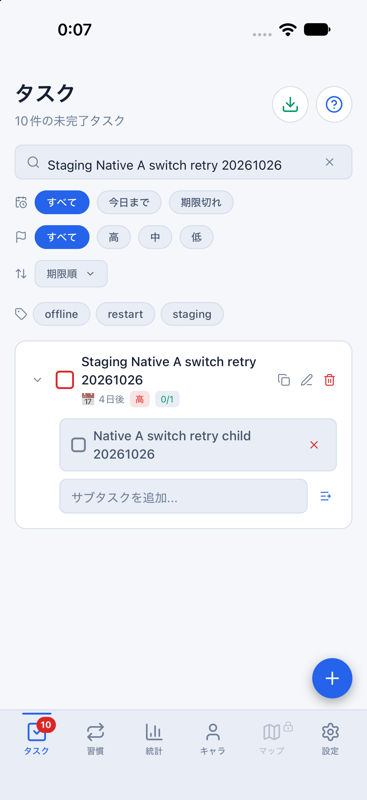
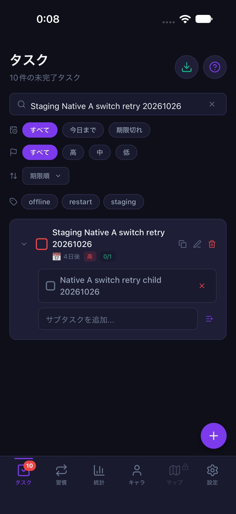

# Nativeの未送信タスクとアカウント切替（2026-10-26〜27 / #840）

計画④ [#699](https://github.com/YuTakane256/Life-Quest/issues/699) / T06の追加確認。
main `df8b9dbc0143fe8d80389c91b53bf5e42c421daf`（#837・#838マージ後）から、
専用iOS Simulatorのparity開発ビルドと既存stagingアカウントA/Bで確認した。
Webの結果は[別記録](staging-account-switch-20261026.md)を参照。

追加確認: #842で[同一プロセス・中断なしの連続切替](staging-native-continuous-switch-20261027.md)も成功した。
この文書は途中中断を含む当初の実測として保持し、その結果を連続成功へ読み替えない。

## 条件

- iPhone 18 Pro / iOS 27.0、402×874pt。通常のSimulatorとは別の専用端末を使用。
- Native生成・ビルドは一時ディレクトリで実施。ビルド成功後、bundle identityを確認し、
  専用アプリのデータを非公開領域へ退避してから上書きインストールした。アンインストールや初期化はしない。
- Expo 57.0.31、Reanimated 4.5.1 / Worklets 0.10.1、SVG 15.15.4、Gesture Handler 3.0.2を含む更新後のNativeビルドを使用。
- `npm run sync:staging:mobile`（8083）。専用stagingへ固定し、匿名fixture/captureは無効。
- 対象A親子の`upsert_task` / `upsert_subtask`だけを開発プロセス内で一時失敗させた。
  Auth・pull・Bの保存は通常接続。OS回線切断やNetInfo通知の試験ではない。
- 保存は通常フォーム、認証切替は通常のログアウト/ログイン画面を使用。
  SDKの`getUser`でNativeの所有者を照合し、A/Bそれぞれの独立したNode SDKからRLS経由で対象行を読み取った。
  service_roleは使用しない。操作キーと生ログは非公開領域に保存する。

## 実測

| 段階 | 結果 |
| --- | --- |
| Aで追加 | 親1件・子1件、期限2026-10-31、重要度high。端末の永続outboxにpending 2件、DBの対象親は0件 |
| 未保存の編集 | 同じ親の名前を別名、重要度をlowへ変更し、更新を押さず設定へ移動。Nativeではタブ離脱時点でフォームが閉じる |
| Aをログアウト | Aの同じ2個の操作キーを保持。匿名状態の送信キューは非アクティブ |
| Bでログイン・作成 | Aの対象親/下書きが出ず、新規フォームからBの親を保存。B所有の対象親1件、期限なし/重要度mediumで、Aの入力値を継承しない |
| Bで今すぐ同期 | Aの同じpending 2件を保持し、AのDBには対象親が不在。BにはB自身の対象親1件 |
| Aへ復帰 | 下記の中断後も、同じ2個の操作キーをpendingで復元。Bの対象親/未保存の別名をAの一覧へ適用しない |
| 対象RPCを復旧 | 通常の今すぐ同期で、Aの同じIDの親1件・子1件をDBとNative表示で確認。元の期限/highを保持し、未保存の別名/lowは適用しない |
| 最終状態 | A/Bの対象親はそれぞれ1件、Aの子は1件。A/Bの永続キューは各0件、Nativeのpending/inflight/failed/conflictは各0件 |

**自動操作の中断を含む確認であり、中断なしの連続シナリオの合格とはしない。**
最初の下書き入力では文字置換後に旧末尾が残り、自動操作の完全一致チェックで停止した。
そのケースのデータは削除せず通常同期し、別名のケースでAの作成から再確認した。
再確認ではBの保存/同期まで成功したが、最後のAログインでメール欄の選択操作が失敗して文字が連結されたため停止した。
この時点ではBをログアウト済みで、Aの2件は同じキーで端末内に残り、DBは未反映だった。
専用アプリだけを再開し、対象RPCの障害を再設定してからAへ通常ログインし、同じキューから上表の復帰を確認した。
フォーム入力の自動操作失敗を製品の認証障害とは判定しない。追加のアカウントや同じ対象タスクの再作成はしていない。

## 確認画像

最後に復帰したAの対象親子。端末の配色だけを切り替え、アプリ設定はsystemを維持した。
メール、パスワード、ユーザーID、操作キーは含めない。

| ライト | ダーク |
| --- | --- |
|  |  |

## 検証範囲と残確認

- アカウント境界/永続キュー/同期の既存回帰72件、Mobile型検査、check:secrets成功。
- アプリのソース・DB/RLS/API・報酬計算・保存形式は変更しない。今回は確認結果と進捗の更新。
- **T06はNativeのA/B・未送信親子タスクと下書きの上記範囲を追加確認。全体は一部確認のまま。**
  同一プロセスで中断なしの切替、全回線オフラインでのログアウト、習慣/報酬全状態、Android/実機は未確認。
- タスク完了、宝箱、合成、戦闘は操作していない。通常ログインのボーナス表示は閉じており、T07の合格にはしない。
- T04のNative実回線切断、T05の未送信プロセス終了→オフライン起動→復帰、T07の報酬再送、T08の期限切れ復帰は残る。
  今回の自動操作中断後の再開をT05の代用にはしない。
- 古い失敗キューの消去/自動再送、アカウント追加/削除、DB初期化、Auth設定や有料プラン変更はしていない。
  検証データは保持し、障害注入を除去。確認後は専用Metroと専用Simulatorだけを終了する。

PR後に既存CI3件とGPT-6.1 Sol・中の独立レビューを確認し、自動マージしない。
