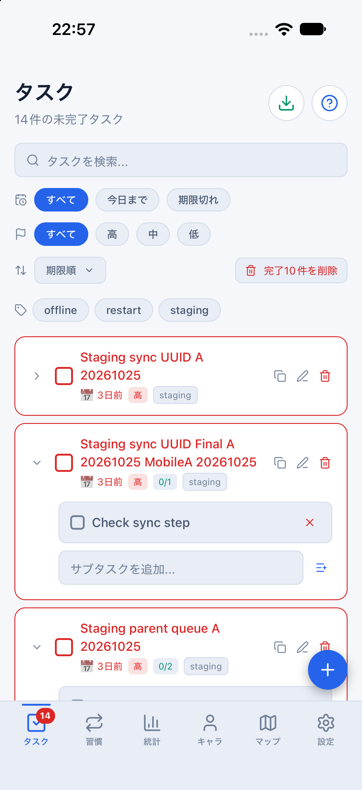
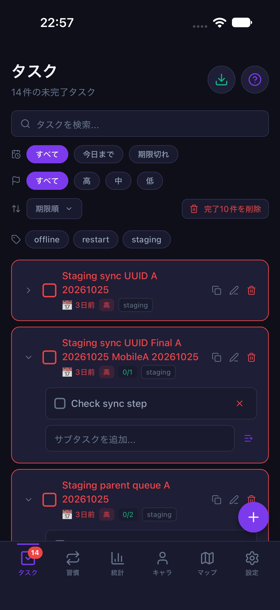

# Nativeの期限切れ起動とクラウド表示の保護（2026-10-29 / #864）

計画④ [#699](https://github.com/YuTakane256/Life-Quest/issues/699) / T08のiOS Simulator限定確認。
保存済みJWTが実際に期限切れだった起動で、SDKの通常refreshが400 `refresh_token_not_found` を返した。
その後のクラウド表示が匿名データとして利用される不具合を修正した。

## 実測した不具合

- main `deb0c66a1b650bad3708096dd733f15b8176f518`、専用staging、承認済みA/B、専用iOS 27 Simulator（402×874）を使用した。
- 起動前のAの表示キャッシュは23件（未完了13件）・390 XP、所有者別outboxは0件。
  以前のWeb確認で追加した1件は、この端末のキャッシュにはまだ届いていなかった。
- 一時的なMetro起動前計測で、SecureStoreアダプターの読み取りと通常fetchを受動観測した。
  SDKが読んだJWTの所有者・issuer・期限切れを照合し、refreshのHTTP 400とエラーコードを確認した。
  認証情報・要求・応答を差し替えず、トークンの値を検証ファイル・公開記録へ保存していない。
- SDKのセッションとライフサイクル所有者は空になったが、23件・390 XPが残り、報酬権威が`anonymous`になった。
  修正前コードを再読み込みすると匿名のログインボーナスで端末内が410 XPになった。
  この間にタスクを完了したり、宝箱を開けたりはしていない。サーバーのAは390 XPのままだった。

## 修正

- クラウド表示を適用する前に、表示の所有者IDだけをAsyncStorageへ記録する。
  トークン・メール・パスワードは含めず、認証の正当性は引き続きSupabase SDKで判定する。
- 有効な所有者のセッションを確認できない間は、報酬権威を`resolving`に保ち、ネイティブのモーダルで再ログイン画面だけを表示する。
  タブ・戻る操作・背後のアクセシビリティ操作から、以前のタスクや報酬を操作させない。
- データ・所有者別キャッシュ・outboxは削除しない。同じアカウントの再ログインで既存の移行・同期処理へ戻す。
  保護中は別アカウントのSDK認証が成功しても、元データの移行・同期・報酬復元は開始しない。
  元のアカウントが不明な場合のデータ移送・破棄操作は今回追加していない。
  既にAの同期が稼働中にSDKがBへ切り替わる場合は、Aのworker停止と通常ログアウトの片付けを終えてからBを確認する。
  旧AのworkerがBの認証でデータを取得しないよう、所有者の確認前から操作を待機させる。
- 旧版には所有者マーカーがないため、表示中のタスク/習慣IDと所有者別キャッシュを照合する。
  ゲーム表示も装備・宝箱の安定IDで照合し、XP・達成回数・名前だけの偶然一致で所有者を推定しない。
  複数所有者に一致、読取・保存失敗、形式不明では匿名へ切り替えず保護を維持する。
  古いクラウドキャッシュが存在するだけで、無関係な匿名データを初期化しない。
- 通常ログアウト・退会の片付けで所有者を解放する。認証通知の世代を確認し、遅れた判定やログアウトが新しいログインを上書きしない。

## 復帰確認

refreshで無効セッションが既に取り除かれた同じ端末・保存データを、修正版で起動した。
**同じ期限切れJWTを再投入して、修正後にもう一度自然期限切れを再現した試験ではない。**

1. 再ログイン画面が出て、23件・410 XPをそのまま保持し、報酬権威は`resolving`、outboxは0件だった。
2. 通常UIでBへログインしても保護が続き、Bのライフサイクル・移行・同期は始まらなかった。
   Aの端末内タスク・XP・キューと、サーバーのタスク/version・キャラクター/version・報酬台帳は変わらなかった。
3. 通常UIで同じAへログインすると通常同期が再開した。
   端末はサーバーの24件・390 XPへ戻り、pending/inflight/failed/conflictは0件。
   復帰前後でサーバー行・version・報酬台帳は同じだった。
4. 一時的な計測設定を除去し、最終コードで改めて有効なAの保存セッションから起動した。
   アカウント表示・通常同期・データ数・XPを確認し、配色設定`system`のまま両テーマを撮影した。

詳細な認証情報・所有者ID・操作IDを含むチェックポイントと操作ログはMac内の非公開領域に保持する。
公開用には[匿名化した確認結果](evidence/staging-native-auth-recovery-20261029.json)だけを記録する。

## 限界と残確認

- 初期outboxが空の1ケース。期限切れと未送信/処理中操作を同時に残した起動の合格ではない。
- 旧版キャッシュの識別は残っている所有者別キャッシュの安定IDとの一致に限る。キャッシュが欠落した場合やXPだけ残る場合など、所有者の証拠もない任意の旧データの分類までは保証しない。
- 全回線切断、refreshの一時的通信エラー、Android、実機、Apple/Googleプロバイダーの再認証は未確認。
- DB/API・RLS・報酬計算・通常のタスク/習慣の保存形式は変更していない。
  今回は表示所有者の補助キーと再ログイン保護UIを追加している。
- 計画④の完了や⑤への移行、ストア提出の承認とはしない。
