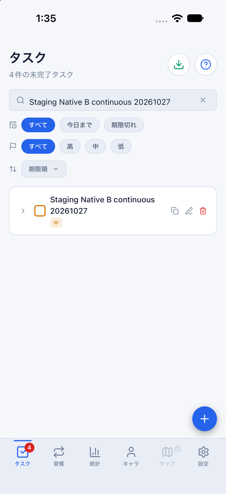
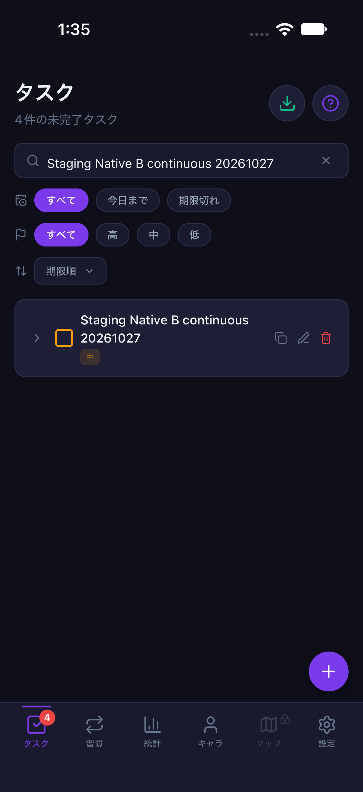
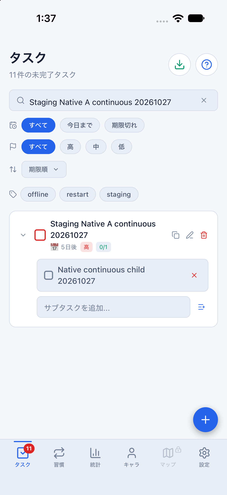
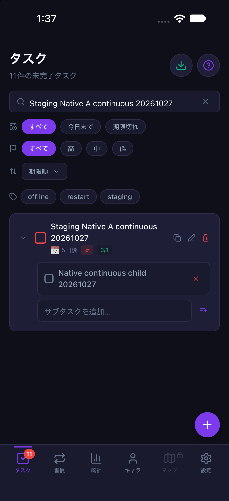

# NativeのA/B切替を同一プロセスで連続確認（2026-10-27 / #842）

計画④ [#699](https://github.com/YuTakane256/Life-Quest/issues/699) / T06。
前回の[途中中断を含む確認](staging-native-account-switch-20261027.md)を補い、
今回は未送信親子タスクの作成からA→B→Aと再送・表示まで、途中中断・再起動なしで成功した。
アプリ本体の修正ではなく、実操作の確認記録と進捗の更新である。

## 条件と事前確認

- main `5ad87b53d8757e5ba8f711b7efa4df3e4b9aaf60`（#839・#841マージ後）のJSを使用。
  Native依存に差分がないため、前回作成・確認済みのparityバイナリを再利用した。
- 専用iPhone 18 Pro / iOS 27.0 / 402×874pt、専用staging、承認済みの既存A/Bのみ。
  起動は`npm run sync:staging:mobile`（8083）、接続先固定・fixture/capture無効。
- タスク欄はフォーカス後に全選択して置換。メール欄は選択・有限回の削除後に空欄を読み取り確認し、
  新しいメール入力後も完全一致を確認してから通常のログインを押した。
  [Maestroの削除](https://docs.maestro.dev/reference/commands-available/erasetext)と
  [ダブルタップ](https://docs.maestro.dev/reference/commands-available/doubletapon)を用いた操作であり、
  認証状態や入力値をアプリ内部から書き換えていない。
- 非保存フォームと未送信データなしのログインで入力手順を調整した。表示が遅れるログインボーナスも待ち、通常の背景タップで閉じた。
  事前段階では自動選択失敗やボーナス表示による停止があったが、対象ケースのタスクはまだ作られていなかった。
  以下の成功ケースは別の1回の連続実行として記録し、前回の途中中断を成功へ読み替えない。
- 対象A親子の作成RPCだけを開発プロセス内で一時失敗させた。Auth・pull・Bの保存は通常接続。
  全回線切断、NetInfo通知、期限切れセッションの試験ではない。

## 連続実行の結果

| 段階 | 確認結果 |
| --- | --- |
| Aで追加 | 親1件・子1件、期限2026-11-01、重要度high。永続outboxにpending 2件、DBの対象親は0件 |
| Aの未保存編集 | 名前を別名、重要度をlowへ変更。保存せず設定へ移動し、タブ離脱でフォームが閉じる |
| Aをログアウト | 同じ2個の操作キーを保持。匿名状態のoutboxは非アクティブ |
| Bへログイン・保存 | Aの対象親/下書きが出ない。空の新規フォームからBの親1件を保存し、期限なし/mediumでAの値を継承しない |
| Bの同期 | Aの同じpending 2件を保持し、AのDBには対象親が不在。Native一覧の各タスクIDがBのDBに存在することも照合 |
| Aへログイン | 同じ2個の操作キーがpendingで復帰。Bの対象親/未保存の別名がAへ混入しない |
| RPCを復旧・今すぐ同期 | Aの元の親ID・子IDが各1件でDBとNativeへ復帰。期限/highを保持し、下書きの別名/lowは適用されない |
| 最終状態 | A/Bの対象親は各1件、Aの子1件。双方の永続キュー0件、Nativeのpending/inflight/failed/conflictは各0件 |

開始から最終表示まで、専用アプリのPIDとプロセス内の一時識別情報の一致を8地点で照合した。
対象RPCの遮断は4回、A以外の認証スコープから対象RPCへの送信試行は0回。
障害注入と一時識別情報は終了時に除去した。操作中にアプリの停止・再起動、データ初期化や手動でのキュー再投入を行っていない。

Nativeの所有者はSDKの`getUser`でA/Bを確認。DBはそれぞれのアカウントで独立したNode SDKからRLS経由で読み取った。
追加の読み取り照合でも、元の親ID/子ID、元の期限/重要度、Bの所有者と新規フォームの既定値が一致した。
service_roleは使用しない。[値を除去した照合結果](evidence/staging-native-continuous-20261027.json)を添付する。
これはチェック済み条件の要約であり、資格情報や生の通信/操作ログは公開しない。

## 確認画像

同じ連続試験中のBの分離とAの復帰。対象ケースを検索し、キーボードを閉じて撮影した。
テーマ設定systemを維持し、専用Simulatorの配色だけを切り替えて元のlightへ戻した。
過去の検証タスクも残しているため、見出しの総件数と絞り込んだ表示件数は異なる。

| 場面 | ライト | ダーク |
| --- | --- | --- |
| B自身のタスク |  |  |
| Aの元の親子が復帰 |  |  |

## 検証と残確認

- 既存の認証境界・永続キュー・同期回帰72件、Mobile型検査、check:secrets成功。
- **T06はWebの2タブとNativeの同一プロセス連続切替について、A/B・タスク/下書きの範囲でpass。**
  全回線オフラインでのログアウト、習慣/報酬全状態、Android/実機まで合格とはしない。
- T04のNative実回線切断、T05の未送信プロセス終了→オフライン起動、T07の報酬再送、T08の期限切れ復帰は残る。
  通常ログインのボーナス表示を閉じたことを、報酬の二重付与防止やVoiceOver実機確認の合格にはしない。
- アプリUI/認証・DB/RLS/API・報酬計算・保存形式に変更なし。通常Simulator・通常チェックアウトは変更せず、
  アカウント追加/削除、古い失敗キューの消去/再送、DB初期化はしていない。
- 検証データは保持し、確認後は専用アプリ・専用Simulator・Metroだけを終了する。
  PR後に既存CI3件とGPT-6.1 Sol・中の独立レビューを確認し、自動マージしない。
