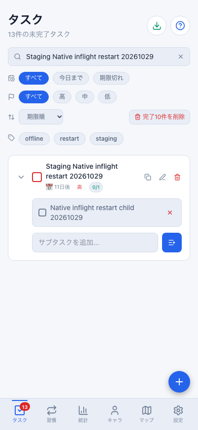
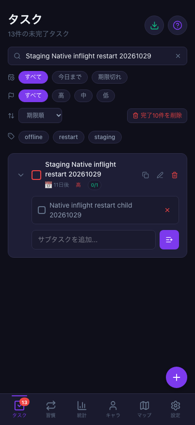
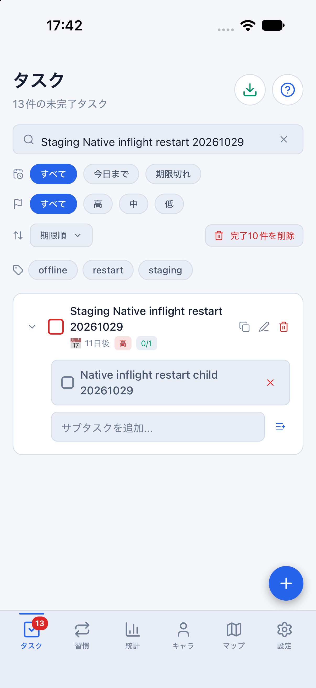
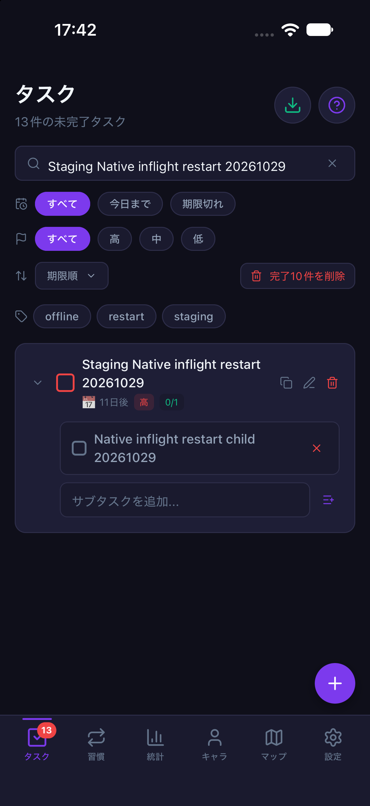

# Nativeの送信直前待機中の終了と、依存付きキューの復帰（2026-10-29 / #860）

計画④ [#699](https://github.com/YuTakane256/Life-Quest/issues/699) / T05の追加確認。
専用iOS Simulatorで、親のoutbox状態が`inflight`、親に依存する子が`pending`のままアプリを終了し、
実保存の保持と新プロセスの通常オンライン起動による自動復帰を確認した。
**親RPCをネットワークへ渡す直前で待機させた条件であり、サーバー受理後の通信中断・OS回線断・オフライン起動の試験ではない。**
アプリ・DB/API・保存形式・報酬計算の変更はない。

## 条件

- main：`b5cac35d71adf4e22439880e3b6d683af982c1f9`（#857・#859マージ後）。
  ネイティブ依存は変わっていないため、既存parityバイナリを専用Metroの最新JavaScriptへ接続した。
- 承認済みの専用staging A、専用iPhone 18 Pro / iOS 27.0 / 402×874ptと、専用Web profile / 402×874。
  `sync:staging:mobile`（8083）/`sync:staging:web`（4175）の専用設定ファイルを使用し、fixtureは無効。
  起動後のSDKで所有者と接続先を照合し、既存の失敗/競合を持つ別の保存領域は操作していない。
- 通常Nativeフォームから親`Staging Native inflight restart 20261029`と子`Native inflight restart child 20261029`を各1件作成。
  親はhigh・期限2026-11-09・繰り返しなし。双方とも未完了で、完了・宝箱・戦闘・合成は操作しない。
- 当該A・接続先・親名の`upsert_task`だけをfetch境界で未解決Promiseにした。元のfetchへは渡していない。
  子への呼出しは監視し、終了まで0回だった。Auth・pull・Mac全体の回線は通常接続を保った。

## 終了前と実保存の照合

親1件が`inflight`、子1件が`pending`としてAsyncStorageへ保存された。
子の`dependsOn`は親の操作IDを1件持ち、payloadの親IDも一致した。
待機させた親の要求キーと保存操作IDも一致。本人RLS読み取りでサーバーの対象親は0件だった。

その状態で`simctl terminate`を実行した。**終了前にoutbox.stopを呼ばず、fetchの待機も解除していない。**
旧プロセスが不在になり、サーバーの対象親が引き続き0件であることを確認した。
アプリ停止中に、専用コンテナのAsyncStorageファイルを読み取りだけで照合した。

- Aのoutbox namespaceに、同じ2個の操作ID・payload・依存配列が残っていた。
- 保存状態も親`inflight` 1件・子`pending` 1件のままで、子の依存先は同じ親操作だった。
- アクティブな`quest-board-tasks`保存にも同じ親子ID・名前・high・期限・未完了状態が残っていた。
  このタスク保存キーは所有者別キーではないため、それだけでアカウント分離全体の合格とはしない。

前回の[送信停止後のオンライン起動確認](staging-native-pending-restart-20261028.md)では両操作の依存配列が空だった。
今回は依存追跡修正後の明示依存がある2操作について、送信キューを止めずに終了した点が異なる。
前回記録を変更したり、同じ確認だったと読み替えていない。

## 新プロセスからの復帰

| 段階 | 保存/送信状態 | サーバーと表示 |
| --- | --- | --- |
| 親RPCの送出前待機 | 親inflight 1件・子pending 1件、子は親に依存 | 対象親0件、Nativeの親子は未完了 |
| プロセス終了後 | 同じ2操作・payload・依存配列・inflight/pendingを実保存で確認 | 旧プロセス不在、対象親0件 |
| 通常オンラインで新プロセスを起動 | 手動同期前に自動送信・受信、キュー0件 | 同じIDの親1件・子1件、high・期限・未完了が一致 |
| 両端の通常UI同期後 | pending/inflight/failed/conflictすべて0件 | Web/Nativeの同じ親子、DB行とversionも不変 |

新プロセスのPIDが終了前と異なり、試験用fetch待機が存在しないことも確認した。
通常UIからの「今すぐ同期」と、Webでの同じ親子の検索・表示も成功した。
起動直後の通信キーは再捕捉していない。同一操作ID・依存情報の確認は、終了後のディスク保存値について行ったものである。
サーバー成功後の応答喪失や冪等キーの再送計測は、この試験の結果に含めない。

## 報酬と確認画像

開始基準は当日の通常ログインボーナス処理が落ち着いた後とした。比較開始から終了まで390→390 XP、
タスク消化数10、当日のタスクXP 0、装備1個、開封履歴2件、最高到達1で不変だった。
今回の親子をsourceとする報酬台帳は0件。未完了の親子作成・再起動による報酬増加はない。

[識別子を除いた結果JSON](evidence/staging-native-inflight-restart-20261029.json)には、資格情報・メール・URL・
ユーザー/親子のUUID・操作キー・生の通信/保存ログを含めない。非公開の値は同一性を比較し、公開結果は真偽値と件数にした。
画像は今回作った検証用の親子だけを検索したタスク画面で、アカウント情報は写っていない。
配色のシステム設定は維持し、撮影後はlightへ戻した。

| 画面 | ライト | ダーク |
| --- | --- | --- |
| Web 402×874 |  |  |
| iOS 402×874pt |  |  |

## 残る確認

- **T05は部分確認のまま。** 制御した送出前待機からのプロセス終了と、通常オンライン起動の1ケースである。
- サーバー受理後の要求中断、OS回線断/NetInfo通知、オフライン起動、期限切れ認証T08、任意のクラッシュ耐性は未確認。
- 再起動後に新しく子を追加する追跡復元は[#858の自動回帰](offline-outbox-session-quality.md)の範囲。
  今回の実操作は終了前に存在した親子の復帰で、新規追加の実操作まで確認したとはしない。
- Android/実機、T07合成や未確定戦闘の終了、⑤の署名済み内部配布は別項目。
- 検証データを保持し、専用アプリ/Simulator・今回のWeb/Metroだけ停止した。普段のSimulatorと保存領域は保持した。
  既存の失敗操作の消去/救済・DB初期化は行っていない。
