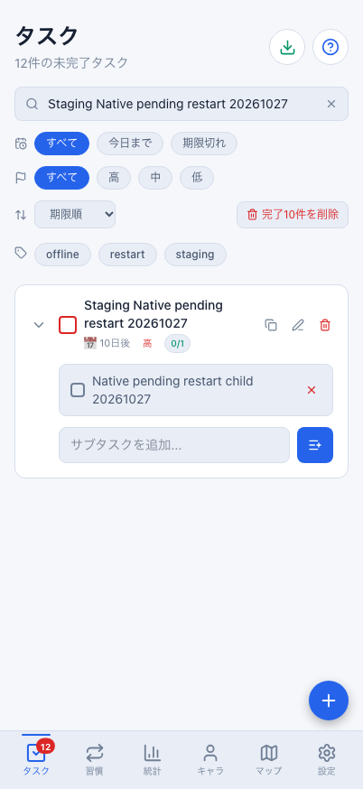
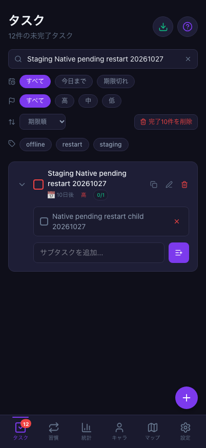
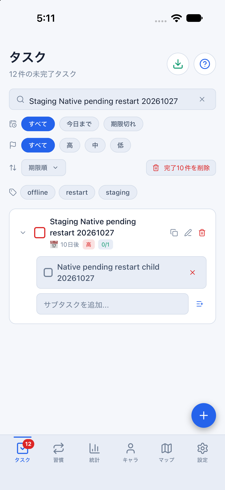
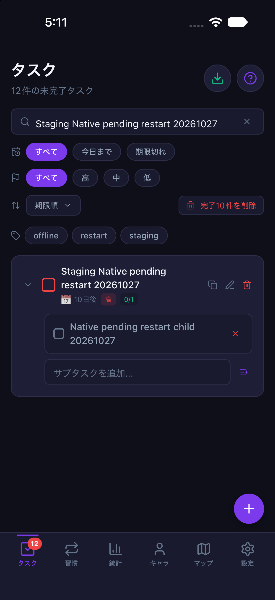

# Nativeの未送信親子タスクとオンライン起動時の復帰（2026-10-28 / #854）

計画④ [#699](https://github.com/YuTakane256/Life-Quest/issues/699) / T05の部分確認。
iOSに残った未送信の親子2操作について、アプリ停止後のディスク保持と、新プロセスの通常オンライン起動による自動同期を確認した。
**送信を停止してからアプリを終了した条件であり、送信中のクラッシュや回線断状態での起動の確認ではない。**
アプリ・DB/API・保存形式の修正はない。

## 条件と途中の中断

- 対象main：`6dcfc317fbd271aea44be814417f9419f485713e`（PR #853マージ後）。
  ネイティブ依存の変更がないため、既存parityバイナリと最新JavaScriptを使用した。
- 承認済みの専用staging A、専用iPhone 18 Pro / iOS 27.0 / 402×874pt、既存の専用Web profile。
  `sync:staging:mobile`（8083）/`sync:staging:web`（4175）、fixture/capture無効・接続先固定。
- 2026-10-27にNativeの通常追加フォームから未完了の親1件・子1件を作成した。
  親は`Staging Native pending restart 20261027`、重要度high・期限2026-11-07・繰り返しなし。
  子は`Native pending restart child 20261027`。完了や報酬操作は行っていない。
- 指定staging・A・当該親子の`upsert_task` / `upsert_subtask`だけを一時的なfetchエラーにした。
  Auth・pull・他の通信は通常接続。親子の計2操作がpendingに残った。両操作の`dependsOn`配列は空で、payloadの親子ID参照が一致していた。
  独立Node SDKの本人RLS読み取りでは対象親は0件だった。
- 終了前の撮影用検索操作が要素を取得できず、中断した。検証ヘルパーのcleanupで
  **outboxの送信を停止し、元のfetchを復元してから、専用アプリを終了した。**
  この中断を、送信中に突然プロセスを失った試験へ読み替えない。
- アプリ停止中に専用データコンテナのAsyncStorage保存ファイルを**読み取りだけ**で照合した。
  Aのnamespaceを持つoutboxには2件ともpendingで、元の操作ID・payload・`dependsOn`配列（両方とも空）が残っていた。
  アクティブな`quest-board-tasks`保存にも同じ親子ID・名前・期限・重要度が残っていた。
  後者を所有者別キーと呼んだり、その保存だけでアカウント分離全体の合格とはしない。
- この同じケースを保持し、2026-10-28に復帰確認を続けた。タスクを作り直したり、キューや
  保存領域を消したり、直接DBへ投入していない。既存の古い失敗キューも操作していない。

## 復帰の実測

| 段階 | 保存outbox | 対象のサーバー親/子 | 確認したこと |
| --- | --- | --- | --- |
| 作成・RPC障害後 | pending 2件 | 親0件 | 通常フォームの親子・期限・重要度を保持 |
| アプリ停止後 | 同じ2操作・payload・空のdependsOn配列 | 親0件 | ディスク読み取りで確認、新プロセス起動前に旧プロセス不在も確認 |
| 通常オンラインの新プロセス起動後 | 0件 | 親1件・子1件 | 手動同期より先に、自動送信/受信で同じIDと内容へ収束 |
| Native/Webの通常同期後 | 0件 | 同じ親1件・子1件 | 期限/重要度/未完了状態、行のversionも変わらない |

起動後のユーザーと接続先をSDKで確認し、ローカルstore・保存outbox・サーバーの本人RLS読み取りを照合した。
親/子とも元のIDのまま、親の重要度high・期限2026-11-07、子の所属と名前、双方の未完了状態が一致した。
画面の「今すぐ同期」前に自動復帰を確認し、手動同期後も親/子が複製されないことを確認した。
両端のpending/inflight/failed/conflictは0件。新プロセスには試験用fetch障害を引き継いでいない。

再起動後の撮影でも検索欄の取得で自動操作が一度止まり、画面とアクセシビリティ情報を読み直して表示操作のみ再開した。
対象親子は通常UIで表示でき、保存・送信・作成を繰り返していない。
起動直後のネットワーク送信キーは再捕捉していない。今回の同一キー照合は**停止後ディスクの保存値**について行ったものである。
**明示的なdependsOnを持つキューの復元は今回未確認**で、空配列の保持を依存付きキューの検証とはしない。

### 日付をまたいだXPの照合

XPは315から350へ増えた。新しい報酬台帳は2026-10-28の`login_bonus` 1件・35 XPのみで、差分と一致した。
今回の親子をsourceとする報酬台帳は0件。タスク消化数10、作成日のタスクXP200、装備1個、開封履歴2件、最高到達1は不変だった。
日付変更による正規ログインボーナスを、親子の再送による報酬重複と取り違えない。

[識別子を除去した結果](evidence/staging-native-pending-restart-20261028.json)には資格情報・メール・ユーザー/親子のUUID・
操作キー・生の通信/保存ログを含めない。非公開の値は同一性を比較し、公開資料では真偽値と件数にした。

## 確認画像

通常同期後、同じ親子だけを検索した画面。未完了・重要度high・期限が両端で一致している。
ライト/ダークはOS/ブラウザの配色を切り替えて取得し、撮影後はlightへ戻した。

| 画面 | ライト | ダーク |
| --- | --- | --- |
| Web 402×874 |  |  |
| iOS 402×874pt |  |  |

## 残る確認

- **T05は部分確認のまま。** 送信停止後に保存済み2操作を残して終了し、オンラインで起動する条件を追加した。
- 送信中の予期せぬ終了、OS回線切断/NetInfo通知、オフラインのままの初回起動、期限切れ復帰T08の合格とはしない。
  認証先の失効、A/B切替、報酬・合成・未確定戦闘の再起動もこの試験に含めない。
- 親子1件・既存A・iOS Simulator/Webの範囲。Android/実機、⑤は別の残項目。
- 既存のoutbox保存/再送・所有者controller・Mobile outbox/タスクstoreの回帰77件が成功した。
  PR後にGPT 6.1 Sol・中の独立レビューとCI3件を確認し、自動マージしない。
- 検証データは保持。専用アプリ/Simulator・今回のWeb/Metroだけ停止し、普段の環境は保持した。
