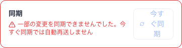
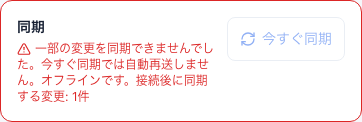
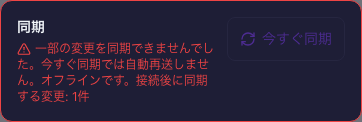

# オフライン待機の表示と復帰確認（2026-10-25 / #831）

計画④ [#699](https://github.com/YuTakane256/Life-Quest/issues/699) / T04。
main `24ccb20b5848f286664653ba12560d709ffe1934`（#830マージ後）を基準に確認した。
ユーザー承認済みの専用Supabase・アカウントA、専用Web profileとiPhone 18 Pro Simulator / iOS 27.0を使用。
fixture無効の専用起動コマンド（Web 4175 / Metro 8083）を使い、通常の接続設定やMac全体のネットワーク設定は変更していない。

## 見つかった問題と修正

過去に恒久失敗した操作が1件あると、Webの同期欄にはその注意だけが表示された。
新しい操作がオフラインで5件待機していても、切断中であることと未送信件数が分からなかった。

- Web/Mobile共通の`cloudSyncMessage`で、失敗/競合の注意と現在のオフライン・送信待ち・送信中の状態を併記する。
- 過去の失敗・競合を単純な再試行で解消できるという案内にはしない。待機がなくなっても注意を残し、同期済みと誤表示しない。
- 再ログインが必要な状態の優先度、同期ボタンの有効条件、キューの状態/再送処理は変更しない。
- Webは狭いカードでも同期ボタンの文字を1行に保ち、必要ならボタンを次の行へ折り返す。

DB/RLS/API、保存形式、報酬計算、通常の画面構成は変更していない。
過去の失敗キューは削除・変換・自動再送しない。

## 実操作の結果

| 対象 | 障害の作り方 | 確認結果 |
| --- | --- | --- |
| Web | 操作用Chromium contextだけを`setOffline(true)`にする。別contextの同じAはオンラインのままDBを読み取る | 通常フォームで親子付きタスクを作成し、名前・子の一覧を編集。ローカルは更新され、DBには親が存在せず、未送信5件を保持。接続を戻すと親1件・有効な子1件に収束し、初期子はsoft delete。期限・重要度・タグも一致 |
| Web・修正後 | 同じ検証タスクを片側オフラインで編集し、期日/重要度を変更 | 以前の失敗の注意と「オフライン・1件待機」を同時表示。同期ボタンは無効。オンラインの確認側では変更前のまま。接続復帰後の期日2026-10-28/重要度medium・子1件をDBとNativeの受信状態で確認。古いfailedは1件のまま |
| Native | 専用開発セッションで、対象stagingのHTTP fetchだけを一時的に失敗させる | 実アカウントAと接続先を確認後、通常UIでタスクを作成し、重要度highと子1件を編集。HTTP要求3回を遮断し、端末内に3件待機。オンラインのWeb側からDBに親が存在しないことを確認 |
| Native・HTTP復帰 | 元のfetchを復元し、アプリの`syncMobileNow`を呼び出す | 親1件・子1件・high・期限なしでDBに保存。Web再読込でも表示を確認。Nativeのfailedは0件のまま。障害注入用の状態が除去されたことを確認 |

Native側の確認は、対象アプリ/専用Simulatorを識別した開発用Inspectorから行った。
接続先・本人確認は既存クライアントで行い、資格情報をログやキューへ追加していない。
一時的なfetchの差し替えには3分の自動復旧とfinallyでの復元を用意し、アプリのソースには組み込んでいない。
通常フォームからの書き込みを、DBの直接編集で置き換えていない。

**Nativeの試験はHTTP通信障害であり、端末の回線切断ではない。**
NetInfoのoffline→online通知、WebSocketの切断・再接続、実機の機内モードは未検証。
HTTP復帰後の再送はアプリの同期処理を呼び出して確認し、OS接続通知による自動再送の合格とは扱わない。
[React Native公式のDevTools説明](https://reactnative.dev/docs/react-native-devtools#network)でも、ネットワーク観測と通信条件のシミュレーションは別の機能として扱われている。

## 確認画像

同期カードだけを撮影し、メールアドレスや認証画面を含めていない。Web幅は402px。
修正前の画像はfailed=1/待機5件、修正後はfailed=1/新しい編集1件の別の確認時点。
ライト/ダークの修正後画像は同じ状態で、テーマ設定のsystemを維持して撮影した。

| 修正前 | 修正後・ライト | 修正後・ダーク |
| --- | --- | --- |
|  |  |  |

## 回帰と残る項目

- 共有状態の回帰：failed/conflictとoffline・pending・inflightの併存、待機0件、認証待ち、pull失敗の優先度を確認。
- 単体全体3,349件成功/98件skip。Webのレイアウト調整後も関連単体と型検査を確認する。
- Playwrightは実際のカード・共通メッセージ・CSSを使用。プラットフォームの公開状態だけを置換した独立fixtureで、320/402/1280px・両テーマ・PC/モバイルの12件成功。ボタン1行・カード内配置・横溢れなしを確認。実アカウントは使っていない。
- 独立fixtureのHTMLも既存と同じCSPを使用し、外部bootstrapから起動する。アプリの通常フローへテスト用画面や状態切替を追加しない。

**T04はWebの実オフラインを確認。NativeはHTTP障害の範囲を確認し、回線切断の確認は残る。**
T04全体の完了とはしない。T05〜T08、Android/実機、旧失敗データの救済（#827）は引き続き未確認。
今回の操作はタスクの追加/編集のみで、未送信状態のOS終了や報酬の再送試験の代用にはしない。
アカウント追加/削除、DB初期化、過去の失敗キューの消去/再送はしていない。
検証データは次回へ残し、確認後はサーバーと専用Simulatorを停止する。
